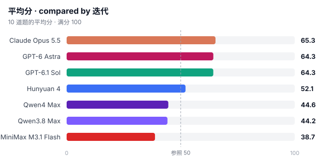
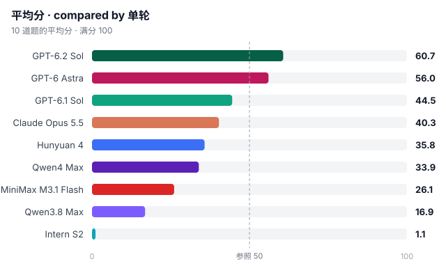

# FrontierAM

FrontierAM 收集**有明确对错、可复现评分**的数值算法题，让 AI 编程模型在断网环境里限时（单轮 1 小时、迭代 4 小时）从零写出求解程序，再在隐藏测试集上用题目自带的评测器打分，并与在同一台机器上重测的人类参照实现（baseline）比较。

## 榜单（协议 v6.3）

<!-- board:start -->
协议 v6.3；更早协议与题目版本的成绩见各题 README。



<details><summary>Compared by 单轮</summary>



</details>

| task | Claude Opus 5.5 单轮 | Claude Opus 5.5 迭代 | GPT-6 Astra 单轮 | GPT-6 Astra 迭代 | GPT-6.2 Sol 单轮 | GPT-6.2 Sol 迭代 | GPT-6.1 Sol 单轮 | GPT-6.1 Sol 迭代 | Hunyuan 4 单轮 | Hunyuan 4 迭代 | Qwen4 Max 单轮 | Qwen4 Max 迭代 | Qwen3.8 Max 单轮 | Qwen3.8 Max 迭代 | MiniMax M3.1 Flash 单轮 | MiniMax M3.1 Flash 迭代 |
| --- | --- | --- | --- | --- | --- | --- | --- | --- | --- | --- | --- | --- | --- | --- | --- | --- |
| [conic](tasks/conic/README.md) | 33.5 | 73.7 | 36.9 | 32.5 | 39.2 | 36.8 | 28.4 | 28.6 | 12.6 | 17.4 | 0.1 | 10.9 | 11.6 | 4.5 | 0.0 | 1.6 |
| [exponential](tasks/exponential/README.md) | 59.3 | 68.9 | 60.9 | 58.9 | 65.3 | 70.3 | 58.6 | 66.9 | 38.2 | 59.3 | 43.3 | 60.4 | 20.8 | 55.2 | 15.7 | 60.0 |
| [galaxy-gravity](tasks/galaxy-gravity/README.md) | 57.8 | 64.4 | 51.9 | 69.6 | 72.8 | — | 0.0 | 66.1 | 0.0 | 53.1 | 0.0 | 0.0 | 0.0 | 50.9 | 0.0 | 0.0 |
| [polarization-demosaicking](tasks/polarization-demosaicking/README.md) | 44.2≈ | 50.9 | 54.0 | 53.8 | 57.1 | 54.2≈ | 53.0 | 54.1 | 47.0 | 44.7 | 43.4≈ | 51.7 | 38.6 | 40.7 | 32.9 | 36.6 |
| [trajectory-covariance](tasks/trajectory-covariance/README.md) | 52.6 | 62.6 | 55.2 | 63.7 | 63.9 | 64.0 | 0.0 | 62.3 | 47.9 | 59.3 | 51.4 | 51.0≈ | 0.0 | 51.1≈ | 50.8 | 49.8 |
| [species-tree](tasks/species-tree/README.md) | 28.1 | 51.2 | 54.7 | 53.5 | 52.3 | 52.5≈ | 49.3 | 52.6≈ | 0.0 | 30.1≈ | 0.0 | 26.6≈ | 0.0 | 0.0 | 0.0 | 34.7≈ |
| [ihvp-sequence](tasks/ihvp-sequence/README.md) | 58.5≈ | 60.2≈ | 60.2 | 63.2≈ | 58.4≈ | 61.3 | 62.6 | 63.0≈ | 52.6≈ | 56.1 | 56.1 | 60.2≈ | 52.2≈ | 51.8 | 40.2 | 53.5 |
| [pdhcg-qp](tasks/pdhcg-qp/README.md) |  |  |  |  |  |  |  |  |  |  |  |  |  |  |  |  |
| [blackbox-cubature](tasks/blackbox-cubature/README.md) | 45.7 | 83.9 | 58.7 | 83.9 | 73.5 | 93.4 | 59.3 | 87.4 | 56.6 | 66.0 | 65.7 | 58.8 | 11.9 | 55.2 | 43.4 | 53.6 |
| [continuum-estimation](tasks/continuum-estimation/README.md) | 36.3 | 43.8 | 73.7 | 68.7 | 70.0 | 72.4 | 72.6 | 68.5 | 73.3 | 50.1 | 69.2 | 46.3 | 0.0 | 45.4 | 44.7 | 30.6 |
| [fluorescence-deconvolution](tasks/fluorescence-deconvolution/README.md) | 77.0 | 92.9 | 94.4 | 95.2 | 96.1 | 95.2 | 94.3 | 93.5 | 79.4 | 85.0 | 56.5 | 79.9 | 66.8 | 77.3 | 47.1 | 66.9 |
| **平均** | **49.3** | **65.3** | **60.1** | **64.3** | **64.9** | **66.7** (9/10) | **47.8** | **64.3** | **40.7** | **52.1** | **38.6** | **44.6** | **20.2** | **43.2** | **27.5** | **38.7** |

满分 100，参照 = 50；列按迭代平均分排序（还缺格的行按缺格记 0 估算位置）；平均为各题分数的简单平均，没有成绩的题不计；≈ 表示与同一题、同一设置的相邻名次按测试用例重抽分不开（领先概率低于 0.9；只计用例抽样，不含尝试间波动）。

**提交次数与用时**

| task | Claude Opus 5.5 单轮 | Claude Opus 5.5 迭代 | GPT-6 Astra 单轮 | GPT-6 Astra 迭代 | GPT-6.2 Sol 单轮 | GPT-6.2 Sol 迭代 | GPT-6.1 Sol 单轮 | GPT-6.1 Sol 迭代 | Hunyuan 4 单轮 | Hunyuan 4 迭代 | Qwen4 Max 单轮 | Qwen4 Max 迭代 | Qwen3.8 Max 单轮 | Qwen3.8 Max 迭代 | MiniMax M3.1 Flash 单轮 | MiniMax M3.1 Flash 迭代 |
| --- | --- | --- | --- | --- | --- | --- | --- | --- | --- | --- | --- | --- | --- | --- | --- | --- |
| [conic](tasks/conic/README.md) | 43 分钟 | 10 次提交，156 分钟 | 58 分钟 | 6 次提交，240 分钟 | 46 分钟 | 7 次提交，86 分钟 | 57 分钟 | 7 次提交，239 分钟 | 57 分钟 | 12 次提交，172 分钟 | 31 分钟 | 20 次提交，180 分钟 | 60 分钟 | 0 次提交，96 分钟 | 30 分钟 | 13 次提交，190 分钟 |
| [exponential](tasks/exponential/README.md) | 28 分钟 | 13 次提交，124 分钟 | 57 分钟 | 5 次提交，232 分钟 | 32 分钟 | 10 次提交，58 分钟 | 54 分钟 | 8 次提交，205 分钟 | 57 分钟 | 10 次提交，121 分钟 | 33 分钟 | 18 次提交，66 分钟 | 32 分钟 | 5 次提交，186 分钟 | 38 分钟 | 7 次提交，74 分钟 |
| [galaxy-gravity](tasks/galaxy-gravity/README.md) | 36 分钟 | 7 次提交，164 分钟 | 60 分钟 | 4 次提交，236 分钟 | 57 分钟 | 8 次提交，146 分钟 | 60 分钟 | 5 次提交，217 分钟 | 60 分钟 | 8 次提交，186 分钟 | 31 分钟 | 10 次提交，189 分钟 | 58 分钟 | 3 次提交，198 分钟 | 60 分钟 | 6 次提交，195 分钟 |
| [polarization-demosaicking](tasks/polarization-demosaicking/README.md) | 13 分钟 | 26 次提交，128 分钟 | 58 分钟 | 15 次提交，229 分钟 | 41 分钟 | 3 次提交，45 分钟 | 60 分钟 | 13 次提交，165 分钟 | 57 分钟 | 18 次提交，173 分钟 | 33 分钟 | 20 次提交，75 分钟 | 41 分钟 | 9 次提交，148 分钟 | 23 分钟 | 2 次提交，56 分钟 |
| [trajectory-covariance](tasks/trajectory-covariance/README.md) | 14 分钟 | 18 次提交，127 分钟 | 52 分钟 | 17 次提交，186 分钟 | 42 分钟 | 11 次提交，28 分钟 | 2 分钟 | 28 次提交，116 分钟 | 53 分钟 | 21 次提交，177 分钟 | 26 分钟 | 16 次提交，47 分钟 | 35 分钟 | 5 次提交，169 分钟 | 47 分钟 | 6 次提交，117 分钟 |
| [species-tree](tasks/species-tree/README.md) | 26 分钟 | 4 次提交，110 分钟 | 58 分钟 | 22 次提交，227 分钟 | 46 分钟 | 6 次提交，50 分钟 | 58 分钟 | 13 次提交，128 分钟 | 58 分钟 | 4 次提交，157 分钟 | 44 分钟 | 12 次提交，96 分钟 | 30 分钟 | 2 次提交，230 分钟 | 53 分钟 | 4 次提交，66 分钟 |
| [ihvp-sequence](tasks/ihvp-sequence/README.md) | 19 分钟 | 8 次提交，159 分钟 | 55 分钟 | 9 次提交，102 分钟 | 30 分钟 | 5 次提交，45 分钟 | 57 分钟 | 8 次提交，122 分钟 | 60 分钟 | 4 次提交，183 分钟 | 33 分钟 | 6 次提交，56 分钟 | 38 分钟 | 4 次提交，179 分钟 | 29 分钟 | 6 次提交，162 分钟 |
| [pdhcg-qp](tasks/pdhcg-qp/README.md) |  |  |  |  |  |  |  |  |  |  |  |  |  |  |  |  |
| [blackbox-cubature](tasks/blackbox-cubature/README.md) | 11 分钟 | 16 次提交，97 分钟 | 55 分钟 | 18 次提交，232 分钟 | 50 分钟 | 9 次提交，24 分钟 | 60 分钟 | 15 次提交，221 分钟 | 51 分钟 | 12 次提交，179 分钟 | 31 分钟 | 13 次提交，121 分钟 | 56 分钟 | 1 次提交，240 分钟 | 26 分钟 | 9 次提交，90 分钟 |
| [continuum-estimation](tasks/continuum-estimation/README.md) | 24 分钟 | 7 次提交，65 分钟 | 44 分钟 | 12 次提交，47 分钟 | 12 分钟 | 10 次提交，12 分钟 | 49 分钟 | 37 次提交，211 分钟 | 51 分钟 | 31 次提交，180 分钟 | 21 分钟 | 30 次提交，83 分钟 | 60 分钟 | 9 次提交，177 分钟 | 60 分钟 | 14 次提交，157 分钟 |
| [fluorescence-deconvolution](tasks/fluorescence-deconvolution/README.md) | 25 分钟 | 4 次提交，199 分钟 | 57 分钟 | 4 次提交，132 分钟 | 20 分钟 | 5 次提交，24 分钟 | 59 分钟 | 3 次提交，182 分钟 | 53 分钟 | 8 次提交，178 分钟 | 22 分钟 | 6 次提交，65 分钟 | 49 分钟 | 3 次提交，220 分钟 | 22 分钟 | 14 次提交，74 分钟 |
<!-- board:end -->

评测从接入到计分的完整流程：[评测流程](docs/BENCH_PROCESS.md)。成绩能说明什么以及需要人类关注的事项：[结果解读](results/INSIGHTS.md)。

本仓库不含私有评测集（各题的私有测试数据另行保管，需要时单独提供）。

## 题目目录结构

每个题目目录：

```
tasks/<题目>/
├── README.md        阅读入口：背景、版本、题面/数据/评测器/参照的位置、评测依据、baseline、模型成绩与解法
├── meta.json        本题的数据源：说明文字、版本列表、各部分位置、已发布成绩（README 与看板都由它生成）
├── versions/<版本>/  每个题目版本一个目录：题面 statement.md、data/samples/（给模型的样例）、data/public/ 与 data/private/（反馈集与私有集，只在内部仓库）、封存说明
├── references/      参照实现：r1/ 为现行参照，candidates/ 为候选（更换参照时新增 r<k>/，旧成绩仍对应原参照）
├── solutions/<协议>/<模型>-<设置>-<序号>/   模型冻结提交的源码 source/ 与成绩 result.json、score.json
└── analysis/        这道题的专题分析与复核记录
```

**增加题目、检查或修改现有题目**：流程见 [`docs/TASK_CHANGES.md`](docs/TASK_CHANGES.md)。

## 最终得分约定（所有题目）

所有题目的最终得分统一为**满分 100、参考实现 = 50**：

- **参考在本机重跑**：参考实现在本机上重新运行，作为计分锚点（baseline），不使用历史记录或其他机器上的数字。
- **映射的三个锚点**：题目原始指标经单调映射得到最终得分，参考的成绩映射为 50，题目允许的最好成绩映射为 100，无效提交为 0。
- **已有映射的题目**：题目自带以参考为锚点的分数时（例如 0–10 分、参考 5 分），直接线性换算到 100 分。
- **没有映射的新题**：出题时定好映射公式，并写进结果报告。
- **报告内容**：每份结果同时给出原始指标、映射公式和最终得分；基础设施失败记为未测，不记 0 分。

**参照是固定锚点**：参照由出题人提供或深度参与，不声称是 SOTA，不因被模型超过而升级；超过 50 分照常记分，只记做法。任一格子 ≥ 80 分或高分段分不开时请出题人修改，见 [`results/BASELINE_POLICY.md`](results/BASELINE_POLICY.md) 与各题的“结果解读”。

## 评测协议（v6.3）

每个模型在每道题、每种设置下的每次尝试独立进行：一个物理核、4 GiB、断网，模型用各自原生的编程助手。

- **数据**：samples 给模型；public 不给，只用来在迭代设置中反馈；private 用于最终评分。
- **单轮**：1 小时，开发中没有反馈。
- **迭代**：4 小时，可随时提交测试：快照后在后台评测 public（时钟不停），报告给出 public 分数和按类别与参照的对比，不列逐例结果。
- **评测时长**：public 每次最多 15 分钟，private 最多 1 小时。

- **机器**：16 个物理核，4 个杂务核（独占一个 L3 域）、6 个开发槽、6 个评测槽；开发与评测默认全并发，每次评分前后做负载小测，异常时报警。

榜单展示的是 v6.3 的成绩，更早的协议与题目版本折叠在各题 README 与看板中。详见 [`results/PROTOCOL_V63.md`](results/PROTOCOL_V63.md)。

## 仓库结构

| 目录 | 内容 |
| --- | --- |
| `tasks/` | **每道题的全部内容**（见上） |
| `results/` | 跨题内容：排行榜、协议、参照原则与复核总览、新题接入记录、待讨论事项 |
| `arena/` | 评测与开发框架：任务定义、评分、开发 harness、机器隔离（题目按 `tasks/*/versions/*/task.json` 自动发现） |
| `scripts/` | 按用途分目录：`setup/`、`seal/`、`references/`、`rounds/`、`grade/`、`analyze/`、`site/`、`ops/`（索引见 [`scripts/README.md`](scripts/README.md)） |
| `dashboard/` | 看板的全站文字（`site.json`）与样式；各题内容来自 `tasks/*/meta.json` |
| `docs/` | 平台与运维（[`docs/PLATFORM.md`](docs/PLATFORM.md)、`docs/platform/`） |
| `docker/` | 评测与开发镜像 |
| `nexus/`、`fixtures/`、`provenance/` | 固定版本的 Nexus 框架、测试夹具、来源记录 |
| `var/` | 本机运行数据（不进 git）：`var/stores/` 评测与开发记录库，`var/raw/` 出题方原始题包，`var/outputs/` 导出包，`var/dist/` 构建产物 |
| `.runtime*/`、`.venv-*/` | 封存的运行副本与 Python 环境（隐藏目录，不进 git） |
