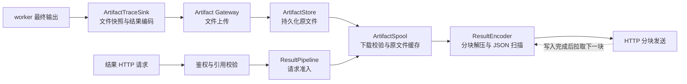

# Application Gateway 结果 Pipeline 架构与开发设计

## 1. 目标与核心改造

本分支新增 **`ResultPipeline` 结果读取流水线**，把大型结果的请求准入、文件获取、分块处理、
HTTP 发送和清理组织成有明确资源边界的生命周期；同时改造 worker 发布与 artifact 文件传输，
减少完整对象驻留、重复编码、重复散列及事件循环阻塞。

| 设计 | 改造前的问题 | 最终实现 |
| --- | --- | --- |
| 结果读取 Pipeline | 下载后整体读取、解压、解析，再构造完整 JSON 响应 | 校验原文件后，分块解压、扫描并直接输出 `output` 的原始 JSON |
| 分层调度与背压 | 解码信号量不能约束整个请求，慢响应持续占用资源 | 分开限制在途请求、CPU 任务和文件传输；客户端写入驱动下一块处理 |
| 通用有界准入 | 多层信号量及提前预留磁盘容易造成排队干扰 | `BoundedAdmission` 统一管理总并发、业务分组、等待队列和等待期限 |
| 共享原文件缓存 | 结果请求各自下载临时文件 | 接入既有 `ArtifactSpool`，合并同内容下载，使用 pin 保护活动文件 |
| 文件 I/O 隔离 | 分块写盘、散列和文件清理仍可能阻塞 HTTP 事件循环 | 增加异步文件 I/O 封装，在线程内完成读写、散列和主要清理 |
| 文件化发布 | 大型输出深拷贝、完整 bytes 编码及重复读取放大开销 | 文件快照、一次 JSON 编码、流式压缩和可复用的发布文件 |
| 内容身份复用 | 同一进程链路重复计算摘要 | 在接收/生成文件时计算身份，内部传递，跨网络边界仍独立校验 |
| 取消安全 | 协程取消后，后台线程可能仍在访问已释放的文件 | 等待已提交任务结束，再按所有权顺序关闭、解除 pin 和释放配额 |

范围包括 artifact-backed `/result`、`/live/result`、worker 结果发布及共用的 artifact 上传/下载组件。
export、非 artifact 结果代理、结果 envelope 版本和数据库 schema 保持兼容。

## 2. 总体架构



两条链路以不可变 artifact 和 `ArtifactRef` 为边界：**发布链路负责生成并可靠保存结果，读取链路
负责鉴权、验证并按需发送结果**。Gateway 缓存的是原文件，响应是 envelope 内的 `output` 对象。

Pipeline 的并行发生在多个请求之间：某请求等待下载或客户端写入时，其他请求可使用 CPU。
单请求先完成原文件下载与身份校验，再交替执行“生成一块 → 发送一块”；不设置阶段间的无界队列，
也不在客户端未消费时持续预解压。这样可保留完整性边界，并使背压直接限制后续计算。

## 3. ResultPipeline 的模块与执行过程

### 3.1 模块职责

| 模块 | 职责与所有权 |
| --- | --- |
| `executions.py` | 鉴权、获取结果引用、组织请求期限和上下文，决定 HTTP 成功或失败语义 |
| `ResultPipeline` | 每个 Gateway application 一个实例；持有结果准入器、独立 CPU 线程池及其关闭生命周期 |
| `ResultEncoder` | 每个请求一个实例；持有流式迭代器及首块，提供 `prepare/next_chunk/close` |
| `iter_result_output` | 读取原文件、检查压缩帧、分块解压、调用扫描器并截取 `output` 字节区间 |
| `JsonFieldScanner` | 增量校验 JSON，维护有界语法栈和顶层字段位置，不构造完整字符串或对象 |
| `ArtifactSpool` | 管理原文件缓存、下载合并、空间预留、pin 和淘汰 |
| `ArtifactStore` / `file_io` | 访问持久化存储，分块落盘/读取，在接收时完成内容身份校验 |

`ResultEncoder` 沿用编码器命名，但新读取路径执行的是**解压、扫描和原始片段提取**，不重新序列化 output。

### 3.2 请求阶段

1. **授权和准入。** 校验用户权限及结果引用，再进入结果等待队列；获得请求槽后才获取原文件。
2. **获取文件。** 以 SHA-256 + 大小查找缓存。命中后 pin；缺失则预留 spool、申请下载槽、
   下载并校验内容，成功后转为缓存。相同内容的并发请求等待同一次填充，每个请求仍独立鉴权。
3. **准备响应。** CPU 池执行 `prepare()`：打开文件、识别压缩格式，扫描至 output 并准备首块。
   下载槽此时已释放，请求槽和文件 pin 继续保留。
4. **按需发送。** HTTP 协程取一块并 `await response.write()`；写入完成后，才向 CPU 池提交下一次
   `next_chunk()`。每个请求最多一个 CPU 任务在途；等待网络时不占 CPU 工作线程。
5. **完成验证。** 扫描完整文件，核对压缩结尾、解压长度及 envelope；全部成功才正常结束 HTTP 响应。
6. **逆序释放。** 等待线程退出，关闭迭代器，解除缓存 pin，最后释放请求槽。

HTTP 事件循环负责网络和状态编排；独立 `result-cpu` 池负责结果准备和分块处理，避免挤占默认线程池。
通用传输文件 I/O 使用默认线程池。CPU 任务继承调用上下文；线程数量表示调度并发，不代表 CPU 核数，
实际并行能力还取决于解释器、GIL 和原生库行为。

### 3.3 流式格式校验

- 支持普通 JSON 和单帧 zstd。压缩帧必须声明解压大小，解压窗口有上限；拒绝超限、截断、
  尾随字节及拼接第二帧，原生解压器验证内容和帧内 checksum。
- 扫描器校验 UTF-8、转义、数字与容器结构，仅保留有界嵌套栈、顶层键及 scalar 元数据。
  深度、元数据和数字 token 均有限制，大字符串跨块扫描；扁平小对象使用有界窗口加速。
- envelope 须包含且仅包含 `version/status/output/error`，顶层字段不能重复，版本和状态须合法。
  `output` 必须是对象，null 表示结果不可用；嵌套内容保持原始 JSON 表示。
- 保留 output 的字段顺序、空白、Unicode 和数值表示，兼容既有 Python JSON 的 `NaN/Infinity`。
  Gateway 不生成解压临时文件、响应临时文件或完整 Python 结果对象。

## 4. 分层配额与缓存设计

配额按 Gateway 实例生效，各层控制不同资源；线程、请求数、文件字节数分别计量。

| 配额/参数 | 控制的资源 | 持有范围与含义 |
| --- | --- | --- |
| `artifact_run_result_max_inflight` | 已准入的结果请求数 | 从取得请求槽到清理结束；包含下载、CPU 等待、处理及慢客户端发送 |
| `artifact_run_result_decode_concurrency` | 结果 CPU 线程数 | 控制同时运行的准备/下一块任务；网络等待不占线程 |
| `artifact_run_result_max_waiters` / `admission_timeout` | 结果准入等待 | 限制排队人数与单次等待时长；不计入已准入请求数 |
| `artifact_{upload,download}_total_concurrency` | 每个传输方向的总并发 | 上传与下载分别管理；结果下载槽仅用于缓存填充，不覆盖之后的 HTTP 结果发送 |
| `artifact_{upload,download}_{input,result}_concurrency` | 传输业务分组并发 | 每次准入同时满足总上限与所属分组上限；是上限，不是预留带宽或保证份额 |
| `artifact_{upload,download}_max_waiters` / `admission_timeout` | 各方向传输等待 | 控制等待数与时长；零等待数表示无空闲槽时立即拒绝 |
| `artifact_transfer_spool_capacity_bytes` | 本地受管文件字节数 | 活动文件预留与缓存共同计费；不等于物理磁盘总量，也不等于内存预算 |
| `artifact_run_result_max_size_bytes` / `max_decoded_size_bytes` | 单份结果大小 | 分别限制存储原文件和解压后的完整 envelope；防止大文件与解压放大 |
| `artifact_upload_max_size_bytes` | 单次上传大小 | 与声明大小共同约束接收量，不能通过分块上传绕过 |
| `artifact_run_result_response_chunk_bytes` | 单次结果处理/输出块 | 限制块缓冲和单次任务粒度，不是总响应大小 |
| `artifact_download_deadline` / `write_idle_timeout` | 读取请求时间 | 前者覆盖准入、下载、处理与发送；后者限制单次响应写入等待 |
| `artifact_upload_deadline` / `body_idle_timeout` | 上传时间 | 前者约束整体上传，后者只约束请求体读取等待 |
| `artifact_run_result_publish_deadline` | worker 发布时间 | 约束发布及重试等待；由发布端控制，与 Gateway 读取期限独立 |

`BoundedAdmission` 在可运行的等待请求之间保持 FIFO：某业务分组已满时，另一分组仍可使用剩余总槽。
普通传输先取得槽位再预留文件空间，避免等待队列占满 spool；结果缓存填充由 spool 先预留文件空间，
随后取得下载槽，下载准入不重复计算文件字节。

缓存按内容身份在实例内共享。填充期间只有一份空间预留；填充成功后从预留转为缓存计费，
请求通过 pin 保证文件可用。空间不足时按最近使用情况淘汰未 pin 的缓存，活动文件不能淘汰；
仍不足则拒绝新工作。缓存命中不占下载槽，但每个读者仍占自己的结果请求槽。

结果 CPU 并发不会超过在途请求数与线程数中的较小值；增加线程不能绕过请求准入。
Gateway 的主要处理内存由活动流数、解压窗口、块缓冲和扫描状态决定，而非整份结果大小。
文件页缓存另计入容器内存，不能与进程堆混为一谈。旧 `memory_budget_bytes` 和
`memory_expansion_factor` 字段仅为配置兼容保留，新路径不再按完整结果大小预留内存。

## 5. 文件化发布与内容身份

### 5.1 发布链路

`ArtifactTraceSink` 支持两种输出入口：事件路径把输出写成不可变文件快照，避免深拷贝并长期持有
大型容器；runner 直接发布路径使用 runner 已持有的最终输出快照。最终统一生成 `ResultFile`。

```text
输出快照 → 流式 JSON 编码/拼接 → 原始 JSON 文件与准确长度
→ 可选 zstd 流式压缩 → ResultFile(path, size, sha256, compression)
→ FileRunResultPublisher → 上传与重试 → 校验 ArtifactRef → 清理文件
```

JSON 只编码一次：文件快照直接拼接，原始文件长度供压缩帧声明使用，不为计算长度再次编码。
未压缩时直接发布原文件；压缩时边写最终文件边计算 SHA-256，并生成帧 checksum。
`iter_json_bytes` 对大字符串分块处理，对短字符串和普通标量减少逐 token 编码开销。

发布任务拥有输出快照和最终文件，所有重试复用同一文件、大小和摘要；返回引用的 kind、大小及摘要
核对成功后才标记持久化完成。失败或取消时等待编码线程退出再清理。发布端仍需要业务输出内存，
并可能同时持有快照、原始 JSON 和压缩文件，其资源边界与 Gateway 流式读取独立。

### 5.2 上传、下载与摘要复用

新增 `file_io` 将文件打开、分块读写、散列、flush/close 等工作交给线程；小网络块合并后写盘，
减少线程调度次数。存储下载在同一次落盘中检查大小和 SHA-256，失败文件不会交给结果读取器。

Gateway 接收上传时同时计算 SHA-256 和 MD5，并返回 `FileIdentity`，包含大小、摘要和文件签名。
该身份沿上传协调器、存储适配器传给内部 Artifact SDK；SDK 核对文件签名后复用 MD5，避免再次全文件扫描。
复用只发生在可信的进程内链路，公开上传仍自行校验，不能用客户端声明的摘要替代接收端验证。
旧 `RunResultReader` 的 bytes 已由读取边界核对身份，source 不再重复散列。

`FileRunResultPublisher` 扩展既有发布接口；`RunResultArtifactGateway` 提供生产文件实现。
旧 bytes 发布/读取接口继续兼容，新文件路径不回退为整块 bytes。文件身份是可选参数，
未提供身份的 SDK 调用仍按原有流程校验。

## 6. 生命周期与失败语义

资源释放遵循一条原则：**取消协程不等于线程已停止，资源必须活到最后一个使用者退出。**
`await_complete`、`to_thread_complete` 和 `run_in_executor_complete` 将取消传播延后到已提交任务完成，
`AsyncExitStack` 按相反顺序释放流、文件 pin 和请求槽；重复取消也不能跳过清理。

| 场景 | 行为 |
| --- | --- |
| 请求队满或等待超时 | 拒绝新工作；结果区分 `result_queue_full` / `result_queue_timeout`，传输映射为方向对应的 busy 错误 |
| 下载内容身份错误 | 拒绝原文件，清理填充状态和预留，不进入成功缓存 |
| 响应头发送前失败 | 按既有 Gateway 错误映射返回 HTTP 错误 |
| 响应开始后扫描失败、写入超时或断连 | 关闭连接，不追加错误 JSON，也不发送正常结束标记 |
| 请求被取消 | 等待当前线程任务结束，关闭迭代器后解除 pin，最后释放请求槽 |
| 发布失败或取消 | 结束正在使用文件的工作后清理临时目录；不接受错误 ArtifactRef |
| Gateway 关闭 | application cleanup 关闭结果线程池并等待已提交任务退出 |

GET 保持 JSON Content-Type 和 CORS，省略 Content-Length，HTTP/1.1 使用 chunked。
HEAD 执行鉴权、原文件身份校验和 output 起始定位，但不发正文、不保证完整扫描剩余 envelope。
GET 只有读完 HTTP 响应才能确认成功：尾部元数据或压缩错误可能在 output 已部分发送后才被发现。
请求 deadline 会触发取消，但不会强杀线程；安全清理可能晚于该期限完成。

## 7. 观测与测试契约

请求记录排队、下载、CPU 等待、首块准备、后续处理、发送和清理的阶段耗时，并输出实际 Pipeline 配置。
`result_send` 包含获取下一块的等待及处理时间，不能直接当作纯网络耗时。
判断瓶颈应结合 CPU、事件循环延迟、RSS、文件缓存、磁盘和网络；判断泄漏应观察请求结束后的
在途数、等待数、缓存 pin、临时文件及线程任务是否回收。

验证按以下契约组织：

- **语义与格式：** 普通/压缩结果与原 output 一致；覆盖 Unicode、大字符串、嵌套、跨块转义、
  非法 JSON、异常 envelope、截断帧及尾随数据。
- **调度与背压：** 慢客户端不持续生成后续块；等待发送不占 CPU 或下载槽；队列、分组及总并发有界。
- **生命周期：** 在排队、下载、准备、发送和清理阶段注入失败/重复取消，不泄漏槽位、pin 或文件。
- **发布与身份：** 输出快照不可变、只编码一次、重试复用文件；错误引用或被修改文件被拒绝。
- **资源边界：** 分别覆盖缓存命中、不同文件冷下载及上传/下载混合压力，验证内存不随单份结果线性增长，
  并检验磁盘预留、淘汰与过载行为。

实现入口为 `nexus/distributed/gateways/application/routes/{executions,_result_pipeline}.py`、
`nexus/distributed/artifacts/{admission,spool,file_io,result_stream,result_file,run_result}.py`、
`nexus/utils/{json_scan,json_stream,common}.py` 及 artifact gateway/store/SDK。
主要回归测试位于 `tests/unit/distributed/gateways/test_result_pipeline.py`、
`tests/unit/distributed/artifacts/`、`tests/unit/artifact/test_client.py` 和 `tests/unit/utils/test_json_stream.py`。
