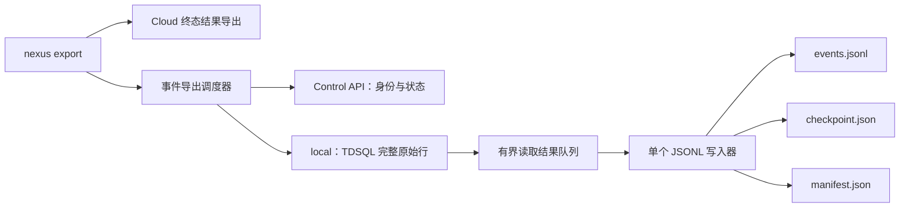

# Nexus Cloud 结果与实时事件导出设计

## 1. 最终契约与范围

- 更新日期：2026-09-29。
- 文档性质：最终开发契约；results 基于 `090aadbc01` 的统一 pipeline 接入 `result-status`。
- 验证状态：本地回归及生产 DB/COS results 验证已完成，范围及结果见第 13.4 节。
- 入口：`nexus export`；保留 SQLite 结果导出与 Cloud 终态 results 导出。
- Cloud traces 仅采用 local：客户端直连指定 TDSQL，完整读取原始事件并写入本地 JSONL。
- results 增加 partial 下的状态选择及 failed/all 模式在文件写完后的无产物过滤；不新增读取通道选择参数，
  不实现 API 轨迹导出适配器，不升级 checkpoint 格式。

local 描述数据读取方式，任务仍在 Cloud 上；与 `nexus export batch.db` 的 SQLite 路径是不同维度。
客户端始终读取数据库原文，不省略事件正文。

客户端负责发现流、轮询、追加 JSONL 和保存 checkpoint；不创建服务端 ExportJob 或后台 Worker。
`--follow` 持续运行到用户中断，终态后仍允许晚到事件。自动证明整个运行的轨迹完整不属于本契约。
API 轨迹导出留待后续独立扩展，当前不预置适配器、命令开关或恢复状态。

## 2. 数据模型与依赖

Trace 表每行是一条 start/update/end，多个事件组成一个 span；导出不先聚合整个 span。
大 span 可能由许多事件累积，也可能包含单条超大 event_data；读取和文件提交都以原始事件为单位。

| 能力 | 模块与边界 |
| --- | --- |
| CLI 与 SQLite 导出 | `nexus/cli/commands/export.py`，保留位置参数与 full/jsonl/csv |
| Cloud 结果与 HTTP | `nexus/distributed/export/results.py`、`client.py`，保留结果映射与发布 |
| TDSQL 原始行 | `nexus/runner/trace/tdsql/sink_source.py`，完整读取接口与 API 正文省略接口隔离 |
| 流身份 | `(来源, run_id, run_span_id)`，每流独立 record_id |
| 存储范围 | principal 表；索引包含 run_id/run_span_id/record_id，Batch 以 parent_execution_id 定位历史 child |

只导出已持久化记录，不恢复被 sink 过滤、写入失败或清理的 token/reasoning/tool-call delta。
同流身份不可重用、记录不可变、writer 不在已读位置前补写，是安全增量的前提。

## 3. 目标、边界与保证

### 3.1 目标

1. 现有 `nexus export batch.db` 行为和结果字段保持兼容。
2. Cloud 终态结果通过正式 CLI 导出；部分 Batch 可按成功、失败或全部终态选择结果。
3. local 支持 Cloud Single、Live、Batch 的运行中原始事件。
4. Batch 持续生成 child、item 重试、更换 execution attempt 后产生的新 run span 均可发现。
5. 支持先补历史再跟随、Ctrl-C 保留进度、进程崩溃后恢复。
6. 文件的已提交部分不重复、不含半行；API/DB 暂时失败不推进相应游标。
7. 按页读取并限制并发，不把整个 Batch 的事件载入内存。

### 3.2 支持范围

- local 支持 `trajectory_span_events_pr_<32-hex>` principal 表。
  `principal_v1` 和使用同一表布局的旧 `batch_principal_v1` 可以归一化到该适配器。
  shared 表、本地 SQLite traces、其他存储后端需要独立适配，不隐式猜测。
- traces 每次命令固定一个目标 Execution 和一个原始来源；local 另固定 Trace DB 表。跨后端或跨表的重试需要分别导出。
  如果已知元数据指向其他后端或表，应明确提示范围不匹配，不能自动扩大查询范围。
- results 支持重复 `--execution-id`，通过同一 pipeline 合并 Batch 与显式 Single/Live。
  默认要求全终态；`--allow-partial` 默认只选成功 Batch item，`--result-status failed|all` 扩展选择。
  逐 item 跟随最终结果不与事件循环混用。
- 不修改 token delta 的采集策略，不增加消息队列、CDC、服务端 SSE 接口或生产 schema。
- 不实时重建 `messages` 对话树、HTML 或最终 `processor_results`；这些属于原始事件的下游投影。
- 不支持同一文件多个写入进程、边写边压缩、输出到 stdout 后断点续传。
- `--follow` 不自动退出，也不将“连续若干轮无数据”解释为完整。

### 3.3 保证成立的条件

增量游标依赖同一 `(run_id, run_span_id)` 由当前顺序写入链路提交，记录不可变且不在已读游标之前补写。
该前提通过事务延迟和重连测试验证。
重试必须产生新的 run span，不能在相同身份下重新从 1 编号。

本期不承诺捕获人为向已读区间插入的旧编号记录，也不承诺恢复已经清理、过滤或上传失败的事件。
若将来允许同一流多 writer 或旧编号回填，必须增加提交水位、变更日志或持久化逐事件去重机制。
不能以一个固定的时间回看窗口替代该保证。

## 4. local 直连与完整性

Cloud traces 通过 Control 校验目标，再使用用户只读 DB 账号直连 TDSQL。
支持 Single、Live，以及 Batch parent 下所选表中的全部历史 child/attempt/run span。
不以 Batch current child 列表代替完整历史发现，不因为前端使用 preview 而改变导出内容。

API Shared Access 不等于 SQL 表级授权；缺少直连权限时不能使用 writer/admin 凭据兜底。
单条 event_data 超过 8 MiB 时仍读取完整正文，不使用 API 的 CASE ELSE NULL 投影。
文件格式、来源校验、错误位置和恢复语义统一遵循无损导出要求。

## 5. CLI 契约

### 5.1 参数与组合

#### 5.1.1 参数层级

| 参数 | 语义 |
| --- | --- |
| `[database]` | SQLite 位置参数；与 `--execution-id` 必须且只能提供一个 |
| `--execution-id` | Cloud Single/Live 或 Batch parent ID；可重复指定以合并 results |
| `--content results\|traces` | 默认 results，traces 为原始事件 |
| `--format` | 保留 full/jsonl/csv；Cloud 本期仅支持 jsonl |
| `--follow` | 仅适用于 Cloud traces，持续补读和发现，直到中断 |
| `--resume` | 仅适用于 Cloud traces + follow；恢复同一来源、输出文件和 checkpoint |
| `--poll-interval` | 正数秒，默认 1；控制已追上进度的流下一次查询时间 |
| `-o/--output` | Cloud 必填本地 JSONL 文件路径，拒绝 `-` |
| `--force` | 保留 Cloud results 的覆盖语义；traces 本期拒绝，应使用新路径或 resume |
| `--allow-partial` | 仅含 Batch 的 Cloud results：放宽批次完成条件，跳过未终态 item，默认选择成功条目 |
| `--result-status success\|failed\|all` | 选择 partial 的 Batch 条目；failed/all 在写完文件后过滤无产物非成功行；原始默认值为 `None`，显式使用必须带 `--allow-partial` |
| `--item-ids` | 限定一个 Batch 的 item ID 集合，逗号分隔、允许重复传参；与状态选择取交集，保留 Batch 顺序及投影 |

使用 `--control-url`、`--application-url`、`--taihu-token[-file]` 和
`--db-host`、`--db-port`、`--db-name`、`--db-user`、`--db-password[-file]`、`--trace-table`。
保留现有环境变量默认值和文件权限校验。traces 需要 Control 与 DB，不要求 Application 轨迹 API 可用。
集成 CLI、独立 Cloud parser 和内部 `export_execution()` 使用相同的参数解析契约：
原始 `result_status=None`，partial 的有效默认值为 `success`，完整模式为 `all`；
显式 `result_status` 未配 partial 一律报错，包括显式 `all`。无效组合在结果读取和文件创建前拒绝。

`--item-ids` 只允许单个 Batch results；多个不同 execution ID、Single/Live、SQLite、traces 均拒绝。
参数去除首尾空格并去重，空 ID 报错；匹配真实 item_id，不匹配原始 run_id。
Batch 分页时先记录指定 ID 是否存在，再与终态和 result-status 选择取交集；
全部页面读完仍缺少指定 ID 时明确报错。不存在与存在但未入选分别处理。
不改变全 Batch 的完成条件、分页/计数检查、metadata 或快照校验；不提前停止分页。
入选 item 的 current_child_execution_id、原始 run ID 和重试信息沿用 Batch 投影，随后交给统一 Single 读取流程。
item_id 仅用于筛选，不额外写入输出 metadata。投影沿用 original_run_id、parent_execution_id、child_execution_id；
通过父 Batch 与 item_id 查询 item metadata 可取得原始运行 ID，未保存时回退 item_id。
未入选 item 不准备 DB 分区、不读取结果正文；保留行的字段及原始字节与同模式全 Batch 导出的对应行一致。

| 参数组合 | Batch 准入与选择 |
| --- | --- |
| 两个参数均省略 | 父执行终态、生成完成、提交关闭、全部 item 终态且摘要一致；选全部终态 |
| `--allow-partial` 或再加 `--result-status success` | 允许未完成批次；只选 `succeeded` |
| `--allow-partial --result-status failed` | 允许未完成批次；选 `failed/lost/expired/killed/cancelled`，读取验证后移除无产物非成功行 |
| `--allow-partial --result-status all` | 允许未完成批次；选全部终态，写完文件后过滤无产物非成功行 |

**裸 `--allow-partial` 默认仅成功；all 选择全部终态并过滤空产物失败行。需要保留空记录时使用完整导出。**

#### 5.1.2 状态选择与产物过滤

选择依据为 Batch item 状态，`failed` 表示全部非成功终态，不根据 RunOutput.success 重新筛选。
所有候选记录写完并校验临时 JSONL 后，`failed` 和 `all` 模式统一检查非 `success` 行的
`task_output`、`agent_output`、`processor_results`：
三个字段各自均为 `None`、空 dict、空 list 或空 string 时不写出。`0` 和 `False` 均保留，
不能用字段 truthiness 判断；非空对象不递归推断 trajectory，只有 score 也算产物。
例如 `{"messages": []}`、`[null]`、`{"score": 0}` 都是非空产物；RunOutput 对象存在本身不足以保留记录。
error、metadata 等其他字段不参与产物判定。完整导出及默认或显式 `success` 不执行此过滤。
partial 不要求生成完成或关闭提交，不使用摘要计数限制输出，也不因父执行重试或批次数量变化而失败。
仍逐页校验 item 身份、严格递增顺序和游标，先跳过未终态，再按状态筛选；已读条目随后完成不会补读。
没有入选条目且没有显式目标，或全部候选行被产物过滤时生成空 JSONL。
分页错误、成功结果缺失、API/DB 读取失败和结果结构错误仍中止导出，不能将错误视为无产物。

这两个选择参数只适用于至少包含一个 Batch 的 Cloud results；纯 Single/Live、SQLite、traces 不接受。
混合输入中的显式 Single/Live 仍须终态、不受 Batch 状态选择限制，读取指定的准确 ID；
显式历史执行不替换为当前重试。failed/all 模式的显式非成功行同样接受产物过滤，显式成功行不受此过滤影响。
success 模式的混合文件仍可包含无产物的显式失败执行。results 不接受 follow/resume。

#### 5.1.3 多目标合并与身份

单 ID 和多 ID 均沿用 `_ExportPlan`、`_SingleExport`、`_batch_items()`、`_single_record()`、
`_read_result()`、`_write_records()`。先按各 Batch 在参数中出现的顺序展开并筛选条目，保留 item 游标顺序；
再补入尚未入选的显式 Single/Live，按其参数顺序排列。相同 Execution 只安排一次结果读取流程。
Batch 记录优先于重复的显式 child，即使显式 ID 出现在 Batch 之前；被 Batch 状态筛掉的 child 不占用去重键，
仍可由显式 ID 补入。产物过滤在去重与读取后执行，不撤销去重键，也不再补入重复显式 ID。
不同 Execution 不能因 original run ID 或 item ID 相同而合并。

所有保留的 Batch 记录均沿用原始 run ID、item metadata、item 的重试次数与状态。
无 child 失败/取消记录用 `(parent_execution_id, item_id)` 区分；failed/all 模式移除占位行，完整导出保留，
单 Batch、多 Batch 的处理一致。
未被 Batch 覆盖的 Single/Live 才使用 `run_id=execution_id`、`metadata=null` 和 Execution 重试/状态投影。
至少一个 Batch metadata 非空时生成旁挂文件：只有一个 Batch 时直接写该对象，
多个 Batch 时写 `{"batches": {"父ID": {...}}}`，包含 metadata 为空的批次；全部为空时不生成。
即使所有结果行被过滤，仍按该规则保留 metadata sidecar。
Batch 数量只影响旁挂格式，不切换结果语义。

例如 Batch A 的 item 顺序为 `s1(success)`、`f1(failed)`、`r1(running)`，Batch B 有 `f2(failed)`。
假设 f1、f2 都有产物，命令输入顺序为 `f1, Batch A, Batch B`：

| partial 选择 | 最终顺序 | 重复 f1 的投影 |
| --- | --- | --- |
| success | s1、显式 f1 | Batch 中的 f1 被状态筛掉，因此使用显式 Execution 投影 |
| failed | f1、f2 | 使用 Batch 投影，显式 f1 不重复输出 |
| all | s1、f1、f2 | 使用 Batch 投影，r1 跳过 |

若 f1 或 f2 没有产物，它在 failed/all 的最终文件中会被移除；删除发生在临时文件写完之后。
固定输入和相同来源下，多 Batch 输出等于各 Batch 使用相同模式的结果依次拼接并按 Execution 去重。

#### 5.1.4 结果读取、失败原因与一致性

轨迹来自已经保存的 RunOutput，例如 agent_output.main_trajectory、chat tracker 或 gateway processor 的结果。
results 不重放中间 LLM/tool span 来重建缺失轨迹。Application API 根据已关联的 result_artifact_id
读取 run_result，COS 是配置的对象存储来源之一；不会扫描桶中未关联的任意文件。

展开、Batch 状态筛选、去重都在访问 DB 之前完成。每个有 Execution 的记录由 `_single_record()` 调用
`_execution_trace_reader()` 准备独立分区，再调用 `_read_result()`；单、多目标均为 DB 优先，
仅缺少 RunOutput 才回退 API，读取错误中止，不增加 backend 预校验或自动换库。
无 child 占位不访问结果源；被 Batch 状态筛掉或去重掉的记录不读取结果，也不准备 DB 分区。
其余有 Execution 的记录全部完成读取与验证并写入临时 JSONL 后，才统一过滤文件中的无产物非成功行。
Boundless 的 Batch 记录使用父执行创建时间，显式 child 使用所属父执行创建时间，独立执行使用自身创建时间；
显式 `--parent-created-at` 覆盖全部目标。按现有逐 record helper 调用，不承诺一次 probe、父查询缓存或跨 record reader 缓存。

success/failed 对入选且有 child 的 Batch 记录读取 Control：校验准确 ID、Single/Live 类型、终态、
父 Batch 归属以及选择类别，保存完整 `execution_snapshot` 并在最终发布前复核。
快照复用到显式重复 child 时仍保留 Batch 投影。类别不同、未终态或快照变化都报错。
完整 child 快照包括 execution_id、spec_type、status、attempt_count、current_attempt_id、
result_artifact_id 和 error_json；失败集合内的细分状态可以不同，Batch 记录仍保留 item 状态。
all 保留基线选择范围和校验边界，不增加按类别读取所有 child 快照的要求。
完整模式保留父执行和 Batch summary 快照复核；partial 的父执行只比较身份；
所有模式仍复核显式 Single/Live 的完整快照与 Batch metadata。
产物过滤不移除任何已保存的快照；即使全部行被过滤，仍完成快照及 metadata 复核后才发布。

保留的失败行沿用已有产物和真实终态，即使 RunOutput.success=true；RunOutput.error 优先，
无输出或失败输出缺 error 时从 Control 补齐可用错误，保留父归属校验。
无 child 记录继续使用 `BatchItemNoChildExecution`，partial failed/all 模式在验证后移除该空产物占位。
状态沿用原映射：succeeded → success，failed/lost → failed，expired → timeout，killed/cancelled → cancelled；
failed 选择类别不合并输出状态，RunOutput.success 不覆盖状态。
成功缺输出或输出 success=false、结构无效、读取失败均中止。
DB 跨 root span 的 attempt 归属是结果读取层的独立问题，不由本次状态选择或产物过滤解决。

Cloud results 保持旧导出脚本的十字段结构与顺序：`run_id`、`status`、`start_time`、`end_time`、
`retry_count`、`error`、`task_output`、`agent_output`、`processor_results`、`metadata`。
保留 main 的兼容行为：RunOutput 的 `extra` 非空时追加顶层 `extra`，空值不追加。
`extra` 不参与产物筛选，各输出对象内原有的嵌套字段保持不变。
`--force` 同时清理上次中断遗留的 JSONL 与 batch metadata `.partial`，正式文件仍在验证后替换。

结果兼容性可用以下命令检查。只删除每条记录顶层的 `start_time`、`end_time`，统一 JSON
空白编码后计算 MD5；不排序字段、不排序行、不删除内层时间字段。因此行序、嵌套对象字段序、
数组顺序及其他任一字段不同都会导致校验失败。旁挂 batch metadata 另作完整字节对比。

```bash
uv run python -m tests.e2e.distributed.compare_cloud_results reference.jsonl candidate.jsonl

# 已经由导出器校验通过的标准 JSONL，可用流式模式处理超大单行；
# 只去掉固定头部的两个时间字段，其余字节（包括空白）原样参与 MD5。
uv run python -m tests.e2e.distributed.compare_cloud_results --streaming reference.jsonl candidate.jsonl

# 固定 API/DB 输入的补充对照，不能代替线上真实导出验证。
uv run python -m tests.e2e.distributed.check_cloud_results_reference \
  --reference workspace/cloud_export_jsonl.py \
  --output outputs/cloud-results-reference-check
```

results 沿用既有 Application 与可选 DB 参数。Cloud 依赖延迟导入，SQLite 不依赖 distributed extra。

Cloud results 将 RunOutput 已记录的 `input_cache_task_id`、`input_cache_task_ids`、
`cache_task_id`、`cache_task_ids` 写入 JSONL 的 `metadata._nexus`。
保留 RunOutput 的单值或客户端键名映射形状，输入值和最终值独立导出；缺失值省略，
不补齐客户端归属、不恢复历史配置、不重新哈希。单值仅表示唯一已知 ID，不表示主客户端。
原 metadata 保留，映射只补充缺失的客户端键；同字段或同客户端键发生冲突时保留已有值，
向 stderr 输出不含 ID 值或凭据的 warning。Single、Live、Batch 及失败任务使用相同规则，
结果正文和 JSONL 顶层字段顺序保持不变。

无效组合在创建输出文件、建立 DB 连接前拒绝，包括 SQLite traces/follow、Cloud csv/full、
results + follow、resume 无 follow、resume 来源不匹配。不添加 --read-mode 或新的 --backend 参数，
读取范围仍由现有 DB 连接、trace-table 与目标元数据共同确定。

### 5.2 命令示例

凭据文件按用户文档提前准备，权限为 `0600`。
Cloud traces 和带 DB 参数的 results 需要先在 checkout 执行 `uv sync --extra distributed`，
或安装 `nexus-agent[distributed]`；这两条直连读取路径默认使用 aiomysql。API-only results 不需要 DB 驱动。

results 在每条有 Execution 的记录读取时准备分区；Boundless 自动分区按该记录的父执行或自身创建时间解析。
沿用 `_execution_trace_reader()` 的 probe 和降级行为，不将其描述为整次导出只探测一次。

Boundless 的批次导出会在缺少 sink 元数据时探测表结构，并从父 execution 创建时间补齐分区键。
results 优先使用 Control 生命周期时间；确需从 DB 补齐时使用已知父批次的覆盖索引。
```bash
# 本地结果导出保持原样。
uv run nexus export batch.db -o results.jsonl

# Cloud 终态 Single/Live 结果导出。
uv run nexus export \
  --execution-id exe_example_single \
  --control-url "$NEXUS_CONTROL_URL" \
  --application-url "$NEXUS_APPLICATION_URL" \
  --taihu-token-file ~/.nexus/auth/taihu-pat \
  -o results.jsonl

# Cloud 部分 Batch：只选失败类终态，保留已有产物，过滤无产物行（含无 child 占位）。
# 裸 --allow-partial 默认 success；需要全部终态时使用 --result-status all。
uv run nexus export \
  --execution-id exe_example_batch \
  --content results --allow-partial --result-status failed \
  --control-url "$NEXUS_CONTROL_URL" \
  --application-url "$NEXUS_APPLICATION_URL" \
  --taihu-token-file ~/.nexus/auth/taihu-pat \
  -o failed-results.jsonl

# 多 Batch：选全部终态，补入指定历史执行，再统一过滤无产物非成功行。
uv run nexus export \
  --execution-id exe_example_batch_a \
  --execution-id exe_example_batch_b \
  --execution-id exe_example_historical_child \
  --content results --allow-partial --result-status all \
  --control-url "$NEXUS_CONTROL_URL" \
  --application-url "$NEXUS_APPLICATION_URL" \
  --taihu-token-file ~/.nexus/auth/taihu-pat \
  -o merged-results.jsonl

# Cloud 本地直连事件导出；Single/Live 与 Batch parent 使用相同入口。
uv run nexus export \
  --execution-id exe_example_batch \
  --content traces --follow --poll-interval 1 \
  --control-url "$NEXUS_CONTROL_URL" \
  --taihu-token-file ~/.nexus/auth/taihu-pat \
  --db-host "$TRACE_DB_HOST" --db-port 3306 \
  --db-name "$TRACE_DB_NAME" --db-user "$TRACE_DB_USER" \
  --db-password-file ~/.nexus/auth/trace-db-password \
  --trace-table "$TRACE_DB_TABLE" \
  -o events.jsonl
```

续传时在同一事件命令中增加 `--resume`。去掉 `--follow` 则执行一次可见事件导出，语义见第 10 节。
恢复的来源身份不包含 token 或密码，因此允许轮换凭据；更换目标环境、数据库、表或 Execution 则拒绝恢复。

### 5.3 结果记录与空产物

| 记录来源 | run_id | metadata、status、retry_count |
| --- | --- | --- |
| Batch 展开的条目，单或多 Batch | original run ID，缺省 item ID | 保留 item metadata、item 终态与 current_attempt_no |
| 未被 Batch 覆盖的显式 Single/Live | Execution ID | metadata=null，采用 Execution 状态与 max(attempt_count-1, 0) |
| 无 child 的失败/取消 item | original run ID，缺省 item ID | 保留 Batch 身份，child_execution_id=null，错误为 BatchItemNoChildExecution |

下面是已有 child、但无 RunOutput 的记录示例。它会完整写入临时 JSONL；failed/all 的后置过滤将其移除，
完整导出则保留。未被 Batch 覆盖的显式失败执行使用 Execution 投影，遵循相同产物规则。

```json
{
  "run_id": "task-003",
  "status": "failed",
  "start_time": null,
  "end_time": null,
  "retry_count": 0,
  "error": {"type": "TaskFailed", "message": "示例失败原因"},
  "task_output": null,
  "agent_output": null,
  "processor_results": null,
  "metadata": {
    "_nexus": {
      "original_run_id": "task-003",
      "parent_execution_id": "exe_example_batch",
      "child_execution_id": "exe_example_child"
    }
  }
}
```

时间或错误有数据就填写，没有则为 null。有 RunOutput 但没有对话轨迹时，其他产物仍原样保留；
空列表、空字典和 null 不互相替换。成功记录即使产物字段为空，只要 RunOutput 合法，也不会被产物过滤删除。

## 6. 模块职责与数据流



| 代码位置 | 职责 |
| --- | --- |
| `nexus/cli/commands/export.py` | 注册参数、校验组合、分派 SQLite/results/traces；保留现有本地 writer 函数 |
| `nexus/distributed/export/{client,results,cli,types}.py` | CloudApi、选择参数解析、统一结果 pipeline 与结果发布 |
| `nexus/distributed/export/follow.py` | 目标授权和来源检查、流发现、快照和轮询调度 |
| `nexus/distributed/trace/models.py`、`export/types.py` | 共用错误与轨迹流身份 |
| `nexus/distributed/export/writer.py` | 事件快照与可恢复事件文件；独占锁、checkpoint、manifest |
| `nexus/runner/trace/tdsql/sink_source.py` | 增加原始行读取和流发现的公共方法，保持现有 `read_events_after()` 返回类型 |

同一事务查询和重试机制在 source 内共享，不通过调用其私有方法来拼接 CLI。
只抽取本次两种 Cloud 导出需要的能力，不重构无关的本地 full/csv 或整个 trace backend 注册体系。

results 统一数据流为：

```text
参数校验 → _expand_executions / _ExportPlan
  → _batch_items：按 Batch 终态与 result-status 选取，去重并补入显式 ID
  → _single_record：读取、验证、生成完整记录
  → _write_records：按顺序写完全部候选记录（读入侧磁盘预取与单条驻留
    见[导出内存与完整性设计](export-memory-fix-design.md) C.6）
  → close_and_validate：关闭并校验临时 JSONL（默认按写入时记账校验，不解析 JSON）
  → partial failed/all：filter_records_by_index 按写入时索引过滤无产物非成功记录
  → 快照与 metadata 复核 → 发布正式文件
```

Batch 状态选择仍发生在展开层。产物过滤是写完临时 JSONL 后的独立文件处理步骤：
`_single_record()` 永远返回完整 record，`_write_records()` 不判断内容，两者均不接收过滤或统计参数。
过滤只读取保留行的原始字节，直接复制到同目录临时文件，校验后原子替换 `.partial`。
这样不改变字段顺序、空白、Unicode 编码及结果行序，不加载整个 Batch。
默认路径用写入时记录的每行 status 与产物判定结果做判断，不解析 JSON；`--strict-validate`、
`NEXUS_EXPORT_STRICT_VALIDATE=1` 或记录数超过索引上限时，回退为 `filter_records()` 逐行解析，内存随单行大小增长。
校验、过滤与降级规则见[导出内存与完整性设计](export-memory-fix-design.md)。
失败或取消时不发布正式文件，临时处理文件会清理；快照检查即使在全部结果被过滤后也照常执行。

删除逐条产物统计，仅在成功发布后报告最终 `written_records`；过滤过程返回保留行数供文件校验使用。
批次分页日志仅报告读到的终态条目数和未终态跳过数，不统计状态过滤数量，也不参与产物过滤。

核心内部契约：

```python
@dataclass(frozen=True)
class TraceStreamKey:
    storage_scope: str
    table: str
    run_id: str
    run_span_id: str


class CloudTraceSource:
    async def discover_streams(self, scope, *, after, limit): ...
    async def read_raw_events_after(self, stream, cursor, *, limit): ...


class JsonlEventWriter:
    def cursor_for(self, stream): ...
    async def commit_page(self, stream, *, expected_cursor, rows): ...
    async def close(self, *, reason): ...
```

以上是接口示意；实际读取由 TDSQL 原始行适配器实现。
local 不复用 API 读取的正文省略策略，原始行方法的其他消费者保持返回类型和完整内容。
`expected_cursor` 用来拒绝重复调度或过期读取结果；
每条流同一时间最多有一个未提交的读取任务。

## 7. 事件与文件契约

### 7.1 原始事件 JSONL

principal 表的每行保留全部 12 个字段：

```json
{"id":1001,"run_id":"exe_example_child","run_span_id":"run_span_example","parent_execution_id":"exe_example_batch","record_id":7,"event_type":"update","time_unix_nano":1789084800000000000,"trace_id":"trace_example","span_id":"span_example","parent_span_id":"run_span_example","event_data":"{\"attributes\":{\"step\":1}}","created_at":"2026-09-11T00:00:00.123456"}
```

- `event_data` 保留数据库返回的 JSON 字符串；可校验其语法，但不解析后重新序列化它。
- `id`、`record_id`、`time_unix_nano` 保持整数精度，不经浮点转换。
- `created_at` 按 DB 返回值编码为 ISO 日期时间字符串，不给无时区值擅自添加 UTC 标记。
- `run_id` 保留云端 execution 身份；原始事件不套用结果导出的 original_run_id 恢复规则。
- `null` 字段原样保留，禁止静默丢字段、截断大 payload 或跳过无法编码的记录。
- 去重身份为来源加 `(run_id, run_span_id, record_id)`；`id` 和时间戳均不作全局游标。
- 文件保证同一流内按 `record_id` 递增，允许编号间隙；不同流按读取和提交顺序交错。
  若需要全局时间排序，结束后另做离线排序，不阻塞实时追加。

### 7.2 文件集合

```text
events.jsonl
events.jsonl.checkpoint.json
events.jsonl.manifest.json
events.jsonl.lock
```

以上四个文件用于 follow 模式。一次性 traces 使用临时数据文件和最终 manifest，不生成可续传 checkpoint。
checkpoint 是恢复的唯一权威状态；manifest 是人和下游程序读取的状态说明，可从 checkpoint 重建核心进度。
manifest 包含 schema_version、export_id、source、snapshot/follow 模式、开始/最后提交时间、已提交行数/字节数、
已发现流数、最后一次完整发现轮次、最近观察到的 Execution 状态、停止原因和完整性说明。
开始时间与最后提交时间随 checkpoint 保存；发现轮次、尚未提交的流和远端状态属于观测信息，
恢复后重新获取，获取前标为未知，不能从持久化游标数量推导全部发现状态。

完整性说明固定区分：`following`、`interrupted`、`snapshot`、`error`。
本期不产生表示“全部采集事件完整”的 complete 标记。manifest 不用于提前推进任何游标。
轮次状态只表示客户端完成一次发现扫描，不表示分布式数据库的全局一致性快照。

## 8. 流发现与增量读取

### 8.1 local 流发现

开始导出前由 Control GET 校验目标存在、访问权限及 `spec_type`，读取目标身份并固定查询范围。
本期沿用只读 DB 账号的访问边界；客户端参数过滤不是新的服务端授权边界。

- Single/Live：`WHERE run_id = execution_id`，枚举全部 `run_span_id`，覆盖相同 Execution 的历史 attempts。
- Batch：`WHERE parent_execution_id = batch_execution_id`，枚举全部 `(run_id, run_span_id)`。
  导出范围是 Batch 的 child 轨迹；parent 自身若有独立轨迹，按其 ID 单独导出。
- 不从当前 child 列表删掉已经发现的旧流；没有事件的 attempt 不伪造一条 raw event。
- 可以用 Batch item/attempt API 补充身份解释，但不能把 current child 作为唯一历史发现源。

发现查询使用 `DISTINCT run_id, run_span_id`，按二者排序并做键集分页。
`after` 只在一轮扫描内使用；下一轮从头开始。首次扫描也分批交给调度器，尽早开始读取。
分页比较遵循数据库的排序规则，下一页使用本页最后一行的键；不能用 Python 的字符串排序或 `max()`
替换数据库游标。默认 MySQL collation 对混合大小写 run span ID 的排序可能与 Python 不同。
完整一轮结束后等待默认 5 秒，再启动下一轮，避免长扫描重叠。
新流在下一轮可能才被发现；不能给新 child 承诺 1 秒可见。

Batch parent 索引能限定查询范围，但不保证 DISTINCT 与该排序可以完全利用索引。
大 Batch 必须核对查询计划和发现耗时。首版不自动建索引；达到瓶颈后可另加专用流目录 API。

### 8.2 local 每流读取

```sql
SELECT id, run_id, run_span_id, parent_execution_id,
       record_id, event_type, time_unix_nano,
       trace_id, span_id, parent_span_id, event_data, created_at
FROM <validated_trace_table>
WHERE run_id = %s
  AND run_span_id = %s
  AND record_id > %s
ORDER BY record_id
LIMIT %s;
```

Batch 读取还须带上固定的 `parent_execution_id` 条件；逐行核对返回身份，禁止结果串流。
表名仅允许现有 schema helper 或严格表名校验生成；其他条件均绑定参数。
每批最多 500 行，并受第 8.3 节原始字节预算限制。SELECT 直接返回完整 event_data，
没有 CASE ELSE NULL、嵌套字段替换或 API 的 8 MiB 正文上限。先以有界的 record_id/
OCTET_LENGTH 查询确定批量，再完整读取相应范围；长度只用于本地调度，不用于丢弃正文。

source 每批新建连接、查询后关闭，同时在途普通查询最多 4 个；大事件独占规则见第 8.3 节，
避免为每条流保留常驻连接。读取不用 slave hint。
`build_db_config()` 默认 `autocommit=False`；如果将来复用连接，必须在每次 SELECT 后结束读事务，
或在只读连接上显式启用 autocommit，避免重复读取旧事务快照。不能改变 sink 的事务设置来解决 reader 问题。

### 8.3 大事件、调度与背压

local 初始预算：每批最多 500 行、原始正文合计目标 8 MiB、普通查询并发最多 4，
在途和待写的原始正文总预算 32 MiB，流发现间隔 5 秒。原始字节预算不是 Python 进程内存上限，
验收要测量 driver、字符串与编码副本的实际峰值。

1. 同一流在读取、排队、提交期间保持占用；writer ACK 后才派发下一批。
2. 普通批次同时限制行数和字节数；慢磁盘/队列满时暂停派发，固定 worker 数量。
3. 单条事件超过 8 MiB 时，等待普通在途与队列清空，独占读取、编码和提交，然后恢复其他流调度。
   它允许超过普通批次及队列字节目标，不能因过大而省略、截断或跳过。
4. writer 分块编码并写文件，避免构造整页副本；MySQL driver 仍可能需要持有完整单行。
   内存随有限在途数据和最大单条事件增长，不随整个 span/运行的历史长度增长。
5. 每流一次只读一批，完成后加入队尾；非满批/空页按 poll interval 再查。发现共享并发预算，保留调度机会。

直连消除了 Gateway 上限，仍受 DB/driver 包限制、单行可用内存、查询超时和磁盘空间约束。
触发实际资源错误时停止并保留 checkpoint，不推进问题记录，不自动修改数据库参数。
不为每条流持有常驻连接，不创建临时表、存储函数或集群 Job。

通常可见延迟包含上游落库、轮询、排队、查询和文件提交；新流还包含发现扫描延迟，不承诺固定 SLA。


## 9. checkpoint 与恢复协议

### 9.1 checkpoint 内容

```json
{
  "version": 1,
  "export_id": "export_example",
  "started_at": "2026-09-11T00:00:00+00:00",
  "last_committed_at": "2026-09-11T00:00:10+00:00",
  "source": {
    "control_url": "https://control.example.invalid",
    "execution_id": "exe_example_batch",
    "spec_type": "nexus_batch",
    "db_host": "trace-db.example.invalid",
    "db_port": 3306,
    "db_name": "trace_example",
    "table": "trajectory_span_events_pr_00000000000000000000000000000000",
    "storage_scope": "principal_v1",
    "content": "traces",
    "schema_version": 1
  },
  "output_path": "/example/events.jsonl",
  "committed_bytes": 183420,
  "committed_records": 42,
  "committed_sha256": "0123456789abcdef0123456789abcdef0123456789abcdef0123456789abcdef",
  "streams": [
    {"run_id": "exe_example_child", "run_span_id": "run_span_example", "last_record_id": 128}
  ]
}
```

示例数值仅解释结构。来源 URL 规范化后保存，不包含 query 中的鉴权材料、token、密码或 DSN 密码。
数据库用户不作为游标身份，允许在同一来源范围下更换有权读取的凭据。
输出路径归一化后绑定；本期移动文件续传需要保留原路径，不猜测文件对应关系。
发现但尚未写入的流可以不进 checkpoint，恢复后重新发现即可。

checkpoint 保持 version=1，来源身份与文件提交协议不因 preview 展示功能而变化。
本地导出只使用每流已提交 record_id；展示端的 HTTP cursor 不能作为文件已提交位置。

### 9.2 初始化与独占

- 独占锁针对最终输出路径，覆盖校验、恢复、写入和关闭的整个生命周期。
- 使用 OS 文件锁；进程异常退出自动释放。锁文件保留，不通过删除并重建锁文件抢占锁。
- 第一期支持具备可靠本地文件锁、原子 rename 和 fsync 的 Linux/macOS 本地文件系统；
  网络盘和 Windows 不作为已验证恢复平台，不以简单 PID 文件代替锁。
- 新导出发现 data/checkpoint/manifest 任一已存在时拒绝覆盖；`--resume` 必须有合法 checkpoint。
- 输出、checkpoint、manifest 使用 `0600`。先创建空数据并持久化，再原子写入偏移 0 的初始 checkpoint。
  初始化崩溃可能留下无 checkpoint 的空文件，明确报初始化未完成，由用户清理或换新路径。

### 9.3 每页提交

```text
校验来源身份、expected_cursor、页内顺序和 JSON 可编码性
→ 分块编码并写入完整 UTF-8 JSONL 行
→ 追加二进制文件，记录新的字节偏移与累计 SHA-256
→ flush + fsync 数据文件
→ 将候选 checkpoint 写到同目录临时文件，fsync 临时文件
→ os.replace 临时 checkpoint，fsync 所在目录
→ 更新内存中的已提交状态，ACK 该页
→ 更新非权威 manifest
```

超大事件独占提交也遵守同一顺序，中途失败不提交半行；文件对应的 DB 读取位置不提前推进。
文件 hash 在进程内增量计算，提交 checkpoint 时保存 hex digest。
只在恢复时重新扫描已提交前缀以校验 hash 并恢复 hash 对象，不在每页重读整个文件。
完整 checkpoint 每页原子重写，空间和写入成本均为 O(流数)；极大规模时再评估本地状态库。

提交临界区使用一个受保护的 writer 工作单元执行文件 I/O，取消信号不能让同一个文件有两个并发写操作。
不要仅取消 `asyncio.to_thread()` 的 await 就假定底层线程已经停止；必须等在途提交完成或失败后再关闭文件。
checkpoint 提交失败后停止导出，不能带着不确定状态继续提交下一页。

### 9.4 崩溃恢复

1. 获取锁，校验 checkpoint 版本、来源和输出路径。
2. 检查文件长度至少达到 committed_bytes；更短则报损坏，不能继续追加。
3. 流式校验该前缀的 hash、完整行、记录数、来源、流内顺序及最后游标与 checkpoint 一致。
4. 截断 committed_bytes 之后的未提交尾部，并 fsync。
5. 从校验后的前缀重建 hash 状态；恢复游标，从头启动新一轮流发现。

| 崩溃位置 | 恢复行为 |
| --- | --- |
| 写数据之前 | 使用旧 checkpoint 重读该页 |
| 数据写了一部分或只完成 data fsync | 校验旧前缀、截断未提交尾部、重读 |
| checkpoint 临时文件写完但尚未替换 | 忽略临时文件，按旧 checkpoint 恢复 |
| checkpoint 替换后、目录 fsync 前 | 可能看到新或旧 checkpoint，两者均须通过前缀校验 |
| checkpoint 已提交、内存状态尚未更新 | 恢复使用新 checkpoint，不再重复该页 |
| manifest 尚未更新 | 从 checkpoint 重建 manifest |

保证对象是恢复后的已提交文件。`tail -f` 的外部读者可能已看见后来被截断的未提交尾部，
这不等于对下游提供 exactly-once 投递。要求可靠消费时，读者仅消费 checkpoint 指定偏移之前的数据，
并自行持久化消费位置；普通 tail 只用于实时观察。

## 10. 一次性导出、终止与完整性

### 10.1 Cloud results

Cloud results 的契约包括终态校验、标准字段、原始 run_id/metadata 恢复、
统一逐 record Trace DB 优先与缺失时 API fallback、前后快照校验、`.partial` 原子发布、`--force` 语义。
partial 默认 success，failed/all 的选择范围、Batch 优先去重及 child 快照规则见第 5.1 节。
all 延续 `090aadbc01` 的完整/partial 校验范围；success/failed 额外复核入选 child 的完整 Control 快照。
failed 的无产物过滤在读取与验证后执行；全部过滤也须复核所有已保存的快照和 Batch metadata，
通过后发布空 JSONL，并按原规则保留 metadata sidecar。
任何结果读取、结构校验或最终复核失败都不发布本次正式 JSONL，已写 `.partial` 仅供诊断。
不把 trace 跟随过程中读到的 `run.output` 自动当成整个 item 的最终结果。
结果路径保留既有取消/生成失败处理语义，与事件跟随的完成语义分离。

### 10.2 traces 不带 follow

local 允许目标处于运行态。执行一次发现扫描，为发现的每条流固定当时可见的最大 record_id，
分页读取到该上界后停止，新事件和下一轮才可发现的流不计入本次输出。
使用临时文件写入，校验后原子发布，并将 manifest 标为 snapshot。
这些上界不是跨流同一时刻的数据库快照，不能描述成整个 Execution 的完整轨迹。
该模式不提供 resume，避免将移动的来源快照误认为固定的恢复任务。
读取接口在 snapshot 路径增加 `through_record_id` 上界，使用 `record_id <= upper` 限制查询，
避免读取持续增长的数据。数据发布完成后再发布 manifest；两次 rename 不构成多文件事务。
若 manifest 发布失败则报错，保留已发布数据并说明状态文件缺失，不留下错误的成功标记。

### 10.3 traces + follow

目标 queued、running 或 terminal 都可开始跟随。已终态且尚无事件时继续轮询，但每次心跳应说明
“目标终态、当前没有可见 trace”，不能将未启用 TDSQL、配置错误与零事件成功混为一谈。
可从已存在元数据确认不支持的后端时直接报错；没有元数据时保留不确定性。

Ctrl-C/正常 SIGTERM 时停止新发现和派发，等待在途提交结束，保存状态，关闭连接并释放锁。
读取后尚未提交的页允许丢弃，续传会重读。中断 manifest 标为 interrupted。
强杀通过第 9 节恢复协议处理，不依赖退出回调一定执行。

### 10.4 自动结束的后续条件

本期不增加 `--until-terminal`。若后续需要，须同时满足以下条件才能把导出标为完整：

1. parent 已终态且不会再生成或重试 child；枚举范围覆盖全部实际生成的 items、attempts 和 run spans。
2. 每条流存在可核验的持久化关闭结果，而非仅看到子 Execution 终态或 root span end。
3. 可区分过滤事件、成功持久化事件、上传失败事件，并得到持久化上界或等价的计数/hash 证据。
4. 完成最终流发现及到各已证实上界的补读；所有无 trace 的 attempts 有明确原因。

现有 `trace_event_cursor` 包含被过滤事件，writer settled 也包含失败；二者均不能独立证明上述条件。
当前公开接口不保证能取到每个历史 attempt 的全部关闭证据，因此不能只加一个空读次数阈值就实现该能力。
强杀、sink 上传失败、保留期过期均应输出不完整或未知，而不是伪造成功。

## 11. 错误、退出码和可观察性

| 场景 | 行为 |
| --- | --- |
| 参数组合、格式或来源不匹配 | 退出 2；不创建/截断数据文件 |
| API 401/403、SQL 权限/表结构错误 | 退出 1；保留进度，错误信息隐藏凭据 |
| 网络超时、API 429/5xx、可恢复 DB 连接错误 | 同一游标有界重试；API 尊重 Retry-After；耗尽后退出 1 |
| 页身份错误、JSON 非法、顺序异常、checkpoint 不一致 | 退出 1；不跳过问题页 |
| local DB/driver 包限制、单行内存或编码失败 | 退出 1；保留已提交前缀，不截断、跳过大事件 |
| 磁盘满、文件 I/O/fsync 失败 | 停止派发，退出 1；旧 checkpoint 仍为恢复依据 |
| Ctrl-C / SIGTERM | 分别退出 130 / 143；保留可恢复数据 |
| 一次性导出完成 | 退出 0；snapshot 与 results 的语义分别说明 |

每个逻辑 API/DB 读取默认最多 3 次尝试，指数退避并加 jitter；已有 reader 的重试只保留一层，
避免嵌套重试放大请求。连接超时沿用 10 秒，DB 查询超时沿用 90 秒。
认证问题、来源不一致及数据错误不作为无限重连处理。

日志写 stderr：目标、已发现流数、已提交事件数和字节数、轮询/发现耗时、重试次数、最近提交时间。
每 10 秒最多输出一条无进展状态，发现变化、错误和退出及时报告；不打印完整 event_data 或凭据。
心跳中的计数只取已提交状态，不能把读到但未提交的事件计入完成量。

## 12. 兼容性与依赖

- results 的十字段、Batch 身份、失败产物和附属 batch_metadata 格式沿用 `090aadbc01`；
  failed/all 模式移除无产物非成功行（含无 child 占位和显式失败），完整导出和 success 不做产物过滤。
- 裸 partial 默认值改为 success；需要全部终态时追加 `--result-status all`，其结果仍会过滤空产物失败行。完整导出范围保持不变。
- 结果测试直接覆盖实际实现模块与正式 CLI 入口。
- 本地 SQLite/full/csv 以及 batch runner 使用的 `write_run_to_jsonl()` 当时不受影响；
  后续导出内存优化保持其流式写出不变，`--format full` 改为原子发布，
  见[导出内存与完整性设计](export-memory-fix-design.md) B.2/B.3 与 G 表。
- 保留 `TDSQLTraceSource.read_events_after()` 的公开返回类型；原始行方法不改变其他消费者。
- 依赖沿用 aiohttp 和 distributed extra 的异步 MySQL 驱动；不新增服务、存储产品或 schema migration。
- local 独立于 Application trace API，不要求改变 Runtime 采集协议或生产表结构。
- 现有 traces 命令和 version=1 checkpoint 保持兼容，原始文件不包含 preview 字段。
- 用户文档明确公开“仅导出指定 DB 中持久化的事件”，避免将其与未过滤的 token 流混淆。

## 13. 验证与验收

### 13.1 单元测试

| 测试组 | 必须验证的行为 |
| --- | --- |
| CLI | SQLite/results 与现有直连 traces 命令兼容；参数组合校验；缺少 distributed 不影响 SQLite |
| 结果兼容 | 现有结果映射、metadata、分页、fallback、快照变化拒绝发布仍成立 |
| results 选择 | 原始 None → partial success/full all；显式状态无 partial 错误；failed 覆盖全部非成功终态；显式 Single/Live 不受 Batch 状态选择限制且仍终态 |
| 产物过滤 | partial failed/all 的非 success 行在临时文件写完后过滤；三字段均为 None/空 dict/list/string 才移除；0/False、非空对象、仅 score 保留，不递归判断 trajectory |
| 显式目标与状态 | failed/all 同样过滤显式失败，显式成功不受影响；完整导出、默认或显式 success 不过滤；输出保留 success/failed/timeout/cancelled 的区别，output.success 不覆盖状态 |
| 单多统一 | Batch 先展开、显式 ID 后补；重复 child 优先 Batch，产物过滤不撤销去重；保留记录的身份及状态不变；failed/all 移除无 child 占位；多 Batch sidecar 按 batches 聚合 |
| 选择与读取 | Batch 状态筛选、去重后读取；所有结果完整写出临时文件后统一过滤；读取错误仍中止 |
| 分区与文件 | 单、多全 DB 优先且仅缺失回退；逐 record 分区独立；后置过滤保留原始字节、顺序及最终行数 |
| child 一致性 | success/failed 保存及最终复核 Control 快照；全部过滤仍复核快照和 metadata 并保留 sidecar；类别不符拒绝；all 保留基线校验；失败输出缺 error 补 Control |
| 事件格式 | 保留 12 列、event_data 原文、整数精度；不产生正文省略或占位值 |
| local 大事件 | >8 MiB、约 20 MiB 真实结构、同 span 多个大事件完整落盘；不套用 API 正文上限 |
| 大事件资源 | 字节背压与独占读取/提交；大行中途断网、磁盘满、包/内存限制后不提交半行 |
| 流发现 | 空目标后来产生流、分页中新增小排序键、item 重试替换 child、同 Execution 多 run spans |
| 游标 | 两个流都有 record_id=1 不冲突；允许合法间隙；未提交不能推进；DB/API 错误不跳页 |
| 调度 | 热流不会饿死新流；并发/队列上限；每流最多一页在途；慢磁盘形成背压 |
| checkpoint | 全部崩溃点；保持 version=1 兼容；来源变化、文件变短、hash 不符拒绝恢复；大事件恢复无半行或重复 |
| 独占/取消 | 第二进程不能写同一路径；取消期间等待 writer 结束；强杀后锁释放 |
| 结束语义 | terminal 或空读不会自动退出；snapshot 固定各流上界；中断不写 complete |

测试覆盖事件导出、原子 writer、结果导出和 CLI 参数；
以行为与恢复边界为准，不依赖某个模块的私有实现。
时间和 sleep 注入测试时钟，避免真实等待数秒来测试调度。

### 13.2 本地集成测试

使用临时 MySQL 兼容数据库和本地 HTTP 测试服务，分别验证：

1. 同一 run span 按顺序提交；早一页事务延迟和连接重试不会让游标跳过可持久化记录。
2. 不同 run spans 交错提交，即使事件时间更早也能由独立游标读出。
3. 持续写入时 reader 可看见后续事务，覆盖连接复用/事务快照回归。
4. 杀掉实际导出子进程，在数据与 checkpoint 各阶段恢复，最终文件与 DB 记录逐字段对齐。
5. 大页和慢消费者下并发受限，导出进程内存不随历史事件总数线性增长。

验收比较使用事件身份集合和逐字段内容，不用“最大 record_id 等于行数”作判断。
固定历史数据测试可以在最终停止写入后另做完整查询对照；该测试条件不等价于生产通用完成协议。

### 13.3 Cloud E2E 验收

在明确选定且获授权的测试环境执行小 Batch：至少一个较长运行任务、一个 item 重试、一个较晚生成 child。
保持现有 runtime trace 写入路径；如果需要修改运行任务的 Python 代码，按仓库约定优先使用 worker_venv。

- Running：同一次 Execution 仍在运行时，输出已包含可解析事件；保存状态和文件进度证据。
- Retry：失败 child 与新 child 都在导出范围，run span 身份互不覆盖。
- Resume：中断并恢复导出进程，已提交前缀保持一致，无重复或缺失记录。
- Terminal：任务结束后继续跟随，确认尾部事件可读；在测试写入已停止的条件下与 DB 作完整对照。
- Cleanup：核对测试任务终态、Allocation/资源释放及临时产物清理，保存输出路径和 hash。

results 的真实 COS 验收需覆盖部分或全部失败 Batch、已保存轨迹与无结果混合、跨 Batch 合并及重复显式 child，
逐字段比较产物，核对失败状态、错误回填、failed/all 的空产物过滤及 metadata sidecar。

自动化验收应记录 DB commit 到本地 checkpoint 的延迟。轻载、单流、无重试/积压的受控测试目标为
不超过 3 个 poll interval 加测试中观察到的查询与文件提交耗时；该目标不包含上游尚未落库的等待。
实际 Cloud 延迟单独报告，不将受控测试目标当成服务 SLA。

### 13.4 已完成的验证

2026-09-29，基于 `090aadbc01` 的统一结果流程完成以下验证。这里记录已有结果，本次文档整理未重新执行业务测试。

| 范围 | 结果 |
| --- | --- |
| 下列十个测试文件的完整相关回归 | 718 passed |
| 修改的 Python 文件 | Ruff lint、format check（--preview）及 diff 空白检查通过 |
| 全项目 ty 检查 | 退出 0；有 15 项位于本次未修改文件的既有警告 |

覆盖参数组合、本地 HTTP API、单多统一输出、DB/API 回退、状态筛选、失败产物保留、
写完文件后的过滤、保留行原始字节及顺序、0/False、过滤失败或取消时不发布、全部过滤后的快照复核，
以及既有 traces 和 writer 回归。未修改或运行独立未跟踪的 key-order 测试，不宣称整个仓库测试通过。

```bash
uv run --no-sync pytest \
  tests/unit/cli/test_export_cloud.py \
  tests/unit/distributed/test_cloud_result_status.py \
  tests/unit/distributed/test_cloud_result_file_filter.py \
  tests/unit/distributed/test_cloud_results_api_first.py \
  tests/unit/distributed/test_cloud_multi_execution_export.py \
  tests/unit/distributed/test_cloud_execution_jsonl_export.py \
  tests/unit/distributed/test_cloud_event_export.py \
  tests/unit/distributed/test_cloud_event_export_output.py \
  tests/unit/distributed/test_export_database_reads.py \
  tests/unit/distributed/test_cloud_results_comparison.py -q --tb=short
```

同日完成 25 次生产 CLI 调用：21 次成功导出，4 次按预期拒绝；17 组原始字节及 MD5 对照、
14 组选择与读取检查全部通过。生产矩阵覆盖完整导出、默认 partial、partial + all，
包括 DB 优先及缺失回退、COS 失败产物、多个 Batch 与显式 Single 混合去重、无 child 占位，
以及 running 且提交未关闭的 Batch。显式 success/failed 由上述本地测试覆盖。

三个终态 Batch 的完整导出与 `090aadbc01` 基线逐字节一致；partial/all 与独立选取的参考原始行一致。
COS 样本中 all 保留 7 条成功和 42 条有产物的失败记录，过滤 1 条无产物的取消记录；
DB 样本完整导出 50 条，默认 partial 为 47 条，all 为 48 条。
失败结果缺少 error 时新增的 Control 回填可能补全其他样本的错误字段，不承诺所有输入的文件绝对不变。

生产验证为只读查询与结果下载，相关源码指纹前后一致；这些结果不代表第 13.3 节的全部 traces 验收已执行。

## 14. 交付要求

交付包括现有 local 命令兼容、原始行与大事件字节背压、writer 提交恢复协议、用户用法和真实验收证据。
无损内容、snapshot/follow 边界与 checkpoint version=1 在代码、文件和文档中保持一致。

local 使用完整原始行 source，API preview 使用受限投影；两者不能因共用模块而串用正文策略。
至少用一条超过 8 MiB 的事件及其后续正常事件验证：preview 可继续展示、raw API 明确停止、local 完整导出并可恢复。
API 轨迹导出、跨 backend 合并、通用完成证明、每个 token 的持久化和服务端 ExportJob 不属于本期范围。

results 的参数组合、合并身份、读取与过滤边界统一维护在本文第 5、6 节，已完成验证集中记录在第 13.4 节。
