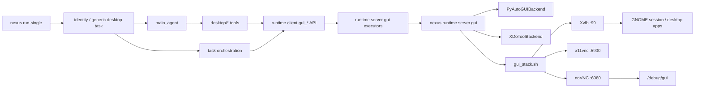

# Container GUI Runtime 设计

日期：2026-05-21
最近更新：2026-09-30
状态：通用容器Desktop设计保留；OSWorld章节按当前AGS实现更新。

## PyAutoGUI action guard

`desktop/pyautogui` 使用 pyautogui guard 校验动作代码：允许直接 `pyautogui.*`
GUI 输入、`time.sleep` 和只读 `platform` 信息；禁止 `pyautogui.screenshot`、
`pyautogui.locate*` 和 window-inspection 等绕过统一观测入口的操作。
浏览器中也不能通过输入 `javascript:` 或 `data:text/html` URL 绕过 GUI 操作约束。

## 目标

Container GUI Runtime 为 Nexus 提供一套可运行、可观察、可测试的 Linux 桌面自动化环境。本文主体描述Docker/Gongfeng的通用Desktop能力。当前OSWorld-V1评测已使用AGS原生桌面runtime与COS。

设计目标：

- runtime server 作为 GUI 能力的统一入口。
- Docker和Gongfeng共享通用runtime client、GUI executor和desktop tools；不作为当前OSWorld六模式provider。
- `desktop`提供工具；`os_world`通过AGS执行独立benchmark流程。
- GUI 栈通过 `desktop/start` / `gui_start` 显式启动。
- base runtime image 提供 runtime server、executor、Python venv、X11 控制依赖和 noVNC 调试链路。
- Ubuntu desktop session image 提供 GNOME session 和 OSWorld 常用桌面软件。
- agent 只通过工具完成可见 GUI 动作；task setup、mock app 启动和 evaluator 由 task adapter 调用 runtime executor 完成。
- `/debug/gui` 提供统一浏览器观察入口。

## 支持的 Provider

本节通用容器Desktop支持：

- `docker`
- `gongfeng`

两类 provider 的差异集中在容器启动、端口映射和远端资源调度。GUI executor和desktop tools共享接口。OSWorld评测的默认provider是AGS，不能直接套用下述容器镜像配置。

## 组件关系



核心模块：

- `deployment/runtime/start.sh`
- `deployment/runtime/gui_stack.sh`
- `deployment/runtime/flake.nix`
- `nexus/runtime/client/base.py`
- `nexus/runtime/executors/gui.py`
- `nexus/runtime/executors/models/gui.py`
- `nexus/runtime/server/gui.py`
- `nexus/runtime/server/debug.py`
- `nexus/runtime/utils/gui.py`
- `nexus/runtime/pyautogui_guard.py`
- `nexus/extensions/tools/desktop/tools.py`
- `nexus/extensions/tools/desktop/observation.py`
- `nexus/extensions/tools/desktop/osworld_actions.py`
- `nexus/extensions/tasks/os_world/task.py`
- `nexus/extensions/tasks/os_world/execution/setup.py`
- `nexus/extensions/tasks/os_world/evaluation/evaluator.py`
- `nexus/extensions/tasks/os_world/execution/tools.py`

## 启动后的桌面

完整 Ubuntu GNOME session 启动后，noVNC 中可以看到带 Dock 和常用桌面软件图标的 Ubuntu 桌面。


## Runtime 启动

runtime 容器启动后运行 `start.sh`。`start.sh` 初始化 runtime server，并加载 GUI stack 脚本能力。

GUI 栈启动流程：

1. agent 调用 `desktop/start`。
2. tool 调用 runtime client 的 `gui_start`。
3. runtime server 执行 `gui_start` executor。
4. executor 调用 `server.gui.start_stack()`。
5. backend 执行 `gui_stack.sh start`。
6. `gui_stack.sh` 启动 Xvfb、desktop session、x11vnc、noVNC。
7. runtime server 返回 display、VNC、noVNC、stdout/stderr 和错误摘要。

默认 GUI 参数：

- display：`:99`
- width：`1440`
- height：`900`
- session user：`user`
- session home：`/home/user`

`desktop/start` 不传分辨率时使用上述 runtime 默认值。当前OSWorld-V1使用AGS镜像已启动的桌面，标准配置为`skip_gui_start: true`；屏幕和坐标适配由对应agent/runtime负责。

## Desktop Session

完整 Ubuntu GNOME session 由 desktop session image 提供。runtime 通过 `gui_start` 参数把 session 配置传给 `gui_stack.sh`：

```json
{
  "desktop_session": "gnome-session",
  "session_options": {
    "gnome_session_name": "ubuntu"
  }
}
```

GNOME session 启动时配置：

- `NEXUS_GUI_DESKTOP_SESSION=gnome-session`
- `NEXUS_GUI_GNOME_SESSION_NAME=ubuntu`
- `NEXUS_GUI_REQUIRE_SYSTEM_DBUS=1`
- `XDG_SESSION_TYPE=x11`
- `GDK_BACKEND=x11`
- `CLUTTER_BACKEND=x11`

desktop session image 包含：

- GNOME / Ubuntu session：`gnome-session`、`gnome-shell`、`mutter`、`ubuntu-session`
- system services：`dbus`、`dbus-user-session`、`dbus-x11`、`accountsservice`、`polkitd`
- desktop shell：`gnome-terminal`、`nautilus`、`zenity`
- OSWorld applications：Chrome、GIMP、Thunderbird、VLC、VS Code、LibreOffice Writer/Calc/Impress
- themes：Yaru、Ubuntu wallpapers、Ubuntu fonts、Ubuntu Dock、AppIndicator、Desktop Icons NG
- graphics / X11：Mesa llvmpipe、`wmctrl`、`x11-apps`、`x11-utils`
- first-run profile：Chrome、LibreOffice、VS Code、GIMP、VLC 的自动化友好默认配置
- launch wrappers：`nexus-desktop-app` 和桌面 `.desktop` wrapper，确保 GUI app 默认在 `/home/user` session 环境运行

## Session User

GUI session 默认使用普通用户环境：

- user：`user`
- home：`/home/user`
- `XDG_RUNTIME_DIR`：`/run/user/<uid>`

应用启动、PyAutoGUI code 和 desktop session 进程默认进入该用户环境。这个约定让桌面应用配置、Chrome profile、OSWorld evaluator 路径和用户文件路径保持一致。

## GUI Backend

`nexus.runtime.server.gui` 是 GUI backend 的统一出口。

backend 类型：

- `PyAutoGUIBackend`
- `XDoToolBackend`

backend 选择：

```bash
NEXUS_GUI_AUTOMATION_BACKEND=auto
NEXUS_GUI_AUTOMATION_BACKEND=pyautogui
NEXUS_GUI_AUTOMATION_BACKEND=xdotool
```

`auto` 模式优先使用 PyAutoGUI，运行环境不可用时使用 xdotool。

公共能力：

- `screen_size`
- `screenshot`
- `move_to`
- `click`
- `mouse_down`
- `mouse_up`
- `right_click`
- `double_click`
- `long_click`
- `drag`
- `drag_to`
- `scroll`
- `type_text`
- `press_key`
- `key_down`
- `key_up`
- `hotkey`
- `run_pyautogui`
- `launch_app`
- `close_app`
- `reset_apps`
- `get_device_info`

共享的 session user command 构造逻辑放在 `nexus.runtime.utils.gui`。

## Desktop

`desktop` 是通用桌面工具项目。它注册以下工具：

- `desktop/start`
- `desktop/close_app`
- `desktop/launch_app`
- `desktop/screenshot`
- `desktop/screen_size`
- `desktop/computer_13`
- `desktop/pyautogui`
- `desktop/bash`

支持的任务形态：

- multi-window：启动 GNOME session，打开多个窗口，写入文件，打开 dialog，截图并关闭窗口。
- browser：启动 Chrome，打开网页并执行 GUI 操作。
- provider：同一套 desktop tools 可运行在 Docker 或 Gongfeng runtime 上。

用户可运行配置放在 `docs/examples/configs/desktop.yaml`。集成测试使用本地和 Gongfeng 配置覆盖 provider 差异。

## OSWorld-V1 Task：AGS与COS

当前六模式运行链路为：

```text
COS task_files → task.json与setup/evaluator资源 → AGS控制面申请
→ setup → CUA或通用CC/Codex native bridge → evaluator → score → 释放AGS
```

使用`runtime_provider_name: ags`、`runtime_kind: osworld`、
`interface_mode: nexus`及`provision_mode: control_plane`。
CC/Codex由execution_profile=osworld接入，不需要Gongfeng Desktop镜像、
本地官方examples。getter/metric支持范围以当前注册实现为准，

六模式的完整YAML、Run Part和Batch命令统一见
[OSWorld原生运行指南](../how-to/osworld-runbook.md)。

## Module Commands

extension module 可以注册 command。CLI 通过 `nexus module_commands` 提供 lazy command 入口：

- `nexus module_commands`：列出已发现的 extension commands。
- `nexus module_commands build-ubuntu-session-image --image <image> --force`：构建 Ubuntu desktop session image。

command 列表来自 extension 的 `pyproject.toml` metadata。执行具体 command 时才导入对应模块并注册 parser。

## 配置

本地 Docker desktop：

```yaml
imports:
  - nexus.extensions.tools.desktop

runtime_provider_name: docker
runtime_provider_config:
  runtime_image: current
  force_rebuild: false
  print_port_mappings: true

runtime_configs:
  main:
    image: ${oc.env:NEXUS_UBUNTU_SESSION_IMAGE,"nexus-ubuntu-session:latest"}
    exposed_ports: [5900, 6080]
    extra_args:
      - --tmpfs
      - /run
      - --tmpfs
      - /run/lock
      - -e
      - GTK_A11Y=none
      - -e
      - NEXUS_GUI_REQUIRE_SYSTEM_DBUS=1
```

Gongfeng desktop：

```yaml
imports:
  - nexus.extensions.tools.desktop

runtime_provider_name: gongfeng
runtime_provider_config:
  api_base_url: ${oc.env:GONGFENG_API_BASE_URL,"http://hyrl-sandbox.prod.woa.com:8052"}
  token: ${oc.env:GONGFENG_TOKEN}
  runtime_image: ${oc.env:NEXUS_GONGFENG_RUNTIME_IMAGE,"current"}
  runtime_provider: ${oc.env:GONGFENG_RUNTIME_PROVIDER,"gongfeng"}
  resource_spec:
    cpu: 4
    memory: 16
  print_port_mappings: true

runtime_configs:
  main:
    image: ${oc.env:NEXUS_GONGFENG_DESKTOP_IMAGE,"mirrors.tencent.com/hunyuan_yanguan/nexus-ubuntu-session:latest"}
    exposed_ports: [5900, 6080]
    environment:
      GTK_A11Y: 'none'
      NEXUS_GUI_REQUIRE_SYSTEM_DBUS: '1'
```

OSWorld任务使用独立AGS配置，不复用上面的Gongfeng Desktop片段：

```bash
nexus run-single nexus/extensions/tasks/os_world/configs/osworld_gpt_bare.yaml \
  -o /tmp/osworld.json
```

该命令需要先配置AGS、模型服务及WEDATA_KEY，完整说明见原生运行指南。

## Debug 入口

runtime server 提供 GUI 调试入口：

- `GET /debug/gui`
- `GET /debug/gui/vnc`
- `GET /debug/gui/vnc/{asset_path}`
- `WS /debug/gui/vnc/websockify`

provider 端口摘要包含：

- runtime server URL
- `/debug/gui`
- noVNC URL
- VNC URL

端口摘要输出到 `stderr`，保持命令行结构化输出可解析。

## 测试与验收边界

- 通用Desktop保留Docker/Gongfeng runtime与GUI工具测试。
- OSWorld-V1验证六模式配置、COS资源声明、AGS接口、原生CC/Codex策略和评分。
- 运行完成不等于满分；分别检查runner success、agent结束状态、evaluator结果及score。
- 真实模型与AGS结果只按具体测试记录报告，不沿用早期容器实验的“已验证”结论。
