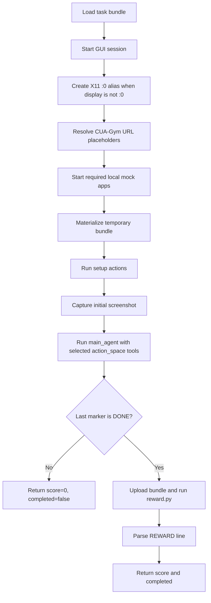
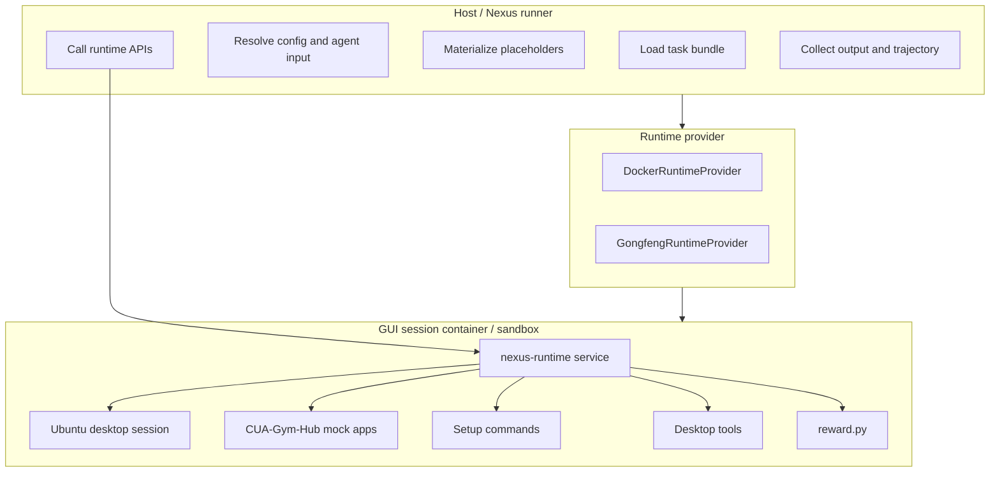

# CUA-Gym Task Adapter Design

状态：Implemented
日期：2026-06-02

## 目标

`cua_gym` 是 Nexus 对 CUA-Gym public dataset task bundle 的执行适配层。它读取公开数据集中的 `task.json`、setup 资源和 `reward.py`，在 Nexus 标准 GUI runtime 中完成环境准备、单 Agent 操作和程序化评分。

当前实现聚焦公开训练集中稳定覆盖面最大的 setup 子集：

- 支持 `download`
- 支持 `execute`
- 其他 setup action 按 `unsupported_setup_policy` 返回 unsupported 或失败

设计边界：

- 不生成 CUA-Gym dataset。
- 不调用官方 pipeline 中的 orchestrator/setup-gen/reward-gen agent。
- 不执行 `golden_patch.py`。
- 不让 Agent 推断或补齐 setup 行为。
- 不在运行时动态安装 mock app 依赖；mock app 和依赖预置在 CUA-Gym session image 中。

## 数据契约

一个 CUA-Gym task bundle 是一个目录：

```text
<task_id>/
  task.json
  reward.py
  initial_setup.py | initial_setup.sh | other setup assets
  other files imported or read by reward.py
```

`task.json` 关键字段：

```json
{
  "task_id": "0018392e-cfed-5e2f-8278-a4580d64a00a",
  "app_type": "libreoffice_writer",
  "instruction": "Complete the visible desktop task.",
  "config": [
    {
      "type": "download",
      "parameters": {
        "files": [
          {
            "url": "./initial_setup.py",
            "path": "/home/user/initial_setup.py"
          }
        ]
      }
    },
    {
      "type": "execute",
      "parameters": {
        "command": "python3 /home/user/initial_setup.py"
      }
    }
  ],
  "evaluator": {
    "type": "python",
    "path": "reward.py"
  }
}
```

加载入口：

- `task_file`：可以指向 `task.json`，也可以指向 task bundle 目录。
- `task_root + task_id`：定位到 `<task_root>/<task_id>/task.json`。

缺省行为：

- `task_id` 优先取 `task_id`，再取 `id`，最后取目录名。
- `instruction` 优先取 task input 覆盖值，否则取 bundle 内字段。
- evaluator 缺省为 `{"type": "python", "path": "reward.py"}`。

## 执行流程



步骤说明：

1. Host 侧读取 `task.json`，确定 bundle 根目录、instruction、app_type 和 evaluator。
2. Runtime provider 创建或获取 GUI runtime。
3. Task 调用 `gui_start` 启动桌面，默认分辨率 `1920x1080`。
4. 如果 runtime display 不是 `:0`，在 `/tmp/.X11-unix/X0` 创建到实际 display socket 的兼容别名，适配写死 `DISPLAY=:0` 的官方 setup。
5. 扫描 bundle 中的 URL/HOST placeholder。
6. `mock_hub_mode=local` 时按需启动镜像内的 CUA-Gym-Hub mock app。
7. 将 placeholder 替换到临时 materialized bundle，不修改原始 dataset。
8. 顺序执行 setup action；任一 action 失败时默认停止并返回失败。
9. 抓取初始 screenshot，和 instruction 一起传给单个 `main_agent`。
10. Agent 每轮调用一个桌面 action 或 fixed marker；post-iteration hook 在 action 后自动追加下一张 screenshot。
11. 只有 `desktop/fixed_marker` 的 `DONE` marker 才会触发 evaluator。
12. evaluator 上传 materialized bundle，运行 `reward.py`，解析最后一个 `REWARD: <float>`。

## 执行环境分层



Host 侧负责 orchestration，不直接操作 GUI：

- 加载 task bundle。
- 启动 runtime 和 GUI session。
- 处理 placeholder 和临时 bundle。
- 调用 runtime API 执行 setup、Agent 工具和 evaluator。
- 汇总 `score`、`completed`、`setup_results`、`mock_hub_result`、`evaluator_result` 和 `agent_output`。

Runtime 侧负责所有会改变沙盒状态的动作：

- 运行 `download` 上传后的文件。
- 运行 `execute` 命令。
- 启动 CUA-Gym-Hub mock app。
- 执行 `desktop/pyautogui` 或 `desktop/computer_13`。
- 执行 `reward.py`。

## Setup

### download

`download` 只支持 bundle-relative source：

- `./initial_setup.py`
- `data/input.xlsx`
- `assets/file.txt`

不支持远端 URL：

- `http://...`
- `https://...`
- `oss://...`

处理逻辑：

1. 校验 source 必须在 bundle 目录内，禁止路径逃逸。
2. 在 runtime 内创建 target 父目录。
3. 用 `runtime.upload_file(..., overwrite=True)` 上传文件。
4. 调整文件为可读，并尽量归属 `user:user`。

### execute

`execute.parameters.command` 支持字符串或字符串数组。字符串数组会转成 shell command。

执行时统一通过 `session_user_command` 包装：

- user：`user`
- home：`/home/user`
- cwd：`/home/user`
- display：`gui_start` 返回的实际 display，默认 fallback 为 `:99`
- missing user policy：`fallback`

## Mock Hub

CUA-Gym web mock 任务通过 URL/HOST placeholder 指向 mock app。默认模式为 `mock_hub_mode=local`。

支持三种模式：

- `local`：扫描 placeholder，按需启动镜像内 `/opt/cua-gym-hub/websites/<app_name>`。
- `external`：从 `url_env_file` 读取外部 mock endpoint，不启动本地 app。
- `disabled`：不启动 app，只做 env replacement；未解析 placeholder 可由 strict policy 决定是否失败。

placeholder 到 app 的映射规则：

```text
__GITHUB_URL__      -> github_mock
__TRELLO_BASE_URL__ -> trello_mock
__FOO_HOST__        -> foo_mock
```

local mock app 启动方式：

1. 确认 app 目录存在。
2. 确认 `node_modules` 和 `dist` 已在镜像构建期生成。
3. 创建 `.mock-states` 和 `.mock-files`。
4. 用 `npm run preview -- --host 127.0.0.1 --port <port>` 启动。
5. health check 先访问 `/go?sid=nexus-health`，失败时 fallback 到 `/`。

mock app 进程随 runtime 生命周期释放；当前 task adapter 不做跨任务 runtime 复用。

## Agent

CUA-Gym 使用一个 `main_agent`。setup 和 evaluator 不由 Agent 驱动。

默认 action space：

```yaml
action_space: pyautogui
```

支持的 action space 和工具：

| action_space | tools |
| --- | --- |
| `pyautogui` | `desktop/pyautogui`, `desktop/fixed_marker` |
| `computer_13` | `desktop/computer_13`, `desktop/fixed_marker` |

`guidance` 是可选 task input，默认为空。只有用户显式配置时才追加到 user prompt：

```text
Additional guidance:
...
```

prompt 由 OSWorld screenshot prompt 适配而来：

- system prompt 描述当前 action_space 和工具调用方式。
- user prompt 包含 task instruction、`/home/user` 和 Desktop 路径信息。
- 初始 user message 包含第一张 screenshot。
- 每轮 action 后通过 `desktop_observation` hook 自动追加当前 screenshot。

`desktop/fixed_marker` 语义：

- `WAIT`：等待并继续下一轮。
- `DONE`：终止 Agent loop；CUA-Gym 继续执行 evaluator。
- `FAIL`：终止 Agent loop；CUA-Gym 不执行 evaluator，返回失败。

`desktop/pyautogui` 有运行前静态校验：

- 允许直接 `pyautogui.*` 调用。
- 允许 `time.sleep(...)`。
- 允许只读 `platform.*` helper。
- 禁止 import。
- 禁止读写文件、shell、网络 API、mock service API。
- 禁止 `pyautogui.screenshot()`。
- 禁止 `pyautogui.locate*`。
- 禁止隐藏窗口检查 helper，如 `getActiveWindow()`、`getAllWindows()`。
- 禁止输入 `javascript:` 和 `data:text/html` URL。

## Reward

evaluator 只支持：

```json
{"type": "python", "path": "reward.py"}
```

执行逻辑：

1. 上传整个 materialized bundle 到 `/tmp/cua-gym/<task_id>`。
2. 如果 `reward.py` 引用 `reward_judge`，上传包内置 `/tmp/reward_judge.py`。
3. 在 runtime 内以 session user 执行：
   ```bash
   python3 /tmp/cua-gym/<task_id>/reward.py
   ```
4. cwd 设置为 `/tmp/cua-gym/<task_id>`，便于 reward 使用相对路径。
5. return code 非 0 时，`score=0.0`。
6. return code 为 0 时，解析 stdout 中最后一个 `REWARD: <float>`。
7. 缺少 `REWARD:` 或解析失败时，`score=0.0`。

CUA-Gym task output 中：

- `score` 取 evaluator score。
- `completed=true` 仅当 `score >= 1.0`。
- `supported=false` 表示 setup/evaluator 超出当前适配范围或 placeholder 未解析。

## 镜像

训练集验证和示例配置使用发布镜像：

```text
mirrors.tencent.com/hunyuan_yanguan/nexus-cua-gym-session:latest
```

该镜像继承共享 Ubuntu GUI session image，并包含：

- CUA-Gym 常用 Python reward 依赖。
- PyAutoGUI 和 Tk 依赖。
- CUA-Gym-Hub 源码。
- public train split 覆盖到的 mock app。
- mock app 的 `node_modules` 和 `dist`。
- `/tmp/reward_judge.py` helper。

构建入口只用于镜像维护：

```bash
uv run nexus module_commands build-cua-gym-session-image \
  --image mirrors.tencent.com/hunyuan_yanguan/nexus-cua-gym-session:latest \
  --hub-source /path/to/CUA-Gym-Hub
```

构建阶段可能访问 NodeSource、npm registry 和 pip/index mirror。训练集复跑不要求现场构建该镜像。

集成测试配置使用 dev tag，避免本地测试构建污染发布 `latest`：

```text
mirrors.tencent.com/hunyuan_yanguan/nexus-cua-gym-session:dev-integration
```

## 配置

Gongfeng 示例：

```yaml
imports:
  - nexus.extensions.tasks.cua_gym

task_name: cua_gym
task_config:
  task_root: ${oc.env:CUA_GYM_TASK_ROOT,"/tmp/cua_full"}
  task_id: ${oc.env:CUA_GYM_TASK_ID,"0018392e-cfed-5e2f-8278-a4580d64a00a"}
  run_setup: true
  run_evaluator: true
  unsupported_setup_policy: fail
  require_done: true
  action_space: ${oc.env:CUA_GYM_ACTION_SPACE,"pyautogui"}
  mock_hub_mode: local
  mock_hub_root: ${oc.env:CUA_GYM_HUB_ROOT,"/opt/cua-gym-hub"}

runtime_provider_name: gongfeng
runtime_provider_config:
  api_base_url: ${oc.env:GONGFENG_API_BASE_URL,"http://hyrl-sandbox.prod.woa.com:8052"}
  token: ${oc.env:GONGFENG_TOKEN}
  runtime_image: ${oc.env:NEXUS_GONGFENG_RUNTIME_IMAGE,"current"}
  runtime_provider: ${oc.env:GONGFENG_RUNTIME_PROVIDER,"gongfeng"}
  resource_spec:
    cpu: 4
    memory: 16
  print_port_mappings: true

runtime_configs:
  main:
    image: ${oc.env:NEXUS_GONGFENG_CUA_GYM_IMAGE,"mirrors.tencent.com/hunyuan_yanguan/nexus-cua-gym-session:latest"}
    exposed_ports: [5900, 6080, 18000, 18001, 18002]
```

本地 Docker 运行使用同一套 task 字段和 session image，差异只在 provider 配置：`runtime_provider_name=docker`，`runtime_provider_config` 使用本地 Docker runtime 配置，`runtime_configs.main.image` 使用 `NEXUS_CUA_GYM_SESSION_IMAGE`，并保留 GUI、VNC/noVNC 和 mock hub 端口。Docker 配置不作为 user-facing example config 维护。

用户示例配置：

- `docs/examples/configs/cua_gym_gongfeng.yaml`

集成测试配置：

- `tests/integration/cua_gym/configs/cua_gym_docker.yaml`
- `tests/integration/cua_gym/configs/cua_gym_gongfeng.yaml`

## 代码结构

```text
nexus/extensions/tasks/cua_gym/
  __init__.py
  task.py                    # task input/output, orchestration, prompt/tool selection
  setup.py                   # download and execute setup actions
  evaluator.py               # reward.py upload, execution, score parsing
  mock_hub.py                # placeholder scan and mock app startup
  materializer.py            # temporary bundle replacement
  cua_gym_session_image.py   # session image build command
  hub_manifest.py            # mock app list and build-time source patches
  reward_judge.py            # packaged helper for reward.py
  pyproject.toml             # task/tool/command registration
```

Shared OSWorld/desktop modules:

```text
nexus/extensions/tasks/os_world/prompts.py
nexus/extensions/tasks/os_world/tools.py
nexus/extensions/tools/desktop/observation.py
nexus/extensions/tools/desktop/osworld_actions.py
nexus/extensions/tools/desktop/tools.py
nexus/runtime/pyautogui_guard.py
```

## 测试策略

Unit tests 覆盖：

- task bundle 加载。
- prompt 和 tool selection。
- config 默认值。
- materializer placeholder 替换。
- mock hub placeholder 和 startup command。
- setup `download` / `execute`。
- evaluator reward parsing and failure handling。
- `DONE` marker gating evaluator。
- pyautogui guard。
- session image Dockerfile 内容。

Integration tests 覆盖：

- Docker provider smoke。
- Gongfeng provider smoke。
- `run-single` 配置加载和真实 agent trajectory。

## 4 轮验证结果

最近一次 16 个 CUA-Gym 任务验证结果如下。分数格式为 `score/iterations`，`DONE` 表示该轮 Agent 以 `desktop/fixed_marker` 的 `DONE` 结束；通过按 `score=1.0` 统计。

- R1：`5/16`
- R2：`4/16`
- R3：`5/16`
- R4：`6/16`
- 四轮至少通过一次：`8/16`
- 四轮全部通过：`2/16`

| # | task | app_type | R1 | R2 | R3 | R4 | 4轮通过 | best | 结论 |
|---|---|---|---:|---:|---:|---:|---:|---:|---|
| 01 | `aaa74c67` sort sales pipeline | libreoffice_calc | 1/7 DONE | 1/33 DONE | 1/26 DONE | 0/80 | 3/4 | 1 | 稳定/可用 |
| 02 | `f6cae267` imagemagick grayscale | multi_apps | 1/7 DONE | 1/10 DONE | 1/6 DONE | 1/11 DONE | 4/4 | 1 | 稳定/可用 |
| 03 | `0cc19c30` duplicate slide 1 | libreoffice_impress | 1/6 DONE | 0/12 | 1/8 DONE | 1/14 DONE | 3/4 | 1 | 稳定/可用 |
| 04 | `e432f800` contacts csv to calc | multi_apps | 1/36 DONE | 1/41 DONE | 1/29 DONE | 1/19 DONE | 4/4 | 1 | 稳定/可用 |
| 05 | `08453c82` eslint auto-fix on save | vscode | 0/32 | 1/60 DONE | 0/26 | 0.4/30 | 1/4 | 1 | 偶发可过 |
| 06 | `bee6a5cc` follow Nina Rodriguez | pinterest_mock | 0/80 | 0/80 | 1/42 DONE | 1/40 DONE | 2/4 | 1 | 偶发可过 |
| 07 | `f91548d2` add agenda table rows | libreoffice_writer | 1/51 DONE | 0/50 | 0/23 | 1/77 DONE | 2/4 | 1 | 偶发可过 |
| 08 | `41bc7a35` groceries csv to writer | multi_apps | 0.8/7 | 0.8/12 | 0.8/7 | 0.74/77 | 0/4 | 0.8 | 部分分 |
| 09 | `44d2707a` add blank slide | libreoffice_impress | 0/21 | 0.7/29 | 0/20 | 0.7/33 | 0/4 | 0.7 | 部分分 |
| 10 | `41849652` employees csv to writer | multi_apps | 0.017/34 | 0/19 | 0.65/14 | 0.417/65 | 0/4 | 0.65 | 部分分 |
| 11 | `2214183f` fade transition all slides | libreoffice_impress | 0/70 | 0/80 | 0/80 | 0/80 | 0/4 | 0 | 未通过 |
| 12 | `00aa356d` enable git auto-fetch | vscode | 0/24 | 0/33 | 0/16 | 1/12 DONE | 1/4 | 1 | 偶发可过 |
| 13 | `f90e91b9` enable word wrap | vscode | 0/35 | 0/42 | 0/31 | 0/22 | 0/4 | 0 | 未通过 |
| 14 | `6439d87c` minimal interface | vlc | 0/2 | 0/2 | 0/2 | 0/2 | 0/4 | 0 | 未通过 |
| 15 | `82a6158b` default volume 50 | vlc | 0/80 | 0/80 | 0/50 | 0/80 | 0/4 | 0 | 未通过 |
| 16 | `8f458761` send message to Li Si | wechat_mock | 0/80 | 0/80 | 0/80 | 0/33 | 0/4 | 0 | 未通过 |

运行方式：

```bash
uv run pytest tests/unit/extensions/tasks/test_cua_gym_task.py \
  tests/unit/extensions/tasks/test_cua_gym_session_image.py \
  tests/unit/runtime/test_pyautogui_guard.py -q

NEXUS_RUN_CUA_GYM_INTEGRATION=1 \
uv run pytest tests/integration/cua_gym -q
```

集成测试需要模型服务凭据；Gongfeng 测试额外需要 `GONGFENG_TOKEN`。
