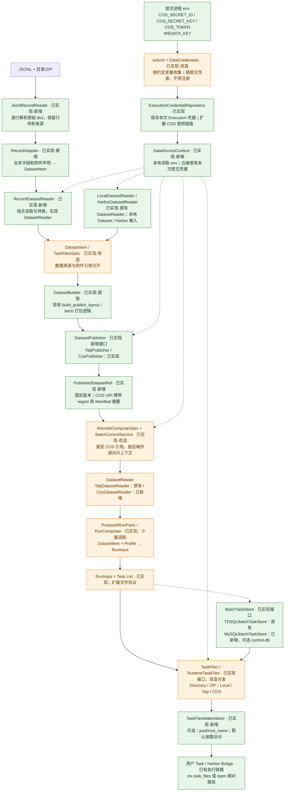
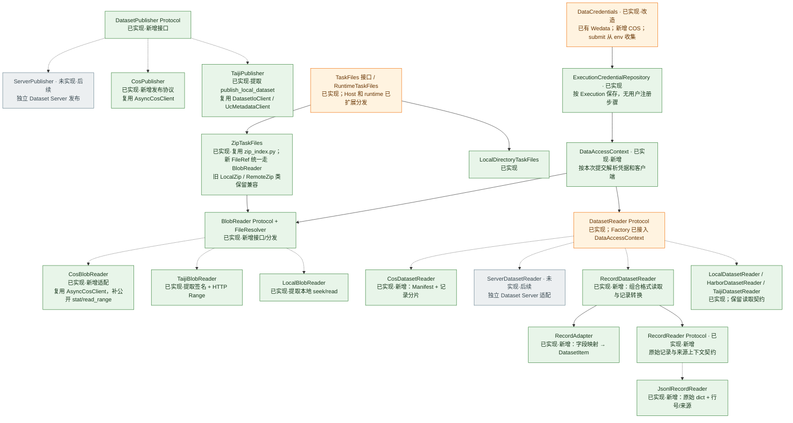

# Dataset 导入、多后端发布与远程运行设计

状态：功能已实现；实现状态与代码对应，runner-dev 验收记录见配套验证报告。更新日期：2026-09-17。

代码基线：`main@81bf95d681c204f9479a2502e6ef4bc21082d99c`；实现分支 `feat/dataset-jsonl-cos` 已基于该版本开发。历史 standalone 分支只作为可复用代码来源，不计入 main 已实现能力。

## 1. 目标和确定的边界

完整交付链路：**本地 JSONL + 附件 → 转换 → 发布到 Taiji 或 COS → 仅凭发布引用远程 materialize → 云端执行。**

- 每个 item 的附件是一个目录或一个 ZIP；不增加 `NamedFilesSpec`、离散附件列表或虚拟挂载。
- 保留 `DatasetItem → Compose → RunInput → TaskFiles` 主链路。数据发布不绑定本次 Agent、模型或实验 Profile。
- 发布默认复制并固化附件；输入为远端 ZIP 时，也校验并复制到目标。首批交付不依赖跨后端外部引用透传。
- 可选兼容模式在实际任务 pwd 下恢复原目录名，例如 `case-01/abcd`；保持现有线程/asyncio 执行，不引入任务进程隔离，不调用 `os.chdir()`。
- 首批完整实现 Taiji、COS。独立 Dataset Server 可后续实现相同接口；现有 Cloud Data List 保留，用于未发布的本地数据直接提交。
- 凭据在 submit 时直接从环境变量读取，随本次提交传递；无需用户预先注册密钥、创建 credential ID 或配置 data-profile。云端按本次 Execution 保存和使用。
- 最终验收必须移走原始 JSONL/目录并从另一提交环境运行，核对附件和实际任务结果。

## 2. 整体链路

标记统一为：**已实现·原有**＝复用既有实现；**已实现·改造**＝已完成兼容扩展；**已实现·新增/提取**＝本分支落地；**未实现·后续**＝本次不交付的独立 Dataset Server 适配。



发布阶段冻结记录和附件；云端 materialize 读取已发布记录并组合运行配置，附件在单题执行时按需读取或预先展开。发布后的这条路径不生成 Data List。

## 3. 抽象边界与实现状态

本图虚线表示接口与子实现，实线表示调用关系；“提取”节点注明可复用的现有实现。



| 边界/目标类型 | 契约 | 现有实现与待改点 |
| --- | --- | --- |
| `DatasetReader` | `describe / iter_item_ids / iter_items` | 已实现；显式 context 与任务作用域均支持，兼容旧 URI-only Factory |
| `RecordReader` | `iter_records(with_source_digest=False)` | 已实现 Protocol；供 JSONL 与后续格式实现共同遵循 |
| `JsonlRecordReader` | `iter_records() -> 原始 dict + source_context` | 已新增；只负责逐行解析、行号/来源和格式错误，不理解任务或附件语义 |
| `RecordAdapter` | `convert(record, source_context) -> DatasetItem` | 已新增；只负责记录语义、字段和附件声明映射，不解析 JSONL 文件格式 |
| `RecordDatasetReader` | 组合 `record_reader + adapter`，实现 `DatasetReader` | 已新增；负责 descriptor、split、ID 枚举、筛选、limit 与生命周期，向 Compose/Builder 返回 DatasetItem |
| `DatasetBuilder` | `build(reader, options, context) -> DatasetBuild` | 从 `build_publish_layout`、CLI exporter 和本地打包逻辑提取，按流处理记录 |
| `DatasetBuild / PublishedDatasetRef` | 目标无关的构建产物 / 可读取的发布结果 | 从 `PublishBuild / PublishResult` 提取统计与对象信息，新增固定引用和内容摘要契约 |
| `DatasetPublisher` | `publish(build, target, context) -> PublishedDatasetRef` | 已实现接口；Taiji 复用服务发布并增加幂等校验，COS 实现 Manifest 协议 |
| `FileResolver` | `open(FileRef, context) -> BlobReader` | 新增，按明确的 `kind` 分发，不猜 URI 所属平台 |
| `BlobReader` | `stat / read_range / download_to` | 提取现有本地/Taiji 字节获取，新增 COS 适配；通过上下文管理关闭 |
| `TaskFiles` | `list / exists / read_bytes / read_text / download` | 保持公共接口；ZIP 解析依赖 `BlobReader`，不依赖 Taiji |
| `TaskFilesMaterializer` | `prepare(files, policy, workspace) -> lease` | 新增可选运行前落地；任务结束/取消时释放自己创建的目录 |
| `DataCredentials` | 本次提交携带的敏感凭据，独立于公开运行配置 | 已有 Wedata；新增 COS，submit 从约定 env 收集，无预注册流程 |
| `DataAccessContext` | 用本地 env 或本次 Execution 凭据提供客户端和 session | 新增协调层，复用已有认证与凭据仓库；资源在 Reader/任务上下文退出时关闭 |

## 4. 记录、数据集引用与文件引用

`DatasetItem` 保留 `id/body/merge/metadata/files`；数据来源由 Reader descriptor 与旧 `remote_ref` 兼容字段表达。来源信息不能覆盖显式文件引用。

```text
DatasetRef 类型族                  发布版本/数据集的定位
├── TaijiRemoteDatasetRef           namespace / dataset / version / split
└── CosDatasetRef                   manifest_uri / region / manifest_sha256

FileRef                            一个 ZIP 对象的定位
├── LocalFileRef                    path
├── TaijiFileRef                    TaijiRemoteDatasetRef + path
└── CosFileRef                      bucket / region / key / etag（发布时固定）

TaskFilesSpec                      已有模型，扩展而不增加文件集合类型
├── type=directory                 path + root_name
└── type=zip                       source: FileRef + size + sha256 + root_name
```

- 现有具体 `RemoteDatasetRef` 改名为 `TaijiRemoteDatasetRef`；旧构造/导入提供过渡兼容入口。
- 新文件协议显式版本化；旧 `type/path/remote` 由入口归一化，Taiji 输出编码器仍能生成已有平台 wire 格式。
- `DatasetItem.resolved_task_files()` 已改为仅补齐未绑定的旧 Taiji 引用，保留显式 FileRef。
- `source` 定位包，任务调用 `read_text('abcd')` 读取包内相对路径。`root_name` 只控制 cwd 落地目录，不改变包内 API。
- 凭据和签名下载 URL 不进入 DatasetRef、FileRef、发布记录或 Task List；连接提示与数据内容身份分离。
- COS 发布目标必须明确 region；发布后 `CosDatasetRef.region` 与 `CosFileRef.region` 必填。首次读取 Manifest 所需的 bucket、key、region 均来自发布引用，不能依赖 Manifest 内部信息、提交机本地配置或预注册连接。首批使用标准 COS endpoint，网络访问方式由运行环境决定。

规范化示例（哈希/大小为占位）：

```yaml
id: case-01
body:
  task_name: my_task
  task_config:
    input_file: case-01/abcd
  runner:
    task_files_materialization:
      mode: cwd
      target: host
files:
  type: zip
  root_name: case-01
  source:
    kind: cos
    bucket: example-bucket
    region: ap-guangzhou
    key: datasets/demo/objects/<digest>.zip
  size: 12345
  sha256: <digest>
```

## 5. JSONL 转换和文件构建

输入链路分为三层：

```text
JsonlRecordReader：JSONL → 原始 dict + 行号/来源
    → RecordAdapter：原始记录 → DatasetItem
    → RecordDatasetReader：以 DatasetReader 契约提供给 Compose / DatasetBuilder
```

这是数据流方向；调用时由 `RecordDatasetReader` 组合前两者。`JsonlRecordReader` 不实现 DatasetReader，也不处理任务名、附件或发布后端；`RecordAdapter` 不负责文件格式解析。后续支持普通 JSON 时，只需替换底层 RecordReader，复用转换和 Dataset 接口。

2026-09-19 补充：未传 import-spec 时，Reader 使用内置 `auto` 模式；普通业务记录完整包装为
`body.task_config`，无需发布时绑定 task_name。带所选 ID 字段和对象类型的 body，且仅含标准 envelope
字段的记录按 DatasetItem 解析；有额外业务字段的记录继续完整包装。业务数据恰好与标准
envelope 同形时，显式 `record_kind: task_input` 消除歧义。

`dataset import/publish` 均支持 `--id-field` 与 `--files-field`。优先级为 CLI 字段覆盖、
显式 import-spec、内置默认规则。显式 spec 未写 record_kind 时仍为 dataset_item，保留旧行为。
未指定 ID 字段时默认读 id，缺失才生成行号 ID；显式指定后禁用自动补 ID，缺失、空值、
null、非字符串和重复 ID 均失败。附件字段按 JSONL 目录解析并识别目录/ZIP；未声明的路径
仍是业务数据，不自动扫描。字段名只支持顶层键，ID 与附件字段不能相同。

默认模式与 task_input 模式均只在显式指定 task_name 时写入该字段；其余情况保留缺失，
由运行 Profile 补齐。Compose 生成完整 RunInput 时继续强制校验 task_name。

示例输入目录：`tasks.jsonl`、`case-01/abcd`；可选提供 `import.yaml`。JSONL 每行是一个对象：

```json
{"id":"case-01","input_file":"case-01/abcd","bundle":"case-01"}
```

最简用法为 `dataset import tasks.jsonl --files-field bundle --files-to-cwd -o converted`。
需要更完整映射时可提供转换配置：

```yaml
schema_version: 1
record_kind: task_input
task_name: my_task
id_field: id
split: test
files:
  path_field: bundle
  type: directory
compat:
  files_to_cwd: true
```

| 输入模式 | 标准化行为 |
| --- | --- |
| `auto` | 未提供 spec 的默认模式，识别标准 envelope，其余记录包装为 task_config |
| `task_input` | 业务字段原样放进 `body.task_config`，仅显式配置时补 `task_name`；选作 Dataset ID 的字段仍保留在业务输入中 |
| `run_input` | 运行配置放进 `body`，将已有 `task_files` 转到 `files`；仅移除额外的顶层 `id`，以 `run_id` 等运行字段作 ID 时仍保留原字段 |
| `dataset_item` | 校验后使用，不再套一层 |

转换规则：

1. 按输入文件所在目录解析 `bundle`；提取为附件声明，保留 `input_file` 等业务字段原值，不扫描任意字符串猜路径。
2. 优先采用明确业务 ID；可选生成行号 ID，并记录输入内容摘要/行号。校验 ID、split、重复记录及文件存在性，错误定位到行。
3. 单目录自动记录 basename 为 `root_name`。路径必须是单个安全目录名；相对业务路径由用户保持与目录布局一致。
4. JSONL 逐行处理，校验/输出通过有界缓冲和磁盘暂存完成。目录扫描、ZIP 单条目解压也受大小限制。
5. 本地目录生成确定性 Nexus ZIP；保留相对路径、文件内容和必要权限，固定不影响语义的时间属性。构建期间源文件变化则失败。
6. 现有 Nexus ZIP 校验后复用；普通 ZIP 在构建阶段归一化。远端 ZIP 经 `FileResolver` 下载校验后复制到目标，发布不留下原来源依赖。
7. 公共 `DatasetBuild` 保存目标无关的记录/附件句柄。最终 FileRef 由 Publisher 渲染，不能在公共构建层写死 Taiji 坐标。

可提供 `dataset import` 导出标准本地布局供检查；直接发布 JSONL 走 `RecordDatasetReader + DatasetBuilder`，不强制先生成大量本地 item YAML。

## 6. 发布协议

`PublishedDatasetRef` 至少返回 `backend/data_uri/resolved_version/content_sha256/item_count/splits`，COS 额外返回 `region/manifest_sha256`。Taiji 沿用现有 `namespace/dataset@version` URI；COS 的 `data_uri` 同时携带固定 Manifest 路径、region 和 Manifest 原始字节摘要：

```text
cos://example-bucket/datasets/research/demo/releases/v1/manifest.json?region=ap-guangzhou#sha256=<64位十六进制摘要>
```

解析后得到 `CosDatasetRef(manifest_uri, region, manifest_sha256)`；`manifest_uri` 只保留对象位置，query/fragment 由 Dataset URI 解析器处理，不作为 COS 对象 key 或请求参数。发布输出的独立字段与 URI 必须一致；submit、RemoteComposeSpec 和 `resolved_datasets` 保留完整引用。远程提交缺少 region 或摘要时前置报错，不静默接受未固定内容的 COS URI。因此命令只取 `published.json` 的 `data_uri` 也不会丢失校验信息。

Reader 下载 Manifest 后先验证原始字节 SHA256，再解析分片与附件引用；分片和附件按 Manifest/记录中的摘要继续校验。不能用本次下载算出的摘要替代发布引用中的预期值。Manifest 使用确定性序列化，不包含上传时间等易变字段；同一发布内容重试产生相同字节与摘要。

### TaijiPublisher：提取现有流程

```text
DatasetBuild
  → 渲染平台兼容 raw/JSONL/blobs 布局
  → UcMetadataClient 检查/注册
  → DatasetIoClient 签名上传
  → commit snapshot → publish release → 读取回验
```

继续兼容现有 Taiji 记录和服务接口。发布前比较现有 release 的 split、item ID、业务记录和附件摘要；相同内容直接返回，不同内容报冲突。比较不依赖服务返回的记录顺序。`content_sha256` 表示本次冻结构建摘要；请求结果不明确时先回读固定 release。Taiji 服务端的并发原子性仍由既有服务协议负责。

### CosPublisher：新增发布协议，复用 AsyncCosClient

```text
<prefix>/<namespace>/<dataset>/
  objects/<sha256>.zip
  snapshots/<content-id>/<split>/items-00000.jsonl
  releases/<version>/manifest.json
```

Manifest 保存 schema/编译格式版本、固定 release、split 数量、记录分片位置/大小/哈希及内容摘要。记录分片中的 FileRef 固定附件位置和身份。首批 `iter_item_ids/iter_items` 流式扫描分片；单 ID 查询允许扫描，随机索引可独立优化。

发布顺序：**附件 → 记录分片 → 完整性校验 → 最后创建 Manifest → 回读确认 → 返回引用。**

- 同版本同内容幂等，不同内容冲突；内容摘要不含上传时间、临时路径、凭据。`root_name`、业务字段、附件内容及有语义的权限纳入身份。
- 对象和 Manifest 使用原子禁止覆盖语义；首批 COS 命名版本发布仅接受已验证支持该语义的桶配置。不满足时前置报错，不自行改桶配置。
- COS 的 `x-cos-forbid-overwrite` 在开启版本控制的桶中无效，不能将普通 HEAD+PUT 当作原子发布。参见 [COS API 说明](https://cloud.tencent.com/document/product/436/7746)。版本化桶的命名 release 提交需另行实现等价协议后启用。
- Range 读取固定对象身份并校验响应区间、长度及 ZIP 条目校验和；完整下载校验全对象 SHA256。对象变化明确报错，不能拼接不同版本的区间。
- COS 附件引用保存发布校验时的 ETag，HEAD 和每次 Range 都绑定该身份；外部 COS ZIP 未提供 ETag 但声明 SHA256 时，首次访问先完成全对象摘要校验。大文件分块上传的初始化和完成请求都保留禁止覆盖条件，参见 [Complete Multipart Upload](https://cloud.tencent.com/document/product/436/7742)。
- Manifest 提交前失败，不创建本次 release；同名已有 release 保持原样。提交请求发出后发生超时、断连或取消，结果记为“提交结果未知”，不能据此认定发布失败或回滚已提交 release。
- 结果未知时回读固定 Manifest：摘要与本次构建一致则确认成功；存在但摘要不同则报版本冲突；确认不存在则允许按同一内容重试原子创建。读请求本身超时、无权限等仍属未知，保留目标位置和预期摘要供重试核对，不返回已确认成功的发布引用。
- 取消时中止未完成 multipart。提交结果未知时不删除可能已被 release 引用的对象；上传残留仅在确认不可达后清理，不删除被其他 release 引用的内容对象。

历史 standalone 的 manifest/store/publisher 可选择性复用，但必须适配当前模型、Reader 和 COS 客户端接口，重新验证上述语义。

## 7. 云端 materialize 与鉴权

```text
submit 读取 env → DataCredentials → 本次 Execution 凭据存储
                                         ↓
RemoteComposeSpec + DataAccessContext
  → BatchControlService._materialize_remote()
  → _materialize_compose_subprocess()
  → materialize_compose()
  → open_dataset(ref, context)
  → TaijiDatasetReader / CosDatasetReader
  → PreparedRunParts.compile_batch_item()
  → Task List / BatchTaskStore
  → 子 Execution → TaskFiles → 附件读取
```

已完成的 Cloud 改造：

| 现有耦合 | 修改 |
| --- | --- |
| `RemoteComposePart` 调用 `validate_dataset_service_uri()`，拒绝 `cos://` | 由受支持 DatasetRef/Reader 能力校验；拒绝提交机本地路径，不放行任意未知 URI |
| `_compose_requires_wedata()` 只要有 data part 就要求 Wedata | 按实际后端解析访问依赖，替换为通用访问配置 |
| submit 只从 `--wedata-key-file` 收集 Wedata，`DataCredentials` 只有 Wedata | 增加约定 env 读取与 COS 字段；凭据随本次提交传递，不要求预注册 |
| 子进程参数/环境专门处理 Wedata | 注入受控 `DataAccessContext`，支持 Taiji 与 COS，避免只在客户端可读 |
| 文件分类依赖 `remote != None && type == zip` | 识别新 FileRef；已发布远端 ZIP 保留引用，本地路径必须走现有 Data List 或提前发布 |
| `resolved_datasets` 只记录 Taiji | 统一记录实际版本、COS region、Manifest/内容摘要；提交解析与恢复/重试均保留完整固定引用 |
| 本地 Profile 可能含本地路径 | 提交时归一化为 inline RunPart，扩展 RemoteComposeSpec；保留运行时环境引用。代码/模块由固定 wheel、source package 或 workload image 提供 |

### 提交时直接传递环境变量凭据

用户只需在执行 submit 的进程中提供下列环境变量。submit 自动收集这些约定变量，无需注册密钥、credential ID、data-profile 或额外的凭据选择参数。

| 后端 | 环境变量 | 行为 |
| --- | --- | --- |
| COS | `COS_SECRET_ID`、`COS_SECRET_KEY`；可选 `COS_TOKEN` | 前两项必须同时非空；临时凭据携带 token。复用现有 `CosCredentials` 校验与序列化 |
| Taiji/Wedata | `WEDATA_KEY`，内容为现有 Wedata key JSON | 复用 `WedataKey.from_raw()`；已有 `--wedata-key-file` 继续兼容，与 env 同时指定时报冲突 |

1. submit 对本次进程的约定变量做一次快照。任一凭据组出现但不完整或无效时，在发送前报错；不混用本地 key 文件、全局缓存中的旧值补齐。未设置的组不传，不复制整个 `os.environ`。首批支持每种后端一组凭据，不引入多账号绑定配置。
2. 实际值放入提交请求专用 `data_credentials` 字段，通过 Cloud 认证接口传输。不能只传 `${COS_SECRET_KEY}` 或变量名，因为云端无法读取提交机 env。COS 映射为 `data_credentials.cos = {secret_id, secret_key, token?}`；Wedata 沿用原字段。
3. 服务端复用 `ExecutionCredentialRepository`，在创建顶层 Execution 时保存，子任务通过父 Execution 读取。这里是本次任务的内部凭据存储，不是用户预注册的密钥服务；submit 结束、提交终端关闭后仍能排队、生成和重试。
4. `DataAccessContext` 从本次 Execution 获取所需后端凭据，分别用于远程 materialize 和执行阶段的 Host/runtime 附件读取。连接参数从资源引用或非敏感运行配置读取。独立生成子进程可通过受控 env 注入；共享线程执行器使用任务上下文，不修改进程全局 env，避免不同任务串用凭据。sandbox 沿用受控 session/桥接。
5. 数据访问不得隐式回退到 Cloud 服务进程自身的 COS/Wedata env 或 key 文件；独立子进程移除继承的相关凭据变量，只注入本次提交值。不能用普通 `host_env` 或 `RunInput` 承载密钥，也不能要求只在任务 Host 注入，因为生成进程同样需要访问数据。
6. 凭据不进入公开 spec、DatasetRef/FileRef、Manifest、Task List、发布报告、dry-run 输出或日志。模型与错误输出脱敏；凭据保存、有效期和清理按下述 Execution 生命周期约定实现。

凭据生命周期：

- 排队、materialize、执行和框架内部重试共用顶层 Execution 的凭据快照；某次尝试失败或单个子任务结束时不删除，也不重新读取提交机 env。
- 顶层 Execution 已终止，且全部子任务、生成进程和相关读取 session 停止后，幂等删除该 Execution 的凭据记录并释放关联客户端/session。取消请求或父任务状态先变为终态，不足以单独触发删除。
- 终态清理由生命周期流程触发，并由定期核对补偿服务重启或遗漏；已有到期删除仅作补充，不能只依赖 TTL，尤其是未配置总超时的任务。保留重试所需快照不会延长上游临时凭据的有效期。
- 用户重新提交时，从当次 env 读取并创建新的 Execution 与凭据快照，不复用已清理的旧凭据。网络重试同一次 submit 使用原幂等键和同一快照；换密钥重新提交必须使用新幂等键，不能通过重放请求覆盖运行中的凭据。

本地 publish 可以直接使用同一套 COS env，凭据不会随 Dataset 发布；换环境 submit 时提供该环境的读权限凭据。发布写权限与运行读权限可使用不同密钥。Cloud 提交接口自身的登录认证保持原有机制。

环境变量传入的是凭据快照，不附带刷新能力。临时 token 在排队或执行期间到期时明确报凭据过期，用户换有效凭据重新提交；首批不承诺自动续期或运行中更换密钥。签名 URL 按访问时生成，但重新签名不能延长已过期 token 的有效期。

### 临时 Data List 的平台存储

发布后只传远端引用的链路不要求另行配置 Task Store。未发布的本地文件仍可走 Task List v3 + Data List，由 `BatchTaskStore` 保存逐题记录和 ZIP frame。

- `TDSQLBatchTaskStore`：沿用既有 TDSQL backend 配置。
- `MySQLBatchTaskStore`：新增可选实现。平台设置 `batch_task_store_backend: control-db` 后，复用 Control 数据库连接，在同一测试数据库内维护 `batch_task_records`，不注册 Trace backend 或额外用户密钥。
- 两者共用记录编码、哈希、幂等写入、读取和按 Batch 清理接口。普通 MySQL 使用无 shardkey 的表结构，item ID 按大小写区分。
- `control-db` 适用于 MySQL 部署；文件大小配置仍须符合数据库的 packet/存储容量限制，大附件优先发布到 COS 后传引用。

## 8. 相对路径自动兼容模式

选项 `--files-to-cwd` 在导入时写入 `body.runner.task_files_materialization`，随 publish 保留；运行 Profile 可覆盖。默认 `mode=none`，用户仍通过 `ctx.task_files` 按需读取。

开启后：

```text
共享任务 pwd/
├── case-01/abcd       ← task 1: open("case-01/abcd")
└── case-02/abcd       ← task 2: open("case-02/abcd")
```

- `target=host` 为默认；在任务函数调用前完成落地。若用户代码在 sandbox 中执行，指定 `target=runtime:main`，在对应 runtime 可被用户代码使用前准备其实际工作目录。
- 框架不改变 cwd、不增加进程隔离。前提是同一 pwd 内并发任务的 `root_name` 唯一。准备阶段捕获实际 pwd，目标为 `pwd/root_name`。
- 动态镜像模式若 `/workspace` 只读，Manager 启动阶段先将镜像代码复制到已有 allocation 的可写 workspace，再沿用现有启动流程进入该目录；复制受 workspace 大小限制。该准备每个 Manager 做一次，任务执行期间不切换 cwd、不新增每任务进程。
- 兼容模式下，包内规范布局是根目录的内容；`root_name` 另存。例如 ZIP 条目是 `abcd`，落地为 `case-01/abcd`。输入 ZIP 已有唯一顶层目录时，在显式启用该模式的导入阶段归一化一次；旧 ZIP 无 root 元信息且无法唯一识别时要求显式配置，不能猜测。未启用模式的旧 ZIP 保持原条目路径。
- 对目标名做跨线程/进程可见的原子占用；已有目录或同名占用默认失败，不覆盖、不接管。临时解包/校验完成后再发布目标目录，拒绝越界路径和不支持的链接，恢复必要权限。
- 准备受超时/取消控制，成功后才启动任务。通过 lease 记录目录归属，正常结束、失败、取消只清理本次创建的目录；本地调试 hold 按既有生命周期延迟清理；Cloud 沿用既有行为，关闭 `hold_after_task`。
- 同一题多次并发运行若会争用同名目录，明确报冲突；用户可安排不重叠执行或显式配置不同 root_name，并确保业务相对路径对应。自动模式不扫描或重写业务字符串。

这是独立的运行准备策略：读取后端、发布格式和任务逻辑均不承担 cwd 管理。Harbor 原有 `ctx.task_files.download()` 路径保持默认行为，兼容模式是显式选择。

## 9. 对外用法和兼容发布

以下命令/参数已实现：

```bash
# 同一份输入发布到 Taiji
nexus dataset publish ./tasks.jsonl research/demo@v1 \
  --import-spec ./import.yaml --backend taiji \
  --json > published.json

# 或直接发布到 COS；凭据由 shell/CI 注入，不写入配置文件
export COS_SECRET_ID='<secret-id>'
export COS_SECRET_KEY='<secret-key>'
# 使用临时凭据时额外设置 COS_TOKEN
nexus dataset publish ./tasks.jsonl research/demo@v1 \
  --import-spec ./import.yaml --backend cos \
  --store cos://example-bucket/datasets --region ap-guangzhou \
  --json > published.json

# 发布后切换提交环境，在该环境设置上述 COS env 即可；可改用只读凭据
# data_uri 已包含 region 和 Manifest 摘要，整体加引号传递
nexus submit batch --generation remote \
  --data "$(jq -r '.data_uri' published.json)" \
  --use ./run-profile.yaml \
  --environment '<environment>'
```

旧 CLI 默认 Taiji 行为继续有效。原始 JSONL/附件路径不写入可执行的远端文件引用；发布报告可记录本地诊断，发布版只保留业务需要的相对路径。

旧 DatasetItem、旧 Ref 和旧 Task List 保持可读。先验证已有 artifact 的原始字节身份，再做模型归一化，不重写已有对象。新协议先部署 reader/runtime，再允许写出；提交前检查后端和文件协议能力，旧执行端不能静默接收新 COS 引用。

## 10. 改造清单与验收

| 批次 | 核心改造 | 必须验收 |
| --- | --- | --- |
| 1：文件与访问边界 | `item.py`、`task_files.py`、`source.py`、runtime session；新增 FileRef、FileResolver、BlobReader、DataAccessContext | 旧 Taiji 兼容；COS ZIP 在 Host/runtime 可读；数据来源不覆盖附件来源 |
| 2：导入与公共构建 | 新增 JsonlRecordReader/RecordAdapter/RecordDatasetReader/DatasetBuilder；提取 CLI exporter、publisher 和打包代码；实现 TaijiPublisher | 原始记录解析与业务转换分别验收；JSONL + 目录/ZIP/远端 ZIP 可发布 Taiji；流式构建、哈希稳定、错误定位准确 |
| 3：COS 发布与读取 | 新增 CosPublisher、CosDatasetReader、Release Manifest；复用并补充 AsyncCosClient | region/摘要完整引用与校验；重复/并发发布和冲突；提交前失败与提交结果未知分别恢复 |
| 4：Cloud 和自动兼容 | submit env 收集、`DataCredentials` 扩展、`batch/control.py`、`batch/materialize.py`、TaskStore 校验、两阶段凭据注入和终态清理；新增 TaskFilesMaterializer | 无预注册、仅 env 提交的 Taiji/COS 全链路；重试保留、全部停止后删除凭据；共享 pwd 独立目录与清理 |

端到端验收矩阵：

| 场景 | Taiji | COS |
| --- | --- | --- |
| JSONL 纯配置、目录附件、ZIP 附件 | 必测 | 必测 |
| task_input / run_input / dataset_item 转换 | 必测 | 必测 |
| 输入已有远端 ZIP，复制到目标再移除来源访问 | 必测 | 必测 |
| publish 后移走原始 JSONL/目录，由新提交环境 remote materialize | 必测 | 必测 |
| 无本地 COS 连接配置，仅完整 data_uri + env 完成首次 Manifest 读取；缺 region/摘要时拒绝提交 | 不适用 | 必测 |
| Manifest 被替换或摘要不符时拒绝解析；提交、生成及恢复全过程保留原引用摘要 | 不适用 | 必测 |
| Manifest 提交前失败、服务端已创建但响应丢失、回读失败后重试；同内容成功、不同内容冲突且不误删 | 不适用 | 必测 |
| 不注册密钥、不配置 data-profile，仅 submit env 访问私有数据；提交进程退出后生成、子任务读取和重试 | 必测 | 必测 |
| env 缺失/不完整、过期凭据、公开输出无密钥、终态清理 | 必测 | 必测 |
| 内部重试保留凭据；父终态但子任务未停时不提前删除；全部停止后删除，重启补偿清理含无总超时任务 | 必测 | 必测 |
| 同次 submit 网络重试保持快照和幂等键；换凭据新提交使用新键，不覆盖旧 Execution | 必测 | 必测 |
| Cloud 服务自身无凭据或配置另一账号；不同提交并发时凭据不串用、不隐式回退 | 必测 | 必测 |
| `files_to_cwd`，`case-01`/`case-02` 在共享 pwd 并发 open | 必测 | 必测 |
| 相同 root_name 冲突不覆盖；旧格式、默认按需读取回归 | 必测 | 必测 |
| Harbor 发布后运行，验证附件及 verifier 输出 | 必测 | 必测 |

真实 E2E 使用现有测试 Cloud/DevCloud 容器集群，固定代码版本、发布引用和凭据范围。核对 Task List 实际远端引用、附件字节、任务输出/Harbor reward 与清理；不以“publish 成功”或“Batch 状态成功”单独代替验收。

## 11. 实现入口

| 文件/符号 | 实现边界 |
| --- | --- |
| `nexus/dataset/records.py::RecordReader / JsonlRecordReader / RecordAdapter / RecordDatasetReader` | 原始记录解析、字段映射、生成 ID 的来源摘要、Reader 生命周期 |
| `nexus/dataset/item.py::TaskFilesSpec / FileRef / TaijiRemoteDatasetRef` | 显式附件来源、root_name、旧格式与旧名称兼容 |
| `nexus/dataset/build.py::DatasetBuilder / DatasetBuild` | 有界记录构建、目录/ZIP 校验、远端附件复制、构建产物身份检查 |
| `nexus/dataset/publishing.py::DatasetPublisher / TaijiPublisher` | 统一发布接口、Taiji 服务适配、重复发布与冲突校验 |
| `nexus/dataset/cos.py::CosDatasetRef / ReleaseManifest / CosPublisher / CosDatasetReader` | COS 固定引用、Manifest 最后提交、回读确认和记录分片读取 |
| `nexus/dataset/blob.py::BlobReader / FileResolver` | Local / Taiji / COS 字节获取；ZIP 解析不依赖发布平台 |
| `nexus/dataset/task_files.py::ZipTaskFiles / RuntimeTaskFiles` | 显式 FileRef 的 Host/runtime 访问；保留旧 LocalZip/RemoteZip API |
| `nexus/dataset/access.py::DataAccessContext / credentials_from_env` | 访问上下文、按次 env 快照、任务间凭据隔离 |
| `nexus/dataset/source.py::open_dataset_reader` | 向支持 context 的 Factory 传递访问上下文，同时兼容旧 Factory |
| `nexus/dataset/preparation.py::TaskFilesMaterializer` | pwd 目录准备、原子冲突检查、归属清理、runtime lease |
| `nexus/cli/commands/dataset.py::dataset_import / _dataset_publish_reader` | JSONL 导入与多后端发布入口 |
| `nexus/cli/commands/submit.py::_submit / _validated_compose_payload` | env 凭据提交、本地 Profile 转 inline RunPart |
| `nexus/distributed/submission/specs.py::DataCredentials / RemoteComposeSpec` | 私密凭据 envelope、COS 引用与 inline Profile 协议 |
| `nexus/distributed/batch/control.py::_materialize_remote` | 按后端检查凭据并注入生成进程 |
| `nexus/distributed/execution/drivers/nexus_single.py::prepare_data_credentials` | Manager loop 读取凭据，执行 loop 绑定 DataAccessContext |
| `nexus/distributed/repositories/reconciler.py::cleanup_terminal` | 重试期间保留凭据，父子任务终止并清理后删除 |
| `nexus/distributed/batch/task_store.py::TDSQLBatchTaskStore / MySQLBatchTaskStore` | 相同 task record 协议的 TDSQL / Control MySQL 实现 |
| `nexus/distributed/instance_manager/bootstrap.py::_copy_image_workspace` | 只读镜像工作区复制到现有 allocation 可写目录 |
| `nexus/runner/single.py::run / nexus/core/context.py::ExecutionContext` | Host/runtime 运行准备、缓存 Runtime 的准备重试及生命周期释放 |

独立 Dataset Server 适配与离散 NamedFiles 不在本次交付中。
