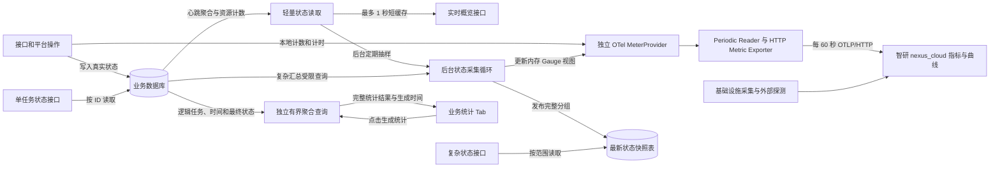

# Nexus Cloud 平台可观测性 MVP 开发设计

本文定义平台 P0 监控与业务统计的目标行为、指标口径、代码职责、生成与存储方式、查询机制和验收标准。
业务数据库提供轻量实时状态和后台汇总快照，独立 OpenTelemetry MeterProvider 经 OTLP/HTTP 向智研监控宝上报指标。
业务统计复用既有任务表，按用户选择的时间范围生成一次统计结果，用于业务展示和导出。

## 1. 目标与范围

覆盖任务从接收、准备、派发、执行，到结果交付和资源回收的完整平台链路，每个环节保留必要的高优指标。
用户能按环境和组件查看当前状态、资源量、请求量、错误率和耗时趋势。
业务统计支持最近 7 天、最近 30 天、自然月与自定义范围内的任务量、小时/日峰值、任务名称分布和成功失败数量。

设计范围：

| 项目 | 决策 |
| --- | --- |
| 关注范围 | 平台运行状态、资源占用、请求与操作结果、耗时和数据交付指标 |
| 业务状态 | 继续保存在现有数据库业务表中，作为任务与资源状态的事实来源 |
| 状态接口 | 单任务按 ID 读取；在线 Manager 和资源概览轻量实时查询；复杂汇总读取后台快照 |
| 指标与历史曲线 | 使用智研自定义监控，复用已有基础设施监控；Metrics 最长展示最近 30 天，按范围调整聚合粒度 |
| 指标出口 | 独立 OTel MeterProvider → PeriodicExportingMetricReader → OTLP/HTTP → 智研 `nexus_cloud` |
| 状态采集 | Reconciler 内独立定时循环，通过专用租约保证单个有效采集者 |
| 新增监控存储 | 一张最新快照表；不在数据库另建监控时序历史或逐请求监控明细表 |
| 业务统计入口 | System 的“业务统计” Tab；选择时间和环境后手动生成，无定时统计或页面自动刷新 |
| 业务统计存储 | 复用 Execution、Batch item 与 attempt 表，补少量字段和索引；首期不新增统计事实表、汇总表或报表任务表 |
| 任务自身属性 | 模型和工具调用、Agent 成功率、Token、评测分数暂不纳入 |
| 异常与告警功能 | 首期不做异常判定、异常列表/分级、告警入口、策略、通知和处理流程，范围后续单独确定 |

P0 表示首期需要具备的指标采集、存储、查询和展示能力。

错误率、超时数量、失联事件等指标保留，依据已有业务状态、操作结果和业务时间预算计算。
错误来源复用业务侧明确记录的错误边界和受控错误码，区分平台、任务、主动取消和未知；不新增根因推断或跨指标异常规则。
采样时间、无数据、采集失败和过期等信息用于说明数值有效性。

## 2. 整体数据流



### 2.1 执行时直接打点

接口请求和平台操作在发生时记录次数、结果和耗时。例如：

```text
请求进入：开始计时
处理请求：查询或更新业务状态
请求结束：本地记录一次请求、结果类别和耗时
OTel SDK：在内存累计计数和耗时分布
Periodic Reader：每 60 秒在后台收集并经 OTLP/HTTP 导出
```

业务请求不等待智研返回，不额外向业务数据库插入逐请求监控记录。
涉及状态变更的成功计数在事务提交成功后产生；失败尝试单独记录。
后台反复看到同一条失败记录时，不重复增加失败事件计数。

### 2.2 轻量实时读取

在线 Manager 数量、已申请/预留资源量和有效可用槽位，由固定范围的轻量查询提供。
资源额度占用按范围主键读取计数表；Manager 数量和可用槽位在数据库内聚合必要字段，不加载完整库存记录。

实时概览采用最多 1 秒的短缓存和相同请求并发合并，页面按 2 秒刷新；可用槽位可根据查询成本采用 2–5 秒刷新。
实时查询不依赖后台采集租约、快照是否初始化或智研是否可用。

### 2.3 后台生成状态快照

排队数量、容量缺口、最老等待时间和超时未回收数量，描述的是某个时间窗口内采集到的当前状态。
后台从相关业务表受限查询，发布最新快照，同时向智研上报状态值。

阶段超时、回收积压等复杂汇总通过后台快照提供。在线 Manager 和资源概览在页面实时读取，后台仍定期调用相同的
轻量查询生成监控样本，确保无人访问页面时智研曲线仍持续更新；后台直接复用查询逻辑，不调用实时 HTTP 接口。

状态采集成功后更新供 ObservableGauge 读取的内存视图，下一次 OTel 导出时发送。
ObservableGauge 回调不查数据库、不访问网络，也不触发采集。

后台不通过调用 `/v1/system/status` 采集，不扫描任务结果和 Trace 来计算请求量、错误率或耗时分布。

### 2.4 存储职责

| 数据 | 保存位置 | 用途 |
| --- | --- | --- |
| Execution、Assignment、Command、Build、Allocation 等状态 | 原有业务表 | 状态查询、调度、恢复和问题归因 |
| 环境/授权范围的资源占用计数 | 原有资源计数表 | 按主键读取已申请/预留 CPU、内存和槽位 |
| 实时概览短缓存 | 服务进程内，最多 1 秒 | 合并短时间内相同范围的重复查询 |
| 最近一次完整的后台分组汇总 | 新增最新快照表 | 复杂状态读取和后台监控采样 |
| 请求数、操作结果、耗时分布、状态指标历史 | 智研 | 趋势、分位数和数据查询 |
| 具体错误、任务 ID 和调用上下文 | 现有结构化日志及 Trace 存储 | 既有任务和日志详情查询 |
| 业务任务数量、峰值和任务名称分布 | 既有任务表按需聚合，服务进程内短期缓存 | 业务统计页面与当前结果导出 |

历史曲线沿用智研项目的保留策略。监控计数用于运行监控，不承担精确业务审计；进程异常或上报失败产生的缺报要可见。

## 3. P0 指标清单

采集方式使用以下名称：

- **直接打点**：请求或操作发生时记录次数、结果和耗时。
- **实时读取**：按范围读取资源计数或轻量聚合心跳与有效容量，用于高频概览。
- **后台快照**：定时检查数据库中的相关状态，汇总排队、容量和超时数量。
- **基础监控／外部探测**：复用容器、主机、数据库监控和入口探测。

表中的指标是看板口径，同类指标共享底层计数器或耗时分布，通过组件、阶段等固定维度区分。
标为实时读取的指标由后台另行定期抽样上报智研，不随页面访问次数重复上报范围级 Gauge。

### 3.1 接口可用性与状态查询

| 指标 | 口径 | 采集 |
| --- | --- | --- |
| 请求量及服务端错误率 | 按路由模板记录请求数和结果；5xx 数 / 已完成请求数；401、403、参数错误单列 | 直接打点：Gateway 中间件 |
| 请求耗时 P95 | 请求进入到响应完成；状态查询、提交、控制命令接口分别统计 | 直接打点：Gateway 中间件 |
| 超时与不可用 | 入口连接失败、请求超时、探测失败；与服务端完成的请求分层展示，不重复相加 | 外部探测：入口网关或外部探测 |
| 状态快照年龄 | 当前时间减数据采集时间，返回旧快照不刷新该时间 | 后台快照：快照元数据 |

单任务状态和全局状态分别设性能目标。耗时覆盖失败请求，不能只统计成功响应。
返回 200 但快照已过期，要能同时看到请求成功和数据过期。

### 3.2 平台准备与运行

准备阶段包括依赖构建、任务生成、物化、Manager 启动、Runtime 创建和 Worker 启动。

| 指标 | 口径 | 采集 |
| --- | --- | --- |
| 阶段操作次数与失败率 | 每次阶段尝试结束时记录成功、平台错误、任务错误、超时、取消、未知；分别计算 | 直接打点：对应操作边界 |
| 阶段耗时 P95 | 进入阶段到本次尝试结束，成功和失败分开；重试退避不算单次执行耗时 | 直接打点：对应操作边界 |
| 阶段超时未完成数 | 当前仍未结束且超过该阶段有效截止时间的对象数 | 后台快照：活跃阶段与截止时间 |
| 异常失联或退出数 | 承担任务的 Manager、Runtime、Worker 异常失联或退出；按异常事件记录 | 直接打点：故障确认或状态变更处 |
| 已归因的平台终态失败数 | 最终确认由平台原因导致的任务失败、丢失或超时；任务错误和未知单列 | 直接打点：最终状态提交后 |

依赖构建 `failed + next_retry_at` 是待重试失败，`ready + next_retry_at` 可能是成功后的资源回收安排。
阶段尝试失败与逻辑任务最终失败不能混算。正常停止、计划缩容和主动取消后的退出不计入实例异常。

阶段起点和截止时间优先复用现有持久化字段。缺少可靠时间字段的阶段需补最小标量字段，不能拿普通 `updated_at` 或
“最近没有日志”代替。Live 正常等待用户输入不算卡住，其超时遵循会话配置。

### 3.3 调度、容量与配额

| 指标 | 口径 | 采集 |
| --- | --- | --- |
| 待调度数量 | 已满足当前调度前置条件但尚未分配的任务数；准备中和重试退避中分别展示 | 后台快照：调度状态 |
| 最老调度等待时间 | 当前可调度队列中，进入本次可调度等待后持续最久的时间 | 后台快照：有效等待起点 |
| 控制循环距最后成功时间 | Scheduler、Reconciler、Environment Controller 正常完成循环的时间差；正常空循环也算成功 | 直接打点：循环结束时间 |
| 无有效 Owner 的分片数 | 应管理的分片中没有有效租约 Owner 的数量，区分租约组 | 后台快照：租约表 |
| 在线 Manager 数量 | 在目标环境/池中，当前有效会话满足心跳健康窗口且未被 fencing 的 Manager 数量 | 实时读取：心跳和存活状态聚合 |
| 已申请/预留资源量 | 按环境或授权范围读取 Manager、CPU、内存、槽位等资源占用账本；保留统计范围 | 实时读取：资源计数表主键 |
| Manager 就绪缺口 | 仍有运行需求的 Allocation 中，期望数与有效就绪数的差值 | 后台快照：Allocation 和 Manager 状态 |
| 可用执行槽位 | 健康且可接任务的 Manager 容量减去有效 Assignment 预留，按环境和可匹配的池统计 | 实时读取：Manager、存活状态、Assignment 轻量聚合 |
| 容量或配额阻塞信号 | 按明确原因记录准入拒绝、调度无容量次数，结合当前排队量和等待时间判断影响 | 直接打点 + 后台快照 |

额度占用可复用现有资源计数表，但额度占用不等于物理使用量，也不等于当前实际可用槽位。
全局资源汇总只合并环境级计数，不再叠加对应授权范围计数，避免重复计算。
池级槽位与环境级额度占用分别标明范围；没有池级资源账本时，不把整环境资源量标为该池资源量。
现有 Scheduler 的 `no_capacity` 计数描述调度尝试，不能直接称为“被阻塞的独立任务数”。
使用明确拒绝/阻塞次数与队列状态联合判断；只有存在可靠任务级阻塞原因时，才展示去重后的阻塞任务数量。

### 3.4 控制操作与状态推进

| 指标 | 口径 | 采集 |
| --- | --- | --- |
| 派发确认时延 | Assignment 产生到目标执行方确认接收的时间 | 直接打点：确认处 |
| 未完成命令数量与最老等待时间 | Command 处于 pending/claimed 的数量及年龄；按命令类型区分 | 后台快照：Command 状态 |
| 停止与收尾超时数 | 已申请停止或进入 finalizing，超过相应预算仍未完成的任务数 | 后台快照：停止、收尾状态与截止时间 |
| 终态上报确认时延 | 执行方发起终态报告到收到持久化成功确认的耗时，失败或超时单列 | 直接打点：终态报告调用处 |
| Batch 子任务终态同步延迟 | 子任务持久化结束时间到 Batch item 识别该终态的时间 | 直接打点：Batch 状态同步处 |

命令被领取或标记 done 与任务已经停止是不同事实。停止是否生效，要检查任务终态及相应执行资源状态。
跨进程时间指标依赖时间同步；优先使用调用方单调时钟记录往返耗时，跨记录的业务时延用持久化时间字段计算。

### 3.5 数据交付与资源回收

| 指标 | 口径 | 采集 |
| --- | --- | --- |
| 持久化操作失败率 | Trace 写入/flush/close、结果发布、Artifact 上传分别记录操作和结果 | 直接打点：实际操作边界 |
| 持久化超时未完成数 | 超过对应发布或关闭预算，仍未确认完成的对象数 | 后台快照：发布状态；进程内积压由所属进程直接上报 |
| 数据完整性错误数 | 明确的事件丢弃、队列溢出、校验错误和无效结果引用 | 直接打点：错误确认处 |
| 已发布结果读取失败率及超时率 | 用户或已配置探测实际读取有效结果时发生的失败；过期或主动删除按业务预期单列 | 直接打点／外部探测：结果读取边界 |
| 回收超时资源数 | 已应释放、超过宽限期仍未释放的 Allocation、Builder 等资源 | 后台快照：回收状态与期限 |

结果可读取性通过实际读取和已有探测观测，首期不定时下载全部产物。若无法取得平台外对象是否真实删除的可靠证据，
仅展示控制面尚未确认释放，不能把控制面 `released` 当作独立验证物理资源已消失的证明。

### 3.6 数据库、服务进程与监控自身

| 指标 | 口径 | 采集 |
| --- | --- | --- |
| DB 操作失败/超时率、耗时 P95 | 按控制库、Trace 库及操作类别区分；连接池等待与 SQL 执行分别计时 | 直接打点：数据库访问边界 |
| DB 连接使用率 | 应用池已用/上限与数据库连接数/上限分别展示 | 直接打点／基础监控 |
| 事件循环延迟 | 按服务和循环记录调度延迟，配合最后成功时间和缺报判断 | 直接打点：本进程探测 |
| OOM、异常重启、磁盘水位 | 复用容器、主机、数据库监控，区分计划重启 | 基础监控 |
| CPU 实际利用率、内存实际使用量 | 读取容器/主机采样，保留采样时间；与数据库资源占用账本分开展示 | 基础监控 |
| 采集失败、采集耗时、快照年龄 | 按范围和指标组观察采集是否按预算完成 | 直接打点 + 后台快照 |
| 指标数据新鲜度及上报丢弃 | 展示最近上报数据时间；上报组件记录丢弃和失败 | 直接打点／基础监控 |

采集进程停止后不会继续更新自身状态，页面通过最后成功时间、样本年龄和无数据状态呈现数据有效性。

## 4. 指标口径与智研上报

### 4.1 指标组织

使用三个基本类型：事件计数、耗时分布、当前状态值。首期统一归入目标应用下已有的 `nexus_cloud` 指标组，
各服务统一调用指标入口，复用现有控制循环的采集位置和 `ControlPlaneMetrics` 接口边界。

- 计数上报分子和分母；跨实例错误率用计数求和后相除，不能平均各实例错误率。
- 耗时上报分布；跨实例、跨窗口合并分布后计算 P95，不能平均各实例 P95。
- Counter、Histogram 直连智研时使用 DELTA，只导出本周期新增量，不把累计值反复作为增量上报。
- 当前数量使用 Gauge/ObservableGauge，不能在每次采集时对 Counter 重复 add 当前数量。
- 当前状态值使用 Gauge 口径。范围级全局值只由有效采集者上报，不能把多个副本的重复全局值相加。
- 状态值从非零降为零、租约切换、分钟聚合后的新鲜度，都纳入智研接入验收。
- Metrics 窗口默认最近 1 小时，可切换最近 24 小时、7 天、30 天；最长为滚动 30 天，不表示自然月。
  显示粒度及刷新规则见 7.4.1 节，错误率展示对应窗口的分子、分母和比例。
- 没有样本显示“无样本”，没有数据或过期显示“未知/过期”，均不显示为成功率 100%。

维度仅使用受控的环境、组件、阶段、路由模板、资源类型、操作类型、结果和错误类别。
单实例健康类指标可使用平台已有实例维度；业务 ID、用户 ID、完整 URL、异常文本不作为自定义指标维度。
具体对象 ID 保存在日志、控制事件和有权限的明细接口中。

### 4.2 独立 OTel 指标出口

采用标准 OpenTelemetry Python SDK 和 `opentelemetry-exporter-otlp-proto-http`，通过智研官方 OTLP Metrics
入口直连。

```text
Counter.add / Histogram.record / 内存 ObservableGauge
    → 独立 MeterProvider
    → PeriodicExportingMetricReader
    → OTLPMetricExporter（proto.http.metric_exporter）
    → 智研 OTLP Metrics 入口 /v1/metrics
    → 应用 + 智研环境 + nexus_cloud 指标组
```

每个服务进程复用自己的平台 Metrics 生命周期，服务启动后创建，退出时关闭，不按请求或任务重复初始化。
通过 `provider.get_meter('nexus_cloud')` 创建 Meter，并显式传入需要上报的组件。
例如现有 `OpenTelemetryControlPlaneMetrics` 支持注入 Meter，可以复用其采集位置。

不调用全局 `set_meter_provider()` 抢占已有 Provider；不修改 Trace 的 Provider、Sampler 或 Exporter。
现有全局 `metrics.get_meter()` 不会自动进入独立 Provider，需要逐个接通统一入口。
`OTEL_METRICS_EXPORTER=none` 约束自动初始化路径，不会禁止显式创建的独立 Provider 导出。

### 4.3 配置与 Resource 映射

测试环境配置如下，由 Metrics 初始化入口校验并显式接线：

```yaml
metrics:
  enabled: true
  endpoint: http://opentelemetry.access.inner.monitor.zhiyan.woa.com:4318/v1/metrics
  app_mark: 21625_199057_nexus-online-service
  environment: dev
  meter_name: nexus_cloud
  export_interval_seconds: 60
  export_timeout_seconds: 5
```

该 app_mark、dev 和指标组用于测试目标，其他环境分别配置对应值。
`environment` 是智研环境名；业务任务的 Nexus Environment 另作为受控数据点维度，不混用两者。

| 配置 | OTel 接线 |
| --- | --- |
| `enabled` | 关闭时使用不产生数据的指标入口；不启动 Metrics Reader/Exporter，不影响 Trace |
| `endpoint` | 显式传给 HTTP `OTLPMetricExporter(endpoint=...)`，使用完整 `/v1/metrics` 路径 |
| `app_mark` | Resource 的字符串属性 `__zhiyan_app_mark__` |
| `environment` | Resource 的字符串属性 `__zhiyan_env__` |
| `meter_name` | `provider.get_meter(...)` 的 scope name，对应智研指标组英文名 |
| `export_interval_seconds` | 转成 Reader 的 `export_interval_millis`，60 秒即 60000 毫秒 |
| `export_timeout_seconds` | 显式传 Exporter 的 `timeout=5`，以及 Reader 的 `export_timeout_millis=5000` |

Resource 还应设置分钟级 `__zhiyan_data_grain__=60`；不设置秒级 `__zhiyan_data_type__=second`。
Resource 扩展维度默认不全量展开，只上报白名单数据点维度，避免自动加入大量进程或任务属性。
如配置 `__zhiyan_instance_mark__`，必须区分进程级指标身份和范围级快照身份。

指标名需要显式与平台注册信息对应。`meter_name` 只决定分组，不会将
`nexus.distributed.control_loop.ticks` 自动改名为已有 `control_loop_ticks`。
秒为单位的耗时统一使用 `unit='s'`；Histogram 通过 View 明确桶边界，与平台分布定义核对，
桶边界应能区分 200ms、500ms 等性能目标附近的耗时分布。

固定使用 Counter、Histogram、ObservableGauge 三种采集形式。Counter 和 Histogram 的
`preferred_temporality` 显式设为 `AggregationTemporality.DELTA`；Gauge 没有 DELTA/CUMULATIVE 时序口径。
已有 `owned_shards` 等 UpDownCounter 采集值需适配为当前绝对数量，不能机械地全部改为 DELTA。

### 4.4 查询鉴权与网络

测试目标为 `Nexus-Agent / nexus-online-service / dev / nexus_cloud`。
上报使用上述 Resource 路由字段和 Metrics 专用端点；`.env` 中的 `ZHIYAN_STAFFNAME`、`ZHIYAN_TOKEN`
用于智研 OpenAPI 查询回读，不直接作为 OTLP 上报请求头，也不写入 Resource、指标或日志。
查询凭据在本地配置或 Secret 中读取，方案不包含真实凭据内容。

Exporter 需显式使用 Metrics 自己的配置，不能意外继承全局 `OTEL_EXPORTER_OTLP_HEADERS` 中的 Trace/查询鉴权。
显式传入仅含合法 Metrics 协议头的非空字典，避免 SDK 将空 `headers={}` 回退为环境配置。
接线验收检查实际发送的请求头。

内网地址为配置中的 HTTP 4318 入口。网络位置不同时按官方文档选对应入口，外网入口使用 HTTPS。
选择由实际发送指标的进程所在网络决定，不使用 Trace 的域名替代 Metrics 域名。

### 4.5 导出线程、Gauge 与故障处理

直接打点只更新 SDK 内存聚合，不执行 SQL、HTTP 请求或全量序列化。
周期 Reader 在后台线程收集和导出；ObservableGauge 回调只读短小的线程安全内存视图。
状态采集成功发布后更新该视图；失去租约的采集者停止返回范围级 Gauge，禁止重复上报多个副本的全局总数。
过期值即使仍在导出，也必须同时保留真实的采集成功时间/年龄，不能把导出时间当作状态更新时间。

Owner 切换时，范围级快照查询按最新有效来源读取；若配置稳定逻辑上报实例，其生命周期要与采集所有权一致。
进程实例诊断指标与全局快照指标分开聚合，不能对带不同 Owner 身份的同一全局值求和。
配置为 `avg` 的状态曲线表示所选窗口的平均值；当前状态按数据类别由实时查询或后台快照提供。
最老等待等峰值曲线使用窗口 `max`，不将窗口平均值标为当前最老值。

指标数量和维度组合必须有界；导出超时、重试和诊断日志同样有界。失败不改变业务结果，也不阻塞快照发布。
不额外建设发送队列或数据库逐指标重放队列，不假设 DELTA 导出在网络故障下具备 exactly-once 保证。
监控缺报与导出失败要显式可见，精确业务事实仍以数据库为准。

正常退出在整体预算内执行 `force_flush()` / `shutdown()`，避免短命测试进程等不到首个 60 秒周期就丢掉全部样本。
整体退出预算要验证，不能把多次各 5 秒调用误当作总耗时只有 5 秒。

实时概览按 2 秒刷新，短缓存最多 1 秒；后台状态采集是 30 秒一轮，OTel 导出是 60 秒一轮，各周期独立。
后台快照新鲜度目标为正常情况下不超过 60 秒；实时概览不等待这个周期。
智研曲线还包含等待导出、接入与聚合的延迟，需单独实测。
秒级曲线需要成套匹配数据粒度、平台秒级配置和导出周期，不能只调整导出间隔。

## 5. 后台状态采集任务

### 5.1 部署与职责

在 Reconciler 进程中增加独立采集循环。它只读业务状态、维护采集租约、写最新快照并更新内存 Gauge 视图，
不修改任务状态、不触发重试、不承担资源回收操作。

采集循环负责复杂汇总和持续的监控抽样；实时概览由独立的请求读取路径提供。
在线 Manager、资源量和可用槽位复用同一套轻量 Repository 查询，后台以采集周期调用，前台按实时请求调用。

使用独立租约组 `observability-snapshot`，首期一个分片。复用 `ShardLeaseCoordinator` 和现有租约表，
与业务 Scheduler/Reconciler 的租约组独立。进程使用独立会话身份，持有者失效后其他副本可接管。

租约初值：TTL 60 秒、续租间隔 10 秒、发现间隔 5 秒；接管成功立即尝试采集。
正常采集新鲜度与接管期间的数据过期分别验收。

### 5.2 每轮流程

1. 确认持有有效采集租约；未持有则等待并重试领取。
2. 按范围和指标组轮转安排工作，优先执行到期组，避免某个环境或慢组长期阻塞其他组。
3. 记录本组采集起点，执行必要的索引查询，在单组预算内得到完整结果。
4. 在短事务中校验租约归属、有效期及快照版本，原子更新这一组快照。
5. 提交成功后更新 ObservableGauge 的内存视图，等待下一个 OTel 导出周期；不等待网络上报。
6. 记录本组耗时和结果，继续剩余预算内的工作；下一轮续采尚未执行的范围。

查询期间不持有租约行锁，不开启覆盖整轮的大事务。发布时复用租约 fencing，锁冲突或租约失效则放弃本次发布。
失去租约的旧任务不能覆盖新 Owner 的快照。指标组之间允许不同采集时间，接口逐组返回时间和质量状态。

### 5.3 预算与数据库保护

| 参数 | 建议初值 |
| --- | --- |
| 采集周期 | 30 秒 |
| 采集 SQL 并发 | 1 |
| 采集专用连接池 | size=1，overflow=0，连接获取等待有上限 |
| 单条查询执行预算 | 1 秒 |
| 单组预算 | 3 秒 |
| 每轮预算 | 10 秒 |
| 正常快照新鲜度 | 60 秒以内 |

采集使用独立的少量连接额度，租约控制操作保持短小，避免监控查询占满业务连接池。
连接池隔离不等于数据库 CPU/IO 隔离，仍必须控制扫描量、频率和执行时间。

- 查询只取计数、时间等必要列，不加载完整 ORM 对象、spec、结果 JSON 和 Trace。
- 复用可靠的资源计数和 Batch 汇总；其他查询限定在明确的活跃状态或截止时间范围。
- 固定查询模板与复合索引一起验证。现有调度索引不自动保证新监控查询高效。
- `COUNT/MIN/SUM` 仍可能扫描大量记录；在聚合外加 `LIMIT` 不等于限制扫描量。
- 需要分批的范围使用稳定游标，限制每批工作量；没有完整覆盖的分组不得发布成完整总数。
- 测试环境以 `EXPLAIN ANALYZE` 和数据库指标验证实际耗时、扫描行数、排序和临时表。
- 应用超时同时配合数据库支持的语句执行上限，并验证取消后 SQL 已停止、连接可安全回收。

活跃数据量增大到预算无法覆盖时，采集明确标记过期并保留最后成功时间；针对实际超预算指标优化索引或维护增量计数。
不能为了凑齐全部指标取消查询预算，也不能把部分结果伪装成实时完整状态。

### 5.4 故障隔离

Reconciler 使用 `FIRST_EXCEPTION` 管理子任务，普通未处理异常可能导致全部循环退出。
采集循环需在自身边界处理采集、发布和上报异常，记录失败并退避；不能把采集失败传播成业务 Reconciler 故障。
正常取消和进程停止仍按生命周期退出，不能被异常重试吞掉。

一组失败不回滚其他已成功的分组。不并发补跑上一轮，不因智研失败重复扫描业务数据库。
请求错误率、操作耗时等直接打点与状态采集独立，因此采集故障不会同时切断所有监控信号。
采集者自身退出或失去租约时还要清除其范围级 Gauge 所有权，避免周期 Reader 继续导出旧 Owner 的全局值。

## 6. 最新快照表

新增一张表，建议名 `distributed_observability_snapshots`。
该表保存后台采集结果；实时概览请求不写这张表，也不为每次页面轮询持久化新的快照。

| 字段 | 语义 |
| --- | --- |
| `scope_type`、`scope_id`、`metric_group` | 联合主键；范围为全局或环境，组名为固定枚举 |
| `values_json` | 本组有界的标量汇总，不存逐任务或逐请求明细 |
| `sampled_at` | 最近一次成功采集的起点；没有完整成功样本时为空 |
| `last_attempt_at` | 最近尝试时间，失败也更新 |
| `collection_status`、`last_error_code` | 最近采集是否成功及受控错误码 |
| `version`、`publisher_id` | 并发发布防护与发布者诊断信息 |

一次成功发布原子替换本组 values 与 sampled_at；失败只更新尝试元数据，保留旧值和原采集时间。
`sampled_at` 取采集起点，保守计算新鲜度；多次读取快照不会延长其有效期。

每组表示一个短采集窗口，不能把不同组描述成全系统同一事务时刻的强一致快照。
失去租约后不再写尝试状态，避免旧 Owner 将新样本标为失败。
删除环境的快照按已删除状态清理，不能无限累积已不存在的范围。

## 7. 状态接口与看板

### 7.1 读取路径

- `/v1/system/summary` 提供在线 Manager、资源占用和有效容量等轻量实时概览。
- `/v1/environments/{environment_id}/stats` 提供指定环境及受支持池范围的轻量实时统计。
- `/v1/system/status` 提供阶段超时、控制命令、回收积压等后台快照分组，保留各组采集时间。
- 上述接口保留鉴权边界，数据只覆盖调用方有权读取的统计范围。
- 单任务状态接口提供 `summary=1` 轻量视图，按 ID 读取白名单字段；Console 状态轮询使用该视图。
- 轻量视图必须在数据库查询层选列，不能先读全部 spec/结果再在响应中删字段。
- 日志、Trace、完整结果和完整任务配置按需独立加载。
- 详细视图保留完整字段及其语义；Console 和调用方按响应契约分别使用状态、详情和结果接口。

实时与快照响应分别标明数据来源及时间。实时概览返回原查询时间和缓存年龄；后台分组返回 `sampled_at` 和采集状态。
资源计数表的 `updated_at` 表示最后一次业务变更，资源长期不变化不代表实时查询失效。

系统快照缺失、过期或部分分组失败时，返回明确的数据质量状态；采集失败不返回零值。
数据库本身不可用时采用有界超时并返回明确错误，不能声称还读到了实时数据。
上述状态接口处理请求时不触发全量重算、不请求智研、不逐个探测 Manager/Runtime。
业务统计使用 7.8 节的独立入口和查询预算，不复用状态轮询或后台采集循环。

全历史累计字段使用独立的低频或离线快照，缺失时明确返回未知；高频采集只覆盖本方案的状态指标。
“全部历史数量”与“活跃数量”使用不同字段，均不触发请求内全表聚合。

### 7.2 轻量查询与短缓存

- 在线数量直接在数据库内按有效心跳、会话和 fencing 条件聚合，不将完整 Manager 对象加载到 Python 求和。
- 资源占用按 `scope_key` 普通只读查询计数表，不调用配额写路径的 `FOR UPDATE` 方法。
- 可用槽位只聚合有效 Manager 与 pending/active Assignment 的必要列，约束环境/池范围。
- 高并发实时读取只提供索引可以支撑的固定筛选；任意标签搜索和完整库存明细单独处理。
- 全局概览采用有界查询条数的汇总，不逐个环境发起 HTTP 或 N+1 数据库请求。
- 固定查询模板验证执行计划、扫描行数和耗时；不能仅把完整库存接口的轮询频率调高。

相同范围请求使用最多 1 秒短缓存，并发缓存未命中只触发一次查询。缓存键包含接口、环境/池筛选和有效授权范围，
读取缓存前完成权限校验。缓存键数量和查询并发有界，避免大量不同筛选放大数据库负载。

缓存与并发合并在服务进程内生效；多副本仍可能分别查询，性能验收必须包含实际副本数和多种统计范围。
缓存过期后允许执行预算内的轻量实时查询。查询失败时若返回上次成功值，必须标记过期并保留原查询时间；
不能把 30 秒后台快照静默当成实时结果。

### 7.3 页面刷新与数据源时效

| 页面分区或数据 | 读取来源 | 刷新/采集周期 |
| --- | --- | --- |
| System 总览、环境详情的在线 Manager 卡片 | 轻量实时概览 | 页面 2 秒，短缓存最多 1 秒 |
| 已申请/预留 CPU、内存、槽位 | 资源计数表 | 页面 2 秒，短缓存最多 1 秒 |
| 实际可接任务的槽位 | 健康 Manager 与有效预留聚合 | 页面 2–5 秒 |
| 阶段超时、停止/收尾、回收积压等复杂汇总 | 后台快照 | 后台 30 秒；页面 30 秒 |
| CPU 实际利用率、内存实际使用量 | 容器/主机监控 | 遵循采集源周期并显示采样时间 |
| Metrics 最近 1 小时 / 24 小时 | 智研，1 分钟聚合 | OTel 每 60 秒导出；页面每 60 秒刷新 |
| Metrics 最近 7 天 / 30 天 | 智研，分别按 30 分钟 / 1 小时聚合 | OTel 仍每 60 秒导出；页面每 5 分钟刷新 |
| 业务统计 Tab 的数量、分布和峰值 | 既有任务表的有界聚合 | 仅点击“生成统计”时查询；缓存过期、切换 Tab 和修改筛选均不自动触发 |

实时概览和复杂统计分区独立请求、渲染和处理错误，实时卡片不等待其他分区完成。
页面不可见时暂停轮询；同一分区的前一次请求尚未完成时，不叠加启动下一次请求。

在线 Manager 的实时性受心跳源约束。配置默认心跳间隔为 5 秒，健康窗口为 15 秒，运行时按有效配置判断。
2 秒页面刷新能及时反映数据库变化，但不表示实例失联后 2 秒内必定判离线。
查询时间、缓存年龄、心跳更新时间和健康窗口分别表达，不以页面刷新频率替代源数据时效。

### 7.4 看板与数据查看

System 保留 `Observability`、`业务统计`、`Configuration` 三个 Tab，默认打开 Observability。
切换 Tab 保留各自筛选、已生成结果和配置草稿；只有 Observability 激活且页面可见时执行其轮询。

总览展示接口可用性、平台失败、排队与容量、准备与控制、结果交付与回收。
每组展示数据更新时间；历史趋势由独立的智研页面或独立加载的趋势模块提供，不阻塞状态卡片。

页面展示数值、计数、比例和趋势，保留环境、组件、阶段、错误类别和时间范围筛选。
具体任务、资源和日志沿用既有授权详情入口，不增加独立异常榜单或故障处理页面。
明细查询限制范围和返回条数，采用游标分页；查不到具体对象时不虚构任务关联。
无样本不计算为 0% 错误或 100% 成功；数据质量状态与业务状态分别展示。

#### 7.4.1 Metrics 最长 30 天与分级聚合

Metrics 的 `Time range` 提供以下固定选项，所有核心趋势和已展开的详情共享选定范围：

| 选项 | 接口 `hours` | 每个点的聚合跨度 | 约点数 | 页面刷新周期 |
| --- | --- | --- | --- | --- |
| 最近 1 小时 | `1` | 1 分钟 | 60 | 60 秒 |
| 最近 24 小时 | `24` | 1 分钟 | 1,440 | 60 秒 |
| 最近 7 天 | `168` | 30 分钟 | 336 | 5 分钟 |
| 最近 30 天 | `720` | 1 小时 | 720 | 5 分钟 |

约点数不含接口约定的边界点，返回点数上限按实际范围和粒度计算，禁止静默截断曲线。
7 天/30 天按完整半小时/小时桶查询：截止时间向下对齐到最近的桶边界，再向前取完整 7 天/30 天。
界面显示实际起止时间；接口另返回 `requested_window_end` 说明点击时刻与完整桶截止时间的差异，不包含当前未完成桶。
该对齐避免老数据自动降低分辨率后，月窗口首部仍请求不可用的分钟级数据；不按比例拆分历史桶，也不混用分钟 P95 补齐小时桶。
月份趋势仍读取智研历史，不新增数据库监控历史表，不扩大业务统计接口的职责。
显示粒度改变不改变源端分钟级采样或 OTel 每 60 秒导出周期；Live 和 Snapshot 的刷新频率保持各自规则。
页面显示实际时间范围、北京时间标签、聚合跨度、最新样本时间和查询时间；P95 卡片从“最新分钟 P95”改为对应桶的描述。

**聚合语义：**

- Counter 按时间桶合并增量计数；区间总数为各个不重叠桶计数之和，不把累计值重复相加。
- 错误率按同一桶的失败数 / 操作总数计算，整个窗口按分子分母分别求和后计算；不平均分钟错误率。
  分子分母覆盖不一致或分母为零时，保留缺失/无操作语义，不展示伪造的零错误率。
- Gauge 沿用每个指标声明的时间聚合语义，平均值、最大值等必须在元数据和页面中明确。
  不因切换到月视图就静默改变平均/最大值口径，数量类 Gauge 不按分钟求和变成累计量。
- P95 必须合并桶内原始 Histogram 分布后重新计算，包括跨实例合并。
  不能平均、相加或直接取分钟 P95 的最大值来冒充小时 P95；智研当前引擎不支持所需分布聚合时，明确显示不支持。
- Metrics 使用已对齐的完整桶，边界点只用于关闭时间轴、不计入数量；桶外样本不得计入实际返回范围。
  空值与真实零值保持区别，缺失区间不插值连接，也不补零掩盖未上报或已过保留期。

**查询与图表改动：**

- `/v1/system/metrics` 的路由校验、历史读取器和前端选项同步支持 `hours=1/24/168/720`，拒绝超过 30 天的 Metrics 范围。
- 后端按范围选择聚合参数，响应返回实际 `granularity_seconds`、窗口和桶边界、指标聚合方式及数据质量状态。
  现有固定 `gap=1`、`granularity_seconds=60` 和按分钟估算的响应点数限制必须一起调整。
- 图表根据响应粒度和真实时间戳定位点与缺口，移除“固定 60 秒步长、最多 1,441 个分钟点”的假设。
  一个月曲线必须覆盖完整返回窗口，悬停、图例与最新值不能误标为分钟样本。
- 查询只覆盖核心指标和已展开详情；折叠组不发请求。保留前端最多 3 个指标请求并发及服务端总上游并发上限，
  分段查询不能在每个请求内部再放大为无限并发。
- 切换范围取消旧请求并清理旧范围结果；迟到响应不得覆盖新范围。长区间查询独立于 Live 和 Snapshot，慢查询不阻塞它们。

**分段、缓存与数据保留：**

- 实施时验证当前智研项目、指标组和存储引擎的单次查询跨度、分钟/小时数据保留期及分布聚合能力，不能从其他项目或
  MCP 工具限制推断当前 OpenAPI 的全部能力，也不能因为选择器支持 30 天就声称已有完整 30 天历史。
- 需要分段时使用后端有界分段，边界按目标桶对齐；跨段边界点去重，不遗漏也不重复累计。
  部分分段失败须标注缺失范围，保留旧完整结果或显示不完整状态，不能把其余分段当成完整总数或完整窗口错误率。
- 复用已结束时段的分段缓存，最近时段按相应页面周期重新查询。短范围响应缓存不超过 60 秒，长范围响应缓存不超过 5 分钟；
  已结束分段也要为迟到数据保留有界重验，不能将无样本段或查询失败段永久冻结。
- 缓存键包含项目、应用、数据环境、指标/视图、业务环境筛选、授权范围、时间段、粒度和聚合定义。
  缓存容量、上游请求总数、响应字节数与单轮总预算均有上限，缓存命中保留原查询/采样时间。
- 长区间冷查询按面板独立加载，建议单面板总预算 5 秒、六张核心图首轮预算 15 秒，前端等待上限与后端预算配套；
  分段数量不能成为逐段重新获得完整超时预算的理由。短范围保留原有性能目标。
- 新上线、未启用、未上报和超出已核验保留期的区间明确区分。只有部分历史可查时显示实际覆盖情况，不向前补造历史。
  上游不能提供某种粒度时明确提示能力边界，不通过前端加工已经计算好的分位数伪造支持。

### 7.5 业务统计 Tab 与交互

业务统计用于展示一段时间内的任务使用量和产出，使用数据库中的任务事实，不使用智研 Counter 或监控快照拼接业务总数。
进入页面时只展示筛选和已有结果；用户点击“生成统计”后，执行一次有界查询，成功后整份替换结果。

| 区域 | 内容 |
| --- | --- |
| 筛选 | 最近 7 天、最近 30 天、自然月、自定义起止时间；环境；任务类型；完整 `task_name` |
| 时间口径 | 默认“完成量”；可切换“提交量”“首次开始执行量”，含义见 7.6 节 |
| 概览 | 范围内任务总数、成功数、失败数、取消数、未结束数、执行成功率；完成量口径的未结束数为零 |
| 任务量趋势 | 按小时或按天展示数量，按成功、失败、取消、未结束分类，所有图表使用同一任务集合 |
| 峰值 | 小时任务量峰值和日任务量峰值、对应时段；返回最早峰值时段及并列时段数 |
| 任务分布 | `task_name` Top 10、其他和未知名称；明细表提供名称、数量、占比、成功失败数量与执行成功率 |
| 结果说明 | 实际筛选范围、北京时间边界、时间口径、生成时间、数据完整性和缓存来源 |
| 导出 | 导出当前已生成的统计结果及口径元数据，不因导出重新查询或读取逐任务结果文件 |

- 修改筛选条件只更新表单，旧结果仍标注原条件，并提示“条件已变更，请生成统计”。
- 生成期间禁用重复提交，允许取消；请求失败或取消不以零值覆盖旧结果，保留旧结果的生成时间和条件。
- 切换 Tab、页面隐藏或离开时取消未完成请求；返回后保留已成功生成的结果，不自动重试或重算。
- 图表小时/天切换、表格排序和本地分页使用同一份已生成数据，不触发新统计。
- 刷新入口在业务统计 Tab 激活时只显式生成当前条件的业务统计，不触发其他 Tab 请求。
- 按钮、下拉框、加载、禁用、悬停和键盘焦点状态沿用 Console 的统一样式。

### 7.6 业务任务、时间与成功率口径

**计数单位为逻辑任务。** 独立 Single 和 Live 按 `execution_id` 计数；Batch 按
`(parent_execution_id, item_id)` 计数，父级编排 Execution 不计入业务任务总数。
Batch 自动重试产生的新子 Execution、同一 Execution 的 Assignment 重试均不增加逻辑任务数。
用户另行提交的新任务或新 Batch 属于新的业务任务；同一幂等请求命中既有记录时不重复计数。
Live 一次会话计一个任务，不按交互轮次计数；任务类型筛选可单独排除或查看 Live。

| `basis` | 时间字段 | 任务集合 |
| --- | --- | --- |
| `finished`，默认完成量 | 逻辑任务最终结束时间 | 区间内最终结束的任务，包含成功、失败和取消；重试中的暂时失败不算最终结束 |
| `created`，提交量 | Single/Live 的 `created_at`；Batch item 的 `created_at` | 区间内已建立持久化记录的逻辑任务；Batch 以 item 物化入库时间计算，不按父 Batch 创建时间展开全部子项 |
| `started`，首次开始执行量 | Single/Live 的 `started_at`；Batch item 的首次开始时间 | 区间内第一次实际进入 running 的逻辑任务；重试不改变首次开始时间 |

仅选择时间字段落在 `[start_at, end_at)` 内的任务。未物化的 Batch 计划数量不作为已提交任务；未开始任务不计入执行量。
最近 7 天和最近 30 天在点击时解析为明确起止时刻；自然月按北京时间月初至下月月初，当前月截至本次查询时刻。
自定义范围首期最多 31 天，禁止“全部历史”无界查询。接口接收带时区时间，内部使用 UTC，按 `Asia/Shanghai` 划分小时和日期。

总量、状态分布、趋势、峰值、名称分布均基于同一 `basis`、筛选和一致性读取视图。
对提交量和执行量，状态表示本次查询时看到的任务状态，不表示任务在区间结束时的历史状态。
例如区间内提交、区间外完成的任务，按提交量查询时可以显示为成功；本期不提供“回到过去某时刻”的状态重建。

| 展示项 | 定义 |
| --- | --- |
| 成功 | 逻辑任务最终状态为 `succeeded` |
| 失败 | 最终状态为 `failed`、`lost`、`expired`，同时保留原始状态分项 |
| 取消 | 最终状态为 `killed` 或 `cancelled` |
| 未结束 | 所有非终态任务，包含排队、运行、等待输入和仍可重试的任务 |
| 执行成功率 | `成功 / (成功 + 失败)`；取消和未结束不进入分母，分母为零时返回 `null` 并显示“无已判定任务” |
| 名称占比 | 该完整 `task_name` 对应任务数 / 当前集合任务总数，未知名称也计入总数 |
| 小时/日峰值 | 当前时间口径下，区间内自然小时/自然日桶的最大任务数；表示吞吐量，不表示同时运行的并发数 |

总数必须等于成功、失败、取消、未结束四类之和。执行成功率不等同于 Agent 或评测的业务成功率，本期不读取
`agent_output.success`、评测分数或 Trace 内容推断业务成功。
时间桶覆盖完整查询区间；在数据覆盖完整的前提下补零，首尾不足一小时/一天的桶标记为不完整时段。
空集合返回任务数零、成功率空、峰值零且发生时段空，不虚构峰值发生时间。

`task_name` 是配置中的任务注册名，按完整原值分组，例如 `identity`、`cua_gym`、`harbor_bridge_task`。
运行和自动重试不追加名称后缀；不得统一删除 `_task`、下划线、连字符或末尾数字。
业务自行拼接的动态名称也保留原值；名称归一化或业务分类映射需要另行定义显式规则，不在本期隐式推断。
未知名称作为独立分组，不与名为 `unknown` 的合法任务混同，不丢弃、不归入“其他”掩盖缺失。

### 7.7 复用既有表与最小字段变更

首期不新增统计事实表、小时/日汇总表或持久化报表任务表。
既有状态仍是唯一事实来源，统计字段在业务状态写入事务中维护，不增加轮询全表同步任务。

| 既有表 | 复用字段与职责 | 拟补充字段 |
| --- | --- | --- |
| `executions` | 独立任务的身份、环境、所有者、状态及 `created_at`、`started_at`、`finished_at`；关联 Batch 父级权限和环境 | 可空 `task_name` 标量列，保存完整注册名 |
| `distributed_batch_items` | 逻辑子任务主键、当前状态、创建时间、当前子 Execution 和 attempt 编号 | 可空 `task_name`、`first_started_at`、`finished_at` |
| `distributed_batch_item_attempts` | 各次子任务尝试的状态、开始/结束时间与 Execution 关联；用于时间回填和重试核验 | 默认不加统计字段 |
| `distributed_batch_runs` | 父级身份、所有者和 Batch 关联信息 | 默认不加统计字段 |

字段写入约束：

- Single/Live 接收规范化配置时保存 `task_name`；Batch 物化 item 时从该 item 的有效配置保存名称。
  不把父级编排任务名、item ID、run ID 或生成器名称当成子任务的 `task_name`。
- Batch 的输入可能只通过 `run_input_ref` 引用，原始 Task Store 记录会在完成后清理。
  因此名称必须在输入仍可读时写入独立列，不能依赖月度查询时重新解析输入，也不覆盖用户自定义 `metadata_json`。
- Batch item 首次实际 running 时维护 `first_started_at`，取所有尝试的最早真实开始时间。
  协调循环可能直接发现已经终态的子任务，仍须从尝试记录保留起点，不能要求采样恰好看到 running。
- item 进入不可再自动重试的终态时写入 `finished_at`；有子 Execution 时使用最终尝试的真实结束时间。
  尚未创建子 Execution 就取消/过期的 item，使用业务事务确认其终态的时间；不得用父 Batch 的完成时间代替。
- 自动重试中的失败不留下逻辑终态结束时间；重复事件、重试恢复和旧 attempt 回报不得覆盖正确的名称与时间。
- 不通过逐条读取结果 Artifact 或 Trace 获取这些字段；字段写入保持有界，并与既有状态版本/fencing 检查一致。

按实际筛选设计时间前导索引：独立任务按选定时间列扫描，环境筛选考虑 `(environment_id, 时间列, execution_id)`；
Batch item 考虑 `(时间列, parent_execution_id, item_id)`，再关联父级环境与权限。
这是待执行计划验证的候选结构，不机械添加所有组合，也不将全部字段堆成宽索引。
使用必要标量列和数据库聚合，不加载完整 ORM、spec、结果 JSON；仅为兼容回填读取旧配置。

### 7.8 按需接口、缓存与查询保护

拟新增只读接口 `GET /v1/system/business-statistics`，与实时概览、状态快照和智研历史查询独立。
请求参数包含带时区的 `start_at`、`end_at`、`basis`，以及可选的环境、任务类型和完整 `task_name`。
页面每次点击解析并冻结这些条件；一次请求返回概览、小时/日桶、峰值、名称分布和数据质量信息。

响应至少包含：

- `definition_version`、规范化的 `filters`、`timezone`、`generated_at`、`cache_age_seconds`。
- `summary`：总量、四类状态数量、原始状态分项、成功率分子/分母/比例。
- `hourly`、`daily`、`peaks`：有界时间桶、首尾时段完整性、峰值与发生时段。
- `task_names`：完整名称分组、未知名称、Top 10 与其他的汇总；“其他”不能遮蔽明细是否完整。
- `coverage`：时间和名称覆盖情况、无法判定时间归属的记录数、已核验的数据范围及不完整原因。

计数和分布使用同一次有界只读一致性视图；`generated_at` 表示该次统计读取的起点，缓存命中不改写它。
初始缓存 TTL 建议 5 分钟，只缓存完整成功结果；缓存键包含全部筛选、时区、定义版本和有效授权范围。
权限检查在读取缓存前完成，权限变更不得因缓存复用扩大可见范围。
同进程内同条件请求合并；缓存容量和单份结果大小有界，缓存过期只影响下一次点击，不触发自动计算。

首期在请求内完成有界聚合，不创建持久化任务队列；进程重启后用户可再次点击生成。
如实际数据验证无法在预算内完成月度统计，先调整查询和索引，再单独评审汇总表或异步报表任务，不静默改变架构。

| 查询保护项 | 建议初值与行为 |
| --- | --- |
| 最大时间范围 | 31 天；拒绝无起止时间和越界范围 |
| 统计连接池 | 与业务写入、Live 和 Snapshot 连接池独立；size=1，overflow=0 |
| 单 SQL / 整份结果预算 | 8 秒 / 15 秒；前端请求超时 20 秒，单 SQL 预算按三倍月度数据实测调整 |
| 统计并发与等待 | 每进程最多 1 次计算，等待有界；超额返回明确繁忙状态，不积压无限队列 |
| 输出大小 | 时间桶不超过范围内小时数/天数；名称分组和总字节数设上限，超限明确提示缩小范围，不静默截断完整统计 |
| 取消与错误 | 取消后验证 SQL 停止、只读事务结束、连接可回收；失败不缓存为成功，不返回部分总数或零值 |

连接池隔离不等于数据库资源隔离；有可用只读副本时可配置统计读取源，并明确其数据延迟。
多副本实例的合计并发必须纳入验收，不能将“每进程 1 次”描述为全服务只有一次查询。
复用 System 管理员鉴权；环境、所有者和任务类型约束在数据库查询中生效，不能依赖前端过滤。
未来开放给非管理员时需要额外定义授权范围与缓存隔离，本期不顺带扩大权限。

### 7.9 历史回填、完整性与升级

新增列初始可空，分批、可断点续跑地回填，控制批次、频率和锁持有时间；页面查询不触发回填。
优先从仍存在的规范化配置、Task Store/任务列表和 attempt 时间恢复字段，并验证逻辑 item 与输入的身份关联。
不执行用户 Task、不重新运行任务生成器，也不以结果文件批量解析代替字段回填。
回填不能覆盖业务事务已写入的有效值；滚动发布期间允许旧实例暂时不写新增字段，但必须在切换统计可用状态前核对覆盖情况。

历史输入已删除且没有可靠来源时，`task_name` 保持空并显示未知名称及名称覆盖率；不能猜测或从随机 ID 截取名称。
最终结束/首次开始时间无法恢复时，不使用 `updated_at` 或父级时间冒充。
没有时间就无法证明记录是否属于所选区间，因此报告中的缺失时间数量须注明其已知环境/类型等范围，不能谎称是“区间内漏了 N 条”。
相关缺口可能影响所选区间总量或峰值时，标记结果不完整、说明覆盖边界；数据恢复前不对外宣称完整的 7 天/月度统计。
在同一已核验集合中只有名称缺失时，总量和状态计数仍可准确，名称分布单独注明覆盖率。

迁移采用新增可空列与经过验证的索引，保留既有业务表和状态语义；不删除历史任务或原始输入来完成迁移。
回滚可先关闭业务统计入口并回退代码，新增列与索引保留，后续再评估是否移除；不在回滚时丢弃已采集的统计字段。

## 8. 实施范围与验收

### 8.1 交付内容

1. 统一的平台指标入口、独立 MeterProvider、Periodic Reader 与 HTTP Metric Exporter，显式接通受控 P0 埋点。
2. 一张最新快照表、短事务发布逻辑和独立采集租约组。
3. Reconciler 内受限、可停止、异常隔离的采集循环；必要的索引及缺失时间标量字段。
4. 轻量实时概览、复杂状态快照读取、单任务轻量轮询视图，以及 Console 各分区刷新和新鲜度展示。
5. 一张指标总览、分组数据视图和最长最近 30 天的 Metrics 曲线；分级聚合、图表时间轴、分段查询与有界缓存。
6. System“业务统计” Tab、按需聚合接口、结果导出、独立查询预算和授权范围内的短期缓存。
7. 既有 Execution/Batch item 的最小字段与索引迁移、事务内字段维护、受限历史回填及覆盖率说明。

先在 `dev / nexus_cloud` 中使用明确隔离的测试维度，验通请求计数、耗时分布和一个状态 Gauge，
再扩展全部 P0 采集组。记录准确测试时间窗口、目标指标与预期数量，避免与真实业务流量混算。
检查 OTLP 返回的错误或 partial_success 信息，并使用 OpenAPI/智研页面回读实际数据；HTTP 200 或端口可达不作为验收完成。
业务接口不能因监控组件尚未就绪而无法启动；监控未就绪必须显式可见。

### 8.2 验收标准

| 验收项 | 要求 |
| --- | --- |
| 全链路覆盖 | 每个 P0 组都有真实采集来源、明确缺失语义和可检查的故障样例 |
| 指标口径 | 错误率使用分子/分母；分位数使用分布；重试、取消、任务错误和平台错误不混算 |
| Provider 隔离 | 现有 Trace 配置和全局 MeterProvider 不变；业务埋点确实使用独立平台 Meter；关闭 Metrics 后不导出 |
| 配置生效 | Resource、scope、endpoint、60 秒周期及两处 5 秒超时在实际请求/导出行为中验证 |
| 单任务状态性能 | 服务端 P95 <= 200ms；测量包含必要鉴权和读取，不含日志/结果下载 |
| 系统状态性能 | 实时概览与复杂快照接口分别满足服务端 P95 <= 500ms；最近 24 小时趋势独立查询 P95 <= 1s |
| Metrics 长区间性能 | 7 天/30 天验证冷查询与分段/响应缓存命中、核心图与展开详情、实际服务副本数；单面板与首轮预算生效，Live/Snapshot 不等待长查询 |
| Metrics 时间轴与粒度 | 1 小时、24 小时、7 天、30 天分别按约定粒度覆盖完整窗口；完整桶截止时间、边界点、缺口、日期标签与悬停准确，超过 30 天被拒绝 |
| Metrics 聚合正确性 | 桶内/整窗 Counter 与错误率对照原始计数；Gauge 不错误累加或改变语义；分布合并后的 P95 与已知样本一致，禁止平均分钟 P95 |
| Metrics 分段与保留期 | 核验当前项目及引擎保留策略；跨段不重复/漏计、失败段不伪装完整；迟到数据可更新缓存，历史不足不补零或伪造样本 |
| Metrics 轮询隔离 | 1 小时/24 小时每分钟、7 天/30 天每 5 分钟刷新；折叠、隐藏页面和非激活 Tab 不查询，取消和迟到响应不串范围 |
| 规模与并发 | 当前等量及 3 倍历史数据，20 个查看者按 2 秒轮询实时概览；覆盖实际服务副本数、相同/不同环境及无缓存情况 |
| 活跃规模 | 独立增加健康/历史 Manager 和有效 Assignment 数，验证实时聚合扫描量、槽位口径及后台采集预算 |
| 故障时读取 | 覆盖重启、无初始快照、短缓存失效、单组超时和智研不可用；实时卡片不等待慢分区，降级保留来源和时间 |
| 采集性能 | 单 SQL、单组、整轮预算生效；取消后的 SQL 与连接均可验证；范围轮转无长期饥饿 |
| 业务影响 | 同负载开关监控对照，提交/调度关键接口 P95 劣化 <= 5%，无业务连接池耗尽 |
| 数据新鲜度 | 实时短缓存 <= 1 秒；页面、心跳源和健康窗口分别验证；后台快照正常各组 <= 60 秒；智研延迟独立实测 |
| 资源统计正确性 | 在线数量符合有效会话和心跳规则；环境/授权计数不重复相加；预留、可用槽位与实际 CPU/内存不混算 |
| 发布一致性 | 采集中租约丢失、旧 Owner 恢复、事务失败都不能覆盖新样本或发布部分计数 |
| 故障隔离 | 采集 SQL、解析、SDK 异常不终止业务协调循环；正常停止不会被重试吞掉 |
| 上报真实性 | 回读精确测试范围内数据；跨周期 Counter 不累计重报，Histogram 分布正确，Gauge 下降到零与 Owner 切换不重复 |
| 鉴权隔离 | 查询 Token 仅用于回读；OTLP 请求不携带无关 Trace/查询鉴权，凭据不进入日志与指标 |
| 指标样本正确性 | 使用已知成功、失败、超时和采集过期样本，对照业务事实验证数值、时间和数据质量状态 |
| 展示范围 | 展示数值、曲线、业务状态和数据质量信息；不新增异常评级、告警入口或通知流程 |
| 业务统计触发 | 初次打开、修改筛选、Tab 切换、缓存过期均不自动统计；一次点击只启动一次计算，重复提交受限，导出与本地切换不重算 |
| 业务任务去重 | Single、Live、Batch 混合样例；Batch 父级不计数，多次自动重试和幂等重复提交仍各计一个逻辑任务，新提交另计 |
| 业务时间口径 | 验证提交/首次开始/最终结束、跨小时/跨日/跨月与右开边界、首尾部分时段；重试恢复、未开始取消和历史时间缺失不伪造归属 |
| 业务数字一致性 | 总量等于四类状态之和及时间桶之和；名称 Top 10、其他、未知相加等于总量；小时/日峰值含并列时段，空集合和零分母正确 |
| 任务名称正确性 | 完整注册名原样持久化；`_task`、下划线、连字符和数字后缀不被截断；Task Store 清理后仍可统计，未知名称独立显示 |
| 回填与状态一致性 | 回填可恢复、幂等且不覆盖新写入；旧 attempt、重复事件、回滚与协调漏看 running 不破坏时间和状态；缺口可解释且不伪装完整 |
| 业务统计性能 | 当前月度等量及 3 倍规模、全局/环境/名称筛选、实际副本数和冷/热缓存；验证扫描行数、临时表和查询预算，提交/调度及 Live P95 劣化 <= 5% |
| 业务统计隔离 | 统计失败/取消不影响状态轮询，查询停止和连接回收可验证；权限撤销后缓存不泄漏；同一结果多区块与导出保持条件及生成时间一致 |

在测试环境使用可控数据完成 SQL 计划、性能和故障注入验收，部署验收检查实际运行配置。
部署交付包括目标环境、迁移、镜像、配置和回滚步骤。

## 9. 代码入口与参考

- [系统状态接口](../../nexus/distributed/gateways/control/routes/operations.py)：实时概览、复杂快照和数据新鲜度入口。
- [环境状态接口](../../nexus/distributed/gateways/control/routes/environments.py)与[环境库存查询](../../nexus/distributed/repositories/environment.py)：环境/池范围的轻量聚合。
- [资源计数读取](../../nexus/distributed/repositories/quota.py)与[Manager 存活规则](../../nexus/distributed/instance_manager/liveness.py)：预留资源和在线判定口径。
- [分布式配置](../../nexus/distributed/config/model.py)：心跳间隔、健康窗口和相关预算。
- [执行状态接口](../../nexus/distributed/gateways/control/routes/executions.py)：单任务轻量视图和详情查询入口。
- [执行阶段投影](../../nexus/distributed/execution/phase.py)：阶段和依赖重试语义。
- [控制循环指标](../../nexus/distributed/observability/metrics.py)：次数、耗时、循环延迟等采集接口。
- [Reconciler 生命周期](../../nexus/distributed/control_plane/reconciler.py)：采集新增循环要与现有异常传播机制隔离。
- [租约协调](../../nexus/distributed/control_plane/leases.py)与[租约 fencing](../../nexus/distributed/repositories/shard_lease.py)：
  复用所有权、续租和发布校验能力。
- [业务表与索引](../../nexus/distributed/persistence/orm.py)、[数据库连接配置](../../nexus/distributed/persistence/db.py)：
  复用已有状态、计数和时间字段，新增查询仍需单独验证计划。
- [Batch item/attempt 状态与重试](../../nexus/distributed/repositories/batch.py)、[Manager 开始执行记录](../../nexus/distributed/repositories/manager.py)：
  业务统计的逻辑任务去重、首次开始和最终结束时间维护入口。
- [Batch 输入物化](../../nexus/distributed/batch/materialize.py)、[Task Store](../../nexus/distributed/batch/task_store.py)与
  [Batch 生命周期](../../nexus/distributed/batch/lifecycle.py)：在输入清理前保留完整任务注册名，明确历史回填边界。
- [OTel 初始化](../../nexus/utils/otel/auto.py)：全局自动初始化与独立平台 MeterProvider 的配置边界。
- [智研自定义监控接入管理](https://iwiki.woa.com/p/4018403963)。
- [智研对接 OpenTelemetry 使用手册](https://iwiki.woa.com/p/4007004639)：Resource、scope、DELTA 和 Metrics 入口。
- [智研查询聚合说明](https://iwiki.woa.com/p/4006995851)：聚合函数、分布分位数及不同引擎的能力边界。
- [智研 OpenAPI 鉴权说明](https://iwiki.woa.com/p/268627573)：查询回读的 Token、项目与人员信息。
- [MySQL EXPLAIN 说明](https://dev.mysql.com/doc/refman/8.0/en/explain.html)。

## 10. Console 的 Run 与资源导航

Runs 统一展示顶层 Single、Live、Batch，类型筛选在服务端执行。Batch 详情沿用 Run 的状态、日志、配置和资源页签，
Subtasks 展示逻辑任务及其 attempt；child execution 不再作为顶层 Run 重复列出。旧 `/batches` 和 item 深链接继续解析到
对应 Run。列表筛选、cursor、详情页签和选中 item 写入 URL；跨实体链接通过 `return_to` 保存来源，分页历史按登录人隔离。

Build 是可以被多个 Run / Allocation 复用的依赖资源。日常入口在 Run 的 Preparation and resources，管理员的全局入口为
Infrastructure → Advanced · Builds。Build 详情分别读取 metadata、logs、usage，日志过期不影响构建状态和重试时间展示。
`failed + next_retry_at` 表示等待重试，`ready + next_retry_at` 表示等待清理。

Infrastructure 的 Manager 汇总来自 `/v1/managers/summary` 的范围聚合，与当前页条数分开显示。健康、容量、预留槽位统一
按当前 manager session 计算；Healthy 包含仍在线的 draining manager，Accepting work 排除 draining。Environment、pool、
workload、allocation 和状态筛选先于分页执行。`/v1/manager-pools` 提供范围内的池名前缀查询，不依赖当前页。

可见页面刷新间隔：Runs / Infrastructure 为 10 秒；活跃普通 Run 为 3 秒、Batch 父级为 10 秒；Batch 当前页和打开的 item 为
5 秒；Build 请求中 / 构建中为 3 秒、等待重试为 10 秒。切换查询范围会取消旧请求并清除不属于新范围的数据；同范围失败显示
保留数据及更新时间。隐藏页面暂停轮询。Manager 日志请求携带 session 身份，旧 session 的日志和操作返回冲突。

Allocation 详情对拥有 `execution:read` 及对应环境授权的所有者和 Shared Access 用户开放，运维细节仅管理员可见。
全局 Allocation 列表和 Force Cleanup 仍仅管理员可用。清理确认显示 Run、环境、当前状态和 active assignment 数，携带
`expected_version` 防止对已改变的状态执行操作；成功响应表示进入异步 draining，不表示资源已经释放。

Batch 详情的一级导航为 Main / Subtasks。Main 内提供 Overview、Logs、Events、Runtime、Resources、Spec / Result；Events 展示控制事件日志，
Events 与 Runtime 直接与 Logs 同排显示；Live Events 只在 Live Run 提供入口。`view=subtasks` 可与 Main 的 `tab` 同时保存在 URL，切换视图保留
子任务筛选、cursor 和选中项。桌面子任务详情为随滚动保持可见的侧栏；窄屏显示在列表前并定位到选中的详情。

请求刷新信息统一收敛到页头的小型状态提示，成功读取不再向正文插入 Updated 行；局部失败仍在对应区域标明旧数据及其
成功读取时间。记录本身的 State updated 与请求刷新时间分开。Rows per page 与分页按钮放在表尾。Overview 展示常用信息、
子任务进度及准备状态摘要，完整资源表在 Resources，调度字段默认折叠。资源 ID 使用一致的缩写、完整值提示及复制按钮。

Console 的共享外观由 `console/src/glassTheme.css` 定义，在入口统一加载。浅色玻璃主题使用柔和蓝绿色背景、半透明面板、
统一工具栏和表单控件；文字及表格行本身不设置透明度。模糊仅放在主要容器和浮层上，避免每个单元格重复合成。
成功、失败和告警保留独立语义色，日志使用高对比度深色阅读面。减少透明度、增强对比度和减少动态效果的系统偏好均有适配；
不支持 backdrop-filter 的浏览器使用不透明底色。视觉参考为 Apple 的 [macOS Golden Gate / Liquid Glass](https://www.apple.com/os/macos/)。
