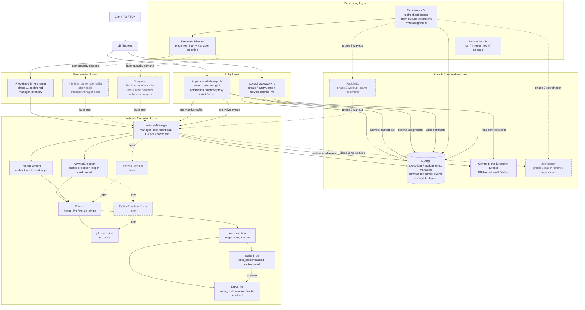
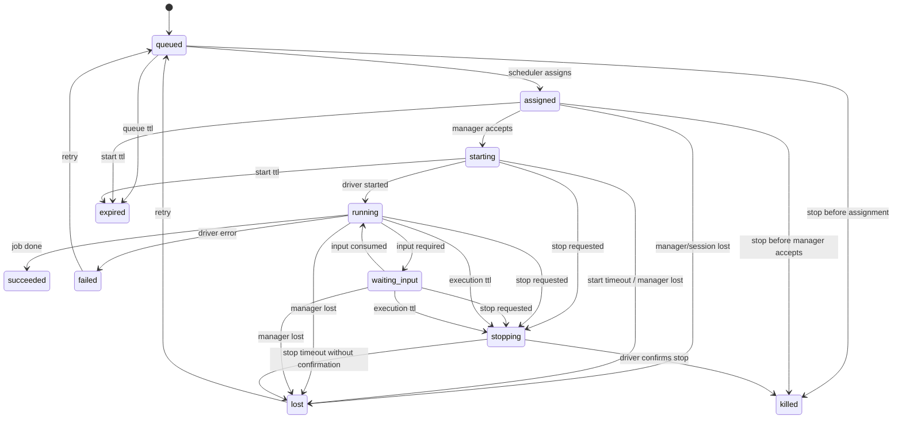
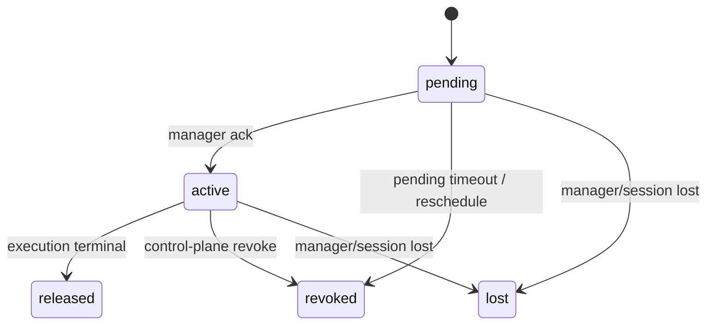
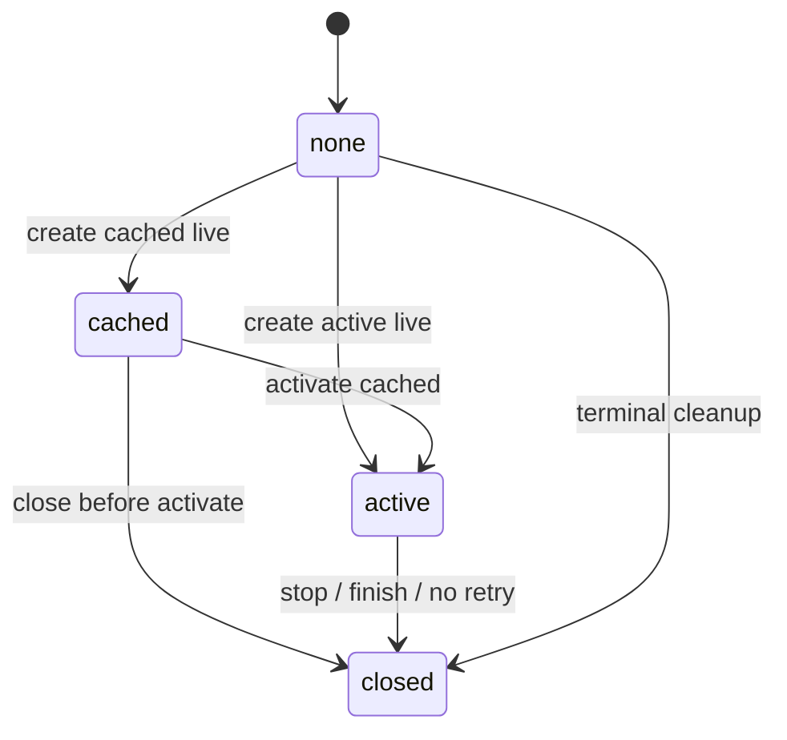

# Distributed Runner 设计

日期：2026-07-12
状态：同步到当前分支实现和已定后续方向

Phase 2 扩展见 `distributed-submit-batch-cloud-design.md`。

本文保留 Execution、assignment、Scheduler、Reconciler、Manager 和 Run Trace 的基础合同。当前分支已经在此基线上增加 typed
`submit single|live|batch`、Artifact Store、owner/auth/quota、`nexus_batch` parent driver 和 Kubernetes/TKEx dynamic
environment。涉及这些能力时，以 [Distributed Submit 与 Batch 上云](distributed-submit-batch-cloud-design.md) 为准。

## 目标

Distributed Runner 是 Nexus 的通用分布式执行控制面。它管理的是 `Execution`，不直接等同于 Nexus
现有的 `RunInput`、`run_single` 或 live server `LiveRun`。

第一期目标：

- 使用 MySQL 作为事实源，支持多进程、多副本部署。
- 支持 `job` 和 `live` 两类 execution。
- 支持 live execution 的 `cached -> active` 路由切换。
- 支持多个 Control Gateway、Application Gateway、Scheduler、InstanceManager。
- 支持 Scheduler shard lease，避免多 Scheduler 重复调度。
- 支持基础 Reconciler，处理 manager dead、session mismatch、pending timeout、starting timeout、TTL 和终态清理。
- 第一阶段只支持 `predefined` environment。`predefined` 没有独立 EnvironmentManager 进程，InstanceManager 由外部预先启动并注册到 MySQL。
- 第一阶段实现 `asyncio` 和 `thread` executor。二者都采用 Manager 主 event loop 与 execution event loop 分离的模型。
- live SSE 由 Application Gateway 透传到 live driver/InstanceManager；`execution_events` 只承载分布式控制面标准事件。
- live trace-backed stream 通过 `RunTraceProcessor` 和 `RunTraceSink` 写 raw `SpanEventRecord` journal；live API
  event 由 raw journal 投影。

## 非目标

- 不在第一期实现 K8s、Gongfeng、ZooKeeper、RabbitMQ、Redis 或 Kafka。
- 不实现 cached pool controller；cached live 是普通 live execution 的一种 `route_status`。
- 不在 Scheduler 中执行业务任务。
- 不把 heartbeat 写成 SSE event。
- 不让已经落库为 `lost` 的 assignment 自动恢复为 `active`。
- 不在第一期实现 process executor；跨进程隔离和 UDS IPC 后续补齐。
- 不把 batch fan-out 放入 Scheduler；`nexus_batch` parent driver 在 orchestration pool 中窗口化提交 child `nexus_single`。
- 不把 live SSE 全量事件写入 `execution_events`；live event 统一进入 trace processor。

## 总体架构



## 核心概念

### Execution

用户提交的一次分布式执行请求。平台只关心 `mode`、`spec_type`、状态、路由和调度，不解释业务 payload。

- `mode=job`：一次性执行，结束后进入终态。
- `mode=live`：常驻服务，可暴露 HTTP、WebSocket、SSE、runtime proxy 等入口。

### Execution Spec

`Execution` 的业务描述。平台只把它交给对应 driver。

```json
{
  "mode": "live",
  "spec_type": "nexus_live",
  "instance_mode": "asyncio",
  "spec": {},
  "driver_config": {},
  "resource": {
    "slot_cost": 1
  }
}
```

字段含义：

- `mode`：`job` 或 `live`。
- `spec_type`：`nexus_live`、`nexus_single`、`python_function` 等。
- `instance_mode`：第一期支持 `asyncio` 和 `thread`。
- `spec`：driver 私有 payload。
- `driver_config`：driver 配置。
- `resource.slot_cost`：调度容量消耗。

### Assignment

一次 execution attempt 和某个 InstanceManager 的绑定。第一期不单独建 `attempts` 表，`assignments` 同时承担 attempt
记录和调度绑定历史。

```text
execution_id + assignment_id + attempt_id -> manager_id + manager_session_id
```

同一时刻一个 execution 只有一个 `current_assignment_id`。

### InstanceManager

预先启动的执行管理进程。它注册到 MySQL，周期 heartbeat，拉取分配给自己的 pending assignment，并在本地 executor
中运行 driver。

Manager 不做持久 `online/stale/dead` 状态机。`instance_managers` 保存 session、endpoint、capability 和 placement 等注册快照；
高频 heartbeat 写 `instance_manager_liveness`，健康状态由当前 session 对应的 liveness 动态派生。

### Environment / Placement

Environment 表示 InstanceManager 所属的资源域，不表示 execution 本身。第一期只有 `predefined` environment：

```text
predefined:
  没有独立进程
  InstanceManager 由人工、脚本、systemd、K8s Deployment 或其他外部系统预先启动
  Scheduler 直接从 MySQL 读取已注册 manager inventory
```

K8s/Gongfeng 属于后续 dynamic environment。它们需要独立 controller 进程维护 InstanceManager 生命周期：

```text
dynamic environment controller:
  读取 pool desired/min/max
  创建、缩容、替换 InstanceManager
  同步资源状态和 drain 意图
  不直接写 assignment
```

Scheduler 是唯一写 assignment 的组件。Environment controller 只负责“让足够的 InstanceManager 出现在 DB 中”，不绕过
Scheduler 给 execution 下发任务。

Execution 通过 `placement` 表达调度约束：

```json
{
  "environment": "predefined-default",
  "pool": "default",
  "target_manager_id": null,
  "preferred_manager_id": null,
  "labels": {},
  "provisioning_policy": "wait"
}
```

- `target_manager_id`：硬约束，只能调度到指定 InstanceManager。
- `preferred_manager_id`：软偏好，优先调度到指定 InstanceManager；不可用时可 fallback 到普通候选。
- `environment`、`pool`、`labels`：候选 manager 过滤条件。
- `provisioning_policy`：无容量时的处理策略。第一期只支持 `wait`，即保留 queued 并 backoff。

### Driver / Executor

- Driver 表示“跑什么”：第一期实现 `nexus_live` 和最小 `nexus_single`；`python_function` 后续补齐。
- Executor 表示“怎么跑”：第一期实现 `asyncio` 和 `thread`。
- ExecutionReporter 表示“怎么汇报生命周期”：driver 通过 reporter 把 running/result/error 等状态送回
  InstanceManager，由 InstanceManager 写 DB。
- Driver 不持有 SQLAlchemy session。需要复合控制面操作的 driver 使用显式注入的 Manager-owned capability adapter；
  Phase 2 的 `nexus_batch` 使用 `BatchControlClient`，adapter 把请求切回 manager loop 并完成 fencing/transaction。

`nexus_live` driver 内部直接包装现有 `nexus.runner.live.manager.LiveRun`。不额外引入 `LiveInstance` 抽象。

## 状态机

第一期只保留三套状态机。

### ExecutionStatus



### AssignmentStatus



`lost`、`revoked`、`released` 都不可恢复为 `active`。

### RouteStatus



`route_status` 只用于 live/http-capable execution。

### 健康判断

Manager 不持久化 `online/stale/dead` 状态。优先读取与 `instance_managers.session_id` 匹配的
`instance_manager_liveness`；升级期间不存在 liveness 行时才回退到静态表快照。运行时判断：

```text
session_matches = instance_manager_liveness.session_id == instance_managers.session_id
manager_active  = session_matches and fenced_at is null
manager_healthy = manager_active and now - last_heartbeat_at <= manager_healthy_ttl
manager_dead    = not manager_active or now - last_heartbeat_at > manager_dead_ttl
assignment_session_matches = instance_managers.session_id == assignments.manager_session_id
```

接受 Manager 上报和 Application Gateway 转发必须同时满足：

```text
assignment.status == active
assignment.manager_session_id == manager.session_id
execution.current_assignment_id == assignment.assignment_id
execution.status in starting|running|waiting_input|stopping
manager heartbeat healthy
```

如果 assignment 已经被 Reconciler 标为 `lost`，即使 Manager 没重启且 `session_id` 仍匹配，也不能自动恢复。

## 数据模型

数据库使用 MySQL 8 / InnoDB。时间字段使用 UTC `DATETIME(6)`。JSON payload 使用 MySQL `JSON` 类型。ID、状态、类型字段使用有界 `VARCHAR`，避免在索引列上使用 `TEXT`。

### executions

```text
execution_id              varchar(64) primary key
idempotency_scope         varchar(128)
idempotency_key           varchar(128)

shard_id                  int not null
mode                      varchar(16) not null
spec_type                 varchar(64) not null
instance_mode             varchar(32) not null
spec_json                 json not null
driver_config_json        json
placement_json            json

status                    varchar(32) not null
route_status              varchar(32) not null

slot_cost                 int not null default 1
current_assignment_id     varchar(64)
current_attempt_id        varchar(64)
next_attempt_seq          int not null default 1
attempt_count             int not null default 0  -- accepted attempts only
max_attempts              int not null default 1

next_event_seq            int not null default 1  -- control/audit events only
priority                  int not null default 0
next_schedule_at          datetime(6) not null
last_schedule_error       text

queue_ttl_seconds         int
execution_ttl_seconds     int
stop_timeout_seconds      int

result_json               json
error_json                json

created_at                datetime(6) not null
updated_at                datetime(6) not null
started_at                datetime(6)
finished_at               datetime(6)
cleanup_done_at           datetime(6)
```

Indexes:

```sql
KEY idx_executions_sched (status, shard_id, next_schedule_at, priority, created_at);
KEY idx_executions_status_updated (status, shard_id, updated_at, execution_id);
KEY idx_executions_route_status (route_status, status, shard_id, updated_at, execution_id);
KEY idx_executions_current_assignment (current_assignment_id);
KEY idx_executions_cleanup (status, shard_id, cleanup_done_at, execution_id);
KEY idx_executions_queue_deadline (status, shard_id, queue_expires_at, execution_id);
KEY idx_executions_execution_deadline (status, shard_id, execution_expires_at, execution_id);
KEY idx_executions_stop_deadline (status, shard_id, stop_deadline_at, execution_id);
UNIQUE KEY uq_executions_idempotency (idempotency_scope, idempotency_key);
```

`shard_id = hash(execution_id) % shard_count` 在创建时写入。`shard_count` 是部署级配置，只允许增加：旧 execution
保留原 shard，新 execution 按新值散列，不重写存量行。扩容后的存量 backlog 仍集中在旧 shard 范围，因此应尽量在
首次部署时预留足够 shard。

### assignments

```text
assignment_id             varchar(64) primary key
execution_id              varchar(64) not null
attempt_id                varchar(64) not null
attempt_seq               int not null

manager_id                varchar(128) not null
manager_session_id        varchar(64) not null
status                    varchar(32) not null
slot_cost                 int not null default 1

endpoint_url              varchar(2048)
endpoint_ready            bool not null default false
endpoint_updated_at       datetime(6)
endpoint_error            text
runtime_info_json         json
last_instance_update_at   datetime(6)

accepted_at               datetime(6)
started_at                datetime(6)
finished_at               datetime(6)
created_at                datetime(6) not null
updated_at                datetime(6) not null
```

Indexes:

```sql
UNIQUE KEY uq_assignments_attempt_id (attempt_id);
KEY idx_assignments_manager_status (manager_id, status, updated_at);
KEY idx_assignments_execution_status (execution_id, status, updated_at);
KEY idx_assignments_status_updated (status, updated_at);
```

`pending` assignment 超时后变 `revoked`，不消耗 `max_attempts`。`attempt_count` 只在 Manager ack assignment 时增加。

### instance_managers

```text
manager_id                varchar(128) primary key
session_id                varchar(64) not null
endpoint_url              varchar(2048) not null

environment_type          varchar(32) not null default 'predefined'
environment_name          varchar(128) not null default 'predefined-default'
pool_name                 varchar(128) not null default 'default'
labels_json               json
draining                  bool not null default false

supported_modes_json      json not null
supported_spec_types_json json not null
supported_instance_modes_json json not null
capacity_total            int not null
observed_capacity_used    int not null default 0  -- heartbeat only, not scheduling fact

local_instances_json      json
version                   varchar(64)
metadata_json             json

last_heartbeat_at         datetime(6) not null  -- 兼容快照；高频健康事实在 liveness 表
created_at                datetime(6) not null
updated_at                datetime(6) not null
```

Indexes:

```sql
KEY idx_instance_managers_heartbeat (last_heartbeat_at);
KEY idx_instance_managers_capacity (capacity_total);
KEY idx_instance_managers_environment (environment_name, pool_name, last_heartbeat_at);
KEY idx_instance_managers_draining (draining, last_heartbeat_at);
```

Scheduler 不使用 `observed_capacity_used` 作为调度事实源。该字段只用于观测和诊断，因为 heartbeat 可能覆盖 Scheduler
刚写入的 reservation。第一期可用 slot 从 assignment 表推导：

```text
reserved_slots = sum(assignments.slot_cost where manager_id = ? and status in pending|active)
available_slots = instance_managers.capacity_total - reserved_slots
```

`pending`、`active` assignment 都占用 slot；`revoked`、`released`、`lost` 后自动释放，因为它们不再参与
`reserved_slots` 计算。

`environment_*`、`pool_name`、`labels_json` 和 `draining` 用于 placement 过滤。`predefined` manager 也必须带这些字段，
只是它们由启动参数或配置静态声明；K8s/Gongfeng manager 后续由对应 EnvironmentController 注入。

### instance_manager_liveness

```text
manager_id                varchar(128) primary key
session_id                varchar(64) not null
capacity_total            int not null
observed_capacity_used    int not null
last_heartbeat_at         datetime(6) not null
fenced_at                 datetime(6)
updated_at                datetime(6) not null

KEY idx_instance_manager_liveness_heartbeat (last_heartbeat_at, manager_id);
KEY idx_instance_manager_liveness_fenced (fenced_at, last_heartbeat_at);
```

Heartbeat 只按 `manager_id + session_id + fenced_at is null` 条件更新该行。`local_instances_json` 由低频 local reconcile
更新静态表，避免高频 heartbeat 与 Scheduler、Reconciler 对 Manager 行的锁竞争。

### execution_commands

```text
command_id                varchar(64) primary key
execution_id              varchar(64) not null
assignment_id             varchar(64)
attempt_id                varchar(64)

type                      varchar(64) not null  -- input.submit / stop.request
status                    varchar(32) not null  -- pending / claimed / done / failed / cancelled
payload_json              json

idempotency_key           varchar(128)
created_by                varchar(128)
claimed_by_manager_id     varchar(128)
claimed_at                datetime(6)
completed_at              datetime(6)
error_json                json

created_at                datetime(6) not null
updated_at                datetime(6) not null
```

Indexes:

```sql
KEY idx_execution_commands_assignment_pending (assignment_id, status, created_at);
KEY idx_execution_commands_execution (execution_id, created_at);
KEY idx_execution_commands_status_updated (status, updated_at);
UNIQUE KEY uq_execution_commands_idempotency (execution_id, idempotency_key);
```

MySQL unique index 允许多个 `NULL`，所以 `idempotency_key` 可为空。
`assignment_id` 和 `attempt_id` 可为空是为了支持尚未分配 execution 的控制命令；`input.submit` 等需要投递到 live
driver 的命令必须写入当前 assignment 和 attempt。

### execution_events

第一期 `execution_events` 只记录分布式控制面标准事件和审计事件，不承载 live SSE 主链路。live run 的业务事件流由 live run
自身管理和存储，Application Gateway 只负责透传。

```text
event_id                  bigint auto_increment primary key
execution_id              varchar(64) not null
seq                       int not null
assignment_id             varchar(64)
attempt_id                varchar(64)

type                      varchar(64) not null
source                    varchar(64) not null
visibility                varchar(16) not null  -- public / internal / debug
payload_json              json
event_key                 varchar(128)

created_at                datetime(6) not null
```

Indexes:

```sql
UNIQUE KEY uq_execution_events_execution_seq (execution_id, seq);
KEY idx_execution_events_created (created_at);
KEY idx_execution_events_attempt (attempt_id, seq);
UNIQUE KEY uq_execution_events_event_key (execution_id, event_key);
```

写事件时在事务内锁 `executions` 行，使用 `next_event_seq` 分配 per-execution `seq`。高频 live event 不走这张表。

### shard_leases

```text
shard_group               varchar(64) not null
shard_id                  int not null
shard_count               int not null
owner_id                  varchar(128) not null
lease_expires_at          datetime(6) not null
updated_at                datetime(6) not null

primary key (shard_group, shard_id)
```

Indexes:

```sql
KEY idx_shard_leases_expires (lease_expires_at);
```

### schema_version

当前 schema 由轻量 migration 管理：

```text
version                   int primary key
```

`nexus distributed db init` 会创建基础表；`nexus distributed db upgrade` 根据 `nexus/distributed/migrations/` 补齐增量
schema。当前代码同时保留 SQLite 兼容路径，用于本地开发和测试；生产事实源仍按 MySQL/InnoDB 设计。

## Repository 边界

Repository 按角色和原子流程拆，不按表拆。

```text
nexus/distributed/repositories/
  execution.py      # ExecutionRepository
  scheduler.py      # SchedulerRepository
  manager.py        # ManagerRepository
  gateway.py        # GatewayRepository
  reconciler.py     # ReconcilerRepository
  environment.py    # EnvironmentInventoryRepository
```

原则：

- Service 不直接写 ORM。
- 单个状态转换必须在一个 repository 方法内完成。
- 状态更新和控制面事件写入在同一事务中完成。
- HTTP wakeup 和 proxy 不放在 DB 事务中。

关键方法：

```text
ExecutionRepository:
  create_execution
  get_execution
  list_executions
  count_executions
  activate_route
  list_commands
  request_stop
  append_control_event
  list_control_events

SchedulerRepository:
  renew_shard_leases
  claim_and_assign
  claim_and_assign_batch
  manager_endpoints_by_id

ManagerRepository:
  register_session
  heartbeat
  list_pending_assignments
  ack_assignment
  mark_start_failed
  mark_running
  mark_waiting_input
  update_runtime_info
  complete_execution
  fail_execution
  mark_killed
  claim_commands
  complete_command

GatewayRepository:
  submit_command
  resolve_route

ReconcilerRepository:
  reconcile_manager_dead
  reconcile_session_mismatch
  reconcile_pending_timeouts
  reconcile_starting_timeouts
  expire_queued
  request_ttl_stops
  reconcile_stopping_timeouts
  cleanup_terminal

EnvironmentInventoryRepository:
  get_environment_stats
  list_environments
  list_managers
  list_environment_managers
  delete_stale_manager
```

`SchedulerRepository.claim_and_assign_batch` 必须在一个事务里完成：

- 确认 execution 仍为 `queued`。
- 锁定候选 manager 行。
- 确认 manager heartbeat healthy，且 `session_id` 是当前有效 session。
- 确认 manager 支持 execution 的 `mode`、`spec_type` 和 `instance_mode`。
- 通过 `assignments.status in pending|active` 汇总已 reservation 的 `slot_cost`。
- 确认 `capacity_total - reserved_slots >= execution.slot_cost`。
- 创建 `pending` assignment。
- 更新 execution 为 `assigned`，写 `current_assignment_id/current_attempt_id`。
- 写控制面事件。

Scheduler 不直接增减 `instance_managers.observed_capacity_used`。容量释放由 assignment 状态流转自然完成，避免
heartbeat 和 Scheduler 同时写容量计数。

## API

### Control Gateway

```text
GET  /v1/health
GET  /v1/system/status
GET  /v1/console
GET  /v1/console/assets/{path:.*}
POST /v1/executions
GET  /v1/executions?status=&mode=&q=&limit=&offset=&summary=
GET  /v1/executions/{execution_id}
GET  /v1/executions/{execution_id}/control-events?cursor=&limit=
POST /v1/executions/{execution_id}/activate
POST /v1/executions/{execution_id}/stop
GET  /v1/environments
GET  /v1/environments/{environment_name}/stats?pool=
GET  /v1/environments/{environment_name}/managers?pool=&label_key=&label_value=
GET  /v1/managers?environment=&pool=&label_key=&label_value=
GET  /v1/managers/{manager_id}/logs?lines=
GET  /v1/managers/{manager_id}/logs/stream?lines=
ANY  /v1/managers/{manager_id}/debug/aiomonitor/{loop}/{path:.*}
GET  /v1/managers/{manager_id}/debug/py-spy/{action}
DELETE /v1/managers/{manager_id}
```

`GET /v1/system/status` 仅管理员可访问；除调度、allocation、batch 和 Artifact 汇总外，MySQL 部署返回连接上限、当前/运行中
连接、历史最大连接、慢查询和失败连接计数。响应不包含数据库地址、DSN、用户名或凭证；非 MySQL 或查询不可用时只返回
`available=false` 和方言。

`POST /v1/executions` 创建 execution，初始：

```text
status=queued
route_status=none|cached|active
current_assignment_id=null
current_attempt_id=null
placement_json=request.placement or default predefined placement
shard_id=hash(execution_id)%shard_count
next_schedule_at=now
```

第一期 environment API 只读，用于 predefined inventory 统计和排障，不启动、不缩容、不替换 InstanceManager。写侧资源生命周期交给外部系统或后续 EnvironmentController。

`/v1/console` 提供最小集群 Web 控制台。第一期包含 `Executions | Environments | Managers` 三个 tab；`Executions`
选中 `mode=live` 且 `spec_type=nexus_live` 的 execution 时，右侧显示 Live Nexus 面板，并通过 Application Gateway 透传
live SSE、input command 和 runtime proxy。

`POST /activate` 只表达 route 意图：

```text
route_status: cached -> active
```

条件：

```text
mode=live
route_status=cached
status in queued|assigned|starting|running|waiting_input
```

如果已经 `active`，返回 200。`closed` 或终态返回 409。`queued` 状态下 activate 只打开 route 意图，实际流量仍要等
assignment ready 后才能由 Application Gateway 转发。

`POST /stop`：

- `queued`：不写 command，直接 `execution.status -> killed`。
- `assigned` 且 assignment 仍为 `pending`：`assignment.status -> revoked`，`execution.status -> killed`。
- `starting|running|waiting_input`：写绑定当前 assignment/attempt 的 `stop.request` command，`execution.status -> stopping`。
- live execution 的 `route_status -> closed`。
- `stopping|killed` 返回 200，作为幂等 stop。

### Application Gateway

```text
GET  /v1/health
GET  /v1/executions/{execution_id}/info
GET  /v1/executions/{execution_id}/live/events?cursor=
GET  /v1/executions/{execution_id}/live/result
POST /v1/executions/{execution_id}/commands
ANY  /v1/executions/{execution_id}/runtimes/{runtime_name}/proxy/{path:.*}
ANY  /v1/executions/{execution_id}/runtimes/{runtime_name}/{path:.*}
ANY  /v1/executions/{execution_id}/proxy/{path:.*}
```

WebSocket 通过 `/proxy` 的 `Upgrade: websocket` 支持，不单独设计 `/ws`。

第一期 `/live/events` 对 live execution 走透传：

```text
AG -> resolve active assignment -> InstanceManager internal events endpoint -> LiveRun.events
```

cached live 的 `/live/events` 第一阶段也按 route 处理：如果 `route_status=cached`，返回 `409 route_not_active`。非 live execution
返回 `404 events_not_supported`。控制面状态查询走 `GET /v1/executions/{id}`，控制面标准事件查询走
`GET /v1/executions/{id}/control-events`。

如果 live execution 已进入终态且当前 assignment 有 live trace metadata，`/live/events` 会 fallback 到
`/artifacts/events`；`/live/result` 会在 result 是 external pointer 时经 InstanceManager 从 live trace 回放 result。

`POST /commands` 示例：

```json
{
  "type": "input.submit",
  "payload": {
    "text": "Alpha"
  },
  "idempotency_key": "input-123"
}
```

AG 只写 command，不理解 turn、interaction 或 agent 协议。

`GatewayRepository.submit_command` 必须在一个事务里完成：

- resolve 当前 execution、current assignment 和 manager session。
- 校验 route、execution、assignment、endpoint 和 manager heartbeat。
- 对需要投递到 live driver 的命令，写入当前 `assignment_id` 和 `attempt_id`。
- 使用 `execution_id + idempotency_key` 去重。

Manager claim command 时必须同时校验：

```text
command.assignment_id == assignment.assignment_id
command.attempt_id == assignment.attempt_id
assignment.status == active
assignment.manager_session_id == current manager session
execution.current_assignment_id == assignment.assignment_id
```

如果 route 已切换、assignment 已 lost/revoked/released，旧 command 只能标记为 `cancelled` 或 `failed`，不能投递给新的
attempt。

AG proxy 条件：

```text
execution.status in running|waiting_input
execution.route_status = active
assignment.status = active
assignment.endpoint_ready = true
manager heartbeat healthy
manager.session_id == assignment.manager_session_id
```

失败返回：

```text
409 route_not_active
503 endpoint_not_ready
503 executor_unavailable
503 assignment_unavailable
410 execution_closed
```

AG route/assignment cache TTL 第一阶段为 1s；proxy 失败时必须强制刷新 DB 再判断。

### Internal Manager API

```text
GET  /v1/internal/health
POST /v1/internal/wakeup
GET  /v1/internal/logs?lines=
GET  /v1/internal/logs/stream?lines=
ANY  /v1/internal/debug/aiomonitor/{loop}/{path:.*}
GET  /v1/internal/debug/py-spy/dump
GET  /v1/internal/debug/py-spy/record
GET  /v1/internal/executions/{assignment_id}/info
GET  /v1/internal/executions/{assignment_id}/events
GET  /v1/internal/executions/{assignment_id}/artifacts/result
GET  /v1/internal/executions/{assignment_id}/artifacts/events
ANY  /v1/internal/executions/{assignment_id}/runtimes/{runtime_name}/proxy/{path:.*}
ANY  /v1/internal/executions/{assignment_id}/runtimes/{runtime_name}/{path:.*}
```

`/v1/internal/wakeup` 只是提示 Manager 立即 poll DB，不携带 assignment payload。

Internal API 不对公网暴露。当前实现使用可选 shared internal bearer token；配置了 `NEXUS_DIST_INTERNAL_TOKEN` 时才启用校验：

```text
Authorization: Bearer ${NEXUS_DIST_INTERNAL_TOKEN}
```

Control Gateway、Application Gateway、Scheduler、InstanceManager 发起内部请求时会在配置了 token 后附带该 header。Manager
在 token 配置非空时拒绝缺失或错误 token；当前代码不做来源网段校验。后续接 K8s/Gongfeng 时可以升级为 mTLS、
短期签名 token 或网络层访问控制。

## Scheduler

Scheduler 多副本运行。每个 Scheduler 在 `shard_leases` 的 `execution-scheduler` group 中抢 shard lease，只扫描自己持有的
shard。Reconciler 使用独立的 `execution-reconciler` group，两类副本互不争抢。

Lease 参数：

```text
lease_ttl = 20s
renew_interval = 5s
discover_interval = 20s
ownership_limit = 0  # per-scheduler shard limit; 0 means all shards
discover_jitter = 20%
```

抢占或续租 shard lease 必须是 DB 原子操作，不能先读再写。并发场景下，同一个 shard 在同一时刻只能被一个
Scheduler 成功持有；抢占失败的 Scheduler 本轮不能扫描该 shard。

Scheduler 在本地缓存 `owned_shards`。正常 tick 直接用 cached owned shards 扫 queued execution；到
`renew_interval` 时只批量续租自己已持有的 shard；到 `discover_interval` 时才重新发现 shard。默认
`ownership_limit=0`，表示每个 Scheduler 最多可持有全部 shard，以保持单 Scheduler 和小集群的调度 liveness。
大集群可设置 `ownership_limit>0` 作为每个 Scheduler 的 shard 持有上限。Scheduler 会优先续租已持有 shard；
未达到上限时，才按 owner-hash window 探索新 shard。发现顺序由 `hash(shard_group, owner_id, shard_id)`
稳定排序，窗口每轮向后滚动。这样不同 owner 会优先尝试不同 shard；即使本地暂时没有 owned shard，也按
`discover_interval` 退避，避免空闲 Scheduler 每秒对所有 shard 反复做 lease DML。

discover interval 会加 `discover_jitter` 抖动，避免多个 Scheduler 同一时刻集中抢 lease。

首次发现 shard 前，owner 先抢占一个按 shard group 哈希隔离的内部 discovery guard。持有 guard 的 owner 在短事务中补齐
该 group 的完整 shard 拓扑；其他 owner 不会同时初始化同一 group。内部 guard 不计入 Scheduler/Reconciler 状态和容量统计。

稳定运行时只批量续租当前 owner 已持有的行。需要发现新 shard 时，按稳定顺序对已过期候选执行
`FOR UPDATE SKIP LOCKED`，锁定后再更新 owner 和到期时间：

```text
acquire isolated discovery guard
ensure all real shard rows exist
UPDATE shard_leases SET lease_expires_at=:expires_at
  WHERE shard_group=:group AND owner_id=:owner_id AND shard_id IN (:owned_shards)
SELECT expired candidate rows ... FOR UPDATE SKIP LOCKED
UPDATE locked candidate rows SET owner_id=:owner_id, lease_expires_at=:expires_at
```

Lease heartbeat 使用独立短事务。assignment 事务提交前对实际修改的 shard 执行
`FOR UPDATE SKIP LOCKED` 最终围栏；heartbeat 短暂持锁时整批回滚重试，只有 owner 或过期状态不匹配时才清空本地
ownership。

扫描 queued execution：

```sql
SELECT execution_id
FROM executions
WHERE status = 'queued'
  AND shard_id IN (...)
  AND next_schedule_at <= NOW(6)
ORDER BY next_schedule_at, priority DESC, created_at
LIMIT 50
FOR UPDATE SKIP LOCKED;
```

Scheduler 选择 InstanceManager 时先应用 placement，再应用能力和容量过滤。健康 manager 的候选发现不加全量
`FOR UPDATE` 锁；只有真正尝试分配的目标 manager 会被单行加锁。锁住目标 manager 后，Scheduler 必须重新计算
该 manager 的 `pending|active` assignment slot 占用，再决定是否创建 assignment，避免多个 Scheduler 并发时超卖。

```text
1. target_manager_id 存在：
   只允许该 manager 成为候选。若不健康、draining、能力不匹配或容量不足，execution 保持 queued 并 backoff。

2. preferred_manager_id 存在：
   先尝试 preferred manager。若不可用，再回退到 environment/pool/labels 的普通候选。

3. 默认路径：
   按 environment、pool、labels、mode、spec_type、instance_mode、draining、heartbeat、session 和 capacity 过滤。
```

目标 manager 抢占分两步完成，只锁静态注册行，不锁高频 liveness 行：

```sql
SELECT manager_id
FROM instance_managers
WHERE manager_id IN (:candidate_manager_ids)
FOR UPDATE SKIP LOCKED;

SELECT manager.*, liveness.*
FROM instance_managers AS manager
LEFT JOIN instance_manager_liveness AS liveness
  ON liveness.manager_id = manager.manager_id
 AND liveness.session_id = manager.session_id
WHERE manager.manager_id IN (:locked_manager_ids);
```

第二步复核 liveness、capability、placement 和 reservation。目标 manager 被其它 Scheduler 锁住时，当前 Scheduler 尝试下一个
候选；如果是 hard `target_manager_id`，则本轮不分配并写 lock-contention backoff。

`draining=true` 的 manager 不再接新 assignment，但已 active 的 assignment 继续由 InstanceManager 和 Reconciler
按原状态机收敛。

无可用 Manager 时：

```text
execution.status 保持 queued
next_schedule_at = now + backoff
last_schedule_error = reason
```

assignment 写入后，Scheduler 可以 best-effort 调用：

```text
POST {manager.endpoint_url}/v1/internal/wakeup
```

失败不回滚，InstanceManager 会通过 DB 轮询拿到 assignment。

## Environment

Environment 层只管理资源池，不管理 execution 状态机。Scheduler 仍然是唯一 assignment 写入方。

### Predefined Environment

第一期的 `predefined` environment 没有独立进程，也没有 controller lease。它只是 `instance_managers` 表上的逻辑资源池：

```text
InstanceManager register/heartbeat
  -> 写 environment_type/environment_name/pool_name/labels/draining/capacity
Scheduler
  -> 读取这些字段作为 inventory
  -> 结合 assignments reservation 计算可用 slot
```

predefined 能力范围：

- 统计 manager 数量、健康数量、总 slot、reserved slot、available slot。
- 按 environment、pool、labels、spec_type、instance_mode 过滤 manager。
- 支持 `target_manager_id` 和 `preferred_manager_id` placement。
- 识别并遵守 `draining` 标记，停止给 draining manager 分配新 execution。

predefined 不负责：

- 启动 InstanceManager。
- 缩容或杀进程。
- 替换 dead manager。
- 直接写 assignment。

这些行为由运维、脚本、systemd、K8s Deployment 或其他外部系统完成。

### Dynamic EnvironmentController

K8s/Gongfeng 属于后续 dynamic environment，需要独立 controller 进程：

```text
EnvironmentController
  -> 读取 environment_pools desired/min/max/template
  -> 观察外部资源状态
  -> 创建/删除/替换承载 InstanceManager 的资源
  -> 等 InstanceManager 自己注册 heartbeat
```

K8s controller 典型流程：

```text
读 pool desired_count
读 k8s pods
读 DB registered managers
少了 -> 创建 pod，pod 内启动 InstanceManager
多了 -> 标记 manager draining，assignment 清空后删除 pod
dead -> 创建 replacement
template 变化 -> 滚动 drain + replace
```

Scheduler 热路径不直接调用 K8s/Gongfeng API。无容量时，Scheduler 只写 backoff 或 demand signal；controller
异步扩容，新的 InstanceManager heartbeat 后再被 Scheduler 正常选择。

后续 dynamic environment 需要增加：

```text
environment_pools
environment_provisioning_requests
environment_controller_leases
```

`environment_controller_leases` 用于多个 controller 副本之间做 leader/fencing，粒度可以是 `environment_name + pool_name`。

## InstanceManager

InstanceManager 启动时：

- 使用稳定 `manager_id`。
- 每次进程启动生成新的 `session_id`。
- 启动 Manager main event loop。
- 启动 internal aiohttp server；Kubernetes/TKEx workload 使用 Downward API 提供的 PodIP 作为 `endpoint_url`。
- 启动配置指定的 executor。`asyncio` 模式启动一个共享 execution loop 子线程；`thread` 模式按需启动 worker thread event loop。
- 注册 manager session；如果同一个 `manager_id` 已有 healthy session，启动失败，除非显式 force replace。
- 注册 heartbeat。

Manager session 使用 fencing 规则：

```text
start:
  insert manager row if absent
  replace session only when existing manager is dead or force_replace=true

heartbeat:
  UPDATE instance_manager_liveness
  SET capacity_total = ?, observed_capacity_used = ?, last_heartbeat_at = now
  WHERE manager_id = current_manager_id
    AND session_id = current_session_id
    AND fenced_at IS NULL

if heartbeat updated_rows == 0:
  stop accepting work
  stop local executions
  exit process
```

这样即使两个进程误用同一个 `manager_id`，也只有一个 session 能继续 heartbeat；旧 session 不能重新覆盖新 session。
连续数据库失败超过 `manager_self_fence_timeout` 时，Manager 在本地停止接单、停止当前 execution 并退出进程，由
workload controller 重启；Reconciler 按 `manager_dead_ttl` 收敛旧 assignment。时间关系必须满足
`heartbeat_interval < healthy_ttl < self_fence_timeout < dead_ttl`。

`register_session` 写入 `endpoint_url`、静态 capability 和 `metadata_json`，并创建或替换 liveness 行。`metadata_json`
保存 endpoint 类型、cluster、namespace、Pod name/uid 等启动身份；Manager id 对应的新 session 原子替换这些字段。
Heartbeat 每 5s 只写：

```text
manager_id
session_id
capacity_total
observed_capacity_used
last_heartbeat_at
```

Manager 轮询自己的 pending assignment：

```sql
SELECT *
FROM assignments
WHERE manager_id = ?
  AND manager_session_id = ?
  AND status = 'pending'
ORDER BY created_at
LIMIT min(capacity.available_slots, manager_start_batch_size);
```

当前默认 `manager_start_batch_size=10`；本地 executor 没有可用 slot 时，Manager 不 ack 新 assignment。

ack assignment 时：

- `assignment.status -> active`
- `execution.status -> starting`
- `executions.attempt_count += 1`
- `assignment.accepted_at = now`

Driver 启动后：

- `execution.status -> running`
- live/http driver 更新 `endpoint_url`、`endpoint_ready`、`runtime_info_json`

Manager 定期清理本地 orphan：

```text
if assignment.status != active:
  stop local execution
if assignment.manager_session_id != current session:
  stop local execution
if execution.current_assignment_id != assignment.assignment_id:
  stop local execution
```

## AsyncioExecutor

`asyncio` executor 内部使用两个 event loop：

```text
manager_loop:
  DB / heartbeat / assignment poll / command poll / internal HTTP

execution_loop:
  driver.start / driver.submit_command / driver.stop / task cancel / LiveRun
```

execution loop 在子线程中启动：

```python
loop = asyncio.new_event_loop()
thread = threading.Thread(target=run_loop, daemon=True)
```

跨 loop 调度统一使用：

```python
asyncio.run_coroutine_threadsafe(coro, target_loop)
```

AsyncioExecutor 必须保存每个 active assignment 的 execution task handle：

```text
assignment_id -> {
  task: asyncio.Task,
  handle: ExecutionHandle,
  stopping: bool
}
```

stop/kill 流程：

```text
1. Manager claim stop.request。
2. Manager 通过 run_coroutine_threadsafe 调用 driver.stop(handle)，执行 driver-level best-effort stop。
3. 如果 driver 在 stop_timeout 内回调 mark_killed/complete/fail，则释放本地 task handle。
4. 如果超过 stop_timeout 仍未终止，AsyncioExecutor 在 execution_loop 上调用 task.cancel()。
5. task 收到 CancelledError 后必须清理 driver 资源，并通知 Manager 标记 killed。
6. 如果 task cancel 后仍无法收敛，Reconciler 按 manager/assignment 状态把 execution 标记 lost。
```

task cancel 是 AsyncioExecutor 的一期必备能力，不依赖 driver 自己实现硬 kill。Driver `stop()` 只表示该 driver
知道的业务停止入口；如果 driver 没有业务停止能力，可以 no-op 并等待 Executor cancel 外层 asyncio task。

约束：

- SQLAlchemy session 只在 manager loop 使用。
- `LiveRun`、`RunTraceSession`、internal journal/view 和相关 asyncio primitive 必须在 execution loop 创建和使用。
- Driver 不直接写 DB；生命周期状态通过 `ExecutionReporter`，batch ledger/child/finalize 操作通过 Manager-owned
  `BatchControlClient` 投递回 manager loop。
- `nexus_live` 支持 `runner.hold_after_task`，但 driver 必须关闭 hold 期间的 signal handler 注册；hold 期间 execution
  继续占用 assignment/slot 并保持 runtime route 可用，直到 hold 超时或 stop/cancel。
- `nexus_single` 仍禁用 `runner.hold_after_task`，避免已完成 job 在 distributed 中长期占用 slot。

## ThreadExecutor

`thread` executor 与 `asyncio` executor 保持同一个外部接口，但每个 worker thread 拥有独立 event loop。同一时刻一个
worker thread 只运行一个 assignment。

支持两种策略：

```text
per_execution:
  每个 assignment 新建一个 worker thread + event loop
  assignment 结束后 worker 退出

pooled:
  worker thread 完成 assignment 后回到 idle
  同一个 worker 最多复用 max_tasks_per_thread 次
  达到上限后 worker 退出，下次 assignment 创建新 worker
```

ThreadExecutor 保存：

```text
assignment_id -> {
  task: asyncio.Task,
  handle: ExecutionHandle,
  worker_id: str,
  slot_cost: int
}
```

事件、命令和 runtime proxy helper 都通过 `assignment_id -> worker loop` 分发：

```text
Manager Internal API
  -> executor.collect_events_after / get_runtime_base_url / submit_command
  -> owning worker event loop
  -> driver / LiveRun
```

stop/kill 流程与 AsyncioExecutor 一致：

```text
1. 在 owning worker loop 上调用 driver.stop(handle)。
2. 超过 stop_timeout 后 cancel 外层 driver task。
3. per_execution worker 退出；pooled worker 成功收敛后回 idle 或达到复用上限后退出。
```

capacity 由 executor 本地状态派生：

```text
effective_capacity = configured_capacity - stuck_slot_cost
available_slots = effective_capacity - running_slot_cost
```

第一期实现不做 thread 硬 kill；如果未来发现 worker loop/thread 无法收敛，Manager 应标记本地 worker stuck，并通过
heartbeat 降低 `effective_capacity`。硬隔离和强制 kill 交给后续 ProcessExecutor。

后续可增加：

- `process` executor：用于隔离同步 CPU-bound 任务。

## Executor / Driver / Reporter 接口

Executor 表示“怎么隔离运行”：

```python
class Executor:
    instance_mode: str

    async def start(self) -> None: ...
    async def close(self) -> None: ...
    async def has_assignment(self, assignment_id: str) -> bool: ...
    async def capacity_snapshot(self) -> ExecutorCapacitySnapshot: ...
    async def start_assignment(..., reporter: ExecutionReporter, slot_cost: int = 1) -> ExecutionHandle: ...
    async def stop_assignment(self, assignment_id: str, timeout: float) -> None: ...
    async def submit_command(self, assignment_id: str, command_type: str, payload: dict) -> None: ...
    async def collect_events_after(self, assignment_id: str, cursor: int, timeout: float) -> list[tuple[int, bytes]]: ...
    async def get_runtime_base_url(self, assignment_id: str, runtime_name: str) -> str: ...
    async def get_assignment_info(self, assignment_id: str) -> dict: ...
```

Driver 表示“跑什么”：

```python
class ExecutionDriver(Protocol):
    spec_type: str

    async def start(self, handle, spec, config, reporter) -> None: ...
    async def submit_command(self, handle, command_type, payload) -> None: ...
    async def stop(self, handle) -> None: ...
```

live-only 能力通过继承 `ExecutionDriver` 的 Protocol 表示：

```python
@dataclass
class ExecutionHandle:
    execution_id: str
    assignment_id: str
    metadata: dict[str, Any] = field(default_factory=dict)


@runtime_checkable
class SseEventStreamingDriver(ExecutionDriver, Protocol):
    async def collect_sse_events_after(self, cursor: int, *, timeout: float = 15.0) -> list[tuple[int, bytes]]: ...


@runtime_checkable
class RuntimeEndpointDriver(ExecutionDriver, Protocol):
    async def get_runtime_base_url(self, runtime_name: str) -> str: ...


@runtime_checkable
class ExecutionInfoDriver(ExecutionDriver, Protocol):
    async def get_execution_info(self, handle: ExecutionHandle) -> dict[str, Any]: ...


@runtime_checkable
class LiveExecutionDriver(SseEventStreamingDriver, RuntimeEndpointDriver, ExecutionInfoDriver, Protocol):
    pass
```

`ExecutionHandle` 是 executor 创建并传给 driver 的轻量执行引用，不承载 events/proxy/input 能力或 endpoint readiness。
SSE 和 runtime proxy 能力由 Protocol 判断，endpoint readiness 由 `mark_running()` 写入 assignment/runtime_info。

Driver 通过 ExecutionReporter 通知 Manager：

```text
mark_running(endpoint_url, endpoint_ready, runtime_info)
mark_waiting_input(payload)
update_runtime_info(runtime_info)
complete(result)
fail(error)
mark_killed()
```

`ExecutionReporter` 只承载通用 execution 生命周期，不扩展为 batch repository facade。`nexus_batch` 的分块物化、child
创建、active-child 状态快照、stop 和 finalize 使用独立 `BatchControlClient`；两者都由 InstanceManager 注入，driver 不持有 DB
连接或内部控制面凭证。

`stop()` 是 driver-level best-effort stop。Driver 不需要自己提供硬 kill；如果 `stop()` 无法按时完成，Executor
会取消外层 execution task。Driver 实现必须允许 `CancelledError` 冒泡或在清理后重新抛出，避免 task 被吞掉导致 stop
永久卡住。

## Nexus Single Driver

`nexus_single` driver 当前直接复用 `nexus.runner.single.run`：

```text
spec_json -> RunInput -> run_single -> RunOutput
```

`spec_json` 可以直接是 `RunInput` 字段，也可以包在 `run_input` 下：

```json
{
  "run_input": {
    "task_name": "...",
    "agent_name": "...",
    "runtime_configs": {}
  }
}
```

当前实现会做两类 distributed 适配：

- `run_input.run_id` 为空时使用 `execution_id`。
- `runner.hold_after_task` 和 `runner.early_output_path` 置空，因为 distributed job 不依赖本地 signal handler 或 early output 文件。

结果映射：

```text
RunOutput.success=true  -> emit run.output, flush trace sink, reporter.complete(trace metadata pointer)
RunOutput.success=false -> emit run.output, flush trace sink, reporter.fail(error, trace metadata pointer)
exception before output -> reporter.fail({type, message, traceback})
exception after durable output -> reporter.fail({type, message, traceback}, trace metadata pointer)
```

完整 `RunOutput` 不写入 `executions.result_json`；`task_output`、`agent_output`、`processor_results`、`cache_stats` 只作为
`run.output` 存入 run trace journal。`executions.result_json` 只保存 trace metadata pointer，供后续通过
`RunTraceLocalSource` 或其它 `RunTraceSource` 读取。

`nexus_single` 当前不接受 command；`stop()` 只作为 executor cancel 的业务兜底入口。

## Nexus Live Driver

`nexus_live` driver 第一阶段直接包装现有 `LiveRun`：

```text
spec_json -> CreateRunRequest -> LiveRun -> run_single
```

`LiveRun` 必须在 execution loop 创建并保存在 driver 内部。`ExecutionHandle` 只作为 stop/command 的轻量引用，不持有
`live_run`、endpoint 或 capability 状态。

状态映射：

```text
LiveRun starting -> Execution starting
LiveRun running  -> Execution running
LiveRun idle     -> Execution waiting_input
LiveRun killing  -> Execution stopping
LiveRun closed   -> Execution succeeded
LiveRun failed   -> Execution failed
LiveRun killed   -> Execution killed
```

关键 live event 映射为状态更新：

```text
runtime.ready   -> mark_running(endpoint_ready=true, runtime_info=...)
input.required  -> mark_waiting_input(...)
run.output      -> cache pending result/error
run.status=closed with result -> complete(...)
run.error       -> fail_execution(...)
run.killed      -> mark_killed(...)
```

live SSE 透传，不进入 `execution_events` 主链路：

```text
Client -> AG /live/events -> InstanceManager internal /events -> LiveRun.events
```

分布式控制面标准事件进入 `execution_events`，例如：

```text
execution.created
execution.status.changed
assignment.status.changed
route.status.changed
command.status.changed
scheduler.assigned
reconciler.retry
reconciler.terminal
```

command 映射：

```text
input.submit -> live_run.submit_turn(SubmitTurnRequest(text=...))
stop.request -> live_run.kill()
```

`nexus_live` 的 driver-level stop 直接调用现有 `LiveRun.kill()`。`LiveRun.kill()` 会进入 `killing` 状态、cancel
内部 `run_single` task、清理 runtime event subscription，并写出 `run.killed` / `killed` 状态。它不设置内部短超时，统一服从
execution `stop_timeout_seconds`；Executor 的 task cancel 仍作为外层兜底。

Phase 2 trace-backed live 通过 InstanceManager `RunTraceBackendRegistry` 选择 sink；默认 local backend 使用
`nexus.runner.trace.local.RunTraceLocalSink` 写本地 run trace 文件：

- 默认写入 `${NEXUS_DIST_RUN_TRACE_ARTIFACT_ROOT}/{execution_id}/{attempt_id}/{assignment_id}/`。
- `trace_events.jsonl` 保存 `SpanEventRecord` 原始 JSON 行，不保存 live API 投影。
- `manifest.json` 保存 trace metadata、cursor 和状态。
- `trace_event_cursor/flushed_trace_event_cursor` 区分已接收和已落盘的最后 record。
- assignment `runtime_info_json["_artifacts"]["live"]` 保存 version 4 envelope；每个 sink metadata 描述自己的
  raw journal。
- 如果启用 live trace，业务成功和业务失败都在 `result_json` 写入 external result pointer；失败状态同时写 `error_json`。
  Application Gateway 可通过 `/v1/executions/{execution_id}/live/result` 读取 raw `run.output` 中的真实 result。
- `nexus_live` driver 只按 `driver_config` 选择 registry 名称、传递具名 backend sinks、发布 metadata/result pointer；不直接写
  event/error/result，不补 final events，也不直接 close sink。sink 生命周期由 `RunTraceSession` 和
  `RunTraceProcessor` 管理。
- 所有启用的 sink 都必须成功；任一 start/write/close/metadata 失败都会使 execution 失败，不回退 inline result。

closed live 的历史事件由所选 `RunTraceSource` 读取完整 raw journal，再通过 `RunTraceProjectionEngine` 投影；结果由对应
source 从 raw `run.output` 读取。Application Gateway 在 execution 终态时通过 InstanceManager registry 读取。

## Application Gateway 流量

Application Gateway 是无状态入口。它不生成 turn id，不维护 live session，不解释 agent 协议。

### Events

第一期仅 live 支持 events，且走透传。普通 job/function 返回 `404 events_not_supported`，或后续提供 control events debug API。

### Commands

AG 写 `execution_commands`。Manager claim command 后交给 driver。

`input.submit` 条件：

```text
execution.status = waiting_input
route_status = active
assignment.status = active
manager healthy
```

### Proxy

AG 每次 resolve active route：

```text
execution -> current assignment -> manager heartbeat/session -> endpoint_url
```

只代理 `route_status=active` 且 `endpoint_ready=true` 的 execution。

Application Gateway 和 InstanceManager internal endpoint 都在各自进程内维护一个 `aiohttp.ClientSession`。HTTP
runtime proxy 使用分块 `StreamResponse` 转发 upstream 响应，避免每次请求新建 client session，也避免把大响应
一次性读入内存。WebSocket 仍使用双向 bridge。

## Reconciler

Reconciler 的 core loop 做 DB 状态收敛。多副本通过 `shard_leases` 的 `execution-reconciler` group 分片，只扫描当前副本
持有的 execution shard；每个短事务提交前执行最终 lease fence。全局 quota repair 只由 shard 0 owner 执行。

所有周期性扫描都按 batch limit 处理，避免 `.all()` 扫全表。默认 `reconciler_batch_size=500`，每类操作每 tick 最多
2 个 batch，core tick 默认 2 秒预算。Environment、DependencyBuild、Artifact maintenance 和 Batch lifecycle 使用同一进程内
固定数量的 async worker，不新增服务或消息队列。

Allocation reserve/release 先锁 Allocation 并短路幂等重放，再一次性按主键顺序锁 Environment/Grant resource usage；
Environment/Grant 配置在热路径只读。配置更新反向以 usage 为串行边界，并拒绝把资源上限降到当前占用以下。usage 行在
Environment/Grant 创建和 migration 中预建，因此热路径不执行 duplicate-key upsert。

### Manager dead / session mismatch

如果 Manager heartbeat 超过 `manager_dead_ttl`，或 assignment 的 `manager_session_id` 与当前 manager `session_id` 不匹配：

- pending/active assignment -> `lost`
- endpoint_ready -> false
- execution -> `queued` if retry allowed, otherwise `lost`
- live route：如果 retry，保持 `cached/active`；如果不 retry，关闭为 `closed`

### Pending timeout

`pending` assignment 超过 `assign_ack_timeout`：

- assignment -> `revoked`
- execution -> `queued`
- 不消耗 `max_attempts`

### Starting timeout

`starting` 超过 `start_timeout`：

- assignment -> `lost`
- execution -> `queued` if retry allowed, otherwise `lost`
- 这次已 ack，消耗 `attempt_count`

### Running

第一期不基于 `last_instance_update_at` 判定 running lost，避免误杀安静长任务。running lost 主要依赖 Manager heartbeat dead 或 session mismatch。

### TTL / stop

- queued 超过 queue TTL -> `expired`
- running/waiting_input 超过 execution TTL -> 写 `stop.request`，execution -> `stopping`
- stopping 超过 `stop_timeout` 且没有 driver 确认 -> Manager 要求 AsyncioExecutor cancel execution task
- task cancel 后仍不能收敛，或 Manager 已 lost -> `lost`
- `queued` 或 pending `assigned` 的用户 stop 可由 Control Gateway 写入 `killed`
- 已经进入 `starting|running|waiting_input|stopping` 的 execution，只能由 InstanceManager/driver 明确确认后写入 `killed`

### Terminal cleanup

终态：

```text
succeeded / failed / killed / lost / expired
```

`failed` 和 `lost` 只有在不可 retry 或 retry exhausted 时才作为终态处理；如果 retry policy 允许重试，Reconciler
必须在同一状态收敛流程中把 execution 重新置为 `queued`，并保留旧 assignment 的 `lost/released` 历史。

Reconciler 清理：

- assignment active/pending -> `released` 或 `lost`
- endpoint_ready=false
- live route_status=closed
- `cleanup_done_at=now`

`cleanup_done_at` 是终态 cleanup marker。Reconciler 只扫描 `status in terminal AND cleanup_done_at IS NULL`，
所以已完成清理的 run 不会在后续 tick 反复处理。该字段不改变最后一次 assignment/attempt 的历史查询。

## Heartbeat / Polling

默认参数：

```text
manager_heartbeat_interval = 5s
manager_healthy_ttl        = 15s
manager_self_fence_timeout = 30s
manager_dead_ttl           = 45s

scheduler_lease_ttl        = 20s
scheduler_lease_renew_interval = 5s
scheduler_shard_discover_interval = 20s
scheduler_shard_ownership_limit = 0  # per-scheduler shard limit; 0 means all shards
scheduler_shard_discover_jitter = 0.2

reconciler_lease_ttl        = 20s
reconciler_lease_renew_interval = 5s
reconciler_shard_discover_interval = 20s
reconciler_shard_ownership_limit = 0
reconciler_shard_discover_jitter = 0.2
reconciler_core_max_batches_per_tick = 2
reconciler_core_time_budget = 2s
environment/dependency/artifact/batch worker_count = 2

scheduler_poll_interval    = 0.1s
no_capacity_backoff        = 3s
scheduler scan_limit       = 250
scheduler max_assignments  = 250

manager_assignment_poll    = 1s
manager_start_batch_size   = 10
manager_local_reconcile_interval = 15s
reconciler_poll            = 5s
reconciler_batch_size      = 500
ag_route_cache_ttl         = 1s
run_trace_artifact_root    = /data/nexus-distributed/run-trace-artifacts
run_trace_sinks            = {"local":{"sinkClass":"nexus.runner.trace.local::RunTraceLocalSink","sourceClass":"nexus.runner.trace.local::RunTraceLocalSource","config":{"root":"/data/nexus-distributed/run-trace-artifacts"}}}
default_run_trace_sinks    = ["local"]
```

Command poll 当前复用 manager poll wakeup/loop。Manager 会批量查询 active assignment 的 pending commands；`waiting_input`
可以更快，普通 running 可以更慢。

Wakeup 只优化延迟，不作为可靠性依赖。

## 模块结构

```text
nexus/distributed/
  __init__.py
  auth.py
  config.py
  db.py
  models.py
  orm.py
  reconciler.py
  run_trace.py
  runtime_info.py
  scheduler.py

  utils/
    __init__.py
    clock.py
    identity.py

  observability/
    __init__.py
    context.py
    event_loop.py
    logging.py

  artifacts/
    __init__.py
    models.py
    store.py
    tickets.py
    maintenance.py
    run_result.py

  submission/
    __init__.py
    specs.py
    source_package.py

  dependency_build/
    __init__.py
    controller.py
    wheelhouse.py
    worker.py

  environment/
    __init__.py
    controller.py
    pool.py
    specs.py
    limits.py
    kubernetes.py
    tkex.py

  repositories/
    __init__.py
    _records.py
    access.py
    allocation.py
    artifact.py
    audit.py
    batch.py
    dependency_build.py
    environment.py
    events.py
    execution.py
    gateway.py
    manager.py
    quota.py
    reconciler.py
    scheduler.py
    submission.py

  gateways/
    __init__.py
    _proxy.py
    _serde.py
    control.py
    application.py

  instance_manager/
    __init__.py
    batch_control.py
    bootstrap.py
    internal.py
    service.py

  drivers/
    __init__.py
    nexus_batch.py
    nexus_live.py
    nexus_single.py

  run_trace_backends.py

  executors/
    __init__.py
    base.py
    asyncio_executor.py
    thread_executor.py

  migrations/
    __init__.py
    versions/
      __init__.py
      0001_initial.py
      0002_add_execution_cleanup.py
      0003_add_trace_carriers.py
      0004_cloud_submit_foundation.py

  console/
  static/console/
```

## CLI

```text
nexus distributed db init
nexus distributed db upgrade
nexus distributed db shell
nexus distributed logs tail --manager-id im-1
nexus distributed control-gateway --host 0.0.0.0 --port 8081
nexus distributed application-gateway --host 0.0.0.0 --port 8082 --enable-live-compat
nexus distributed scheduler --owner-id scheduler-1
nexus distributed reconciler
nexus distributed instance-manager --instance-manager-id im-1 --host 0.0.0.0 --port 8091 --executor asyncio --environment-name predefined-default --pool default
nexus distributed instance-manager --instance-manager-id im-thread --host 0.0.0.0 --port 8092 --executor thread --environment-name predefined-default --pool default
nexus distributed dev --host 127.0.0.1 --control-port 8081 --application-port 8082 --instance-manager-port 8091 --executor thread
```

`dev` 只用于本地联调，不代表生产拓扑。

`--enable-live-compat` 只挂载旧 live API 适配层。除健康检查外，它复用 Application Gateway 的个人 JWE 和应用 x-rio 鉴权，
再使用 internal credential 将已验证的 principal 或 `app_id` 委托给内部 Gateway；不转发原始公网凭据，也不使用独立或共享
submit token。任务归属、Grant 和 Quota 均按映射后的真实用户计算。

## 配置

当前实现使用 `DistributedConfig.from_env()` 读取扁平环境变量。命名规则是字段名转大写并加 `NEXUS_DIST_` 前缀；
`timedelta` 字段也支持 `_SECONDS` 后缀。

```text
database_url                  NEXUS_DIST_DATABASE_URL
internal_token                NEXUS_DIST_INTERNAL_TOKEN
run_trace_artifact_root       NEXUS_DIST_RUN_TRACE_ARTIFACT_ROOT
run_trace_sinks               NEXUS_DIST_RUN_TRACE_SINKS
default_run_trace_sinks       NEXUS_DIST_DEFAULT_RUN_TRACE_SINKS
log_dir                       NEXUS_DIST_LOG_DIR
log_level                     NEXUS_DIST_LOG_LEVEL

aiomonitor_enabled            NEXUS_DIST_AIOMONITOR_ENABLED
aiomonitor_host               NEXUS_DIST_AIOMONITOR_HOST
aiomonitor_base_port          NEXUS_DIST_AIOMONITOR_BASE_PORT
aiomonitor_webui_base_port    NEXUS_DIST_AIOMONITOR_WEBUI_BASE_PORT
aiomonitor_console_base_port  NEXUS_DIST_AIOMONITOR_CONSOLE_BASE_PORT

shard_count                   NEXUS_DIST_SHARD_COUNT
db_pool_size                  NEXUS_DIST_DB_POOL_SIZE
db_max_overflow               NEXUS_DIST_DB_MAX_OVERFLOW
db_pool_timeout               NEXUS_DIST_DB_POOL_TIMEOUT
db_pool_recycle               NEXUS_DIST_DB_POOL_RECYCLE
db_wait_timeout               NEXUS_DIST_DB_WAIT_TIMEOUT
slow_sql_log_threshold_ms     NEXUS_DIST_SLOW_SQL_LOG_THRESHOLD_MS
environment_db_pool_size      NEXUS_DIST_ENVIRONMENT_DB_POOL_SIZE
environment_db_max_overflow   NEXUS_DIST_ENVIRONMENT_DB_MAX_OVERFLOW
environment_orchestration_db_pool_size
                               NEXUS_DIST_ENVIRONMENT_ORCHESTRATION_DB_POOL_SIZE
environment_orchestration_db_max_overflow
                               NEXUS_DIST_ENVIRONMENT_ORCHESTRATION_DB_MAX_OVERFLOW

manager_healthy_ttl           NEXUS_DIST_MANAGER_HEALTHY_TTL_SECONDS
manager_self_fence_timeout    NEXUS_DIST_MANAGER_SELF_FENCE_TIMEOUT_SECONDS
manager_dead_ttl              NEXUS_DIST_MANAGER_DEAD_TTL_SECONDS
assign_ack_timeout            NEXUS_DIST_ASSIGN_ACK_TIMEOUT_SECONDS
start_timeout                 NEXUS_DIST_START_TIMEOUT_SECONDS
reconciler_batch_size         NEXUS_DIST_RECONCILER_BATCH_SIZE

scheduler_lease_ttl           NEXUS_DIST_SCHEDULER_LEASE_TTL_SECONDS
scheduler_lease_renew_interval NEXUS_DIST_SCHEDULER_LEASE_RENEW_INTERVAL
scheduler_shard_ownership_limit NEXUS_DIST_SCHEDULER_SHARD_OWNERSHIP_LIMIT
scheduler_shard_discover_interval NEXUS_DIST_SCHEDULER_SHARD_DISCOVER_INTERVAL
scheduler_shard_discover_jitter NEXUS_DIST_SCHEDULER_SHARD_DISCOVER_JITTER
scheduler_poll_interval       NEXUS_DIST_SCHEDULER_POLL_INTERVAL
scheduler_scan_limit         NEXUS_DIST_SCHEDULER_SCAN_LIMIT
scheduler_max_assignments    NEXUS_DIST_SCHEDULER_MAX_ASSIGNMENTS
scheduler_manager_lock_limit NEXUS_DIST_SCHEDULER_MANAGER_LOCK_LIMIT
scheduler_manager_lock_contention_backoff NEXUS_DIST_SCHEDULER_MANAGER_LOCK_CONTENTION_BACKOFF

reconciler_lease_ttl          NEXUS_DIST_RECONCILER_LEASE_TTL_SECONDS
reconciler_lease_renew_interval NEXUS_DIST_RECONCILER_LEASE_RENEW_INTERVAL
reconciler_shard_ownership_limit NEXUS_DIST_RECONCILER_SHARD_OWNERSHIP_LIMIT
reconciler_shard_discover_interval NEXUS_DIST_RECONCILER_SHARD_DISCOVER_INTERVAL
reconciler_shard_discover_jitter NEXUS_DIST_RECONCILER_SHARD_DISCOVER_JITTER
reconciler_core_max_batches_per_tick NEXUS_DIST_RECONCILER_CORE_MAX_BATCHES_PER_TICK
reconciler_core_time_budget   NEXUS_DIST_RECONCILER_CORE_TIME_BUDGET_SECONDS
reconciler_poll_interval      NEXUS_DIST_RECONCILER_POLL_INTERVAL
manager_poll_interval         NEXUS_DIST_MANAGER_POLL_INTERVAL
manager_heartbeat_interval    NEXUS_DIST_MANAGER_HEARTBEAT_INTERVAL
manager_local_reconcile_interval NEXUS_DIST_MANAGER_LOCAL_RECONCILE_INTERVAL
manager_start_batch_size      NEXUS_DIST_MANAGER_START_BATCH_SIZE
no_capacity_backoff           NEXUS_DIST_NO_CAPACITY_BACKOFF_SECONDS
gateway_route_cache_ttl       NEXUS_DIST_GATEWAY_ROUTE_CACHE_TTL
```

CLI 可以覆盖少量公共字段：

```text
--database-url
--internal-token
--shard-count
```

优先级：`CLI > environment variables > DistributedConfig defaults`。当前代码没有通用 `--config distributed.yaml`
加载器；YAML 示例属于后续配置文件方向。

## nexus_batch 上云

`nexus_batch` 作为 parent `job` execution 接入 distributed。Gateway 强制 parent 使用
`workload=orchestration`，该 pool 的 Manager 只注册 `nexus_batch`；child 强制使用 `workload=execution`，由普通
Manager 按 `nexus_single` 执行。Scheduler 仍只调度 execution，但在 claim 时执行 capability/version 匹配、owner quota
原子预留和 owner-aware 公平扫描。

结论态流程：

1. 本地生成模式由 CLI 运行 `BatchMaterializer`；云端生成模式由 parent driver 在 staged workspace 运行同一 materializer。
2. Materializer 流式生成 task list；本地模式由 CLI 上传，云端模式通过 Manager-owned `BatchControlClient` 发布为不可变
   artifact，再按 `generation_epoch` 分块写 distributed batch ledger；校验完整后 CAS 为 `generation_complete`。
3. 每个 item logical attempt 生成
   `child_execution_id = hash(parent_execution_id, item_id, attempt_no)`，并携带稳定 spec hash。
4. Parent 通过 `BatchControlClient` 按 `submit_batch_size` 创建 child，以 `max_inflight` 控制活动窗口；每次写操作都校验
   parent assignment/attempt fencing。
5. Child 进入 execution pool，按普通 `nexus_single` execution 调度和运行；parent 不占用 single slot。
6. Parent 每轮按 immutable item key 分页快照有界 active child 集合，并用 child execution version 拒绝旧轮询结果。
7. 任务失败重试由 parent 创建新的 logical attempt；child `max_attempts` 只处理 lost/start failed 等基础设施重试。
8. Parent 只通过 `try_finalize_batch()` CAS 关闭 submission、从 execution 事实表准备不可变 summary/version；reporter 再校验
   version 和 parent fencing 后写 execution 终态，丢失的 callback 可安全重放。

trace 边界：

- Parent batch 使用 `run` scope 的 `run.batch` span 记录 batch 级生命周期、`generation_complete`、进度、
  child submit window 和最终 summary。
- Child item 不在 parent 里复制 trace。每个 child `nexus_single` execution 自己使用 `run.single` span 记录完整
  `RunOutput` 和归属到该 run 的普通 span。
- 启用 TDSQL raw backend 时，orchestration Manager 在提交 child 前按 `parent_execution_id` 预建一张逻辑表。所有 child 写入
  该表，并按各自 `run_id` 分片；child 不自行建表，parent 预建失败时不得开始提交。
- Parent 和 child 都使用同一份提交代码快照；dynamic source-package 先由 DependencyBuild Job 生成不可变 wheelhouse，
  parent/child allocation 在 build ready 后才申请 Manager。

云端 batch 的控制面事实源是 distributed DB 中的 batch run/item/attempt ledger；task list、source、Nexus wheel、uv.lock、
wheelhouse 等大对象放
ArtifactStore。现有 batch SQLite 只继续服务本地 `nexus run batch` 和本地 generation，不能作为云端 parent 恢复、查询或
finalize 的事实源。Raw span/log 仍走各 execution 的 TraceSink，不写 batch ledger。

完整 submission、artifact、权限、配额、ledger 和迁移设计见
[`distributed-submit-batch-cloud-design.md`](distributed-submit-batch-cloud-design.md)。

## Run 事件进入 trace processor

runner 生命周期事件统一进入 trace 体系，而不是让 driver、runlog、writer 各自维护一份事件流。

结论态结构：

- scope 只有 `default` 和 `run`。普通 task/openai/tool/runtime span 使用 `default`；runner 生命周期使用 `run`。
- 每次 live run 创建一个独立的 `run.live` span；single job 创建 `run.single` span；batch parent 后续创建
  `run.batch` span。
- 在 `RunTraceSession.activate()` 内，run span 是 task span 的直接 parent；普通直接 single 仍以 task 为 root。
- runner 生命周期事件作为 `run.event` span event 提交，具体语义放在 `event_type` 中，例如 `run.output`、
  `run.status`、`generation_complete`。
- 进程级 `RunTraceProcessor` 注册到全局 `SpanController`，按唯一 `_run_span_id` 路由，并校验 `_run_id/_run_kind`。
- registry 和 state 使用线程锁保护；每个 run 使用一个 owner-loop worker 串行消费 callback，不逐事件创建 task/future。
- `TraceSink` / `TraceSource` 是 `nexus.trace` 中的通用 trace IO 协议，不是 `SpanProcessor`。
- `RunTraceSink` 继承通用 `TraceSink`，写 raw `SpanEventRecord`，不写 live API 投影。
- active live 使用 internal `LiveRunTraceView`；closed live 从任意 `RunTraceSource` 读取完整 raw journal 后统一投影。
- distributed live driver 直接读取 internal raw journal 并解码 `run.event`，不消费投影 stream。
- InstanceManager 将内置 local 定义与 `runTraceSinks` 深度合并，通过 `module::Class` 动态导入 sink/source；driver config
  只选择已注册名称。
- 本地 raw backend 位于 `nexus.runner.trace.local`；TDSQL raw backend 位于 `nexus.runner.trace.tdsql`。distributed registry
  负责多 sink 选择、version 4 metadata、source fallback，以及 TDSQL batch parent 的可选 scope preparation。
- runtime span 在 worker/host 队列完成后发送 sequenced barrier marker；client 以连接内首批建立基线，之后只接受连续 batch，
  并且只有在本地 `SpanController` replay 到目标 batch id 后才完成 drain。跳号、重复、倒序、非法 batch id 或断线均显式失败，不做重传。
  host、worker runtime image 和 client 必须使用同一协议版本。
- `on_run_output` drain 负责把既有 span 排在 output 前；`on_context_closing` 在 runtime provider 释放前执行独立的最终 drain，不能以
  run 级去重跳过。单次 drain 内可对同一 runtime 对象的多个名称去重。
- 本分支不保留 `_live_run_id/_live_span_id`、`live.run/live.event`、`LIVE_SCOPE`、`trace_id -> run_id` fallback、
  `events_path/result_path` fallback 等 trace 内部兼容。

约束：

- Processor 是全局注册，但必须按 span name、`_run_span_id`、`_run_id` 和 `run_kind` 做过滤。
- Processor 不修改原始 span，不影响 chat tracker。
- Processor 不能在 processor callback 中重新写 trace，避免递归。
- 慢 IO 走内部队列和后台任务，不能阻塞 trace 主链路。
- live/single cancel 服从 execution `stop_timeout_seconds`；该预算必须覆盖 runtime trace barrier，强制超时不能发布完整 pointer。

## Phase Plan

### Phase 1

- MySQL / SQLAlchemy ORM。
- SQLite-compatible local/test path。
- `nexus/distributed` 模块骨架。
- Repositories with MySQL transaction/CAS。
- Control Gateway / Application Gateway。
- Control Gateway console、manager logs 和 debug proxy。
- Scheduler shard lease 条件续租和并发接管。
- Predefined environment inventory。
- Scheduler placement 过滤，支持 `target_manager_id` 和 `preferred_manager_id`。
- InstanceManager with heartbeat。
- AsyncioExecutor 双 event loop。
- AsyncioExecutor task cancel / kill。
- ThreadExecutor worker event loop。
- ThreadExecutor per-execution / pooled 策略。
- `nexus_live` driver 包装 `LiveRun`。
- 最小 `nexus_single` job driver。
- live events 透传。
- closed live trace replay。
- cached live activate。
- DB-backed control-plane `execution_events` 查询和调试 API。
- Basic Reconciler。

### Phase 2

- Typed `nexus submit single/live/batch`、versioned spec/capability reporting，并删除 top-level live 兼容命令。
- Source zip、Nexus wheel、uv.lock、wheelhouse/task-list Artifact Store、离线 Manager venv 和 source-aware subprocess；
  worker 不持有控制面或存储凭证。
- Stable principal、owner/admin、Environment Grant/default quota、artifact/access/audit API 和用户/管理员 console。
- Creation/Scheduler 原子 quota、owner-aware 公平扫描，以及独立 orchestration/execution workload pool。
- `nexus_batch` distributed parent driver：orchestration pool、分块 ledger、attempt-aware child、parent fencing、窗口提交、
  active-child 批量状态聚合和 finalize CAS。
- 更多 `TraceSink` / `TraceSource`：支持 DB/COS 等不同 run trace 后端。
- `nexus_single` advanced behavior 和 `python_function` driver。
- process executor。
- Kubernetes / TKEx EnvironmentController 和 dependency builder Job controller。
- environment pool desired/min/max、provisioning request 和 controller lease。
- Route draining。

### Phase 3

- ZooKeeper leader/shard/ephemeral registration。
- RabbitMQ command/assignment wakeup。
- 独立 `Attempt` 表。
- 独立 `EndpointStatus` / `ManagerStatus`。

## 测试计划

最低测试覆盖：

- Repository CAS 和状态流转单测。
- Scheduler 多实例并发 claim 测试。
- Scheduler manager capability filter 测试，覆盖 `mode/spec_type/instance_mode` 不匹配和 manager unhealthy。
- Scheduler shard lease 续租、过期接管和并发接管测试，覆盖两个 Scheduler 同时抢同一个 expired shard 时只有一个 owner 成功。
- Scheduler placement 测试，覆盖 `target_manager_id` 硬约束、`preferred_manager_id` fallback、environment/pool/labels 过滤和 draining manager 跳过。
- Scheduler capacity reservation 测试，覆盖 pending/active 占用和 revoked/released/lost 释放。
- Manager session fencing 测试，覆盖重复 `manager_id` 和 heartbeat update 0 行自退出。
- Manager heartbeat、session mismatch、lost 清理测试。
- Pending timeout、starting timeout、terminal cleanup Reconciler 测试。
- Stop queued/assigned execution 测试，覆盖 no-command cancel 和 pending assignment revoke。
- Retry exhausted 测试，覆盖 `failed/lost` 重排或终态清理。
- cached live activate 测试。
- queued cached live activate 测试。
- AG route resolution 和错误码测试。
- AG command 绑定 assignment/attempt 测试。
- Internal API auth 测试。
- AG HTTP/WebSocket proxy 测试。
- AsyncioExecutor 双 event loop 测试。
- AsyncioExecutor task cancel 测试，覆盖 `stop_timeout` 后 cancel 外层 task。
- ThreadExecutor per-execution worker 测试。
- ThreadExecutor pooled reuse / max_tasks_per_thread 测试。
- ThreadExecutor command、events helper、runtime helper 分发测试。
- `nexus_live` driver command、proxy、events passthrough 测试。
- `nexus_live` driver stop 测试，覆盖 `stop.request -> LiveRun.kill()`。

## 关键取舍

- MySQL 是 distributed control-plane 事实源，但 live SSE 不进入 MySQL；live events 进入 trace processor。
- live trace 的本地实现由 `RunTraceLocalSink` 写 `trace_events.jsonl/manifest.json`；
  `RunTraceLocalSource + RunTraceProjectionEngine` 回放 live API events，同一 raw source 读取 result。
- `nexus_live` driver 只选择 registry sink、传给 `LiveRun`、发布 metadata/result pointer，不直接写
  event/error/result，也不 close sink。
- 第一阶段不复活 lost assignment；Manager 恢复后只能接新任务，并清理本地 orphan。
- 第一阶段只做 `predefined` environment；资源创建交给后续 K8s/Gongfeng。
- 第一阶段实现 `asyncio` 和 `thread` executor；process 作为后续能力。
- 后续 `nexus_batch` 不把 item 编排放入 Scheduler；batch parent driver 负责生成和提交 child `nexus_single` execution，
  Scheduler 只增加通用的 workload/spec capability、owner quota 和公平调度约束。
