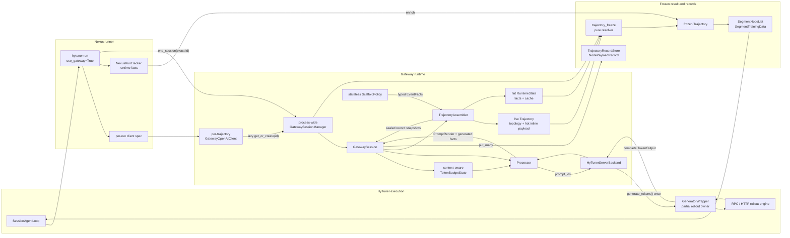
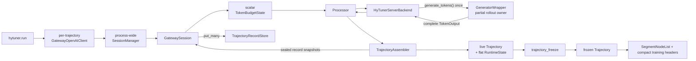
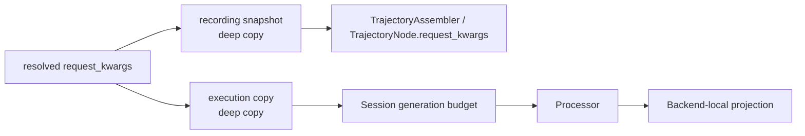
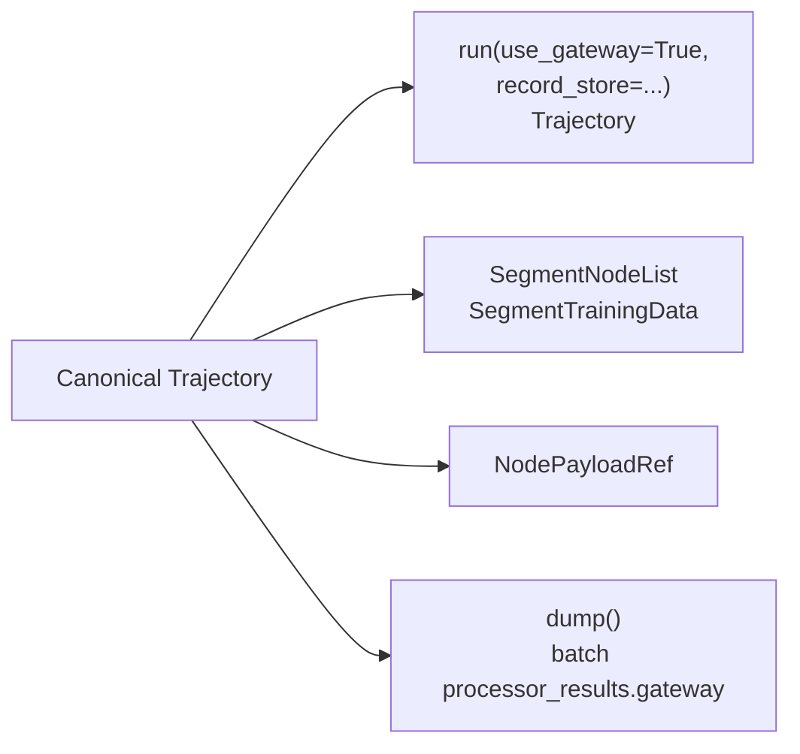

# Gateway Trajectory Contract 设计

日期：2026-07-21（2026-09-01 同步 canonical composition、TrajectoryRecordStore 与 Gateway V1 projection 退役）

状态：Implemented through the MR 3 candidate

审阅基准：`origin/main`

目标基线：`main`

代码评审：[MR !961](https://git.woa.com/nexus-agent/nexus/-/merge_requests/961)（PR1：main-agent 网关核心）

## 摘要

Gateway 位于 agent scaffold 与推理 backend 之间。它对 agent 保持 OpenAI-compatible client 接口，同时把每次
模型调用重建为可审计、可序列化、可投影成训练样本的 `Trajectory`。

设计采用一份 live public topology 和一份 flat private state：

1. `TrajectoryAssembler` 直接修改一份 live `Trajectory`，负责 prefix matching、prompt render ownership、token
   continuity 和 physical boundary；这份 `Trajectory` 是唯一的 `roots` / `parent` / `children` 拓扑。
2. `RuntimeState` 只保存有序 typed-fact ledger 和可重建 lookup cache，不保存 message、node、path 或 adjacency
   副本。无状态 `ScaffoldPolicy` 将 wire event 解释成 typed facts。
3. `trajectory_freeze.freeze_trajectory()` 对一致的 `(Trajectory, RuntimeState)` pair 执行 selection、logical
   chain/correlation resolution、timeline 收敛与公共 schema 验证；active snapshot 先深复制 pair，finish 原地解析。

`Trajectory` 是 Gateway 内部及训练交接路径上的权威中间表示。Gateway mode 的 HyTuner runner 只返回 canonical
`Trajectory`。Node seal 后，token/logprob/top-k/routes payload 经注入的 `TrajectoryRecordStore`
一次性发布；Trajectory 只长期保留 topology、shape metadata 和 opaque refs。Nexus 内不再提供 Gateway V1
`TrajectorySegment` 或 `to_legacy_*()` projection。

## 0. 落地方式与本 PR 范围

本文档最初随 Gateway 核心 PR1 提交。下表记录 2026-08 的 Gateway 功能拆分，不是 2026-09 的
Trajectory KVStore MR 编号；后者以 `docs/internal/trajectory-kvstore/` 下的 engineering spec 和逐 MR spec 为准。
本文已同步 KV MR 3 删除 Gateway V1 projection 后的现行 contract。

| PR | 范围 | 本文档相关章节 |
| --- | --- | --- |
| **PR1（本 PR）** | 网关核心：`GatewayOpenAIClient` / `GatewaySession` / `Processor` / `TrajectoryAssembler` / live `Trajectory` / flat `RuntimeState` / `trajectory_freeze` / TITO 与 segment 派生；direct policy 仅 `nexus_main_agent` 与 `generic`；main-agent 网关侧；single-run TITO 路径；compaction manager；request_meta 贯通 | §3–§9、§12；§11.6 中的 `nexus_main_agent`/`generic` |
| PR2 | batch runner | §10.2 |
| PR3 | Claude Code / Codex，及 anthropic/responses proxy | §11.6 中的 `claude_code`/`codex`；sidechain/subagent 的 CC 相关场景 |
| PR4 | search agent / whitebox | §11.6 中的 `search_agent` |

阅读约定：契约本身是完整的（sidechain、subagent、forest、多 scaffold policy 等都在设计层描述），但**代码落地跨 PR**。凡涉及 batch runner、Claude Code/Codex、search agent 的具体实现，均属后续 PR；本 PR 的评审边界是上表 PR1 一行列出的模块与 `nexus_main_agent`/`generic` 两个 direct policy。四个 PR 的逐文件归属、可重组不变量与各自的端到端验收门，登记在 `docs/internal/31`（内部拆分账本），不在本对外设计文档展开。

## 1. 目标与非目标

### 1.1 目标

- 忠实记录 Gateway 实际发给 token backend 的 prompt IDs，以及 backend 实际返回的 generated IDs。
- 让每个 token-level message span 同时拥有 `original_message`、`templated_message` 和对应的
  `TokenAccount`。
- 支持 compaction、retry、render restart、sidechain、subagent 和多 root forest，而不把轨迹提前拍平成一条
  list。
- 将 scaffold-specific 判断限制在无状态 event inspection；公共 `Trajectory` 只保存普通数据和已解析结论。
- 让训练、持久化、可视化和审计从同一个 `Trajectory` 派生，避免各消费方重新建树。
- 通过统一的 record Store interface 隐藏 InMemory、Ray 和后续 production storage 的传输细节。
- finalization 后只跨 Ray 传递 compact Trajectory；完整 token payload 留在 Store。
- 对无法证明的 token ownership 或物理连续性 fail loudly，不编造归属。

### 1.2 非目标

- `Trajectory` 不负责调用模型、应用 chat template 或解析 scaffold 协议信号。
- frozen `Trajectory` 不重新运行 prefix matching，也不能反向恢复在线 lookup cache 或 policy 瞬态状态。
- Gateway 不试图用一套无声明规则猜出所有 scaffold 的 compaction、chain 和 response-selection 语义。
- 当前版本不支持 rejected sibling 训练导出或自定义 reward policy。
- 当前版本不承诺 per-message multimodal expanded-token ownership。
- 当前版本不持久化 backend 的完整 effective sampling 或每次 abort/resume attempt 参数。
- 当前版本不是独立发布、跨 Nexus 版本兼容的 Python contract package。

## 2. 术语

| 术语 | 含义 |
| --- | --- |
| Wire message | scaffold 在一次请求或响应中实际传递的 OpenAI-format message |
| Original message | 节点保存的主 wire message；不会被 templated text 替代 |
| Templated message | tokenizer template 分配给该 message 的实际文本 span |
| Token account | 该 templated span 的完整 token IDs，以及其中 sampled span 的位置 |
| Live Trajectory | `TrajectoryAssembler` 直接修改的唯一权威 public forest topology |
| RuntimeState | 私有 flat typed-fact ledger 与可从 Trajectory 重建的 lookup cache |
| ScaffoldPolicy | 无状态 wire-event inspector；输出 message identity、boundary、membership 与 correlation facts |
| ScaffoldContext | 非持久化的 request-scoped lane/timeline 事实；跨 event 复用时不携带 message identity 或 anchored fact |
| Trajectory freezer | 从一致 pair 解析 selection/chain/correlation 并验证公共结果的 resolver |
| Trajectory | scaffold/model/policy-agnostic 的公共 forest 契约 |
| Chain | 一条具有稳定执行身份的逻辑流，例如 main、subagent 或 session-memory |
| Segment | 从 frozen topology 派生的一份连续训练样本 |
| Semantic boundary | policy 明确声明的训练语义切分，例如 summary inference 或 compaction resume |
| Physical restart | token/message representation 无法安全续接时产生的训练流切分 |
| Selected response | sibling response policy 保留的候选；不等同于唯一成功或唯一正样本 |

这里的 “agnostic” 只描述物化后的公共对象：对象中没有 policy、tokenizer、backend 或 scaffold 实例。
它仍会忠实携带 provider/scaffold 产生的 wire facts 和 evidence labels；agnostic 不等于删除来源事实。构造过程
本身仍必须使用正确的 scaffold policy 和 tokenizer/template 配置。

## 3. 总体架构



关键约束：

- live `Trajectory` 是唯一父子关系来源；`RuntimeState` 不复制 topology 或 message。
- `trajectory_freeze` 可以解析跨 subtree 的 spawn/join、chain parent 和 sibling selection，但不会再次匹配
  history prefix，也不创建第二份 topology。
- `Trajectory.to_segment_node_lists()` 只读取 frozen topology、selection、chain 和 boundary；它不调用 policy，
  也不 hydrate Store payload。
- Node record publication 是 completion 返回前的 durability fence；Store I/O 不进入 Assembler。
- token/message 的物理不连续性由 `TrajectoryAssembler` 在线冻结为 boundary；freezer 只解析、验证并安全投影。

### 3.1 与 MR !896 的关系

当前实现保留 !896 的执行与生命周期前半段：per-trajectory client、process-wide SessionManager、
`GeneratorWrapper.generate_tokens()` 和按精确 trajectory ID 结束 session。主要替换的是 Session 之后的数据
重建和导出链路。



| Seam | MR !896 | 当前实现 |
| --- | --- | --- |
| 执行与 partial rollout | `GeneratorWrapper` 完整负责 | 保持不变 |
| Session 结束结果 | `GatewayTrace` | canonical `Trajectory` |
| Runtime topology | `TrajectoryTree` | `TrajectoryAssembler` 直接修改 live `Trajectory` |
| 冻结和导出 | `TrajectoryExporter` 直接生成 chunks | `trajectory_freeze` 解析一致 pair，再由 `Trajectory` 投影 |
| Token budget | 单一 baseline 和文本后缀计数 | per-context token-ID ledger |
| HyTuner 转换 | runner 手工转换 `training_chunks` | Gateway mode 返回 canonical `Trajectory`；HyTuner 消费 `SegmentTrainingData` |
| Nexus 运行事实 | `HytunerProcessor` 与 runner helpers | `NexusRunTracker` enrich `Trajectory` |

## 4. 模块职责和 interface

### 4.1 `GatewayOpenAIClient`

Client 是 agent 侧的外部 seam：

- 提供 OpenAI-compatible `create_completion()`。
- 每个 client 绑定一个显式 trajectory ID，并通过 process-wide SessionManager 惰性创建对应 session。
- 将 configured、override 和 per-call 输入解析为一份 resolved `request_kwargs`。
- 将 `request_meta` 作为 Gateway control-plane facts 传给 policy，不混入 provider request。
- 限制当前 Gateway 为 non-streaming、`n=1`。
- Session 生命周期由 runner 直接通过 process-wide SessionManager 结束。

`request_kwargs` 是经过 Gateway 优先级解析后的请求意图，不是调用点 literal kwargs，也不是 backend 最终
执行参数。

#### 多模型配置与用途路由

Gateway 支持在同一条轨迹中使用多个模型。 每个模型配置独立的 endpoint、tokenizer 和上下文长度：

设置 `models` 时，`server_manager`、`openai_client`、`tokenizer`、`tool_parser`、`template_parser`、
`apply_chat_template_kwargs`、`mm_plugin`、`priority`、`enable_rollout_routing_replay`、`max_model_len`
只允许配置在模型项内；与 `models` 并列会报错。 全局 `token_budget`、`token_budget_include` 仍配置在顶层 `client_args`。

```python
client_args = {
    'trajectory_id': trajectory_id,
    'scaffold_policy': 'nexus_main_agent',
    'models': [
        {
            'id': 'main', 'server_manager': main_endpoint,
            'tokenizer': main_tokenizer, 'max_model_len': 8192,
        },
        {
            'id': 'summary_30b', 'server_manager': summary_endpoint,
            'tokenizer': summary_tokenizer, 'max_model_len': 8192,
        },
        {
            'id': 'calculator_8b', 'server_manager': subagent_endpoint,
            'tokenizer': subagent_tokenizer, 'max_model_len': 8192,
        },
    ],
    'default_model_id': 'main',
    'compaction_model_id': 'summary_30b',
    'subagent_model_id': 'calculator_8b',
}
```

- 根 client 绑定 `default_model_id`，fork 子 client 绑定 `subagent_model_id`。 普通推理、token 计数和长度查询使用绑定模型。
- Policy 根据请求 metadata 或消息内容识别 `summary_inference`，主 agent 和子 agent 的摘要均使用 `compaction_model_id`，续写恢复绑定模型。
- `models[].id` 标识注册模型；下游请求的 `model` 通过 `models[].request_args.model` 或下游 client 配置。
  HTTP 服务使用 `models[].openai_client`。
- 前缀与 segment 计数按模型和 context 隔离，切换模型重新渲染并切分 segment。 全局 `token_budget/token_budget_include` 控制共享预算，各模型的 `max_model_len` 控制上下文长度。
- 同一条轨迹记录所有模型输出；`provider_facts.model_id` 保存注册模型 ID，`provider_facts.model` 保存服务返回的模型名。

### 4.2 `GatewaySession`

每个 session 对应一个 trajectory ID，并拥有独立 `TrajectoryAssembler`：

- 对 resolved request 建立两个 deep copy：不可修改的 recording snapshot 和可由执行策略修改的 execution
  copy。
- 按 chain context 维护冻结前缀游标（frozen prefix）和 token-consumption ledger。
- 调用 Processor，并将 Processor/Backend facts 原子地交给 Assembler。
- `get_trajectory()` 默认返回与 live `(Trajectory, RuntimeState)` 深隔离的 active 快照；内部终止路径可通过
  `copy_inputs=False` 原地解析 live pair。
- `end()` 通过无拷贝 `get_trajectory()` 原地物化 live trajectory、写入 terminal facts 并返回它。

Session 的 generation budget 是当前实现的执行策略，不属于 TITO 数据模型。详见第 11 节。

### 4.3 `Processor`

Processor 是模型输入构造的深模块，其 interface 只暴露一次 completion：

- 配置 tokenizer 时走 token lane。
- 未配置 tokenizer 时走 message lane。
- token lane 内部统一完成 render、span discovery、token construction、backend 调用、decode 和 tool parse。
- backend adapter 负责自己的参数方言，Processor 不维护第二份长期 sampling state。

不需要额外的 `RenderAdapter`。结构化 template parser 和 prefix renderer 是 Processor 内部两种 span discovery
实现，最终必须汇入同一个 `PromptRender` 和同一套 token construction。

### 4.4 `TrajectoryAssembler` 与 `RuntimeState`

`TrajectoryAssembler` 直接拥有在线拓扑和 token ownership，`RuntimeState` 只提供 flat facts 与游标：

- direct `ScaffoldPolicy` 用 normalized message identity 和 request-local metadata 产生 typed `EventFacts`。
- `extract_context()` 只保留瞬态 `ScaffoldContext`；跨 request/response/observation 复用时，lane ownership
  来自 context，而 message identity 与 anchored wire facts 始终从当前真实 event 重新解析。
- `_find_or_create_path()` 在 semantic match 后按 templated text 和 token IDs 判定 realization 同一性——这是
  放置期的账本比对，不是匹配授权。
- 同一 original message 的不同物理字节一律形成 realization sibling；冻结节点一经写入不可变，不存在
  原地闭合扩展路径。
- `TrajectoryAssembler` 记录 output LLM node、provider facts、boundary、timeline，并维护 frozen prefix 游标。
- `RuntimeState` 的 occurrence ledger 保留 typed fact 顺序；lookup cache 可以从 live `Trajectory` 和 ledger 重建。
- policy boundary 与 physical restart 在 output LLM node 上合并。

live node 直接是公共 `TrajectoryNode`；policy/runtime-only facts 不写入公共 schema。

### 4.5 `trajectory_freeze`

`freeze_trajectory()` 是一致 Trajectory/runtime-state pair 上的 resolver：

- active snapshot 一次性深复制 live `Trajectory` 与 flat `RuntimeState`；finish 则原地消费 live pair。
- 按 public roots/children 验证 topology 和所有 runtime 引用；NodeId 在 runtime 按创建时序分配，export 不重编号。
- 将 competing LLM sibling 的 policy verdict 写为 `selection`。
- 从 ordered typed facts 解析 logical chain、spawn、join、parent、correlation evidence 与 timeline。
- 保持 live `parent` / `children` 拓扑不变，不从 facts 构造 shadow adjacency。
- 通过 `Trajectory.dump()` 验证公共快照可安全序列化。

### 4.6 `Trajectory`

`Trajectory` 是公共深模块。调用方通过少量 interface 访问拓扑、chain、canonical composition、training headers
和 serialization：

```python
trajectory.iter_nodes()
trajectory.node_chain(node_id)
trajectory.to_messages(chain_id='main')
trajectory.to_segment_node_lists(chains='main')
replacement = trajectory.prepare_segment_training_data(
    initializations=[(segment_node_list, training_enabled)],
)
trajectory.segment_training_data = replacement
trajectory.discard_inline_payload()
trajectory.dump()
Trajectory.from_dump(data)
```

Topology 物化后按契约视为只读；训练侧可写 node reward、final reward 和 segment-occurrence-owned training
data。Python 类型当前没有强制 immutable，因此调用方不得原地修改 topology 或 wire facts。Segment training data 必须先通过
`prepare_segment_training_data()` 完整准备，再一次性发布 replacement。训练侧只投影一次 canonical
`SegmentNodeList`，随后直接读取对应 `SegmentTrainingData`。`discard_inline_payload()` 只能在 terminal trajectory
的全部 training headers 发布后调用；它释放仅供 producer 使用的 messages、render/timeline 和 token hot cache，
使跨 Ray 的对象大小不随 Node payload 增长。

### 4.7 `TrajectoryRecordStore`

Store 是注入 `GatewaySession` 的业务 interface，不属于 `Trajectory`：

- `put_many()` 一次发布完整 Node/Segment record snapshots，并按输入顺序返回 opaque refs；Store 中的 Node
  record write-once；
- `get_many()` 只读取当次 stage 请求的 fields，可选择阻塞到 fields ready；
- `put_fields_many()` 只向 Segment records 追加真正 late-produced fields；
- `release_many()` 幂等释放 refs。

`InMemoryTrajectoryRecordStore` 与 `RayTrajectoryRecordStore` 直接实现同一 interface。Ray actor、pickle codec、
物理 key 和 retry 细节留在 adapter 内部；Gateway/HyTuner 不按 backend 类型分支。Assembler 只返回本次调用刚
sealed 的 record snapshots，Session 负责 Store I/O 和 ref attach，避免把 transport 引入 topology builder。

## 5. 公共数据模型

### 5.1 `Trajectory`

| 字段 | 语义 |
| --- | --- |
| `schema_version` | 当前为 `gateway-trajectory-v1` |
| `session_id` | trajectory identity |
| `state` | 通常为 `active` 或 `completed` |
| `nodes` | `NodeId -> TrajectoryNode` 扁平表 |
| `roots` | parent 为 `None` 的 forest roots；不存在 synthetic root |
| `chains` | `ChainId -> Chain` 的逻辑执行流表 |
| `to_messages(chain_id)` | 从 canonical tree 派生指定 chain 的最新 wire transcript |
| `timeline` | active/finalization 阶段无法锚定到 Node 的 events；compact publication 前释放 |
| `final_reward` | trajectory-level reward；默认不广播给 segments |
| `termination_reason` | rollout termination fact |
| `metrics` | trajectory-level numeric/operational facts |
| `extra` | runner/session-level附加事实，不承担 token ownership |
| `segment_training_data` | completed trajectory 上按稳定 `segment_id` 保存的 compact occurrence headers；不属于 topology |

`root` 不是一个真实公共节点。空 trajectory 的 `roots == []`。

### 5.2 `TrajectoryNode`

每个节点是一条公共 wire message，分为三类事实。

Wire facts：

| 字段 | 语义 |
| --- | --- |
| `node_id` | 物化后的物理节点 identity |
| `message_id` | `TrajectoryAssembler` 创建顺序中的逻辑 message identity |
| `parent` | 指向父节点；forest root 为 `None` |
| `children` | 按在线装配顺序排列的直接子节点；与 `parent` 在同一次 node commit 中写入 |
| `generated_by` | `llm`、`observation` 或 `client` |
| `original_message` | active/finalization 阶段的主 wire message；compact publication 前释放 |
| `templated_message` | active/finalization 阶段该 Node 拥有的 rendered text span；随后释放 |
| `request_kwargs` | active/finalization 阶段该 LLM call 的 resolved ingress request；随后释放 |
| `token_account` | token ownership 摘要与 `NodePayloadRef`；message lane 为 `None` |
| `provider_facts` | model、response ID、usage、finish reason 和 timing 等 |
| `request_message_overrides` | active/finalization 阶段该 LLM call 重发的 ancestor wire variants；随后释放 |
| `timeline` | active/finalization 阶段唯一锚定到该 Node 的 events；随后释放 |
| `as_sent_variants` | active/finalization 阶段 normalized identity 相同的 wire variants；随后释放 |

Semantic conclusions：

| 字段 | 语义 |
| --- | --- |
| `segment_boundary` | 该 LLM node 是否打开新 segment，以及 kind/causes/evidence |
| `selection` | 仅 multi-LLM sibling groups 使用：`selected` 或 `rejected_sibling`；不同 cache contexts 独立裁决 |
| `invocation` | trusted request declaration 中的 iteration/retry；不从文本猜测 |

Training annotation：

- `reward` 是可选 node-level reward。
- response-axis tensors 属于 segment occurrence，不写入 `TrajectoryNode`。当前 compact header 只保存 shape、
  generated ranges 和 training admission；late-produced old/ref/advantage/return fields 将由后续
  `SegmentDataRecord` 承载。

节点不保存 `chain_id`、resolved endpoint 或 render key：

- children 与 parent 在在线 node commit 时同时写入，分别支持向下和向上遍历；
- chain membership 从 nearest ancestor chain root 派生；
- training endpoints 从 topology、selection 和 chain roots 派生；
- render continuity 已冻结成拓扑和 `SegmentBoundary`。

`as_sent_variants` 只用于审计 normalized-equal 的 wire spelling，不影响 topology、selection 或 segment。
`request_message_overrides` 则是具体 LLM call 重发 history 时的精确输入事实，`to_messages()`/segment messages 会
用它覆盖 ancestor 的主 `original_message`。

### 5.3 `TokenAccount`

`TokenAccount` 用一个 Store ref、短期 `token_ids` hot cache 和两个整数表达 token ownership：

```text
token_ids = glue_ids + generated_ids + trailing_ids
                        ^^^^^^^^^^^^^
                        gen_start, gen_len
```

| 字段 | 约束 |
| --- | --- |
| `payload_ref` | Node seal publication 成功后得到的 immutable `NodePayloadRef` |
| `token_ids` | producer-local hot cache；training headers 发布后清空 |
| `gen_start` | sampled span 在 `token_ids` 中的起点 |
| `gen_len` | sampled span 长度 |

三个派生视图：

```python
account.glue_ids  # mask 0, sampled span 之前
account.generated_ids  # mask 1
account.trailing_ids  # mask 0, sampled span 之后
```

不再存在独立 `post_observation_token_ids`。历史 closure 和 observation token 都由同一完整 token stream 表达。
`logprobs`、top-k 和 routed experts 不再属于 `TokenAccount`；它们只存在于完整的
`NodePayloadRecord` publication snapshot。长度/pair/width 校验仅在 backend result seam 执行一次。

#### 5.3.1 `NodePayloadRecord`

每个 token-level Node 对应一个由 `(trajectory_id, node_id)` 稳定寻址的 record。必需字段是 `token_ids`；
`logprobs`、`topk_indices/topk_values` 和 `routed_experts` 按 producer 能力可选。Node record
write-once，不使用 append；同 identity 不得静默覆盖不同 payload。当前 adapter 接受字节相同的重复写，
Session 正常路径不依赖业务层 retry。ref 只包含 namespace 和 record ID，不内嵌 payload。

### 5.4 `SegmentBoundary`

`SegmentBoundary` 存在于打开新 segment 的 LLM node 上。因此 `starts_new_segment=True` 表示该节点是新
segment 的第一个 LLM node，不是上一个 segment 的最后一个节点。

字段只保留：

- `starts_new_segment`
- `kind`
- `causes`
- `evidence`

public contract 不保留重复的 rule/reason 字段。具体 policy rule 是 direct policy 实现细节；公共对象保留训练和
审计需要的结论。

### 5.5 `Chain`

`Chain` 表示稳定逻辑执行身份：

| 字段 | 语义 |
| --- | --- |
| `chain_id` | main 为 `main`；声明或推断的 sidechain 使用稳定 identity |
| `kind` | main、subagent、session-memory 等事实标签 |
| `parent_chain_id` | 唯一解析时填写；歧义时保持 `None` 并保存 candidates |
| `roots` | 该 chain 无法从 physical parent 继承 membership 的 ownership entries |
| `spawn` | 已解析 spawn node/tool-use ID 或 candidates |
| `join` | 已解析 join node/tool-use ID/kind；fire-and-forget 时为 `None` |
| `detector` | 产生 chain classification 的声明/协议证据标签 |
| `evidence` | correlation、歧义 candidates 和 stable attributes |

一个 chain 可以有多个 roots，因为同一逻辑 identity 可能在 forest 中有多个独立 entry。Segment boundary 不会
自动创建新的 chain root；compaction 和 chain identity 是正交概念。

### 5.6 `selection` 和 rejected responses

- 同一 physical parent 有多个 LLM children 时写 `selection`；policy 先按 cache context 分组，再独立裁决每组。
- physical parent 只有一个 LLM child 时保持 `None`。
- 不同 cache contexts 的 siblings 不互相竞争，因此可以同时为 `selected`。
- `KEEP_ALL` response policy 会把竞争 siblings 都标为 selected。
- 其他 response policy 可以保留所有响应节点，但将不采用的节点标为 `rejected_sibling`。
- rejected 节点仍在 topology 中供审计；当前 `to_segment_node_lists()` 不导出它们。

## 6. 请求参数数据流

### 6.1 单一 resolved request

Client 将以下兼容输入归一到一份 per-call `request_kwargs`：

```text
configured request_args + models[].request_args
  -> optional _request_args_override
  -> per-call sampling_params
  -> per-call provider kwargs / model / tools
  -> resolved request_kwargs
```

主要优先级：

- `_request_args_override` 传入非 `None` mapping 时替换 configured defaults；
- per-call `sampling_params` 和普通 provider kwargs 后写覆盖；
- `model` 使用 `setdefault`，保留已配置 model；
- `tools` 使用 sentinel，能够区分 absent、`None` 和空 list；
- 显式 `None` 和未知 provider 扩展字段进入 recorded request；
- `model_id`、`trajectory_id`、Gateway metadata、`request_meta`、`trace_meta`、`priority` 不进入 provider request。

### 6.2 Recorded request 与 execution request



因此 backend 或 execution policy 的 mutation 不会改写 `TrajectoryNode.request_kwargs`。

### 6.3 当前未保存的参数事实

- Session budget 修改后的 effective `max_tokens`；
- token backend allowlist/defaults 后的 effective sampling；
- abort/resume 中每个 backend attempt 的 prompt 和 remaining budget；
- priority、generation gate 和 frozen prefix 命中情况。

这些缺失影响严格执行复现和审计，但不改变已经保存的 prompt/generated token IDs。

## 7. Token-in / Token-out 算法

### 7.1 正确性参照系

当前文本 token lane 的强保证是：

> Processor 构造一份带 message ownership 的 `PromptRender`，将其中同一份 token IDs 交给 backend；
> `TrajectoryAssembler` 直接把这份输入和 backend 返回的 generated IDs 写入 live `Trajectory`；freezer 只解析并验证这些物理事实。

这是 Gateway→backend seam 上的 TITO，不等价于未经观测的 backend 内部 model tensor。对于普通文本 token
backend，两者按当前 backend contract 应一致；对于 multimodal expansion，当前不作此推断。

### 7.2 `PromptRender`

一次 token request 必须满足：

```text
concat(templated_messages) + generation_prompt == rendered_text
concat(message_token_ids) + generation_prompt_ids == prompt_ids
len(templated_messages) == len(message_token_ids) == len(messages)
```

span discovery 有两条内部路径：

1. structured template parser 直接给每条 message 的 rendered span；
2. generic prefix renderer 逐步 apply template，通过稳定文本 prefix 得到 span。

两条路径得到 span 文本后，都对**拼接后的完整文本一次性** `encode(..., add_special_tokens=False)`，再按 span 文本长度的偏移把 token 归属回各 span，构造同一种 `PromptRender`（详见 §7.3）。若 template 不暴露稳定 ownership，Processor 在 inference 前报错。

### 7.3 canonical 编码与 span 归属

Gateway 发送给 backend 的 prompt IDs 是对**完整 rendered text 的一次性 canonical 编码**——与 tokenizer 对整段文本的 one-shot encoding 一致。span 边界只是内部记账：编码完成后，按各 span 文本的累计长度把 token 分配回对应 span；跨边界的 token（例如模板把相邻两条 message 折叠进同一块时，BPE 在边界处合并出的 token）归属到靠前的那个 span。

这样处理的原因：早期实现曾对每个 span 单独 encode 再拼接，若 tokenizer 满足

```text
encode("a") + encode("b") != encode("ab")
```

则在无特殊 token 分隔的折叠边界上，逐 span 拼接会得到与 canonical one-shot 不同的 token 流，让 backend 看到非 canonical 输入。改为整段 canonical 编码后，发送流即 canonical 流，边界处的 BPE 合并被如实包含；span 归属不再具有权威性，仅用于逐节点审计与训练 mask 对齐。span 边界的归属误差不影响正确性：段切分不会切在被模板折叠进同一块的两条 message 之间。

### 7.4 Frozen prefix 拼接：语义授权，采样流为真值

Session 从 live `Trajectory` 与 lookup cache 取当前 context 的 `FrozenPrefix`：游标路径上 semantic 判等的最长前缀，且要求
`normalize_tools` 与游标记录一致（tools 渲染进共享前缀但不在 message 判等内）。**授权是纯语义的**：
命中即把冻结的采样 token IDs 原样拼入新 prompt，render 只用于产出新增 tail 与 generation prompt。

采样流是模型上下文的唯一真值。重渲染与采样流的字节差异（例如 tool parser 对 JSON 参数的无损归一化）
不否决复用；Processor 仅在偏离时输出观测 warning（独立可删的观测点，不承担任何行为）。tail 推导：

- 重渲染字节恰好延伸冻结流时，直接以 frozen text 为差分锚点（活帧模板对孤立历史前缀的渲染会附加
  think 帧，此锚点在该类模板上必需）；
- 否则以 `render(messages[:count])` 为锚点，用冻结尾公共后缀定位块闭合（seam），闭合字节归还给
  tail 首 span 头部；
- 冻结尾在重渲染中不可定位时（例如采样终结符差异）放弃拼接，fresh 重建并冻结 physical restart。

语义不匹配或 tools 变化同样走 fresh 重建。历史 token stream 永不因下一轮 request 被重新编码，除非发生
上述 restart。

**接缝默认与兼容开关。** 默认行为是规范的 ChatML 边界：拼接时保留模板在每个 turn 边界写出的块闭合（例如 `<|im_end|>` 之后的换行）。这是 chat 模板与推理引擎共同约定的正确形态。环境变量 `GATEWAY_LEGACY_SEAM_COMPAT=1` 提供一个兼容开关：复刻 legacy 客户端"全量渲染减去已缓存文本"的减法边界——该减法会把闭合换行切在被丢弃的一侧，导致喂入流在每个 turn 边界少一个换行 token。此开关仅用于对既有 golden（在 legacy 侧上生成）做逐位对齐验证；上游修复 legacy 减法并重新生成 golden 后即可移除。该差异只涉及 turn 边界的一个模板胶水 token，不改变段结构与切分。缝仅在块内部（如 tool 参数无损归一化）造成重渲染与冻结流字节不一致时才需 `_locate_seam` 定位闭合并归还给 tail 首 span；对块闭合后无胶水的模板（如混元系 eos 后直接换块），两种边界产出一致，此开关无行为差。

### 7.5 Template closure（leading framing）

历史 assistant turn 在下一轮作为 history 时，template 补出的 closing token 不追溯写入旧节点：冻结节点
一经写入不可变，closure 字节自然落在下一个 tail span 的头部（leading framing），随新尾编码入流，训练
mask 为 0。发送流与段产物与 trailing 归属方案逐字节相同，差异仅在逐节点归属与审计显示。

因此不存在原地扩展路径：同一 semantic message 的任何字节差异都会建立 realization sibling，并按 §7.8
冻结 restart。

### 7.6 Observation ownership

显式 `record_observation()` 记录 wire message，但拒绝调用方自行提交 observation token IDs。Observation 的
templated text 和 token ownership 由下一次真实 `PromptRender` 决定。

因此：

- observation 后还有下一次 LLM request：其 IDs 从下一次 prompt 中得到，并在 segment 中 mask 为 0；
- trajectory 结束前最后一个 observation 从未再次发给模型：保留 message，但没有虚构 token ownership；
- assistant closure 位于 generated span 后、显式 observation 前，顺序由完整 token stream 自然表达。

### 7.7 Output ownership 和 numeric facts

LLM output node 的 account 为：

```text
generation_prompt_ids + backend_generated_ids
```

- sampled span只覆盖 backend-generated IDs；
- logprobs/top-k 只与 sampled span 对齐；
- backend abort/resume 会先在 backend adapter 中拼成一个逻辑 response；token/logprob/top-k presence 必须跨
  attempts 一致；
- `TrajectoryAssembler` 不从 decoded text 重新 tokenize generated IDs。

### 7.8 Physical restart

Assembler 在每个 LLM call 上比较同 chain 的最近物理流，冻结以下 discontinuity：

| Cause | 条件 |
| --- | --- |
| `training_representation_discontinuity` | token lane 与 message lane 切换 |
| `render_context_discontinuity` | cache/scaffold identity 改变；message lane 还包括 tools 改变 |
| `render_divergence` | live Trajectory 已建立不同 physical realization，或当前 prompt 既不是相同 prompt，也不以之前完整 stream 为 prefix |
| `token_prefix_discontinuity` | projection 可识别的兼容诊断；当前 live Assembler 通常将这类不连续记录为 `render_divergence` |

token lane 中 tools 变化一律拒绝 frozen 拼接并形成 restart：tools 渲染进共享前缀且不在 message 判等内，
纯语义授权下无法区分"渲染不变"与"新工具进入 system span"，保守拒绝。`render_divergence` 的 boundary
evidence 携带归因标签：`content-change`（请求内容离开记录流）、`context-change`（tools 变化）、
`assumption-violation`（同语义历史渲染出不同字节）、`terminator-residue`（分歧差量命中
`ScaffoldPolicy.block_terminator_ids` 声明的模板终结符序列，默认空，作为截断重发升级钩子）。

## 8. 从 frozen topology 派生 segment composition

Gateway V2 通过 `Trajectory.to_segment_node_lists()` 从 frozen topology 派生 canonical segment composition。
它为每个 occurrence 生成只含 `segment_id`、`chain_id`、有序 `nodes` 和
`first_response_node_index` 的 `SegmentNodeList`；`response_nodes` 和 `last_response_node` 均从这些字段派生。

segment composition derivation 的顺序是：

1. 按请求的 chain 集合遍历 selected chain-local paths；
2. 跳过 `rejected_sibling`；
3. 按 `SegmentBoundary.starts_new_segment` 形成 semantic groups；
4. 对 physical-only discontinuity 再做安全切分；
5. 对共享 LLM node 做全局 first-visited dedup；
6. 消费 Assembler 已冻结的 representation/prefix discontinuity physical boundaries；这里信任 construction
   invariant，不重复验证 representation 或 token continuity；
7. 构造 payload-free 的 `SegmentNodeList`；该步骤不调用 Store，也不生成完整 token row。

训练注解按 **segment occurrence** 保存，而不是按共享物理 node 保存：

- `prepare_segment_training_data()` 从 `SegmentNodeList` 固化同一个 composition reference、prompt/response
  lengths、generated ranges 和 `training_enabled`；只有完整 replacement 准备完成后才由调用方原子发布；
- `response_mask` 从 `generated_ranges` 展开；默认 `loss_mask` 在 materialization 时由 `training_enabled` 选择
  response mask 或全零，不在 compact header 中复制完整 vector；
- `response_ids`、logprobs、top-k 和 routes 不复制进 `SegmentTrainingData`。HyTuner worker 根据
  `node_list.nodes[*].token_account.payload_ref` 批量读取所需 fields，并在真正训练前只 materialize 一次；
- `SegmentTrainingData` 不承担阶段 tensor mailbox。未来 late-produced old/ref/advantages/returns 使用
  `SegmentDataRecord`，但首个 producer/consumer 出现前不创建空 record 或无 consumer 的 `data_ref`；
- `segment_id` 是 occurrence identity 和后续 scatter key，不是可选诊断字段。

`to_segment_node_lists(chains=...)` 支持 `'all'`、`'main'` 和显式 chain ID list。Nexus 不再提供
`TrajectorySegment`、`SegmentBatch`、`to_segments()` 或 Gateway V1/debug token materializer。

## 9. 序列化契约

### 9.1 Pickle

`Trajectory` 的稳定类路径是 `nexus.gateway.trajectory.Trajectory`。Ray 传输的是调用
`discard_inline_payload()` 后的 compact object：topology、shape metadata、`NodePayloadRef` 和
`segment_training_data` 保留，wire/render/timeline/token arrays 已释放。同一 object graph 内由多个 headers 共享的
Node 在反序列化后仍保持 identity。只有 chain membership cache 在反序列化后重建，并要求 schema version 完全
匹配。旧 stale pickle 不属于当前迁移契约；Node payload 的跨进程传输由 `RayTrajectoryRecordStore` 独立验证。

当前 pickle contract 要求消费环境安装兼容版本的 Nexus；它不是独立 wheel 或跨版本协议。

### 9.2 `dump()` / `from_dump()`

`dump()` 产生 `gateway-trajectory-v1` plain-data schema：

- `dump()` 只用于尚未发布 `segment_training_data` 的 plain-data trajectory；training headers 非空时会拒绝，
  并指示调用方改用 pickle/Ray serialization；
- `dump()` / `from_dump()` 不访问 Store。它们保存/恢复 opaque `NodePayloadRef`，但不会把 ref 指向的 token payload
  hydrate 或内联；需要训练数据的调用方必须同时持有同 namespace 的 Store；
- nodes 和 chains 使用显式列表；
- 每个 node 内联自己的 `request_kwargs`，canonical output 不使用 kwargs pool/ref；
- bytes、tuple 和非 object-dtype NumPy arrays 使用 tagged JSON-safe encoding；
- non-finite float、非字符串 dict key、未知对象和 object-dtype array 被拒绝；
- nodes 按 ID 输出，普通 dictionary keys 由 tagged encoder 排序；物化对象可稳定持久化为 JSON。

`from_dump()` 验证：

- schema version；
- duplicate/missing node IDs；
- parent existence 和 cycle；
- roots 与 parentless nodes 完全一致；
- request overrides 只引用 ancestors；
- chain roots、spawn/join nodes 存在且 ownership 不冲突；
- tagged values 的结构和 payload 合法。

reader 仍能读取一次早期 `gateway-trajectory-v1` 的 pooled kwargs 形式，但该形式不是当前 writer contract，也不应
由新消费方生成。

## 10. 当前消费与 publication seam



### 10.1 HyTuner runner

Gateway path 不导入或运行 legacy `HytunerProcessor`：

1. rollout worker 构造一个 `TrajectoryRecordStore` 并注入 runner；
2. runner 为每个 trajectory 构造 Gateway client spec，把同一个 Store 继续注入 `GatewaySession`；
3. Session 在 completion 返回前发布本次新 sealed Node records，并把 refs 写回对应 `TokenAccount`；
4. run 结束后按精确 trajectory ID 结束全局 manager 中的 session，得到 canonical `Trajectory`；
5. `run(..., use_gateway=True, record_store=store) -> Trajectory` 无条件返回 canonical 对象；执行事实写入
   `trajectory.extra['hytuner']`，compaction diagnostics 写入 `trajectory.extra['compaction_stats']`；
6. HyTuner finalization 原子发布 `SegmentTrainingData` 后调用 `discard_inline_payload()`，再把 compact object交给
   Controller/Buffer。

`return_trajectory` switch、Gateway `HyTunerRunOutput` projection、chat JSONL exporter 和 Nexus 内的 V1
materializer 已删除。非 Gateway runner 仍可返回现有 `HyTunerRunOutput`，不属于此次 cutover。

Gateway runner 当前不支持 `segment_shaping_config`；非空配置会在启动 agent 前明确报错，不会静默退化为未 shaping
的训练样本。

### 10.2 Batch runner

Batch runner 为每个 run/client spec 注入唯一 trajectory ID，并在 success、failure、timeout 或 exception 路径
结束对应 session。plain-data 结果仍可在未发布 training headers 前通过 `Trajectory.dump()` 存入：

```text
processor_results.gateway[client_key]
```

`dump()` 是审计/持久化接口，不是训练 payload transport；训练主链使用 compact pickle + Store refs。

### 10.3 Nexus agent `main_trajectory`

`WithMainTrajectory.main_trajectory: list[dict]` 是 agent/evaluation 使用的旧 transcript 字段，不是
`nexus.gateway.trajectory.Trajectory`。当前重构没有改变这个外部 agent output contract。

## 11. 已知限制与待确认设计

### 11.1 Multimodal expansion

当前 live Processor 对需要 HF processor 展开的 multimodal list content fail loudly。多模态 producer 与
Store ownership 留给独立的多模态分支定义；MR 3 不预留尚无生产数据源的 record 字段。后续需要明确：

- backend 接收 raw placeholder IDs 还是 expanded IDs；
- 最终 model input tensor 在哪一层展开；
- raw/expanded 两份 stream 各自的 ownership 和命名；
- media payload 是 cumulative request fact 还是 per-message fact。

在 backend contract 和真实 VLM round-trip 验证完成前，不应把现有空 `mm_data` plumbing 解释为已支持能力。

### 11.2 Effective sampling 与 budget

当前 `TrajectoryNode.request_kwargs` 保存 ingress request。Session 和 backend 可能修改 execution copy：

- 使用默认 generation limit 且 runner 提供 `max_model_len` 时，Session 先以
  `max_model_len - initial_prompt_len` 建立初始生成额度；否则 configured default `max_tokens` 是初始额度；
- 后续 prompt growth 从该额度扣除，runner 提供的 `token_budget` 再限制 trajectory 累计消费；
- 显式 per-call `max_tokens` 不经过 Session trajectory-budget rewrite；
- vLLM adapter 仍会执行 physical model-length cap；
- token backend 只投影 allowlisted sampling fields。

这些 effective values 当前不持久化。是否改为纯 per-call OpenAI `max_tokens` 语义，以及是否记录 node-level
effective sampling，需要与 HyTuner owner 确认。

`count_tokens` 按 client 绑定的模型和 chain 上下文计数，推理消费按实际使用的模型记账。
计数度量冻结采样流加渲染尾部，与 §7.4 的请求路径一致，并保持调用方的消息和工具参数不变。

### 11.3 Backend extra fields

公共契约只提升已定义语义的 facts：generated IDs、logprobs、top-k、routed experts、selected provider facts、
abort/preemption metrics。`NodePayloadRecord` 没有 generic `extra_fields`；任意 speculative-decoding counters 等
opaque backend fields 因此不会进入持久 Node payload。

在字段 ownership 和多 turn 聚合规则确定前，不应向 `TokenAccount` 增加无语义的 generic extra dictionary。

### 11.4 Finalization ownership

`GatewaySession.end()` 是 canonical freeze 实现。HyTuner runner 先通过 process-wide SessionManager
结束 session，再由 `NexusRunTracker` 补充 Nexus span/runtime/tool facts。HyTuner finalization 在所有
`SegmentTrainingData` 准备成功后原子发布 replacement，并调用 `discard_inline_payload()`；Store refs 在此之前必须已由
每次 completion publication 写入。batch runner 则直接结束对应 Gateway sessions，不执行训练 compact lifecycle。

### 11.5 Reserved training policies

- rejected sibling 保留在 topology，但训练导出未实现；
- custom reward policy 未实现；
- final reward 不广播；
- shared-prefix dedup 的 attribution policy 当前固定为 first visited；
- per-segment routed-expert 聚合当前 fixed last-wins。

### 11.6 Framework policy coverage

公共 Trajectory 不依赖 scaffold，但在线 event interpretation 依赖显式选择的 direct `ScaffoldPolicy`。当前只注册
`generic` 与 `nexus_main_agent`：`generic` 只提供严格 protocol-message identity、timeline normalization 和 main context；
`nexus_main_agent` 在此基础上只增加 declared-chain 与 compaction facts，不推断 main-agent wire history 中的 implicit
spawn/join。新增 scaffold 集成必须实现同一个无状态 event contract，并显式注册；不存在 declarative DSL 或通用
adapter fallback。

## 12. 不变式

实现和 reviewer 必须共同维护：

1. live `Trajectory` 是唯一权威 topology；`RuntimeState` 和 freezer 不保存第二份 roots/parent/children。
2. 每个公共 node 只有一个 `parent`；parent 和 children 必须双向一致。
3. Freeze 对 live Trajectory、RuntimeState 与 session facts 做 deep isolation。
4. active/finalization 阶段的 `original_message` 永不被 templated text 替代；compact publication 时两者一起释放。
5. token lane 的 `templated_message` 与 `TokenAccount.token_ids` 属于同一 ownership span。
6. Processor 发送给 backend 的 prompt IDs 与 live Trajectory 记录的 prompt IDs 相同。
7. generated IDs 直接来自 backend，不从文本 retokenize。
8. logprobs/top-k 只对齐 `gen_len`，并在 `NodePayloadRecord` producer seam 校验一次。
9. Observation token ownership只来自下一次真实 prompt；terminal observation 不造 token。
10. 冻结复用的授权 = 语义前缀匹配 + tools 一致；采样流是模型上下文的唯一真值，重渲染只产尾部。接缝
    不可定位或语义不匹配时必须 fresh 重建并冻结 restart，不得编造归属。
11. `request_kwargs` 是 per-call resolved ingress fact，不能提升为 trajectory-level common config。
12. Recording snapshot 不受 execution/backend mutation 影响。
13. Selection 只写入 multi-LLM sibling groups，并按 cache context 独立裁决；单 LLM child 保持 `None`。
14. Chain membership 从 chain roots 和 topology 派生；segment boundaries 不改变 chain identity。
15. `starts_new_segment` 标记新 segment 的第一个 LLM node。
16. `to_segment_node_lists()` 不调用 tokenizer、policy、backend、Store 或在线 prefix matcher。
17. rejected nodes 不得被当前训练 projection 静默导出。
18. `final_reward` 不得默认广播成多个独立 segment rewards。
19. canonical dump 不生成 kwargs pool/ref。
20. message-level 和 token-level representations 不能混入同一 segment。
21. `put_many()` 成功前 completion 不得返回；失败后 session 不得发布 terminal Trajectory。
22. Node record 一次完整写入；late fields 只追加到 Segment record。
23. training headers 发布前不得释放 inline payload；释放后的 compact Trajectory 大小不随 Node payload 增长。

## 13. 验证与 review 入口

主要回归文件：

| 范围 | 测试文件 |
| --- | --- |
| Trajectory schema、canonical composition、training headers、serialization | `tests/unit/gateway/test_trajectory.py` |
| Store create/get/append/release、Ray transport | `tests/unit/gateway/test_trajectory_store.py` |
| Node publication fence、failure 和 inline payload release | `tests/unit/gateway/test_session_record_store.py` |
| PromptRender、ownership、frozen splice、closure、render restart、multimodal fail-loud | `tests/unit/gateway/test_trajectory_rendering.py` |
| Chain roots、nested sidechain、spawn/join、ambiguity | `tests/unit/gateway/test_direct_trajectory_resolver.py`, `tests/unit/gateway/test_direct_trajectory_correlation_oracle.py` |
| Semantic/physical continuity 和 representation split | `tests/unit/gateway/test_trace_continuity.py` |
| Direct policy、flat runtime state、cache rebuild、retired-surface absence | `tests/unit/gateway/test_direct_runtime_state.py` |
| Timeline normalization parity | `tests/unit/gateway/test_timeline_policy_parity.py` |
| Client request facts 和 span metadata bridge | `tests/unit/gateway/test_gateway_client_trace_meta.py` |
| Nexus declared chain bridge | `tests/unit/gateway/test_nexus_declared_chain_bridge.py` |
| Session finalization、retry retention、observation parent | `tests/unit/gateway/test_session_finalization.py` |
| Backend abort/resume 和 numeric alignment | `tests/unit/gateway/test_token_backends.py` |
| HyTuner legacy contract | `tests/unit/runner/test_hytuner_gateway.py` |
| Pickle class path | `tests/unit/test_gateway_trajectory_package.py` |

推荐验证命令（PR1 范围；batch 相关测试随 PR2 一并提供）：

```bash
uv run --no-sync pytest -q \
  tests/unit/gateway \
  tests/unit/runner/test_hytuner_gateway.py \
  tests/unit/test_gateway_trajectory_package.py
```

> 端到端层面，本 PR 已在 pod 上通过：compaction bitwise（网关侧，对 golden 8 点位全等）、hy3 A3B PPO bitwise（legacy 侧回归守卫，12 点位全等）、streaming 与非 streaming calculator GRPO 各 100 步（gateway 侧达标）。

人工 review 应依次确认：

1. `nexus/gateway/trajectory.py` 的公共字段和不变式；
2. `nexus/gateway/trajectory_assembler.py` 是否只修改一份 live topology，并正确处理 semantic/render matching、boundary 与 physical continuity；
3. `nexus/gateway/runtime_state.py` 是否保持 flat、topology/message-free 且 cache 可重建；
4. `nexus/gateway/scaffold_policy.py` 与 `nexus/gateway/policies/` 是否无状态、显式注册且不含兼容 fallback；
5. `nexus/gateway/trajectory_freeze.py` 是否只解析一致 pair、保持 public topology 和 runtime NodeId 并解析全局关系；
6. `nexus/gateway/processor.py` 的 PromptRender 和单一 token construction；
7. `nexus/gateway/session.py` / `nexus/gateway/client.py` 的 request snapshot 和 lifecycle；
8. backend adapters 和 legacy consumers。

## 14. 源码地图

| 模块 | 文件 |
| --- | --- |
| 公共契约和 projection | `nexus/gateway/trajectory.py` |
| Online recording、唯一 live topology 和 physical boundary | `nexus/gateway/trajectory_assembler.py` |
| Flat typed-fact ledger 与 rebuildable lookup cache | `nexus/gateway/runtime_state.py` |
| Direct freeze / chain-correlation resolver | `nexus/gateway/trajectory_freeze.py` |
| Prompt rendering / token construction | `nexus/gateway/processor.py` |
| Backend adapters | `nexus/gateway/backend.py` |
| Session lifecycle / budget | `nexus/gateway/session.py` |
| OpenAI-compatible client | `nexus/gateway/client.py` |
| Stateless direct policy contract、event facts 与 normalization | `nexus/gateway/scaffold_policy.py` |
| Built-in direct scaffold policies | `nexus/gateway/policies/` |
| Nexus run-fact bridge | `nexus/gateway/nexus_run_tracker.py` |
| HyTuner compatibility consumer | `nexus/runner/hytuner.py` |
| Batch persistence consumer | `nexus/runner/batch/runner.py`, `nexus/runner/batch/loader.py` |
