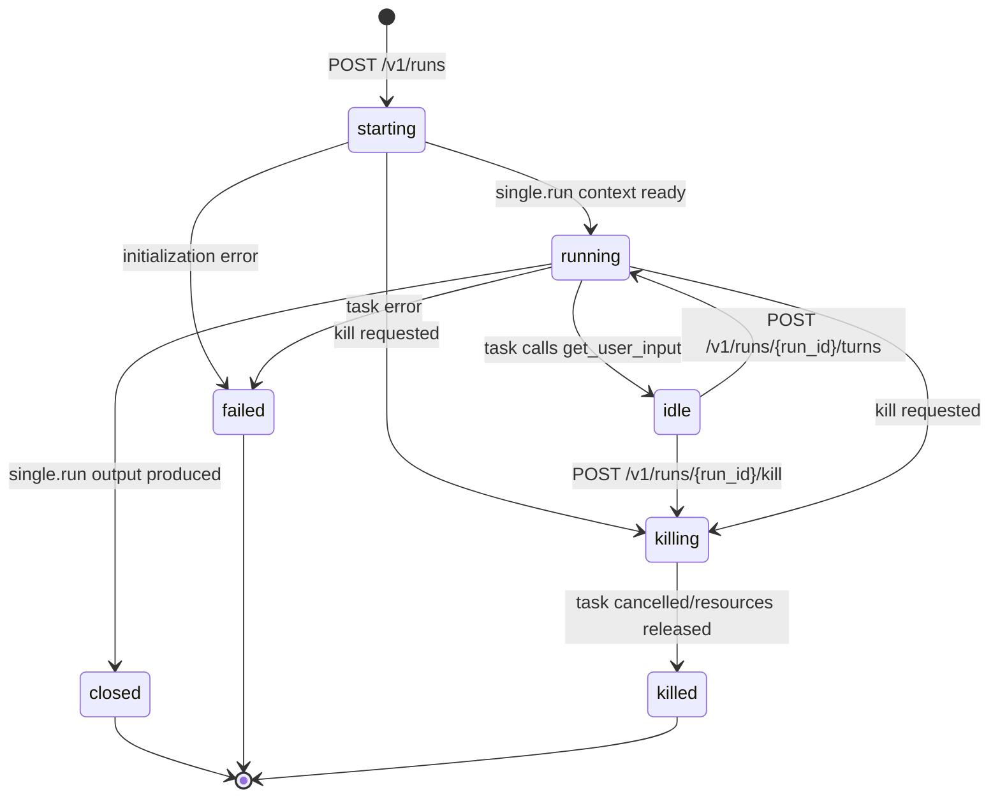

# Live Runner

The live runner is an HTTP/SSE control surface around `single.run`. It starts
one normal Nexus single run in the background, injects a `get_user_input`
callback when the task input supports it, and exposes lifecycle state,
realtime events, and a run-scoped proxy to every active runtime.

Start it with:

```bash
nexus run live
```

By default the service binds both IPv4 and IPv6 all-interface addresses:
`0.0.0.0` and `::`. Use `--host` to override this, and repeat it to bind more
than one address.

The built-in frontend is served from `/` and `/ui`.

The old top-level forms `nexus live-runner` and `nexus live-server` have been
removed. Single and batch runs use the same grouped form:
`nexus run single <config.yaml>` and `nexus run batch ...`.

## State Model



States:

- `starting`: the run exists, but `single.run` context setup is not finished.
- `idle`: the run can accept the next `/turns` request. This includes both the
  initial no-prompt state and the period when the task is blocked in
  `get_user_input`.
- `running`: `single.run` is executing setup, task logic, or a submitted turn.
- `killing`: the service is force-cancelling the task and releasing runtime
  resources after an explicit kill.
- `closed`: the task completed normally and resources have been released.
- `failed`: the run ended with an initialization or task error.
- `killed`: the run was force-cancelled by the live service.

There is intentionally no runner-level `checkpointing` state. Runtime state that
needs to survive across runs should be represented by the task's normal input
and output contract. For example, a task can return state metadata in its
output, and the next run can receive that metadata in task input.

## API Surface

- `POST /v1/runs`: create a run.
- `GET /v1/runs/{run_id}`: inspect run state and final task output.
- `POST /v1/runs/{run_id}/turns`: submit the next user turn while the run is
  `idle`. `text` may be an empty string; the live runner records that turn and
  returns `None` from `get_user_input`, which lets the task end itself normally.
  It is not a runner-level stop command.
- `GET /v1/runs/{run_id}/events?cursor=N`: stream realtime events using SSE.
- `GET /v1/runs/{run_id}/runtimes`: list active runtimes and their run-scoped
  proxy URLs.
- `ANY /v1/runs/{run_id}/runtimes/{runtime_name}/proxy/{path}`: proxy HTTP
  requests to the named runtime.
- `WS /v1/runs/{run_id}/runtimes/{runtime_name}/proxy/{path}`: proxy WebSocket
  connections to the named runtime.
- `POST /v1/runs/{run_id}/kill`: force-cancel the underlying `single.run`
  task. The live runner does not expose a graceful stop endpoint; normal exit
  must come from task completion, or from the task's own reaction to
  `get_user_input` returning `None` after a submitted empty user input.
  `DELETE /v1/runs/{run_id}` is kept as a compatibility alias for kill.

The SSE stream uses track-style events with monotonically increasing `id`
values. Event types include `run.status`, `runtime.ready`, `turn.submitted`,
`turn.started`, `input.required`, `agent.event`, `trace.event`, `run.output`,
`run.error`, and `run.killed`.

Runtime capabilities are intentionally exposed through the proxy. For example:

- Runtime debug home:
  `/v1/runs/{run_id}/runtimes/main/proxy/`
- Runtime executor call:
  `/v1/runs/{run_id}/runtimes/main/proxy/api/v1/call_executor`
- Runtime-local port proxy:
  `/v1/runs/{run_id}/runtimes/main/proxy/debug/ports/8080/`
- Runtime noVNC assets and WebSocket:
  `/v1/runs/{run_id}/runtimes/main/proxy/debug/gui/vnc/...`

Downloads should use the runtime `download_file` executor. Uploads should use
`upload_file`. The live server does not collect or stage artifacts.

## Real Model Config

`CreateRunRequest` mirrors `RunInput`: use `task_name`, `task_config`, runtime
config, OpenAI clients, processors, and runner config as in `nexus run single`.
`live` contains only service-side observation settings such as the default
workspace directory. The live server does not normalize task-specific shortcuts;
the frontend parses the RunInput YAML with `js-yaml` and sends the resulting
JSON directly to `POST /v1/runs`.

`CreateRunRequest.openai_config_path` can still point at an existing Nexus run
config file. The live runner loads `openai_clients` from that server-side file,
so the browser payload can use real model credentials without displaying the key
in the UI JSON.

Example RunInput shape:

```json
{
  "imports": ["nexus.extensions", "nexus.extensions.openai_clients.litellm"],
  "openai_config_path": "/home/sine/code/tencent/nexus-agent/nexus/workspace/tests/openclaw.yaml",
  "runtime_provider_name": "docker",
  "runtime_configs": {
    "main": {
      "image": "mirrors.tencent.com/hunyuan_yanguan/nexus-ubuntu-session:latest",
      "worker_venv": true,
      "extra_args": [
        "--tmpfs",
        "/run",
        "--tmpfs",
        "/run/lock",
        "-e",
        "GTK_A11Y=none",
        "-e",
        "NEXUS_GUI_REQUIRE_SYSTEM_DBUS=1"
      ]
    }
  },
  "task_name": "identity",
  "agent_name": "claude_code_multiturn",
  "agent_config": {
    "user_prompt": "Build the page, then ask me before finalizing.",
    "working_dir": "/workspace",
    "version": "2.1.153",
    "max_turns": 10000,
    "timeout": 86400,
    "enable_user_input_hooks": true,
    "include_hook_events": true,
    "pre_start_scripts": [
      {
        "code": "mkdir -p /workspace && printf 'Nexus live runner workspace\\n' > /workspace/README.md"
      }
    ]
  },
  "live": {
    "working_dir": "/workspace"
  }
}
```

The live runner injects its interactive `get_user_input` callback directly into
the configured agent input. Agent-specific settings such as Claude Code prompts,
working directory, hooks, timeouts, and `pre_start_scripts` belong in
`agent_config`; the task can stay as the pass-through `identity` task.

The bundled UI keeps the conversation grouped as one user message followed by
one agent card per turn. Claude Code events label that card as `Claude Code`;
other agents use the generic `Agent` label. Inside the card it renders
`agent.event` payloads as structured conversation parts when possible: assistant
text, tool calls with their input parameters, tool results, system/result
events, and trace events. User text is derived from submitted turns or agent
user-message echoes. If an agent does not echo user messages, the UI falls back
to the first `openai_completion` trace and uses the last `role=user` message
from its OpenAI-compatible `messages` input. The live server does not read
task-specific fields like `task_config.user_prompt` for display. Unknown agent
or trace payloads are still shown with expandable JSON details instead of being
collapsed into a generic "event received" line.
Non-Claude agents can emit runtime Socket.IO event `agent_event` with their own
payload; the live runner relays it to the same `agent.event` SSE stream.
