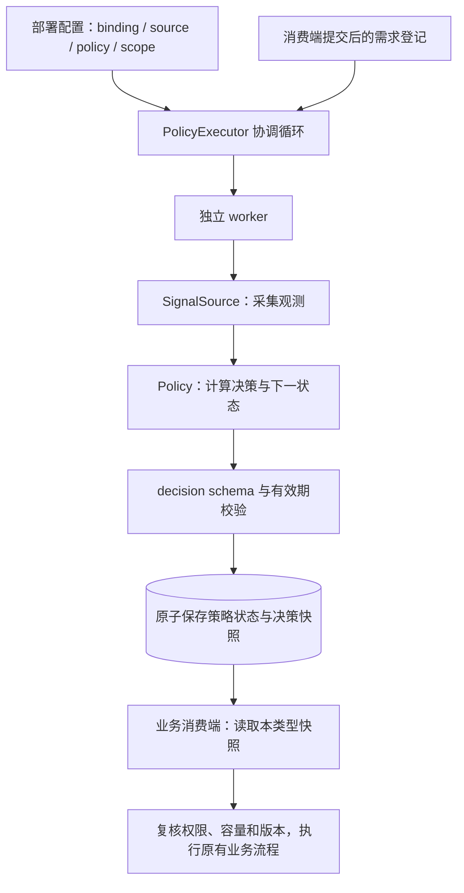
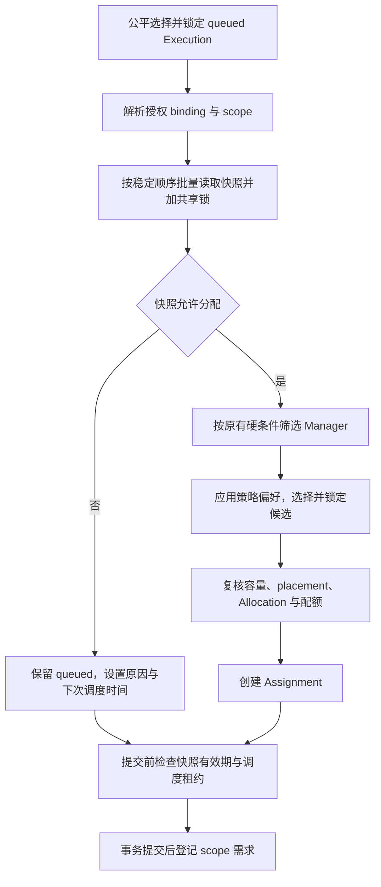

# PolicyExecutor 策略框架最终设计

## 1. 定位与边界

PolicyExecutor 提供统一的策略计算与快照发布机制：在业务事务外采集信号、执行策略，持久化决策，再由业务模块读取快照并执行自身逻辑。

**Tide（潮汐策略）是框架中的一种具体策略。** 模型容量、Key 额度、拥塞阈值属于 Tide 的输入和规则，不是所有 Policy 必须具备的概念。其他策略可以使用不同的信息源、参数和私有状态，复用相同的执行、隔离、存储与发布机制。

设计分为三个层次：

| 层次 | 负责内容 | 扩展方式 |
| --- | --- | --- |
| 公共框架 | 注册、配置、worker 管理、超时、scope 租约、版本校验和原子发布 | 新策略复用这些机制 |
| 业务消费端 | 定义 decision schema，读取快照，在业务事务中应用结果 | 新业务动作需要明确接入对应消费端 |
| 具体策略与信息源 | 采集业务信号，计算 decision 和下一策略状态 | 注册 Source / Policy，通过 binding 选择 |

当前提供的业务消费端是 Scheduler，消费 `kind=scheduler` 的 `SchedulerDecision`。公共执行器支持其他 kind 和独立的 decision schema，但注册新的 kind 不会自动产生 Batch 派发、请求预算或任务控制能力。这些能力需要各自的业务消费端。

框架不定义任意业务回调或动态 consumer 插件链。策略返回数据，业务模块继续负责权限、事务、一致性、资源约束和生命周期。

## 2. 架构与职责



| 组件 | 职责 |
| --- | --- |
| `SignalSource` | 按部署配置采集信号，返回观测版本、时间、有效期和数据 |
| `Policy` | 根据输入与上次私有状态，计算 decision、next_state、有效期和原因 |
| `PolicyWorkerPool` | 有界并行执行，监督启动与评估期限，终止并回收失败进程 |
| `PolicyExecutor` | 轮询有需求且到期的 scope，组织评估、校验结果并发起发布 |
| `PolicyRepository` | 管理 scope、需求时间、版本、快照与状态的原子更新 |
| 业务消费端 | 将合法快照转换为本业务的行为，维持原有事务与资源约束 |

Scheduler 服务托管 Executor 的后台协调循环，复用数据库和 shard lease。调度事务不调用 Source 或 Policy，worker 中的同步计算也不占用 Scheduler 的事件循环。

部署只加载受信插件。插件使用可序列化数据交换结果，按接口约定不获取业务 ORM 或修改业务状态；进程隔离用于超时和故障控制，不构成不可信代码沙箱。

## 3. 插件与数据契约

Source 与 Policy 分别注册。一个 binding 选择一个 Source 和一个 Policy；每次评估采集一份 `SignalObservation`，策略可从该观测读取多个业务字段。

```python
class SignalSource(Protocol):
    async def read(
        self,
        config: dict[str, Any],
        *,
        max_age_seconds: float,
    ) -> SignalObservation: ...


class Policy(Protocol):
    kind: str
    decision_model: type[BaseModel]

    def evaluate(
        self,
        inputs: PolicyInput,
        previous_state: dict[str, Any],
    ) -> PolicyResult: ...
```

| 数据结构 | 字段与含义 |
| --- | --- |
| `SignalObservation` | `version`、`observed_at`、`valid_until`、`values`；描述一次来源观测 |
| `PolicyInput` | `scope_id`、`now`、`params`、`observation`；描述本次计算输入 |
| `PolicyResult` | `decision`、`next_state`、`valid_until`、`reason_code`；描述决策和下一状态 |
| `SchedulerDecision` | `allow`、`preferred_managers`；Scheduler 接受的决策结构 |

Source 可以声明 `config_model`，Policy 可以声明 `params_model`。worker 在执行前验证配置，并检查 Policy 的 kind 与 binding 一致。策略输出经过其 `decision_model` 验证后才序列化返回。

`next_state` 是策略私有数据，由同一 scope 的下一次评估读取。消费端使用公开 decision，不通过策略私有状态实现业务规则。读取或应用快照不会推进策略状态。

决策快照是 `snapshot_json` 中的持久化数据封装，字段为：

| 字段组 | 字段 |
| --- | --- |
| 身份 | `kind`、`binding_id`、`scope_id` |
| 版本 | `schema_version`、`config_revision`、`config_hash`、`snapshot_version` |
| 评估依据 | `evaluation_id`、`input_version` |
| 时间 | `observed_at`、`generated_at`、`valid_until` |
| 结果 | `reason_code`、`payload` |

`payload` 对应具体 kind 的 decision schema。快照不携带脚本、回调或原始来源响应。`input_version` 记录来源观测依据，不代表公共框架已实现跨轮次的来源采样去重；需要去重的策略应在自己的状态中处理该语义。

## 4. 配置、作用范围与权限

一次计算的逻辑键是 `(kind, binding_id, scope_id)`。scope 是绑定内的稳定标识，具体含义由 Source、Policy 和消费端约定，可以表达额度组或其他共享决策范围，框架不要求它一定是模型。

| 配置 | 作用 |
| --- | --- |
| `imports` | 部署端允许加载的注册模块 |
| `kind`、`policy`、`source` | 指定消费类型、策略实现和信息源实现 |
| `scopes`、`params` | 提供各 scope 的来源配置及 binding 的策略参数 |
| `revision` | 标识配置或插件语义的修订 |
| `environments`、`principals` | 限定绑定的适用环境和 owner |
| `mode` | `disabled`、`shadow` 或 `enforce` |
| `refresh_seconds`、`timeout_seconds`、`max_age_seconds` | 控制刷新周期、评估期限和观测最大有效期 |
| `on_unavailable`、`max_defer_seconds` | 指定快照不可用时的处理方式和调度重查间隔 |

Executor 配置还限定 worker 数量、冷启动期限、轮询间隔和 scope 空闲期限。没有 `worker_memory_mb` 配置。

`PolicyBinding` 保留了内置 Tide 的默认 policy/source 标识，配置其他策略时显式覆盖。这个默认值不改变执行器的通用接口；插件标识也不会使绑定自动启用，未配置 binding 时沿用原有调度流程。

Scheduler 的提交参数只引用已配置的 binding 和 scope，不能携带任意插件代码、来源 URL 或明文凭据。环境默认策略不能被提交者选择其他 binding 或删减必需 scope 绕过。绑定只约束已有提交权限，不授予额外资源权限。

任何 binding 配置、插件实现或 imports 变化都应提高受影响 binding 的 `revision`，并重新加载服务配置。更高 revision 会清空该 scope 的旧状态与快照；旧副本不能覆盖更高版本。配置指纹包含 binding 内容及 imports，不自动包含插件源码。

## 5. 评估、发布与故障处理

### 5.1 需求与刷新

初始化建立配置中的 scope。消费端在业务事务提交后登记需求，Executor 轮询 `next_evaluate_at` 已到期且仍有近期需求的 scope。

同一 Executor 内，同一 scope 只执行一个评估；不同 scope 有界并行，多 binding 时限制单个 binding 的并行占用。多副本通过独立的 `policy-executor` shard lease 协调，并在发布时校验租约。

需求登记只更新 `last_demand_at`，不会改变评估版本或打断失败退避。正常刷新带抖动，失败按有界退避重试。超过空闲期限的 scope 停止刷新，当前机制不自动删除其存储记录。

### 5.2 worker 隔离

worker 是可复用的独立进程，每个进程同时执行一个评估。冷启动与评估分别使用有界期限，评估期限包含插件加载、配置验证、信号采集和策略计算。

父进程在超时或协议错误后终止 worker 并等待退出；下一次使用该槽位时重新启动。输入与输出消息均限制为 128 KiB，原生数值库线程池限制为单线程，禁用 core dump。来源适配器还应限制自身响应大小并避免泄露凭据。

这里不设置 `RLIMIT_AS`，也不承诺单 worker 的硬内存隔离。需要硬内存隔离时由部署层提供独立容器或 cgroup。进程隔离可以回收阻塞计算，但不能消除 worker 与 Scheduler 共享容器资源的影响。

### 5.3 原子发布

1. 读取 scope 的配置指纹、版本和私有状态，结束读取事务。
2. 在 worker 中采集观测并计算，返回经过 decision schema 验证的数据。
3. Executor 校验观测时间和有效期，拒绝已过期结果或超过来源有效期、最大年龄限制的结果。
4. 短事务锁定 scope，复核原版本、配置指纹和 shard lease，原子保存 `next_state`、快照与下一次评估时间。

发布成功后版本递增，旧版本计算结果无法再次覆盖当前状态。失败时保留旧状态和旧快照，更新失败次数、稳定错误码与重试时间，不延长旧快照有效期。

持久化表为 `distributed_policy_scopes`，只保存当前状态与快照。业务任务复用同一 scope 的计算结果，不在每次分配时请求容量接口；公共框架不额外承诺跨不同 scope 的来源请求缓存或合并。

## 6. Scheduler 消费契约

Scheduler 只消费 `kind=scheduler` 的 `SchedulerDecision`，不依赖 Tide 类、容量接口或额度字段。任何策略只要符合这一契约，都可以提供分配准入或 Manager 偏好。



准入与排序规则：

- 未绑定策略时沿用原流程；一个 Execution 选择一个 Scheduler binding，可引用多个 scope。
- 多个 scope 的准入条件取交集。只有各 scope 给出的非空偏好一致时，才采用该 Manager 顺序。
- 偏好作用于已有合法候选，不扩大资源资格，也不覆盖显式 placement 优先级；锁候选截断与最终分配使用同一候选规则。
- 暂缓保持 `queued`，不创建 Assignment、不增加 attempt，仍受 queue TTL 和人工控制约束。
- 消费事务持有 scope 共享锁，提交前重查快照有效期。发布事务不反向锁 Execution 或 Manager。
- Batch 编排父任务不应用 Scheduler 策略；提交的策略选择传递给业务子 Execution。

模式与失效处理：

| 条件 | Scheduler 行为 |
| --- | --- |
| `disabled` | 使用原调度行为 |
| `shadow` | 记录策略建议，不执行拒绝或偏好排序 |
| `enforce` 且有效 `allow=false` | 暂缓新分配 |
| 快照缺失、过期、配置不匹配或 payload 无效，`on_unavailable=defer` | 暂缓并等待可用快照 |
| 快照不可用，`on_unavailable=default` | 通常回到原调度行为；已有快照明确拒绝时仍暂缓 |

这套消费规则属于 Scheduler，不由某个具体插件重复实现。其他消费类型应独立定义失效处理、版本复核和业务动作，不能直接套用 Scheduler 的全部语义。

## 7. 内置策略：Tide 准入

Tide 通过普通注册接口接入：

- Source：`infer_proxy_capacity`，读取 Infer Proxy 模型容量与 Key 额度。
- Policy：`infer_proxy_tide`，使用上述观测和上次状态计算准入。
- Kind：`scheduler`，输出标准 `SchedulerDecision`。
- 实现位置：`nexus/distributed/policies/collections/infer_proxy.py`。

Tide 使用当前观测的剩余额度和 hard brake，不维护拥塞迟滞阈值。

| 信号 | Tide 行为 |
| --- | --- |
| 有效额度为零 | 拒绝新分配 |
| hard_brake 为 true | 拒绝新分配，不受 factor 大小影响 |
| 有效正额度且 hard_brake 为 false | 允许新分配 |
| 必需字段缺失、非法或观测过期 | 拒绝；不复用历史信号放行 |

API Key 直接配置在 scope 的 `source_config.api_key` 中。查询失败由 Executor 记录评估失败，不伪造有效容量信号。

此策略控制新 Execution 的分配，不中断运行中的任务，不分配跨任务共享 QPM，也不自动缩容。请求侧调速和 Tide 的 Batch 派发策略是不同的业务接入：它们可以复用公共执行机制，但自身的比例计算、并发与 QPM 应用规则仍属于具体策略和对应消费端。

## 8. 扩展方式

**在既有 kind 下增加策略：** 实现 Source / Policy，注册类，在部署 imports 中加载模块，配置 binding 与 scope。策略返回该消费端认可的 decision schema，业务消费端无需了解策略名称或内部规则。

例如，新的维护窗口准入策略可以输出 `SchedulerDecision.allow`，新的 Manager 偏好策略可以输出 `preferred_managers`。这些是接入方式示例，不表示仓库已内置对应实现。

**增加新的 kind：** 定义 decision schema，实现明确的业务消费逻辑，再接入已有 Executor 与 scope 存储。仅增加一个 `kind` 字符串或在注册表中新增类不会自动执行新业务动作。

| 消费场景 | 必须由该消费端解决的问题 |
| --- | --- |
| Batch 派发 | 已运行子任务、人工并发上限、窗口推进和停止状态如何约束新派发 |
| 共享请求预算 | 多消费者如何原子领取总预算、处理预算有效期与旧租约 |
| 任务控制 | 动作身份、目标版本、幂等回执及已撤回意图如何处理 |

扩展复用计算和发布机制，业务保证由消费端建立。专用于 Tide 的 Batch 并发/QPM 计算，即使使用公共 Executor，也仍然是特定消费逻辑，不能据此声明已具备任意 Batch 策略、全局预算或通用任务控制能力。

## 9. 代码组织与验证要求

| 位置 | 职责 |
| --- | --- |
| `nexus/distributed/policies/models.py`、`registry.py` | 公共数据模型与插件接口 |
| `nexus/distributed/policies/executor.py`、`worker.py`、`workers.py` | 协调、隔离执行与进程监督 |
| `nexus/distributed/policies/collections/` | 内置具体策略与信息源 |
| `nexus/distributed/policies/scheduler.py` | Scheduler 的选择校验与快照消费 |
| `nexus/distributed/repositories/policy.py` | scope 需求、存储与发布 |
| `nexus/distributed/repositories/scheduler.py` | 将策略结果应用到既有分配事务 |
| `nexus/distributed/control_plane/scheduler.py` | 托管 Executor，提交后登记需求 |

验证分别覆盖公共机制、消费端和具体策略：

- 公共机制：不同 kind 与 schema 可复用执行器；阻塞、异常、超时后的回收与复用；版本竞争和租约失效阻止旧结果发布；失败不续期。
- Scheduler：未绑定路径、授权/defaults、shadow/enforce、已知拒绝的失效处理、偏好排序，以及原有容量、配额和 TTL 约束。
- Tide：零额度、正额度恢复、非法字段、独立的拥塞暂停/恢复及必需信号过期。
- 真实集成：核验业务结果与资源回收，并区分受控信号、真实容量查询和真实模型推理的验证范围。

Execution 查询接口展示策略建议与快照依据，`scheduler.policy_deferred` / `scheduler.policy_applied` 事件记录实际使用的决策。故障日志只包含稳定错误码，不返回可能含凭据的来源异常文本。

部署、提交参数与配置示例见 [Scheduler 策略使用说明](../reference/cloud/scheduler-policies.md)。具体环境的验收产物保存在本地忽略目录，不纳入设计正文。
