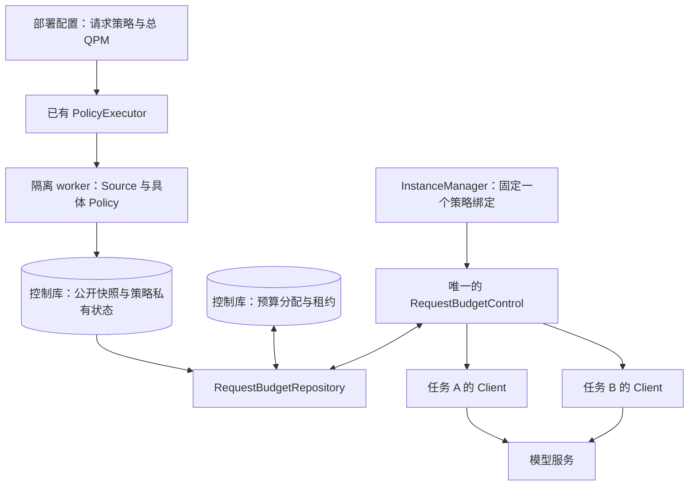
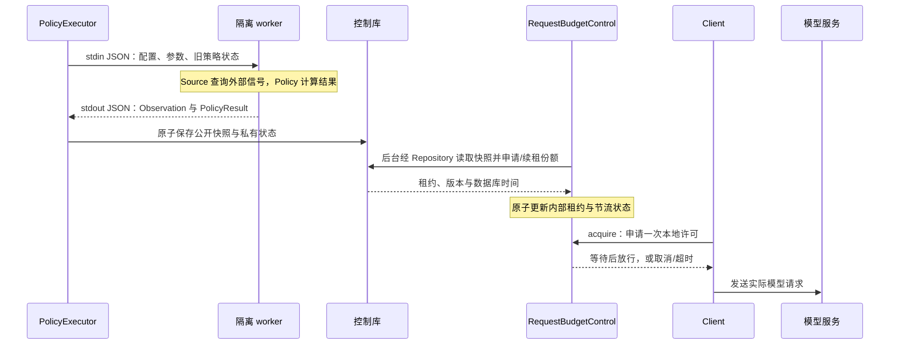

# 共享请求预算与 Client Policy 接入设计

状态：设计方案，尚未实现。

基线：`codex/tidal-scheduler-policy@2f8dca72a2`；当前实现对照：`1c4299ffc9`。
本文扩展 [PolicyExecutor 策略框架](scheduler-policy-framework.md)，作为当前分支后续实现的设计依据。

## 1. 目标与范围

部署端为一个额度组配置总 QPM，所有使用该额度组的 Batch 子任务、Single 和 Client 共同使用这份预算。
例如总预算为 600 QPM，容量下降时策略可将其降为 300 QPM，额度耗尽时暂停，恢复后逐步提高。
额度不会随任务、Client 或 Manager 数量增加而复制，也不再依赖人工填写 `task_concurrency`。

**启用请求预算的 InstanceManager 只绑定一个请求预算 Policy binding/scope，持有一个 RequestBudgetControl；未启用的 Manager 不创建该组件。**
RequestBudgetControl 内部维护唯一租约、节流状态和续租任务，本机所有接入请求控制的 Client 共用它，不按任务、模型或 Client 动态选择策略。
多个 Manager 可以绑定同一份策略并共享总预算。这里的单策略约束指 `request_rate`，不改变 Scheduler 独立的准入策略。

三个控制位置保持独立：

| 位置 | 职责 |
| --- | --- |
| Batch | 保留原有 `max_inflight`、停止、重试和结果汇总 |
| Scheduler | 消费准入决策，控制 queued 子任务是否开始分配 |
| Client | 每次实际模型请求及重试前取得本地许可 |

本阶段新增 `request_rate` 消费类型、共享预算租约和 Client 接入；不做 Batch 动态并发、自动资源缩容、Token/费用预算或严格的任务级公平调度。
本方案按总 QPM 协调速率份额，允许短时突发和配置传播延迟；不要求严格分钟计数或所有 Manager 同时切换模式，具体边界见第 7.3、7.4 节。
首批接入 Infer Proxy 的实际请求入口；其他 Client 需要接入相同协议后才受控，不保证模型吞吐，也不覆盖绕过该入口或平台外使用同一 Key 的请求。

## 2. 架构与组件职责



| 组件 | 负责内容 | 依赖边界 |
| --- | --- | --- |
| PolicyExecutor | 组织评估、隔离执行、校验并原子发布结果 | 复用基线，不处理逐请求许可 |
| 具体 Source / Policy | 采集容量信号，计算预算与下一私有状态 | 放在 `policies/collections/`，不持有业务 ORM 或 Client |
| RequestBudgetRepository | 读取公开快照，事务内分配和续租份额 | 数据库访问模块，不是服务或后台循环 |
| RequestBudgetControl | 汇总需求、后台申请/续租，并按有效份额在本地放行请求 | 每个 Manager 一个；只有后台协调访问 Repository，请求放行使用内存 |
| Client | 调用公共请求准入接口，取得许可后发送 | 不接触数据库、租约分配或 Policy 私有状态 |

不新增 Control Gateway 的请求预算接口，不让每次模型请求经过 Gateway。
各 Manager 通过同一套 Repository 代码和数据库事务协调，无需单独部署预算协调服务。
复用的是现有 Engine、连接池和 `session_factory`；每次预算操作创建独立短事务，不跨线程共享 `AsyncSession`。
沿用基础分支的 `Policy + decision_model` 插件接口。类型化的公开决策和 Client 协议负责解耦，不另建一套 Policy 执行框架。
Manager 负责创建、启动和关闭 RequestBudgetControl，不再单独维护预算循环或本地池组件。

## 3. 额度归属与配置

Policy 名称表示算法，binding/scope 表示实际使用的配置与共享状态。
直接以已有的 `(kind=request_rate, binding_id, scope_id)` 作为 `budget_key`，复用框架的 scope key 生成规则，不另设额度组映射层。

```text
Manager A ─┐
Manager B ─┼─ binding=team-a-hy3-rate / scope=capacity → 共同使用 600 QPM
Manager C ─┘

每个 Manager：一个绑定 → 一个 RequestBudgetControl → 本机所有接入的 Client
```

部署端在 Manager 启动配置中固定这个引用，绑定沿用基线的 environment/principal 授权。
同一实际额度必须使用同一 binding/scope，不能用不同名字重复配置总额；明文 Key 不进入快照、租约或日志。
本机任务和 Client 继承 Manager 的请求绑定，不能自行覆盖、关闭或切换预算。

一个请求速率 binding 可配置一个或多个预算 scope（各 scope 按 `(kind=request_rate, binding_id, scope_id)` 独立核算预算账本）。不同资源若使用同一份额度，就统一计入同一 binding/scope；需要独立额度的任务使用另一 scope 或另一 binding 的 Manager。
请求绑定先由环境/执行配置在提交时解析成授权的 `request_policy` 引用，并冻结到业务 Execution；Batch 子任务继承，编排父任务不因此增加模型预算需求。
该引用与已有 `scheduler_policy` 分开：前者是执行能力要求，后者是分配准入决策。已有 PolicyExecutor 的 `defaults` 只支持 scheduler，不能直接用来配置请求默认策略。
动态 Allocation 将请求绑定纳入执行规格和 Manager 启动参数；固定 Manager 注册同一能力，Scheduler 在硬条件筛选时检查引用一致性。
Driver 在任务启动时再次核对后注入对应请求接口。因此任务先匹配到正确的 Manager，再由本机 Client 继承其唯一请求控制，不允许绕过匹配后才选策略。
以上是新增的通用执行能力匹配，不改变 SchedulerDecision，也不会新增 Tide 专用调度规则。
不设计每请求的模型/凭证到预算路由，也不设计 Manager 内的多池注册表。

配置示意如下；它展示一个 Manager 的有效配置，环境/Allocation 中的模板需生成同一个引用。新插件、Execution/Manager 的 `request_policy` 及 `request_budget` 均属于待实现接口：

```yaml
policy_executor:
  imports: [nexus.distributed.policies.collections.infer_proxy_request_rate]
  bindings:
    team-a-hy3-rate:
      kind: request_rate
      policy: infer_proxy_request_rate
      source: infer_proxy_request_capacity
      revision: 1
      environments: [example-environment]
      principals: [example-owner]
      mode: enforce
      on_unavailable: defer
      scopes:
        capacity:
          source_config:
            model: hy3-offline
            api_key: "<your-api-key>"
            quota_qpm: 600
      params:
        min_quota_ratio: 0.01

instance_manager:
  request_policy:
    binding: team-a-hy3-rate
    scope: capacity
  request_budget:
    lease_seconds: 10
    renew_before_seconds: 4
```

10 秒租约、提前 4 秒续租是初始设计值，需通过压力与故障测试校准。
配置加载时检查单一引用、binding 类型、scope 和权限。相同 binding 的参数更新通过 revision 生效，不清空尚有效的租约重新分配预算。
更换 Manager 的绑定身份时先 drain 并让在跑任务结束，再启动绑定新策略的 Manager；首版不支持同一 Manager 运行中切换绑定。
binding 名称或 scope 名称变化会产生新的 budget_key，涉及同一实际额度时必须先停用旧绑定并等待旧租约到期，不能将重命名视为独立的新额度。

## 4. 数据契约

### 4.1 策略决策

新增 `kind=request_rate`，对应公共数据模型：

```python
class RequestRateDecision(PolicyModel):
    allow: bool
    rate_per_minute: float
```

单位固定为实际请求尝试数/分钟。允许时速率必须为有限正数；拒绝时必须为 0。
例如配置 600 QPM、策略比例为 0.5，输出 `allow=true, rate_per_minute=300`。

决策沿用现有 `DecisionSnapshot` 封装：kind、binding/scope、配置指纹与 revision、snapshot_version、有效期、原因及 payload。
Policy 私有比例只保存在 `next_state`，Repository 和 Manager 不读取这些字段。
消费端按 kind 和公共 schema 校验，不判断具体策略名称。

Tide 请求策略忽略 hard brake，按 `candidate = min(ratio × factor, 1)` 调整。候选比例严格低于 `min_quota_ratio` 时暂停并保留上次有效比例；恰好等于下限时仍允许。因低于下限暂停后，factor ≤ 1 保持暂停且不衰减保存的比例；当前信号有效、Key 余额为正且 factor > 1 时，从保存的比例恢复并封顶到 1。Key 余额为零或信号不可用也发布零速率，并保留比例及下限暂停状态。没有步长限制或减量冷却。
有效零额度输出暂停，只有有效正额度才解除额度阻塞；缺失字段不能被当作恢复信号，失败不会延长旧快照有效期。
每次评估要求当前必需字段完整有效；缺失、非法或过期信号不复用之前的余额或 factor 来放行。决策有效期不超过来源观测。
参数 revision 变化沿用基线的状态重置语义，必须等新有效决策后才能续发预算；旧租约仍按原期限计占用。

### 4.2 Manager 申请与预算租约

Manager 只为启动时固定的 binding/scope 提交一份有界需求；本机没有需求时停止申请。
需求只表达希望得到的份额，不代表已获额度，数据库事务返回的租约才是可使用的授权。

| 对象 | 主要字段 |
| --- | --- |
| BudgetDemand | budget_key、manager_id、manager_session_id、request_seq、requested_qpm |
| BudgetLease | lease_id、lease_version、budget_key、manager 身份、granted_qpm、valid_from、valid_until、依据的配置和快照版本 |
| BudgetLeaseResult | granted/wait/inactive/unavailable、mode、配置 revision/hash、可选 lease、server_now、retry_after、reason_code |

一个 Manager 会话最多保有一个有效预算租约。Manager 重启后使用新的 session_id，不能继承旧进程的剩余额度。
该 Manager 的协调请求串行。结果未知的网络/事务重试复用 request_seq，返回已提交的稳定租约结果；同序号但需求内容不同须拒绝。
收到确定的 wait 或成功结果后，下一轮申请/续租使用新序号；不能一直重放一次 wait 而不重新评估预算。
租约内容和绝对到期时间保持幂等，server_now 每次返回都重新读取数据库时间。旧序号不能覆盖新结果。
inactive 表示当前配置为 shadow/disabled，不分配租约；它是模式信息，不是另一个带期限的授权。

### 4.3 Client 接口

Client 只依赖轻量公共协议：

```python
class RequestAdmission(Protocol):
    async def acquire(self, request: RequestAttempt) -> RequestPermit: ...
```

RequestAttempt 包含执行尝试和 Client 身份，不携带可选择的 policy 或 budget；RequestPermit 是绑定该请求尝试和 Manager 会话的一次性发送许可，enforce 时还受本地租约截止时间约束。
RequestBudgetControl 实现 RequestAdmission，Driver 通过该公共接口向 Client 注入请求控制能力。
执行身份由 Driver 的可信上下文提供，所有接入的 Client 调用同一个 RequestBudgetControl；执行结束时注销上下文并取消等待者。
Client 不接收整组 QPM 决策，也不把许可请求发送到 Gateway。跨线程调用由 RequestBudgetControl 同步，控制库凭据不暴露给任务 Client。
实际许可应紧邻发送取得；SDK 发送适配层检查会话、任务状态，以及 enforce 下的本地租约截止时间，若已过期或发生取消则丢弃许可，不能长期缓存或交给另一请求使用。

## 5. 信息如何传递



上图为 enforce 路径。Executor/worker 的 JSON 管道、策略发布和 scope 存储复用基线。RequestBudgetControl 经 Repository 使用 SQL，Client 经 RequestAdmission 进行进程内调用。
Driver 在任务启动时注入可信执行身份和指向本机唯一 RequestBudgetControl 的请求接口；不使用 `batch.tide` 或 Tide 专用上下文。
现有线程执行路径共享同一个 RequestBudgetControl；将来若任务执行迁移到独立进程，需补充本机 IPC 适配，不能复制租约到各进程独立消费。

RequestBudgetControl 为固定 scope 合并、限频登记本机 demand，包括正在等待第一份租约的 Client。
需求登记使用独立短事务，不在预算锁内触发评估。快照缺失时返回等待，不同步调用 worker，也不默认满速。

## 6. RequestBudgetControl 的运行方式

RequestBudgetControl 合并后台预算协调和本地限流，对 Manager 提供 start/close，对 Client 提供 acquire。
start 只启动后台任务，不等待策略首次就绪；close 停止续租、撤销本地使用并结束等待者，数据库份额仍按租约到期回收。
draining 仅停止接收新任务，已有任务继续申请许可和续租直至结束；Manager 真正停止或被 fence 时才 close。不能通过暂停在跑请求来实现 drain。

内部只有一个续租任务，只允许一个协调请求在途。启动、出现新等待请求、接近租约到期和同一绑定的配置修订都可以唤醒它；定时唤醒兜底。

```text
1. 汇总本机所有接入 Client 的等待请求与近期使用情况，形成一份需求。
2. 为固定 scope 登记 Policy demand，检查当前唯一租约是否需要申请或续租。
3. 调用 RequestBudgetRepository，复用现有数据库连接池。
4. 返回新模式时更新本地配置版本；enforce 下安装有效租约并唤醒等待者，shadow/disabled 不使用预算份额。
5. 等待/失败：enforce 仅继续使用尚有效的旧租约；shadow/disabled 保持已知模式。后台按返回时间与退避重试。
6. 无需求时停止续租；单任务结束只取消该任务的等待。Manager 真正停止或失去会话时关闭整个 RequestBudgetControl。
```

acquire 只读取本地已知模式和任务状态：shadow/disabled 直接放行，enforce 检查有效租约与可用许可。
enforce 额度不足时登记需求、唤醒后台任务并可取消地等待，不直接访问 Repository。
首次等待只触发一次合并申请，不能让每个 Client 各自轮询数据库。续租加抖动，失败有界退避；数据库协调耗时不阻塞心跳和执行状态上报。
enforce 下每次本地放行都检查租约截止时间，不能依赖后台任务准时运行才能停止放行。
跨线程状态更新使用短临界区，异步唤醒投递到等待者所属事件循环；锁内不等待数据库或计时器。

需求初版定义为：有等待请求时 `requested_qpm=null`，表示希望分享当前可用总预算；显式有界需求可填正数，无近期需求填 0。
不能按已经限流后的吞吐量估计唯一需求，否则新 Manager 或暂停中的 Manager 会一直报告 0 而无法恢复。
Repository 先登记本 Manager 的需求，包括尚未获配的等待者，再计算目标份额；没有有效快照时也要保留等待需求并登记 Policy demand。
需求用数据库时间标记有效期，初值为 `2 × lease_seconds`，等待者继续刷新。需求过期只退出分摊计算，不提前回收仍有效的租约。
对近期有需求的 Manager，按等权、受 requested_qpm 上限约束的方式分摊；null 表示没有额外上限。闲置份额在旧租约到期后转移。
这不承诺每个任务平均分配；需求变化与公平性调整均在租约时间尺度上收敛。

## 7. 租约如何保证不重复分配

### 7.1 短事务与分配规则

RequestBudgetRepository 封装以下事务，不进行外部 HTTP 或等待：

1. 验证 Manager 会话、固定引用和当前有效绑定配置；校验请求涉及的任务 owner/environment，不能用一个公共 Manager 的身份替未授权任务领取额度。
2. 共享锁定该 policy scope，再锁定对应预算主记录；所有调用使用相同锁顺序，旧副本不能以本地旧配置续签授权。
3. 使用数据库时间处理序号幂等并登记需求。enforce 校验快照有效期和 payload；shadow/disabled 返回 inactive 和当前模式，不要求存在有效预算快照。
4. 对新请求，新增份额不超过 `min(本 Manager 的目标份额, 当前总预算 - 全部未到期租约占额)`；不足时可以少分或等待，原子保存租约与幂等结果。
5. 提交后才将租约返回给 RequestBudgetControl 使用。失败重试使用相同请求身份，不能再发一份额度。

固定预算下，任意时刻有效租约的 granted_qpm 之和不得超过公开决策的总 QPM。
账本锁只用于分配和续租，不位于每次模型请求路径。不得依靠各 Manager 自己查询后在内存中扣除余额。
份额汇总始终计入全部未到期租约，包括失联会话、过期需求和响应丢失的已提交份额；需求是否活跃只影响目标分摊，不影响占额统计。

### 7.2 续租、调整与回收

首版采用明确的规则，避免“库里已回收，但旧 Manager 还在使用”：

- 同份额续租：保持 lease_id，增加 lease_version、延长到期时间，不新增一份相同额度；仅在当前预算足以覆盖有效租约且原份额不高于本轮目标分摊时允许。
- 改变份额：旧租约不再续期，等到期后分配新的租约；不覆盖仍可被旧进程使用的速率。
- 无需求或 Manager 关闭：停止本地使用；数据库仍按原租约计占用直到到期，首版不提前归还额度。单任务取消不影响其他任务共用租约，draining 中的在跑任务仍可续租。
- 失联或重启：等待旧 session 的租约到期再分配其份额，新 session 不能重用旧租约。
- 无响应的提交：按 request_seq 重试并读回原结果；未确认的额度不在本地使用，但库中已提交的份额仍占预算。

新 Manager 登记需求后，已有 Manager 若占用高于新目标份额则停止续租，让份额在到期后重新分配，避免先到者永久占满。

请求租约到期时间不得超过 `min(数据库当前时间 + lease_seconds, 快照 valid_until)`。
每次调用记录发送前的单调时刻 t0，响应中的 server_now 必须是本次读取的数据库时间。本地租约截止时间保守设为 `t0 + (valid_until - server_now) - safety_margin`。
不能在幂等重放时复用旧 server_now 或重新给一整段 TTL；响应到达时已超过本地截止时间就丢弃。
安装时校验会话、租约身份和版本，较旧响应不能把本地截止时间或速率恢复成旧值。

### 7.3 降速、暂停与时间边界

策略降低总预算时，旧租约可能暂时高于新目标。此时禁止使超额状态继续延长或扩大的发放，等待旧租约到期后按新预算重新分配。
Manager 若提前读到暂停或更低限制，可以主动收紧本地使用，但不能据此立即把旧账面份额发给其他 Manager。

对已经处于 enforce 的 Manager，预算降低或暂停后不再续发超额份额，旧份额随短租约到期退出；外部信号采样、策略评估和已发出请求还会带来额外延迟。
shadow/disabled 到 enforce 按各 Manager 实际观察到新配置后逐步生效，数据库失联的 Manager 可以暂时保留旧的非限制模式，不承诺全局固定时间内完成切换。
只有相关 Manager 都进入 enforce 后，才能把整组请求视为受共享预算控制；查询展示各 Manager 实际模式和配置版本，不把配置提交成功等同于全量生效。
已经发送的请求不被撤回；enforce 下租约失效后不发新请求，失去数据库连接不能延长租约。

### 7.4 QPM 的计量含义

本方案租赁的是速率份额。各 RequestBudgetControl 按获配速率平滑放行，初始无免费请求许可，空闲最多保留一个请求的本地突发额度。
相同租约且本地授权连续有效时，续期不重置节流进度；一旦本地授权已到期，即使迟到的续租使用相同 lease_id，也不能补算失效期间的额度。
新租约不继承旧租约剩余额度，同一额度组内创建新 Client 不新增本地额度。
低速份额需要跨连续续租保留节流进度，避免短租约反复重置后一直无法发出请求。

固定策略且相关 Manager 均处于 enforce 时，长期总放行速率受总 QPM 约束；短区间还受各 RequestBudgetControl 已有突发额度影响，上界至多每个有效 RequestBudgetControl 一个请求。
该语义不等于任意滑动 60 秒严格计数上限，也不保证多个 Manager 的请求不会同时到达模型服务。
本阶段不增加共享请求计数或全局时间槽来实现严格计数。

## 8. Client 行为与故障处理

Client 在实际发送边界取得许可，每次重试重新领取；SDK 隐藏重试必须关闭或纳入同一发送入口。
本地并发等待者共享同一个 RequestBudgetControl，通过线程安全的计数与唤醒机制领取；等待服从任务停止、请求 deadline 和取消。
许可紧邻发送使用，取消后首版不退款，避免取消与实际发送竞争造成重复使用。

已绑定 Manager 在所有模式下均保持 RequestBudgetControl 和请求入口。模式从启动时加载的有效配置初始化，后台按正常协调周期检查配置存储中的 revision/hash/mode；这属于新增 consumer 的配置检查，不假定基线会自动热更新整个服务配置。
shadow 只观测，disabled 旁路；两者都不领取 QPM 份额，也不依赖有效预算快照放行。后台配置检查失败时保留已知模式，不因检查超时或过期阻塞请求。
观察到 enforce 后才进入租约限流；此时尚无租约就等待。观察到 shadow/disabled 后停止使用和续租旧份额，数据库仍等其自然到期，不提前回收。
模式切换提高 revision，旧响应不能回退已观察到的新配置。数据库读取失败不是模式切换；已处于 enforce 的 Manager 不会因此自动旁路。
删除必需绑定按配置错误处理，不等同于 disabled；首次启动无法获得有效配置时不进入请求服务。任务停止和 Manager fence 始终优先于所有模式。

| 情况 | 行为 |
| --- | --- |
| 未绑定请求策略 | 不创建 RequestBudgetControl，沿用原路径；新增必需绑定需要匹配到兼容的 Manager |
| shadow | 只观测，不限制请求；配置检查失败时保持该模式 |
| enforce、尚无有效租约 | 等待，不以基准满速启动 |
| enforce 下快照缺失、过期或配置不匹配 | 不发新租约或续租；旧租约最迟在自身期限内失效 |
| enforce 下额度为零 | 不发新份额，已有份额在短租约内停止 |
| 数据库不可用 | enforce 在旧租约到期后等待；shadow/disabled 保持已知模式，后台退避重试 |
| 单任务停止 | 取消该任务等待，其他本机任务继续使用共享份额 |
| Manager draining | 不接新任务，在跑任务继续领取及续租，直至正常结束 |
| Manager 停止或失去会话 | 关闭 RequestBudgetControl、取消全部等待，不把旧份额提前重新分配 |
| 显式 disabled | 旁路请求限流，保留请求入口与后台配置检查 |

共享预算 enforce 首版只支持 `on_unavailable=defer`，不能因异常转回每个 Client 独立满速。
本地 Policy 模式可使用同一 RequestAdmission 契约的独立适配器，但不参与平台共享额度，也不能在 enforce 下自动切换过去。

## 9. 存储与代码组织

策略快照与私有状态仍使用 `distributed_policy_scopes`。新增预算主记录和 Manager 份额记录，不保存每次模型请求的数据库流水。

| 存储 | 主要内容 |
| --- | --- |
| 预算主记录 | 由 binding/scope 派生的 budget_key、配置版本、用于串行分配的账本版本 |
| Manager 份额记录 | manager/session 的唯一记录、固定 budget_key、需求与期限、可选 lease_id/version、获配速率、有效期、依据配置/快照版本、最新 request_seq 与稳定幂等结果 |

Manager 份额记录以 manager/session 唯一约束落实单绑定，另按 budget_key 索引以汇总共享额度；失效会话与过期租约按保留期清理。
等待者即使尚无租约也有需求记录；幂等结果保存绝对有效期，不缓存用于延长授权的相对 TTL。
旧请求重放必须被当前会话和序号规则拒绝。
额度组关联的活跃租约数量和总配置规模需设上限，避免持锁扫描无界增长。必要的索引和查询计划由 MySQL 并发测试确认。

建议代码位置：

| 位置 | 内容 |
| --- | --- |
| `nexus/distributed/policies/models.py`、`request_rate.py` | 公共请求决策与消费校验 |
| `nexus/distributed/policies/collections/infer_proxy_request_rate.py` | Tide 请求策略与来源注册 |
| `nexus/distributed/repositories/request_budget.py` | RequestBudgetRepository 与事务协议 |
| `nexus/distributed/instance_manager/request_budget.py` | RequestBudgetControl：需求、续租、本地节流与生命周期 |
| `nexus/core/request_admission.py` | Client 可用的轻量协议与 DTO |

公共 Client 接口不导入 distributed ORM；Manager/Repository 只依赖公共请求决策，不依赖 Tide 类或具体策略名称。
Tide 私有比例计算只在 Policy 中推进。保留现有 worker 超时隔离，不恢复已从基础分支移除的 `worker_memory_mb` 或 `RLIMIT_AS`。

## 10. 当前分支迁移与验收

### 10.1 实现迁移

| 当前实现 | 处理 |
| --- | --- |
| Scheduler 准入与 PolicyExecutor | 保留策略契约；另在既有硬条件匹配中加入请求绑定一致性检查 |
| Tide 容量查询和比例算法 | 迁入请求策略插件，输出公共 RequestRateDecision |
| Client 中容量查询与调速混合逻辑 | 拆出策略部分，实际请求接入 RequestAdmission |
| Reconciler 的 Batch 动态计划与提交拦截 | 移除本分支新增部分，恢复原有固定窗口 |
| `batch.tide`、Driver Tide 上下文、TideTargetRegistry | 用通用请求上下文与 RequestBudgetControl 替代 |
| Manager 读取 Batch QPM 系数的循环 | 移入 RequestBudgetControl 内部，改为对固定绑定申请、续租份额 |
| Client `quota_qpm / task_concurrency` | 共享预算模式改为部署端总额，不再静态分摊；冲突配置明确报错 |
| `tide_dispatch` 与 Batch 专用字段 | 移除旧实现及对应 schema 定义 |

请求预算迁移直接接在 PolicyScope 迁移之后，Batch 不再包含潮汐调度私有字段。
新 schema 版本以实施时的实际 migration HEAD 为准，不在设计中占用编号。
旧 Client 不能仅靠修改 binding 自动获得共享预算能力；启用前需确认所有受控任务运行兼容版本。
shadow 到 enforce 的转换只允许已接入通用请求入口的 Client，转换期间不同时使用旧本地调速与共享预算。
同一 Manager 的绑定身份不切换；需要更换绑定时 drain 后替换 Manager。

实施顺序为：公共契约与 Repository 事务 → RequestBudgetControl → Client 接入与旧链路退出 → 集成验证和灰度启用。

### 10.2 验收标准

- 一个 Manager 只允许一个请求 binding/scope 和一个 RequestBudgetControl，内部最多一份有效租约；Client 不能自行选择另一策略。
- 多 Batch、Single、多 Manager、多 Client 使用同一 budget_key，租约分配不复制总额；绑定不同策略的 Manager 互不混用额度。
- 任务分配检查请求绑定一致性，不同绑定的任务不能落到同一 Manager；运行中切换绑定被拒绝。
- 同份额续租不重复占额，结果未知时重试幂等，确定 wait 后新序号能重新申请；重放响应中的时间不能延长租约。
- enforce 下的降速、暂停、恢复、策略过期、数据库故障和 Manager 重启符合租约边界；新 Client 没有首次同步前满速窗口。
- 本地首请求、实际重试、并发等待、取消、低 QPM 连续续租正确；授权中断后的迟到续租不补算空窗额度。
- shadow/disabled 不因快照过期或数据库暂时不可用阻塞请求；恢复读取新配置后进入相应模式，旧响应不能回退已观察到的版本。
- 模式切换允许传播延迟，未观察到 enforce 的 Manager 如实展示旧模式；已处于 enforce 时失联不会自动变成旁路。
- 新 Manager、零额度暂停中的 Manager 和未获配等待者均保持有效需求，恢复后能够重新分配；失效需求不提前释放旧租约。
- draining 不阻塞在跑任务正常完成，单任务取消不影响其他本机任务；真正关闭或 fence 才停止整个 RequestBudgetControl。
- RequestBudgetControl 启动不等待策略计算，关闭取消等待并停止本地放行；enforce 下续租停顿或失败时 acquire 仍执行到期检查，且不直接访问数据库。
- 数据库测试覆盖并发领取、锁竞争、事务重试和到期回收；受控时钟测试覆盖时间偏差与调度延迟。
- 按第 7.4 节验证速率与突发边界，不能只检查各 Manager 获配值之和或每分钟平均值。
- 另一个固定速率 Policy 只替换插件与配置即可接入，Manager、Repository 和 Client 无需修改。
- 统计每个 Manager 的协调频率、连接池等待、锁等待、租约利用率、请求等待时间和心跳延迟；验证数据请求量增加不导致逐请求数据库访问。
- 集成验证核验真实任务结果与资源回收，分别报告受控信号、真实容量查询、真实模型请求的证据，不沿用旧 Batch 方案的通过记录。

查询展示 Manager 的固定 binding/scope、实际模式与已观察配置版本、配置/有效总 QPM、快照原因与年龄、获配份额和租约到期时间；本地上报等待、放行与利用率的聚合指标。
Control Gateway 可沿用管理查询职责展示这些信息，不进入请求许可或额度续租路径。
