# Harbor Bridge

Harbor Bridge 把本地 T3-Harbor 任务目录编译为 Nexus `DatasetItem` / `RunInput`，使用 Nexus
管理 Agent、LLM Client 和 Sandbox，同时复用 Harbor 0.20 的 Task、Oracle、Verifier、
artifact 与 collect 语义。

它不是另一套 Agent Harness：Bridge 只负责数据格式和运行环境转换，具体 Agent 由 Nexus
Profile 选择。

## 运行链路

```mermaid
flowchart LR
    TaskDir["T3-Harbor task directory"] --> DatasetReader["Harbor DatasetReader"]
    DatasetReader --> Compiler["Harbor compiler"]
    Compiler --> DatasetItem["Nexus DatasetItem"]
    DatasetItem --> RunPart["harbor_bridge Run Part"]
    RunPart --> RunInput["Nexus RunInput"]
    RunInput --> Runtime["Nexus runtime"]
    Runtime --> Agent["Selected Nexus Agent"]
    Agent --> AgentResult["T3AgentResult"]
    AgentResult --> Verifier["Harbor Verifier"]
    Verifier --> Reward["Reward and metadata"]
```



推荐入口是 `t3-harbor:///` DatasetReader。该 URI 通过 Source Registry 创建统一
Reader；`generator.py` 仅保留旧
`nexus run-batch`、环境变量和多数据根目录兼容，不是新任务的首选入口。

## 提交前的配置与依赖验证

完整流程统一见 [Cloud：提交前本地验证](../../../docs/cloud/local-validation.md)。该页并列介绍 Generator、常规 Compose
和 [Harbor Compose](../../../docs/cloud/local-validation.md#harbor-compose)。Harbor 用户选择对应输入后，
继续共用的任务物化、Nexus wheel、依赖 wheelhouse 校验和 Cloud 提交步骤。

需要更换 scaffold、Runtime 或模型服务时，选择本 README 下文介绍的对应 Profile；完整实验 YAML 和仅检查 Profile
组合的物化入口也在 Cloud 验证页。模块命令参数与报告字段见
[Module CLI](../../../docs/how-to/manage-modules/module-cli.md#本地构建模块-wheelhouse)。

## T3-Harbor 任务契约

最小目录：

```text
task-name/
├── task.toml
├── instruction.md
├── environment/
└── tests/
    └── test.sh
```

最小 `task.toml` 示例：

```toml
schema_version = "1.2"

[environment]
docker_image = "registry.example.com/task-image:tag"
workdir = "/workspace"
cpus = 2
memory_mb = 4096
network_mode = "public"

[agent]
timeout_sec = 3600

[verifier]
environment_mode = "shared"
timeout_sec = 1800
```

当前 Bridge 的重要约束：

- 只支持单步 Linux 任务。
- `environment.docker_image` 必须是完整的预构建镜像；不构建 Dockerfile 或 Compose。
- `environment.workdir` 必填，必须是绝对容器路径，而且必须已存在于镜像中。
- Nexus Runtime 镜像属于批次 Runtime Profile，不读取任务里的 `runtime_image`。
- 网络策略在 Sandbox 创建时静态确定；Agent/Verifier 阶段不能切换策略。
- 启用网络隔离时 Runtime Provider 会选择 `suanli`；冲突的显式 Provider 会报错。
- 任务目录是 live directory，编译和执行期间必须保持可访问。

### 执行模式

Bridge 只有一个模式字段：

```text
agent   运行选定的 Nexus Agent，然后判分
oracle  运行 Harbor OracleAgent，然后判分
nop     不运行 Agent/Oracle，直接判分
```

Run Part 写法：

```yaml
- use: harbor_bridge:mode=agent
```

`run_oracle`、`run_nop` 已不属于 TaskInput。旧 Generator 的 `RUN_ORACLE` / `RUN_NOP`
环境变量只在 Generator 边界转换一次。

### Anti-hack Policy

Anti-hack prompt 是独立的可选 Policy Profile，不属于 `harbor_bridge` Run Part。代码任务可在
Agent 模式后追加：

```bash
--use harbor_bridge:mode=agent \
--use nexus/extensions/harbor_bridge/configs/policies/code-anti-hack-v1.yaml
```

该 Profile 将版本化的 `id`、`delivery`、`prompt` 和可选
`trajectory_strategy` 写入 `task_config.anti_hack_policy`。支持两种 delivery：

- `instruction_prefix`：将 policy prompt 放在原始任务 instruction 前。
- `instruction_suffix`：将 policy prompt 放在原始任务 instruction 后，也是默认值。

没有 `trajectory_strategy` 时，Policy 只提供 prompt guidance。配置 strategy 后，Bridge
复用 `agent_trajectory.py` 的 reasoning-free trajectory，在 Host 运行受信任的具名插件，
并把 `is_hack` 与 `anti_hack_status` 写入 `TaskOutput.extra_fields`。检测细节只写 Host
日志，避免将命令和重复诊断塞进训练数据。检测始终保留 Harbor Verifier 的原始 reward 和
termination；训练系统可以在训练阶段将 `is_hack=true` 转换为
`CODE_REWARD_HACKING`。当前内置 `restricted-source-access-v1` 与 `tasks/swe` 的
answer-lookup 规则对齐：在任务提供 `repo` 和 `base_commit` 锚点时，检测在线获取目标源码、
提交或测试；对 SWE 形态任务还检测安装包副本读取、越界 Git 历史读取、判分脚手架改写及固定
版本目标包安装。更宽泛的 restricted-source CM-1 规则不再由 Harbor 执行，仅保留在其调用方
CodeMT 中。

Policy Profile 同时安装 Harbor 专用 trajectory tracker。轨迹只供 Host 检测；除非任务另行
声明 `needs_agent_trajectory=true`，否则不会上传给 Verifier。`oracle` 和 `nop` 模式不能
启用该 Policy。

所有 strategy 接收同一个 `AntiHackContext`：reasoning-free `T3AgentTrajectory` 加一份
JSON-only `task_metadata`。后者只包含 `instance_id`、Harbor task name、`workdir`，
以及 `task.toml` 的 `[metadata]` 和 `[other]` 两张表；不会暴露完整 task config、
Verifier 环境变量或凭证。

### Bad-pattern Policy

Agent 模式可通过 Policy Profile 开启 Host 侧轨迹检测和固定 penalty：

```bash
--use harbor_bridge:mode=agent \
--use nexus/extensions/harbor_bridge/configs/policies/bad-pattern-v2.yaml
```

`task_config.tool_call_bad_pattern_policy.patterns` 中只有 `enabled: true` 的规则会执行；
`penalize: false` 的规则只观测。任意可处罚规则命中时仅扣一次 policy 级固定 penalty，
多个规则不会累加；Verifier 的原始 `reward`/`rewards` 保持不变，训练使用扣分后的 `score`。
单条规则可选配置 `penalty` / `reward_threshold` 覆盖 policy 默认值；多条规则同时命中时
取所有满足各自 threshold 的最大 penalty，仍不累加。

`trajectory_truncation` 是终止原因驱动的轨迹级规则：`TRUNCATION` 或
`OUTPUT_LENGTH_EXCEEDED` 命中时按内置 profile 扣 `0.1`。它只处罚截断结果本身；
截断末轮引发的语言或工具协议 finding 仍作为 nonissue evidence，不会造成额外误扣。
同类终止原因规则使用 `rules/_termination_reason.py` 的 factory 扩展，无需修改任务主流程。

v2 不再接受 `legacy_deferred`，所有启用的处罚规则均由 Nexus 直接结算。规则异常采用
fail-open，错误信息写入 `TaskOutput.extra_fields.tool_call_bad_pattern`。Schema 校验会
合并 Host MCP tools 和所选 ChatTracker 分支实际暴露给模型的 tools。

内置 `bad-pattern-v2.yaml` 使用 vendored BPO 2026-09-24 规则实现；完整规则 ID 可从
`nexus.extensions.harbor_bridge.bad_pattern_operator.RULE_TITLES` 获取。

### HyTuner Reward Policy

训练 parquet/RunInput 可按 sample 显式设置二值 reward policy：

```yaml
task_config:
  hytuner_reward_policy:
    mode: binary
    threshold: 1.0
```

缺少该 policy 时保留 Harbor Verifier 的连续 reward。配置后，Verifier 原始 score 不变，
只有 HyTuner 消费的训练 reward 按 `score >= threshold` 转成 `1.0`，否则转成 `0.0`。
Policy 不读取 topic 或进程环境变量，因此同一 Batch 可混用不同策略。也可通过
`configs/policies/binary-reward-v1.yaml` 组合默认阈值为 `1.0` 的 profile。

### Harbor Claude 无人值守 hooks

`configs/agents/claude-code.yaml` 通过
`enable_unattended_interaction_hooks: true` 开启。Host 会自动上传唯一的 installer
源文件，并在调用方 config patches/pre-start scripts 之后执行。它只在选择该 Harbor
Profile 时生效，负责：

- 允许 `ExitPlanMode`。
- 为无人值守的 `AskUserQuestion` 选择第一个选项并把答案返回给 Agent。
- 追加而不是替换已有 `PreToolUse` hooks。
- 幂等、原子地更新 `~/.claude/settings.json`。

通用 `claude_code` Agent 不包含这项 Harbor policy；交互式多轮任务继续使用自己的真实
input provider。

### Harbor OpenClaw Profile

`configs/agents/openclaw.yaml` 提供固定版本、上下文预算和超时配置，可直接与 Harbor
Runtime/LLM Profile 组合。它不启用普通 ChatTracker 或 reasoning 恢复：需要 process
trajectory 的任务通过 `[verifier].needs_agent_trajectory=true` 使用 OpenClaw 自己记录的
transcript，并在缺失时使用 Harbor 专用 ChatTracker fallback。

### Verifier 模式

- `shared`：Agent 和 Verifier 使用同一个 Sandbox。
- `separate`：先收集主 Sandbox artifacts，再启动独立 Verifier Sandbox。

Separate Verifier 必须使用预构建 verifier image。Native Compose 任务可从声明的 sidecar service
执行 collect 并收集 artifact；单容器任务仍只支持 `main` service。`skip_tests_upload` 是编译后唯一的测试上传状态；如果测试已经预置在
Verifier 镜像中，Compiler 会将它冻结为 `true`。

### Boot 与 readiness

Gongfeng 会用 Nexus Runtime 替换镜像 ENTRYPOINT。需要启动镜像服务时，在任务中声明
boot command；健康检查继续使用 Harbor 原生 healthcheck：

```toml
[environment.boot]
command = "/workspace/start.sh"

[environment.healthcheck]
command = "curl -fsS http://127.0.0.1:9900/health"
retries = 20
interval_sec = 2
timeout_sec = 10
```

执行顺序是：Environment start → boot → Harbor healthcheck → Agent/Oracle。
Boot launcher 会优先使用可执行的 `$BASH`，其次查找 `bash`，最后使用 `sh -c`；镜像没有
任何可用 shell 时会以退出码 127 明确失败。

### Native Compose v1

预构建的多服务任务可以声明：

```toml
[environment]
# Outer Gongfeng Sandbox / Compose Controller image.
docker_image = "registry.example.com/nexus-compose-controller@sha256:..."
workdir = "/workdir"
cpus = 8
memory_mb = 16384
enable_dind = true
network_mode = "public"

[verifier]
# shared 或 separate 均可。separate 时判分在独立单容器 Sandbox 内进行，
# 证据通过 [[artifacts]] 交接，`service` 可以指向 lock 中的 sidecar。
environment_mode = "shared"

[extensions.nexus.compose]
definition = "environment/docker-compose.lock.yaml"
primary_service = "main"
startup_timeout_sec = 180
shutdown_timeout_sec = 30
one_shot_services = ["migrate", "seeder"]
# 大批量场景下的启动扰动与重试，见「High-concurrency Compose startup controls」。
startup_jitter_max = 0
start_retry_attempts = 1
start_retry_backoff_sec = 5
```

Compiler 会校验 Compose lock 的 task-local 路径和内部 SHA-256，要求所有 service 使用
预构建 registry image，并拒绝 runtime build、特权容器、Host namespace 和 Docker socket。
镜像 tag、环境变量插值、绝对 Controller bind、external/fixed-name 资源当前允许使用；
只有 Compose lock 及其 relative bind 输入会进入 task identity。`service_completed_successfully`
依赖会自动推导为 one-shot service。

`deploy`、`env_file`、`configs`、`cap_drop`、`shm_size`、`ulimits` 当前作为 Compose
透传字段允许使用，具体值由 `docker compose` 校验。Bridge 暂不自动 stage 或 hash
`env_file` 与 `configs.file` 引用的相对文件。

Bridge 不自动修改 Compose 服务的 Proxy bypass。需要 service-to-service 直连的任务应在
Compose lock 中显式设置 `NO_PROXY` 和 `no_proxy`，至少包含 loopback 与相关 service names。

Compose 模式下 `environment.docker_image` 是外层 Controller image；业务 main image 由
Compose `services[primary_service].image` 定义。`environment.workdir` 和
`environment.env` 仍属于内层 primary service，外层 Controller 固定使用
`/nexus/control` 且不继承任务业务环境变量。

Native Compose v1 要求显式 `enable_dind=true`，且暂不支持 `environment.browser`；
Verifier 可以使用 `shared` 或 `separate`。`environment.boot` 和 `HARBOR_BOOT_CMD` 会在
topology ready 及环境文件上传后进入 primary service 执行，随后才运行 task healthcheck
和 Agent；Compose 服务本身仍由 Controller 生命周期管理。Controller 已支持 topology
staging、启动、readiness、primary/sidecar 命令与文件路由，以及 shared 和 separate Verifier。

`separate` 下 `[[artifacts]]` 会在 topology 仍然存活时从声明的 service 下载到 Host，随后
topology 连同外层 Controller 一起销毁，再拉起独立的单容器 Verifier Sandbox 还原 artifacts；
topology 必须在释放 main runtime 之前销毁，否则残留的 `docker compose down` 会挂在已经
失效的 runtime 客户端上。Verifier Sandbox 内没有 Compose，也不再能访问任何业务 service，
判分依据必须全部经由 `[[artifacts]]` 声明。省略 `[verifier.environment]` 会深拷贝
`[environment]`，把 `enable_dind` 和 topology 规格的资源预算一并带给判分 Sandbox，
Compose 任务建议显式声明。

`claude_code`、`codex` 和 `hycode` 可通过 socket-v1 transport 在 primary service 内运行；
未声明 `execution_target` 支持的 Agent 会明确拒绝，不会静默运行在 Controller 容器。Agent
二进制安装在 Controller 上却在 service 内执行，因此会先探测目标 service 的 libc 再挑选对应
构建，目标 service 必须能执行 `sh -c`。该路径与 Harbor Trial 共用
`AgentExecutionTransport`；`nexus-socket-bridge` 从当前源码或 wheel bundle 按任务上传到
Controller transport 目录，不依赖 Runtime image 预装 helper。没有该 extension 的任务继续使用现有执行路径。

Installed Agent 会自动使用 `/opt/nexus-agent/home/<invocation-id>` 作为可写 HOME。对于
Verifier、`verifier.collect`、Oracle 或直接 `environment.exec` 指定的非默认 `user`，
Bridge 只保证通过 `docker compose exec --user` 切换 UID/GID，不模拟 `su -` 或猜测
passwd HOME；依赖 HOME/profile 的任务必须在 Compose service `environment`（或调用 env）
中显式设置 HOME，并将该目录放在 writable volume/tmpfs 上。

### MCP

任务可在 `[[environment.mcp_servers]]` 中声明 stdio、HTTP 或 SSE MCP。T3-Harbor
要求显式填写 transport，并扩展 Harbor 公共 Schema 以支持任务执行所需字段：

```toml
[[environment.mcp_servers]]
name = "search"
transport = "streamable-http"
url = "http://127.0.0.1:9900/mcp"
timeout_s = 60.0

[environment.mcp_servers.headers]
Authorization__env = "SEARCH_AUTHORIZATION"
```

支持字段包括：

```text
name / transport / command / args / url
env / headers / cwd / timeout_s / prefix
runtime_name="main" / nexus_managed=false
```

`runtime_name` 只能是 `main`，`nexus_managed` 只能是 `false`；任务不能借此控制 Host
路由。`streamable_http` 作为旧数据别名继续兼容，规范写法是 `streamable-http`。
env/header 允许明文，也支持用 `__env` 或 `${ENV_NAME}` 延迟引用 Host 环境变量。
真实凭据仍建议使用引用；明文会随 task config 进入 RunInput 和 Batch DB。

Claude Code 中：

- 通用默认 `mcp_servers_mode=additive`，通过 Runtime `add-json` 保留已有 MCP。
- Harbor Profile 使用 `mcp_servers_mode=strict_file`：Host 转换并上传 0600 配置，
  Claude 仅加载任务与显式 baseline MCP；该路径兼容旧 Runtime。
- `mcp_config_servers` 会与任务 MCP 合并；同名 server 在 Host 侧直接报错。
- `env`、`headers` 和 `timeout_s` 转换为 Claude 原生字段。
- stdio `cwd` 通过只使用位置参数的安全 `/bin/sh` wrapper 实现。
- `prefix` 暂无 Claude 原生等价能力，选择 Claude 时会明确报错，不会静默忽略。

### Browser

WebGUI 任务可以声明由 Agent 创建和维护的浏览器：

```toml
[environment.browser]
start_url = "http://127.0.0.1:3000/"
headless = true
viewport_width = 1280
viewport_height = 720
nav_timeout_ms = 10000

[verifier]
environment_mode = "shared"
```

`start_url` 必须是绝对 http(s) URL；`runtime_name` 固定为 `main`。当前只支持 shared
Verifier，Compiler 会拒绝 browser 与 separate Verifier 的组合，因为 main Runtime
释放后 live Browser Session 会失效。

`configs/agents/browser-gym.yaml` 中的 BrowserGym Agent 会复用已有 session，或按声明创建
session 并导航到 `start_url`；只有导航成功后才会将 ID 发布到
`ctx.tool_state['browser_session_id']`。Bridge 通过保留变量 `T3_BROWSER_SESSION_ID` 将同一
live session 交给 Verifier，任务不能自行覆盖该变量。

### Agent 输出

Bridge 在判分前写入 reasoning-free `T3AgentResult`，并通过
`T3_AGENT_RESULT_PATH` 暴露给 Verifier：

```json
{
  "mode": "agent",
  "status": "success",
  "agent_exit_status": "finished",
  "final_answer": "optional final answer",
  "failure_kind": null,
  "failure_stage": null,
  "failure_message": null
}
```

工作区修改仍直接保留在 Sandbox 文件系统中；`T3AgentResult` 只提供标准状态和最终答案，
不包含隐藏 reasoning。

需要基于 Agent 执行过程判分的任务可以显式声明：

```toml
[verifier]
needs_agent_trajectory = true
```

Bridge 会优先读取 Agent 输出中的 `main_trajectory`，其次读取 Agent 提供的
`recorded_messages`。两者都没有时，Compiler 会自动安装一个只服务于 Verifier handoff 的
ChatTracker；Agent 返回后 Bridge 会等待 Runtime trace 到达 Host，并在快照只有一条候选分支时
使用它。多个 retry/summary 分支无法确定主链时不会猜测。ChatTracker 仍不可用时，最后尝试解析
Claude Code 的 JSON/JSONL 输出。

提取出的消息会删除已知 reasoning 字段和 thinking blocks，写入
`/logs/agent/trajectory.json`，并通过保留变量 `T3_AGENT_TRAJECTORY_PATH` 暴露给 shared 或
separate Verifier。未声明该字段的任务不会安装专用 Tracker、生成或上传 trajectory。

### Agent 失败分类策略（待 rollout 验证）

当前策略遵循“只有明确证据才能判定基础设施失败”：

| Agent 结果 | Bridge 行为 |
|---|---|
| `run_agent` 抛异常 | 记录为 infrastructure，Task 失败，不运行 Verifier |
| Agent 明确返回 `failure_kind=infrastructure` | Task 失败，不运行 Verifier |
| install、proxy、pre-start 等明确初始化失败 | 记录为 infrastructure |
| 普通进程非零退出，但没有 infrastructure 证据 | 记录 Agent `status=error`，继续 Verifier |
| timeout、max iterations、incomplete | 保留状态并继续 Verifier，对已有 workspace 判分 |
| Agent 正常完成 | 正常运行 Verifier |

`task.toml` 的 `agent.timeout_sec` 仍表示 Agent 自身执行预算。Bridge 的外层 watchdog
会自动增加 300 秒内部 grace，用于安装、Proxy、pre-start 和进程清理；该值不是任务配置，
不会改变数据格式。正常完成的任务不等待 grace，只有超过 Agent 预算且尚未返回的调用才会
进入额外等待。

不能将任意 `exit_code != 0` 等价为 infrastructure。进程非零既可能是 LLM
鉴权、Runtime 断连，也可能是 Agent 已修改 workspace 后的 CLI 错误、预算耗尽或普通未完成。
一刀切会丢弃有效模型尝试；反过来将所有错误都继续判分，又会把系统错误污染成模型零分。

NL2Repo 的推理入口提供可配置 `agent_name`，但当前状态处理仍偏向 CodeAct：
它只检查 `execution_status=error`。Claude Code 返回的是 `success/exit_code/output`，
没有 `execution_status`，因此 NL2Repo 使用 Claude 时，只要 `run_agent` 正常返回，就会继续
打包 workspace 和运行 pytest。该行为可用于理解“返回结果后继续部分判分”的原则，但不能
作为完整的跨 Agent 失败分类实现。

长期应由各 Agent 输出共享的机器可读结果：

```text
status: success | timeout | error | incomplete
failure_kind: agent | infrastructure | null
failure_stage: install | proxy | pre_start | provider | runtime | process | null
```

Task 只消费标准字段，不解析 stderr，也不根据 Agent 类名猜测失败原因。这个共享协议应作为
独立框架改动推进，不在 Harbor Bridge 内复制 Claude/CodeAct 私有逻辑。

#### 小规模 rollout 验证

在扩大批量运行前，应抽样覆盖：

1. 正常成功并通过 Verifier。
2. Agent 已修改 workspace，但进程最终非零退出。
3. max iterations、输出截断和 Agent timeout。
4. install、proxy、pre-start 失败。
5. LLM 鉴权、Provider 不可用、Runtime 断连。
6. Claude 返回 `type=result` 且 `is_error=true` 的错误 envelope。

每个 case 至少记录：

```text
Batch success/failed
T3AgentResult.status
T3AgentResult.failure_kind
Claude exit_code / result subtype / is_error
是否运行 Verifier
最终 reward
workspace 是否已有有效修改
```

判断标准：

- **策略过紧**：普通 Agent/CLI 失败被标成 infrastructure，已有 workspace 未判分。
- **策略过松**：鉴权、Provider、Runtime 等系统错误仍运行 Verifier 并产生 `reward=0`。
- **策略正确**：只有明确 infrastructure 证据导致 Batch failed；其余有效尝试保留部分判分。

当前已知盲区是：某些 LLM 错误只表现为 Claude 进程非零，尚无机器可读的 provider
错误分类。这类 case 应在 rollout 中单独统计，后续从 LLM bridge/Agent adapter 补充标准
错误码，不能重新使用 stderr 文本匹配或恢复“所有非零都是 infrastructure”。

另一个待验证边界是 Claude JSON envelope 与进程状态是否始终一致。当前
`type=result,is_error=false` 只用于提取可见 `result`，Agent 状态仍以
`success/exit_code` 为主。如果 rollout 观察到 `exit_code=0,is_error=true`，再将
`subtype/is_error` 接入状态归一化；在出现真实样本前不增加推测性分支。

### Reward

Harbor Verifier 最终生成的 `reward.json` 必须包含 `reward`：

- `reward` 必须是有限数字。
- 合法范围是 `-1` 或 `[0, 1]`。
- 缺失 reward 不能自动解释为 `0`。
- 其他顶层数字保留在 `rewards`。
- bool、字符串、对象等非数字字段保留在 `reward_metadata`。
- Verifier、collect、上传或清理基础设施错误会抛出，不伪装为零分。
- `reward=-1` 会在异常中附带经凭据脱敏、长度受限的 `reward_metadata` 和 Verifier 输出末尾。
- reward 文件缺失、为空或无法解析时，异常会保留同样经过脱敏的 Verifier 输出末尾，避免 trial
  临时目录删除后丢失唯一诊断线索。

## Taiji GPU 沙盒

GPU 数量、卡型、CPU 和内存属于任务数据，由 `task.toml` 声明：

```toml
[environment]
gpus = 1
gpu_types = ["H20"]
memory_mb = 125952

[verifier]
environment_mode = "separate"

[verifier.environment]
gpus = 1
gpu_types = ["H20"]
memory_mb = 125952
```

Bridge 将每个环境转换为 sandbox v3 的 `resource_spec`：
`gpus -> gpu`，唯一的 `gpu_types[0] -> gpu_card_type`，内存从 MB 向上取整为 GB。
CPU 沙盒最多声明 64GB；GPU 沙盒最多声明 123GB。当前每个环境只支持一个
`gpu_types` 值。

调度平台、Token 和太极应用组属于部署配置，使用
`configs/runtime/taiji-gpu.yaml`：

```bash
export GONGFENG_RUNTIME_TOKEN='<sandbox token>'
export TAIJI_APP_GROUP='TaiJi_XXX_YYY'
export TAIJI_APP_GROUP_LOCATION='gz'

nexus run batch ... \
  --use harbor_bridge:mode=agent \
  --use nexus/extensions/harbor_bridge/configs/runtime/taiji-gpu.yaml
```

应用组实际可调度的卡型可能小于 Nexus/沙盒的静态枚举。扩大批量运行前使用
`scripts/probe_taiji_gpu.py` 对候选卡型创建短生命周期沙盒，并通过
`nvidia-smi -L` 验证卡是否可见。Separate Verifier 首版要求 Agent 和 Verifier
都声明 GPU；不支持同一任务混用 Taiji GPU Agent 与 CPU Verifier Provider。

## 推荐运行方式

先检查数据：

```bash
nexus dataset show 't3-harbor:///absolute/path/to/tasks?flat=true'
nexus dataset items 't3-harbor:///absolute/path/to/tasks?flat=true' --limit 20
nexus dataset get 't3-harbor:///absolute/path/to/tasks?flat=true' task-name
```

URI 参数：

- `flat=true|false`：是否只扫描直属子目录。
- `workers=N`：目录扫描线程数。
- `include=a,b` / `exclude=c,d`：按任务目录名筛选。
- `skip=N`：跳过排序后的前 N 个任务。
- `skip_invalid=true|false`：是否跳过编译失败的任务。
- `name=benchmark-name`：覆盖 metadata 中的 benchmark 名称。

完整批量运行：

```bash
export GONGFENG_RUNTIME_TOKEN='<sandbox token>'
export OPENAI_API_KEY='<llm credential>'

nexus run batch \
  nexus/extensions/harbor_bridge/configs/experiments/opus48-claude-code-prod.yaml \
  --max-concurrent 50 \
  --worker-processes 8 \
  -d output/harbor.db
```

Experiment 由四类 Part 组成，按顺序合并：

1. `data`：T3-Harbor DatasetReader。
2. `harbor_bridge:mode=...`：Task 与执行模式。
3. Runtime Profile：例如 `runtime/gongfeng-prod.yaml`。
4. Agent / LLM Profile：例如 `agents/claude-code.yaml` 与
   `llm/aws-opus48-litellm.yaml`。

仓库内可直接参考：

- `configs/experiments/opus-5-claude-code-prod.yaml`
- `configs/experiments/opus48-claude-code-prod.yaml`
- `configs/experiments/search-hy3-prod.yaml`
- `configs/runtime/`
- `configs/agents/`
- `configs/llm/`
- `configs/policies/`

## Legacy Generator

旧入口仍支持：

```bash
export HARBOR_DATASET_PATH=/absolute/path/to/tasks
export GONGFENG_RUNTIME_TOKEN='<sandbox token>'

uv run nexus run-batch \
  -g nexus/extensions/harbor_bridge/generator.py \
  -d output/legacy-harbor.db
```

它保留多根目录、旧环境变量和 campaign metadata 语义。Run ID 与 DatasetReader
共用同一套 task identity；新功能应优先加入 DatasetReader / Compiler，Generator
只做边界转换。

单容器 Task identity 只包含 `task.toml`、`instruction.md` 和完整的 `tests/` 目录。
Native Compose Task 还包含 Compose lock、所有 relative bind 输入及其权限位；修改这些运行时
输入也会生成新 Run ID。未被 Compose 引用的 `environment/` 文件、`solution/` 和其他辅助文件
仍不影响 identity。

## 模块边界

- `compiler.py`：任务固有配置到 Nexus Runtime/Task config 的转换。
- `compose/`：Native Compose task contract、ComposePlan、lock 解析与 admission。
- `discovery.py`：Generator 与 DatasetReader 共用的任务目录发现。
- `identity.py`：Generator 与 DatasetReader 共用的 task content hash 和 Run ID。
- `dataset_source.py`：`HarborDatasetReader`、`t3-harbor:///` Factory、筛选、Dataset Item 与 provenance metadata。
- `run_parts.py`：Task 注册和 `agent/oracle/nop` 模式选择。
- `task.py`：Sandbox、Agent/Oracle、artifact、Verifier 与 reward 编排。
- `environment.py`：Harbor `BaseEnvironment` 到 Nexus Runtime 的适配。
- `agent_result.py`：标准 `T3AgentResult`。
- `agent_trajectory.py`：按需生成供 Verifier 读取的 reasoning-free Agent conversation。
- `browser.py`：shared Verifier Browser 声明、session 校验和保留环境变量。
- `verifier_handoff.py`：Result/Trajectory 共用的固定路径、上传和保留环境变量逻辑。
- `claude_unattended_hooks.py`：Harbor Claude Profile 的无人值守交互 hooks。
- `mcp.py`：Harbor MCP 声明到 Nexus MCP spec 的转换。
- `upload.py`：统一的 Runtime 上传结果校验。
- `generator.py`：Legacy 环境变量入口。

这些文件按职责和依赖方向拆分；不要将它们合并为通用 `utils.py`。

## 已知边界

- `t3-harbor:///` Reader 会将每个任务目录声明为标准 `task_files`，支持本地
  Compose/Run、Dataset CLI/fetch，以及 `nexus submit batch --generation local` 的
  data-list/cloud materialization。Legacy Generator 仍直接引用 Host 上的 live `task_dir`。
- 不支持 Harbor multi-step task。
- 不支持运行时构建任务或 Separate Verifier 镜像。
- Separate Verifier 的非 `main` service artifact/collect 仅支持 Native Compose 任务。
- Harbor DatasetReader 使用任务目录名作为 item ID，因此同一扫描根下目录名必须唯一。

### High-concurrency Compose startup controls

`startup_timeout_sec` is the total topology startup budget. It cannot change an
inner container runtime's own `startContainer` hook timeout (for example the
Gongfeng/gVisor 60-second hook deadline). For large batches, Nexus can instead
bound and smooth the startup burst:

- `[extensions.nexus.compose].startup_jitter_max`: maximum seconds to sleep
  uniformly at random before inner Compose startup. This mirrors Gongfeng's
  provider-level `startup_jitter_max`, but applies after the sandbox is ready and
  before `docker compose up` (including any image pull required by the Compose
  lock). The delay does not consume the topology's
  `startup_timeout_sec`. Default `0`.
- `NEXUS_COMPOSE_STARTUP_JITTER_MAX`: optional process-level override for the
  Compose field, useful for one-off batch experiments.
- `NEXUS_COMPOSE_START_MAX_INFLIGHT_SERVICES`: optional maximum total Compose
  service weight that may be in startup at once across local batch worker
  processes. Each topology consumes one slot per declared service, so large tasks
  naturally receive more backpressure. A nonzero capacity must be at least the
  largest admitted topology's service count; smaller values fail before startup
  rather than silently exceeding the configured limit. `0` disables the gate (default).
- `NEXUS_COMPOSE_START_BATCH_SIZE`: start services dependency-layer by
  dependency-layer, at most this many services per `docker compose up --no-deps`
  call. `0` keeps the single-call behavior (default).
- `[extensions.nexus.compose].start_retry_attempts`: retry count for the specific
  transient `startContainer hook` timeout signature. Default `1` (no retry).
- `[extensions.nexus.compose].start_retry_backoff_sec`: linear retry backoff base.
  Default `5`.
- `[extensions.nexus.compose].start_retry_jitter_max`: maximum additional random
  delay for each retry. When omitted, it follows `start_retry_backoff_sec`. A wider
  value such as `120` helps retries escape the same infrastructure startup wave.
- `NEXUS_COMPOSE_START_RETRY_ATTEMPTS`, `NEXUS_COMPOSE_START_RETRY_BACKOFF_SEC`,
  and `NEXUS_COMPOSE_START_RETRY_JITTER_MAX` remain process-level overrides. Their
  precedence is environment variable > task configuration > built-in default.
- `NEXUS_COMPOSE_START_GATE_DIR`: local lock directory shared by batch worker
  processes. Default `/tmp/nexus-compose-start-gate`.

For a 200-task campaign, start with jitter as the primary mechanism, for example
`startup_jitter_max = 120`, `start_retry_attempts = 3`,
`start_retry_backoff_sec = 8`, and retry jitter up to 120 seconds. Environment
variables may still override these task defaults for one-off campaigns. Leave service batching and the
weighted gate disabled initially; enable them
only as a safety valve if the platform still saturates. Task concurrency remains
200, while only the synchronized inner-container launch wave is spread out.
