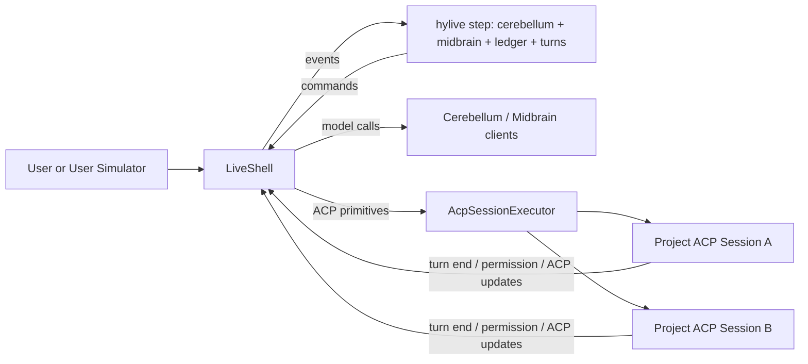

# Hy-Live

`nexus.extensions.projects.hy_live` 把可训练小脑、常驻中脑、确定性账本（harness）和沙箱里的后脑组合为一个 Nexus Project。 小脑、中脑、账本、通知和后脑调度都在 [`hylive`](https://git.woa.com/wallyshi/HyLive) 包里，写成确定的状态机，训练和线上共用；本目录是训练外壳：模拟用户、端口、沙箱执行器和输出。 默认后脑是 WorkBuddy（ACP v2），可用 `backend_adapter: codebuddy` 切回 CodeBuddy（ACP v1）。

## 当前状态

> 这是项目级状态的 **唯一来源** 。 其他文档不要复制这两张清单，只链接过来。

已实现：

- 多轮小脑 `hy-live`：7 个自然语言工具 `delegate` / `cancel` / `question` / `open_artifact` / `answer_permission` / `answer_task_input` / `web_search`，异步工具只返回 `{"status": "submitted"}`
- 常驻中脑：账本工具 `TaskCreate` / `TaskGet` / `TaskList` / `TaskUpdate` / `TaskStop` / `present_files` / `ask_backend` / `answer_permission` / `answer_task_input`，都按 `task_id` 操作；单独的 `reply(status=accepted|ok|ask|failed)` 回执，完成 / 失败总结
- harness：Task / Run / Event 账本，权限请求、补充问题、产物、送达记录；中脑只看到 Task，一个 Task 只有一个 Run，留在内部
- `TaskUpdate` 一律 steer：不排队、不开新 Run，新要求插进正在执行的这一轮（WorkBuddy 还没接手时等它接手），插不进去才 interrupt 后发完整要求；已结束的 Task 在同一条会话里重新开始。 见 [`docs/impl/harness_events.md`](docs/impl/harness_events.md) 第 4 节
- 每个 Task 一条 Project Session、独立工作目录 `<working_dir>/<task_key>`（Task 内部的 id，不用中脑看到的 `task_1`，沙箱复用时不撞名）；`TaskCreate` / `TaskUpdate` 受理即返回，各 Task 在后台链式执行
- hylive 走 v1 边界：回合排队、工作预算、steer、btw 追问、超时都由 hylive 决定；`coordination/backend.py::AcpSessionExecutor` 只在沙箱里执行 ACP 原语
- 中脑请求串行化；回执与后台事实排成 `[通知]`，同优先级的几项完成合并成一条
- ACP 权限请求经 harness 以 `[通知]` 转给小脑，用户表态后小脑 `answer_permission`，中脑映射为 `allow` / `reject` / `allow_all`
- CodeBuddy 向用户提问（`AskUserQuestion`、form elicitation）落成补充问题，见 [`docs/impl/question_channel.md`](docs/impl/question_channel.md)
- 超时与取消：每轮 2000 秒工作预算，等用户批权限或补充的时间不计；超时先撤回权限再 interrupt，等这一轮结束才发下一轮，等不到就重启会话。 `timeout_s`（默认 3600 秒）只是墙钟兜底，partial rollout 下 episode 冻结的时间不计。 取消先把权限按 `cancelled` 回掉再 interrupt，已排队的 Run 不再启动。 详见 [`docs/impl/timeout_and_cancel.md`](docs/impl/timeout_and_cancel.md)
- runtime 实时推送 ACP `session/update`，直接写成 harness Event
- 沙箱在 episode 开始前拉起，用户第一句话之前后台已能干活
- 中脑、每个 Project Session、LLM 模拟用户各带一个独立的网关 `cache_task_id` 以命中 prefix cache；小脑需配置打开，见 [`docs/impl/config_reference.md`](docs/impl/config_reference.md) §2.1
- Scripted 与 LLM User Simulator
- 小脑 / 中脑轨迹导出（`cerebellum_trajectory` / `midbrain_trajectory`）

待完成：

- 在线真人 owner resume API
- owner 结束时统一关闭它的全部 Project Session
- HyTuner `session_agent_loop` 的 segment、mask 和 reward 联合验证
- sandbox `env_error` 归因

## 架构



一个 owner 使用一个 Nexus sandbox：

```text
Nexus Host
├── LiveShell：hylive 的 runner 与端口（`hylive_shell.py`）
│   ├── 小脑模型调用（policy client: main）
│   └── 中脑模型调用（midbrain client，默认与 external 共用）
├── AcpSessionExecutor（`coordination/backend.py`）
└── LLM Channel Router / host_relay_extension

Nexus sandbox
├── Project CodeBuddy ACP Session A
├── Project CodeBuddy ACP Session B
└── localhost OpenAI Proxies
```

沙箱里每条 Project Session 有自己的 localhost OpenAI 代理，模型请求经 runtime 的 LLM channel 回到 Host，由 `external` client（`work_agent_configs[backend_adapter].llm_client_name`）发出。 ACP 权限请求、提问和实时 `session/update` 走公共 `host_relay_extension`，与 LLM channel 分开。 沙箱里的 nexus 来自 runtime 镜像，见 [`docs/impl/runtime_image.md`](docs/impl/runtime_image.md)。

一个用户轮次：小脑先只调工具（结果是 `submitted`），再说一句接下来去做什么；中脑认出账本里的一项、调用账本工具、`reply`。 后台事实（权限请求、补充问题、完成、失败、追问结果）和中脑的非 `accepted` 回执随后以 `[通知]` 送回小脑，小脑转述给用户。 完整时序、episode 收尾、输出字段与训练 mask 见 [`docs/impl/agent_loop.md`](docs/impl/agent_loop.md)。

## User Simulator

实现：`user_simulator.py`

统一接口：

```python
await simulator.next_user_message(
    user_visible_conversation,
)
```

驱动维护 `UserVisibleConversation`，按实际发生顺序记录真实用户发言和小脑的全部可见回复，包括权限询问与完成转述；不传入系统插入的消息或工具结果。 每次 LLM 请求读取完整快照，而不是只看上一条回复。 交付前驱动调用 `is_message_current`，后台通知抢先到达时作废该条用户决策。

### Scripted

所有 user turns 写在数据中，可复现、适合训练和回归。

```yaml
type: scripted
turns:
  - "先做 A"
  - "看到回复后，再做 B"
```

### LLM

使用独立冻结 Client，按私有剧本卡和完整可见对话做结构化决策（`speak` / `wait` / `done`），只把决策里的 `message` 发给小脑。 剧本卡经 `simulator.md` 渲染成用户 system prompt；节点顺序、证据引用、材料披露和进度追问冷却由 `simulation_state.py` 校验。

```yaml
type: llm
client_name: user_simulator
scenario:            # 剧本卡，字段见 simulation_scenario.ScenarioCard
  meta: {script_id: final3-001, topic_id: TP-1}
  topic: 周考勤表
  user: {background: 四年级班主任, style: A}
  goal: 要一个能自动算缺勤次数的 Excel 周考勤表
  required_nodes:
    - {type: D1, when: 开场, action: 说自己是班主任，请它做考勤表}
  ending: {normal: 听到表格做好了}
initial_prompt: "我是四年级班主任，帮我做个周考勤表。"
```

LLM User Simulator 不能使用可训练 Policy 的 `main` Client。

## 最小配置

```yaml
imports:
  - nexus.extensions.projects.hy_live
  - nexus.extensions.openai_clients.openai

task_name: hy-live
agent_name: hy-live
task_config:
  user_simulator:
    type: scripted
    turns:
      - "先在 /workspace 写入 A.txt"
      - "收到回复后，再写入 B.txt"
  policy_client_name: main
  external_client_name: external
  backend_adapter: workbuddy
  work_agent_configs:
    workbuddy:
      working_dir: /workspace
```

完整运行配置见 [`docs/examples/configs/hy_live.yaml`](../../../../docs/examples/configs/hy_live.yaml)；每个配置项的默认值和含义见 [`docs/impl/config_reference.md`](docs/impl/config_reference.md)。

## 数据

真链路 case 的数据冻结在 [`example/data/`](example/data/)。 `example/prepare_scripted_user_data.py::build_scripted_user_row` 给出最小的 Scripted User 基础行（先做 A、再做 B），默认配置 WorkBuddy，传 `backend='codebuddy'` 可生成 CodeBuddy 行。 `example/harness.py` 叠加各 case 的差异后按 `--backend` 选择后脑。 基础行只引用环境变量名，不包含 API key、sandbox token 或其他凭证。

## 测试

在仓库根目录。hy_live 依赖 `hylive` 包，它不在 `dev` 依赖里，先按需装上模块依赖；没装时这些单测会被跳过。之后再跑 `uv sync` 会把它卸掉，要重新装：

```bash
uv run nexus modules install hy-live
uv run pytest tests/unit/extensions/projects/hy_live -q
```

Gongfeng + CodeBuddy 真链路不进单测，运行方式、冻结数据和验收清单在 [`example/README.md`](example/README.md)：

```bash
uv run python -m nexus.extensions.projects.hy_live.example --list
```

## 文档

- [`docs/impl/agent_loop.md`](docs/impl/agent_loop.md)：小脑、中脑与 episode；输出字段、ID 归属、训练 mask
- [`docs/impl/harness_events.md`](docs/impl/harness_events.md)：harness Event 的生成规则
- [`docs/impl/config_reference.md`](docs/impl/config_reference.md)：配置项与常数参考
- [`docs/impl/timeout_and_cancel.md`](docs/impl/timeout_and_cancel.md)：会话与轮次、超时与取消
- [`docs/impl/live_progress_source.md`](docs/impl/live_progress_source.md)：ACP 实时推送
- [`docs/impl/question_channel.md`](docs/impl/question_channel.md)：CodeBuddy 向用户提问
- [`docs/impl/codebuddy_web_search.md`](docs/impl/codebuddy_web_search.md)：沙箱里 CodeBuddy 的联网搜索
- [`docs/impl/security.md`](docs/impl/security.md)：沙箱网络出口安全
- [`docs/impl/runtime_image.md`](docs/impl/runtime_image.md)：runtime 镜像 tag（唯一来源）
