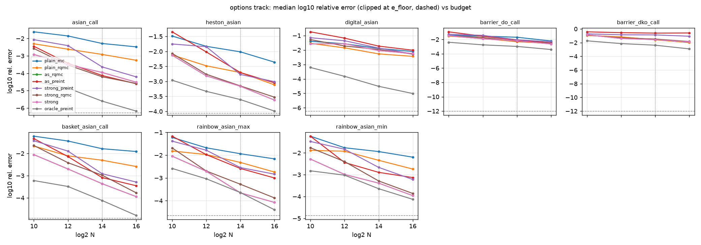

# v3 M2 baselines on the prototype set

Auto-generated by `run.py` (78 instances, budgets 2^10..2^16, 8 seeds, 21440 runs, 1 minutes wall-clock). Error per instance: median over seeds of log10 relative error, clipped to [e_floor, 0].

## Scores at N = 2^14 (draft rule: strong = 50, plain_mc = 0)

Per instance g = clip(e_strong - e_method, -2, 2); mean per (family, dimension) cell, then per track; G = mean of the two tracks; score = 50 + 25 G for G >= 0, 50 (G - G0) / (-G0) for G < 0, G0 = G(plain_mc).

| Method | G hard | G options | G | Score |
| --- | --- | --- | --- | --- |
| plain_mc | -0.33 | -1.02 | -0.68 | 0.0 |
| plain_rqmc | -0.01 | -0.57 | -0.29 | 28.7 |
| as_rqmc | +0.00 | +0.00 | +0.00 | 50.0 |
| as_preint | -0.61 | -0.43 | -0.52 | 11.4 |
| strong_preint | -0.04 | -0.50 | -0.27 | 30.2 |
| strong_rqmc | -0.04 | -0.09 | -0.06 | 45.2 |
| strong | +0.00 | +0.00 | +0.00 | 50.0 |
| oracle_preint | +0.56 | +0.84 | +0.70 | 67.5 |

## Mean error per family at N = 2^14

| Track | Family | e_floor | plain_mc | plain_rqmc | as_rqmc | as_preint | strong_preint | strong_rqmc | strong | oracle_preint | oracle_split | strong - oracle |
| --- | --- | --- | --- | --- | --- | --- | --- | --- | --- | --- | --- | --- |
| hard | H1 | -12.0 | -2.91 | -3.32 | -3.54 | -2.84 | -3.47 | -3.47 | -3.54 | -3.90 | -4.69 | 0.36 |
| hard | H2 | -12.0 | -3.13 | -3.46 | -3.70 | -2.82 | -3.64 | -3.64 | -3.70 | -4.03 | -4.88 | 0.33 |
| hard | H3 | -12.0 | -2.86 | -3.16 | -2.96 | -2.51 | -2.92 | -2.92 | -2.96 | -3.57 | -4.72 | 0.61 |
| hard | H3t | -12.0 | -1.37 | -1.51 | -1.36 | -0.96 | -1.36 | -1.36 | -1.36 | -2.58 | -4.86 | 1.21 |
| options | asian_call | -6.3 | -2.29 | -2.92 | -3.96 | -4.13 | -3.63 | -4.20 | -3.96 | -5.60 | — | 1.65 |
| options | heston_asian | -4.1 | -2.01 | -2.70 | -3.16 | -2.70 | -2.77 | -3.15 | -3.16 | -3.61 | — | 0.44 |
| options | digital_asian | -6.2 | -1.89 | -2.27 | -2.04 | -1.73 | -1.86 | -1.96 | -2.04 | -4.51 | — | 2.47 |
| options | barrier_do_call | -12.0 | -1.69 | -2.31 | -2.18 | -2.10 | -2.05 | -2.24 | -2.18 | -2.98 | — | 0.79 |
| options | barrier_dko_call | -12.0 | -1.56 | -1.60 | -1.57 | -0.61 | -0.88 | -1.48 | -1.57 | -2.38 | — | 0.81 |
| options | basket_asian_call | -4.9 | -1.79 | -2.30 | -3.36 | -3.09 | -2.91 | -2.98 | -3.36 | -4.12 | — | 0.76 |
| options | rainbow_asian_max | -4.6 | -1.94 | -2.32 | -3.65 | -2.59 | -2.54 | -3.28 | -3.65 | -3.64 | — | -0.01 |
| options | rainbow_asian_min | -4.9 | -1.94 | -2.34 | -3.39 | -2.89 | -2.66 | -3.29 | -3.39 | -3.64 | — | 0.25 |

## Error per (family, dimension) at N = 2^14

| Track | Family | d | plain_mc | plain_rqmc | as_rqmc | as_preint | strong_preint | strong_rqmc | strong | oracle_preint | oracle_split |
| --- | --- | --- | --- | --- | --- | --- | --- | --- | --- | --- | --- |
| hard | H1 | 8 | -2.68 | -3.87 | -3.69 | -2.80 | -3.75 | -3.75 | -3.69 | -4.35 | -5.27 |
| hard | H1 | 16 | -2.67 | -3.06 | -3.41 | -2.74 | -3.36 | -3.36 | -3.41 | -3.94 | -4.81 |
| hard | H1 | 32 | -2.99 | -3.29 | -3.54 | -2.78 | -3.30 | -3.30 | -3.54 | -3.80 | -4.46 |
| hard | H1 | 64 | -3.24 | -3.25 | -3.55 | -3.03 | -3.58 | -3.58 | -3.55 | -3.65 | -4.40 |
| hard | H2 | 8 | -3.15 | -3.90 | -3.80 | -2.72 | -3.79 | -3.79 | -3.80 | -4.54 | -5.55 |
| hard | H2 | 16 | -3.00 | -3.49 | -3.77 | -2.86 | -3.83 | -3.83 | -3.77 | -4.09 | -4.97 |
| hard | H2 | 32 | -3.18 | -3.31 | -3.83 | -2.91 | -3.55 | -3.55 | -3.83 | -3.82 | -4.79 |
| hard | H2 | 64 | -3.18 | -3.30 | -3.43 | -2.74 | -3.44 | -3.44 | -3.43 | -3.84 | -4.44 |
| hard | H3 | 8 | -2.69 | -3.38 | -2.97 | -2.60 | -2.89 | -2.89 | -2.97 | -4.00 | -5.19 |
| hard | H3 | 16 | -2.91 | -2.91 | -2.90 | -2.44 | -2.81 | -2.81 | -2.90 | -3.47 | -4.67 |
| hard | H3 | 32 | -2.80 | -3.08 | -3.00 | -2.44 | -2.95 | -2.95 | -3.00 | -3.55 | -4.78 |
| hard | H3 | 64 | -3.04 | -3.27 | -2.97 | -2.57 | -3.02 | -3.02 | -2.97 | -3.25 | -4.26 |
| hard | H3t | 8 | -1.36 | -1.49 | -1.48 | -1.10 | -1.62 | -1.59 | -1.48 | -2.95 | -5.13 |
| hard | H3t | 16 | -1.31 | -1.52 | -1.34 | -0.84 | -1.30 | -1.30 | -1.34 | -2.88 | -5.14 |
| hard | H3t | 32 | -1.21 | -1.37 | -1.15 | -0.85 | -1.21 | -1.21 | -1.15 | -2.34 | -4.87 |
| hard | H3t | 64 | -1.58 | -1.67 | -1.47 | -1.06 | -1.33 | -1.33 | -1.47 | -2.14 | -4.28 |
| options | asian_call | 32 | -2.21 | -2.96 | -3.79 | -4.00 | -3.66 | -3.97 | -3.79 | -5.34 | — |
| options | asian_call | 64 | -2.36 | -2.87 | -4.13 | -4.26 | -3.61 | -4.43 | -4.13 | -5.86 | — |
| options | heston_asian | 32 | -2.00 | -2.82 | -3.42 | -3.01 | -2.82 | -3.46 | -3.42 | -3.65 | — |
| options | heston_asian | 64 | -2.03 | -2.59 | -2.90 | -2.40 | -2.72 | -2.84 | -2.90 | -3.56 | — |
| options | digital_asian | 32 | -2.04 | -2.54 | -2.40 | -2.15 | -2.21 | -2.17 | -2.40 | -4.83 | — |
| options | digital_asian | 64 | -1.73 | -1.99 | -1.68 | -1.31 | -1.52 | -1.75 | -1.68 | -4.19 | — |
| options | barrier_do_call | 16 | -1.69 | -2.44 | -2.36 | -2.31 | -2.12 | -2.26 | -2.36 | -3.13 | — |
| options | barrier_do_call | 64 | -1.69 | -2.19 | -2.01 | -1.89 | -1.98 | -2.23 | -2.01 | -2.82 | — |
| options | barrier_dko_call | 16 | -1.42 | -1.57 | -1.50 | -0.48 | -0.98 | -1.47 | -1.50 | -2.29 | — |
| options | barrier_dko_call | 64 | -1.69 | -1.63 | -1.64 | -0.74 | -0.77 | -1.49 | -1.64 | -2.46 | — |
| options | basket_asian_call | 32 | -1.81 | -2.44 | -3.63 | -3.58 | -3.39 | -3.24 | -3.63 | -4.22 | — |
| options | basket_asian_call | 64 | -1.77 | -2.17 | -3.10 | -2.59 | -2.43 | -2.72 | -3.10 | -4.02 | — |
| options | rainbow_asian_max | 32 | -1.99 | -2.50 | -3.83 | -2.56 | -2.76 | -3.39 | -3.83 | -3.77 | — |
| options | rainbow_asian_max | 64 | -1.89 | -2.14 | -3.48 | -2.61 | -2.33 | -3.16 | -3.48 | -3.52 | — |
| options | rainbow_asian_min | 32 | -1.93 | -2.25 | -3.41 | -3.31 | -2.84 | -3.41 | -3.41 | -3.62 | — |
| options | rainbow_asian_min | 64 | -1.94 | -2.43 | -3.37 | -2.48 | -2.49 | -3.17 | -3.37 | -3.67 | — |

## Convergence: mean error per track and budget

| Track | Method | 2^10 | 2^12 | 2^14 | 2^16 |
| --- | --- | --- | --- | --- | --- |
| hard | plain_mc | -2.00 | -2.24 | -2.55 | -2.90 |
| hard | plain_rqmc | -2.14 | -2.56 | -2.84 | -3.20 |
| hard | as_rqmc | -2.07 | -2.49 | -2.86 | -3.27 |
| hard | as_preint | -1.57 | -1.98 | -2.26 | -2.59 |
| hard | strong_preint | -2.06 | -2.40 | -2.82 | -3.21 |
| hard | strong_rqmc | -2.06 | -2.42 | -2.82 | -3.21 |
| hard | strong | -2.07 | -2.49 | -2.86 | -3.27 |
| hard | oracle_preint | -2.70 | -3.15 | -3.50 | -3.94 |
| hard | oracle_split | -3.72 | -4.23 | -4.79 | -5.37 |
| options | plain_mc | -1.32 | -1.61 | -1.89 | -2.18 |
| options | plain_rqmc | -1.73 | -2.00 | -2.35 | -2.68 |
| options | as_rqmc | -1.91 | -2.45 | -2.91 | -3.36 |
| options | as_preint | -1.20 | -1.91 | -2.48 | -2.79 |
| options | strong_preint | -1.41 | -1.68 | -2.41 | -2.78 |
| options | strong_rqmc | -1.67 | -2.32 | -2.82 | -3.28 |
| options | strong | -1.91 | -2.45 | -2.91 | -3.36 |
| options | oracle_preint | -2.93 | -3.31 | -3.81 | -4.35 |
| options | oracle_split | n/a | n/a | n/a | n/a |

## Wall time per run at N = 2^14 (limit 60 s)

| Method | Median s | Max s |
| --- | --- | --- |
| plain_mc | 0.03 | 0.10 |
| plain_rqmc | 0.04 | 0.15 |
| as_rqmc | 0.04 | 0.11 |
| as_preint | 0.05 | 0.16 |
| strong_preint | 0.04 | 0.23 |
| strong_rqmc | 0.03 | 0.10 |
| strong | 0.04 | 0.11 |
| oracle_preint | 0.29 | 1.81 |
| oracle_split | 0.09 | 0.38 |

