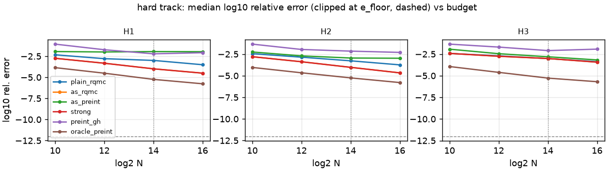

# v3 M2 baselines on the prototype set

Auto-generated by `run.py` (72 instances, budgets 2^10..2^16, 8 seeds, 12480 runs, 3 minutes wall-clock). Error per instance: median over seeds of log10 relative error, clipped to [e_floor, 0].

## Scores at N = 2^14 (draft rule: strong = 50, plain_rqmc = 0)

Per instance g = clip(e_strong - e_method, -2, 2); mean per (family, dimension) cell, then per track; G = mean of the two tracks; score = 50 + 25 G for G >= 0, 50 (G - G0) / (-G0) for G < 0, G0 = G(plain_rqmc).

| Method | G hard | G options | G | Score |
| --- | --- | --- | --- | --- |
| plain_rqmc | -0.58 | -0.44 | -0.51 | 0.0 |
| as_rqmc | +0.00 | -0.12 | -0.06 | 44.1 |
| as_preint | -1.03 | -0.53 | -0.78 | -26.3 |
| strong | +0.00 | +0.00 | +0.00 | 50.0 |
| oracle_preint | +1.48 | +0.86 | +1.17 | 79.3 |

## Mean error per family at N = 2^14

preint_gh runs only on instances with d <= 4; its column averages those.

| Track | Family | e_floor | plain_rqmc | as_rqmc | as_preint | strong | preint_gh | oracle_preint | strong - oracle |
| --- | --- | --- | --- | --- | --- | --- | --- | --- | --- |
| hard | H1 | -12.0 | -3.00 | -3.99 | -1.95 | -3.99 | -2.22 | -5.25 | 1.25 |
| hard | H2 | -12.0 | -3.28 | -4.03 | -2.95 | -4.03 | -2.16 | -5.25 | 1.22 |
| hard | H3 | -12.0 | -3.02 | -3.01 | -2.81 | -3.01 | -2.10 | -5.28 | 2.26 |
| options | spread | -11.4 | -4.12 | -3.79 | -4.24 | -4.12 | -9.74 | -4.06 | -0.06 |
| options | exchange | -12.0 | -4.45 | -4.18 | -4.40 | -4.45 | -9.96 | -4.51 | 0.06 |
| options | asian_call | -6.5 | -2.85 | -3.98 | -3.78 | -3.98 | — | -5.78 | 1.80 |
| options | basket_call | -9.8 | -3.96 | -3.92 | -3.16 | -4.03 | -7.75 | -4.52 | 0.50 |
| options | digital_max | -11.4 | -3.44 | -3.06 | -2.29 | -3.44 | -1.98 | -4.41 | 0.97 |
| options | asian_spread | -5.9 | -2.68 | -3.99 | -3.44 | -3.99 | — | -5.08 | 1.09 |
| options | geo_basket_call | -12.0 | -3.50 | -3.99 | -5.94 | -3.99 | -9.74 | -12.00 | 8.01 |
| options | rainbow_max_call | -11.7 | -4.11 | -3.73 | -2.27 | -4.11 | -2.26 | -4.33 | 0.23 |
| options | rainbow_min_call | -11.3 | -3.48 | -3.47 | -2.51 | -3.48 | -1.89 | -4.80 | 1.33 |
| options | basket_asian_call | -5.2 | -2.72 | -3.74 | -2.78 | -3.74 | — | -4.42 | 0.68 |

## Error per (family, dimension) at N = 2^14

| Track | Family | d | plain_rqmc | as_rqmc | as_preint | strong | preint_gh | oracle_preint |
| --- | --- | --- | --- | --- | --- | --- | --- | --- |
| hard | H1 | 4 | -3.56 | -4.19 | -2.21 | -4.19 | -2.22 | -5.10 |
| hard | H1 | 8 | -3.18 | -3.78 | -1.85 | -3.78 | — | -5.25 |
| hard | H1 | 16 | -2.92 | -4.08 | -1.89 | -4.08 | — | -5.86 |
| hard | H1 | 32 | -2.74 | -3.79 | -1.81 | -3.79 | — | -5.39 |
| hard | H1 | 64 | -2.59 | -4.13 | -2.02 | -4.13 | — | -4.63 |
| hard | H2 | 4 | -3.95 | -4.17 | -2.54 | -4.17 | -2.16 | -5.00 |
| hard | H2 | 8 | -3.33 | -3.94 | -3.08 | -3.94 | — | -5.43 |
| hard | H2 | 16 | -3.19 | -3.95 | -3.35 | -3.95 | — | -5.25 |
| hard | H2 | 32 | -3.02 | -3.93 | -2.61 | -3.93 | — | -5.28 |
| hard | H2 | 64 | -2.89 | -4.16 | -3.19 | -4.16 | — | -5.30 |
| hard | H3 | 4 | -3.31 | -3.10 | -2.72 | -3.10 | -2.10 | -5.63 |
| hard | H3 | 8 | -3.07 | -2.81 | -3.03 | -2.81 | — | -4.89 |
| hard | H3 | 16 | -2.93 | -2.93 | -2.63 | -2.93 | — | -5.38 |
| hard | H3 | 32 | -2.91 | -3.23 | -3.08 | -3.23 | — | -5.25 |
| hard | H3 | 64 | -2.88 | -2.99 | -2.60 | -2.99 | — | -5.23 |
| options | spread | 2 | -4.12 | -3.79 | -4.24 | -4.12 | -9.74 | -4.06 |
| options | exchange | 2 | -4.45 | -4.18 | -4.40 | -4.45 | -9.96 | -4.51 |
| options | asian_call | 16 | -3.22 | -4.07 | -3.83 | -4.07 | — | -5.76 |
| options | asian_call | 64 | -2.48 | -3.89 | -3.73 | -3.89 | — | -5.81 |
| options | basket_call | 2 | -4.18 | -4.00 | -3.68 | -4.18 | -9.85 | -5.01 |
| options | basket_call | 3 | -4.24 | -4.01 | -3.12 | -4.24 | -9.34 | -4.89 |
| options | basket_call | 4 | -3.69 | -3.62 | -3.01 | -3.62 | -4.06 | -3.92 |
| options | basket_call | 8 | -3.74 | -4.07 | -2.81 | -4.07 | — | -4.27 |
| options | digital_max | 2 | -3.73 | -3.27 | -2.61 | -3.73 | -1.90 | -5.09 |
| options | digital_max | 3 | -3.15 | -2.85 | -1.96 | -3.15 | -2.06 | -3.72 |
| options | asian_spread | 16 | -2.66 | -4.07 | -3.49 | -4.07 | — | -5.03 |
| options | asian_spread | 64 | -2.70 | -3.91 | -3.40 | -3.91 | — | -5.13 |
| options | geo_basket_call | 4 | -3.82 | -4.05 | -6.09 | -4.05 | -9.74 | -12.00 |
| options | geo_basket_call | 8 | -3.18 | -3.93 | -5.79 | -3.93 | — | -12.00 |
| options | rainbow_max_call | 2 | -4.33 | -3.97 | -2.04 | -4.33 | -2.13 | -4.43 |
| options | rainbow_max_call | 3 | -3.89 | -3.49 | -2.51 | -3.89 | -2.40 | -4.23 |
| options | rainbow_min_call | 2 | -3.61 | -3.74 | -2.66 | -3.61 | -2.32 | -5.66 |
| options | rainbow_min_call | 3 | -3.35 | -3.20 | -2.36 | -3.35 | -1.46 | -3.95 |
| options | basket_asian_call | 16 | -3.12 | -3.98 | -3.02 | -3.98 | — | -4.69 |
| options | basket_asian_call | 32 | -2.30 | -3.24 | -2.29 | -3.24 | — | -3.82 |
| options | basket_asian_call | 64 | -2.74 | -4.00 | -3.01 | -4.00 | — | -4.75 |

## Convergence: mean error per track and budget

| Track | Method | 2^10 | 2^12 | 2^14 | 2^16 |
| --- | --- | --- | --- | --- | --- |
| hard | plain_rqmc | -2.40 | -2.78 | -3.10 | -3.54 |
| hard | as_rqmc | -2.66 | -3.16 | -3.68 | -4.21 |
| hard | as_preint | -2.05 | -2.39 | -2.57 | -2.71 |
| hard | strong | -2.66 | -3.16 | -3.68 | -4.21 |
| hard | preint_gh | -1.25 | -1.79 | -2.16 | -2.11 |
| hard | oracle_preint | -3.95 | -4.60 | -5.26 | -5.75 |
| options | plain_rqmc | -2.45 | -2.95 | -3.46 | -3.89 |
| options | as_rqmc | -2.59 | -3.14 | -3.78 | -4.37 |
| options | as_preint | -1.95 | -2.58 | -3.34 | -3.90 |
| options | strong | -2.67 | -3.27 | -3.90 | -4.42 |
| options | preint_gh | -4.67 | -4.96 | -5.41 | -5.54 |
| options | oracle_preint | -4.25 | -4.76 | -5.37 | -5.89 |

## Wall time per run at N = 2^14 (limit 60 s)

| Method | Median s | Max s |
| --- | --- | --- |
| plain_rqmc | 0.01 | 0.10 |
| as_rqmc | 0.01 | 0.10 |
| as_preint | 0.02 | 0.07 |
| strong | 0.01 | 0.11 |
| preint_gh | 0.01 | 0.02 |
| oracle_preint | 0.26 | 1.61 |

